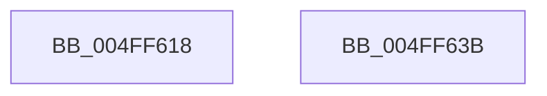

# strtoi64

- RVA: `0x004FF618`–`0x004FF63C` (길이 `36` bytes)
- VA: `0x00000001404FF618`
- 실행 섹션: `.text`
- PDB 이름 있음: `예`; PDB Function 태그: `아니요`
- unwind 정보 RVA: `0x0005D2F4`
- 디코드: `10`개 명령, `36/36` bytes 표시
- 미해석 바이트: `0` (있으면 어셈블리에 `.byte`로 보존)

> 이 문서는 커널 이미지의 기계어와 PDB 기호를 분석해 생성했습니다. 4번과 5번은 함수 원형과 자료형을 바이너리 사용 방식에서 추정한 C 해석이며 원본 소스 복구 결과는 아닙니다.

## 1. Dependencies

- 직접 호출 지점: **1**; 고유 호출 대상: **1**
- 직접 호출자로 확인된 함수: **1**
- RIP 상대 이미지 참조: **1**

### Outgoing calls
- `0x004FF631` → [strtoxq](strtoxq_function_004FF3F8.md) (function, `0x004FF3F8`)

### Direct callers
- [atoi64](atoi64_function_004FF880.md) at `0x004FF893`

### Static image references
- `0x004FF62A` → RVA `0x00006698` (`.rdata`; read)

## 2. Other-region calls and transfers

- 다른 실행 섹션으로 향하는 call: **0**
- 별도 외부 분기/꼬리 이동을 확인하지 못했습니다.

## 3. Assembly (complete function range)

```asm
004FF618  48 83 EC 38                     sub rsp, 0x38
004FF61C  83 64 24 20 00                  and dword ptr [rsp + 0x20], 0
004FF621  45 8B C8                        mov r9d, r8d
004FF624  4C 8B C2                        mov r8, rdx
004FF627  48 8B D1                        mov rdx, rcx
004FF62A  48 8D 0D 67 70 B0 FF            lea rcx, [rip - 0x4f8f99]
004FF631  E8 C2 FD FF FF                  call 0x1404ff3f8
004FF636  48 83 C4 38                     add rsp, 0x38
004FF63A  C3                              ret
004FF63B  CC                              int3
```

## 4. C-style interpretation (structured pseudocode)

```c
__int64 __fastcall strtoi64(__int64 a1, __int64 a2, int a3)
{
    __int64 result;
    __int64 v_rsp;
    unsigned int v_stack_m18;

    v_rsp = (v_rsp) - (56);
    result = strtoxq(v_rip - 5214105, a1, a2, (unsigned int)(a3));
    v_rsp = (v_rsp) + (56);
    return result;
}
```

## 5. (Beta) C Style

```c
int64_t strtoi64(int64_t Arg1, int64_t Arg2, int32_t Arg3)
{
    int64_t result;
    int64_t local_rsp;
    uint32_t v_stack_m18;

    local_rsp = (local_rsp) - (56);
    result = strtoxq(v_rip - 5214105, Arg1, Arg2, (uint32_t)(Arg3));
    local_rsp = (local_rsp) + (56);
    return result;
}
```

## 6. Execution-region graph

[열기: 2D/3D 그래프와 함수 탐색 컨트롤 패널](../../../control-panel.html?section=text&rva=0x004FF618&view=graph)

- 2D 그래프는 위에서 아래로 흐르고, 3D 그래프는 빈 공간을 드래그해 회전합니다. Shift+드래그는 이동, 휠은 확대·축소, 함수 노드 선택은 대상 보고서 이동입니다.

### Static fallback


