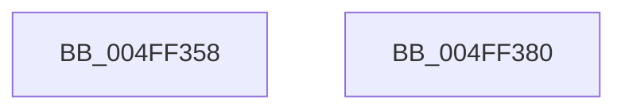

# strtol

- RVA: `0x004FF358`–`0x004FF381` (길이 `41` bytes)
- VA: `0x00000001404FF358`
- 실행 섹션: `.text`
- PDB 이름 있음: `예`; PDB Function 태그: `아니요`
- unwind 정보 RVA: `0x0005D2F4`
- 디코드: `11`개 명령, `41/41` bytes 표시
- 미해석 바이트: `0` (있으면 어셈블리에 `.byte`로 보존)

> 이 문서는 커널 이미지의 기계어와 PDB 기호를 분석해 생성했습니다. 4번과 5번은 함수 원형과 자료형을 바이너리 사용 방식에서 추정한 C 해석이며 원본 소스 복구 결과는 아닙니다.

## 1. Dependencies

- 직접 호출 지점: **1**; 고유 호출 대상: **1**
- 직접 호출자로 확인된 함수: **2**
- RIP 상대 이미지 참조: **1**

### Outgoing calls
- `0x004FF376` → [strtoxlX](strtoxlX_function_004FF130.md) (function, `0x004FF130`)

### Direct callers
- [RtlIpv6StringToAddressA](../4A/RtlIpv6StringToAddressA_function_004A6BD0.md) at `0x004A6D79`
- [RtlIpv6StringToAddressA](../4A/RtlIpv6StringToAddressA_function_004A6BD0.md) at `0x004A6E46`
- [RtlIpv6StringToAddressA](../4A/RtlIpv6StringToAddressA_function_004A6BD0.md) at `0x004A6FFB`
- [sub_006F99DE](../6F/Unknown_function_006F99DE.md) at `0x006F9A49`

### Static image references
- `0x004FF36F` → RVA `0x00006698` (`.rdata`; read)

## 2. Other-region calls and transfers

- 다른 실행 섹션으로 향하는 call: **0**
- 별도 외부 분기/꼬리 이동을 확인하지 못했습니다.

## 3. Assembly (complete function range)

```asm
004FF358  48 83 EC 38                     sub rsp, 0x38
004FF35C  83 64 24 28 00                  and dword ptr [rsp + 0x28], 0
004FF361  45 8B C8                        mov r9d, r8d
004FF364  83 64 24 20 00                  and dword ptr [rsp + 0x20], 0
004FF369  4C 8B C2                        mov r8, rdx
004FF36C  48 8B D1                        mov rdx, rcx
004FF36F  48 8D 0D 22 73 B0 FF            lea rcx, [rip - 0x4f8cde]
004FF376  E8 B5 FD FF FF                  call 0x1404ff130
004FF37B  48 83 C4 38                     add rsp, 0x38
004FF37F  C3                              ret
004FF380  CC                              int3
```

## 4. C-style interpretation (structured pseudocode)

```c
__int64 __fastcall strtol(__int64 a1, __int64 a2, int a3)
{
    __int64 result;
    __int64 v_rsp;
    unsigned int v_stack_m10;
    unsigned int v_stack_m18;

    v_rsp = (v_rsp) - (56);
    result = strtoxlX(v_rip - 5213406, a1, a2, (unsigned int)(a3));
    v_rsp = (v_rsp) + (56);
    return result;
}
```

## 5. (Beta) C Style

```c
int64_t strtol(int64_t Arg1, int64_t Arg2, int32_t Arg3)
{
    int64_t result;
    int64_t local_rsp;
    uint32_t v_stack_m10;
    uint32_t v_stack_m18;

    local_rsp = (local_rsp) - (56);
    result = strtoxlX(v_rip - 5213406, Arg1, Arg2, (uint32_t)(Arg3));
    local_rsp = (local_rsp) + (56);
    return result;
}
```

## 6. Execution-region graph

[열기: 2D/3D 그래프와 함수 탐색 컨트롤 패널](../../../control-panel.html?section=text&rva=0x004FF358&view=graph)

- 2D 그래프는 위에서 아래로 흐르고, 3D 그래프는 빈 공간을 드래그해 회전합니다. Shift+드래그는 이동, 휠은 확대·축소, 함수 노드 선택은 대상 보고서 이동입니다.

### Static fallback


