# strtoxlX

- RVA: `0x004FF130`–`0x004FF350` (길이 `544` bytes)
- VA: `0x00000001404FF130`
- 실행 섹션: `.text`
- PDB 이름 있음: `예`; PDB Function 태그: `예`
- unwind 정보 RVA: `0x000C5440`
- 디코드: `176`개 명령, `544/544` bytes 표시
- 미해석 바이트: `0` (있으면 어셈블리에 `.byte`로 보존)

> 이 문서는 커널 이미지의 기계어와 PDB 기호를 분석해 생성했습니다. 4번과 5번은 함수 원형과 자료형을 바이너리 사용 방식에서 추정한 C 해석이며 원본 소스 복구 결과는 아닙니다.

## 1. Dependencies

- 직접 호출 지점: **4**; 고유 호출 대상: **2**
- 직접 호출자로 확인된 함수: **3**
- RIP 상대 이미지 참조: **0**

### Outgoing calls
- `0x004FF18D` → [_pctype_func](../50/_pctype_func_function_00503CFC.md) (function, `0x00503CFC`)
- `0x004FF22B` → [_pctype_func](../50/_pctype_func_function_00503CFC.md) (function, `0x00503CFC`)
- `0x004FF240` → [_pctype_func](../50/_pctype_func_function_00503CFC.md) (function, `0x00503CFC`)
- `0x004FF32B` → [EmpCheckErrataList](../49/EmpCheckErrataList_function_0049E550.md) (function, `0x0049E550`)

### Direct callers
- [strtol](strtol_function_004FF358.md) at `0x004FF376`
- [strtolX](strtolX_function_004FF388.md) at `0x004FF3A6`
- [strtoul](strtoul_function_004FF3B8.md) at `0x004FF3D9`

### Static image references
- 디코드된 RIP-relative 메모리 참조가 없습니다.

## 2. Other-region calls and transfers

- 다른 실행 섹션으로 향하는 call: **0**
- 별도 외부 분기/꼬리 이동을 확인하지 못했습니다.

## 3. Assembly (complete function range)

```asm
004FF130  48 8B C4                        mov rax, rsp
004FF133  48 89 58 08                     mov qword ptr [rax + 8], rbx
004FF137  48 89 68 18                     mov qword ptr [rax + 0x18], rbp
004FF13B  48 89 70 20                     mov qword ptr [rax + 0x20], rsi
004FF13F  48 89 50 10                     mov qword ptr [rax + 0x10], rdx
004FF143  57                              push rdi
004FF144  41 54                           push r12
004FF146  41 55                           push r13
004FF148  41 56                           push r14
004FF14A  41 57                           push r15
004FF14C  48 83 EC 30                     sub rsp, 0x30
004FF150  45 8B F1                        mov r14d, r9d
004FF153  4D 8B F8                        mov r15, r8
004FF156  4C 8B E2                        mov r12, rdx
004FF159  4D 85 C0                        test r8, r8
004FF15C  74 03                           je 0x1404ff161
004FF15E  49 89 10                        mov qword ptr [r8], rdx
004FF161  4D 85 E4                        test r12, r12
004FF164  0F 84 B1 01 00 00               je 0x1404ff31b
004FF16A  45 85 F6                        test r14d, r14d
004FF16D  74 0D                           je 0x1404ff17c
004FF16F  41 8D 41 FE                     lea eax, [r9 - 2]
004FF173  83 F8 22                        cmp eax, 0x22
004FF176  0F 87 9F 01 00 00               ja 0x1404ff31b
004FF17C  0F B6 2A                        movzx ebp, byte ptr [rdx]
004FF17F  48 8D 7A 01                     lea rdi, [rdx + 1]
004FF183  33 DB                           xor ebx, ebx
004FF185  EB 06                           jmp 0x1404ff18d
004FF187  0F B6 2F                        movzx ebp, byte ptr [rdi]
004FF18A  48 FF C7                        inc rdi
004FF18D  E8 6A 4B 00 00                  call 0x140503cfc
004FF192  F6 04 68 08                     test byte ptr [rax + rbp*2], 8
004FF196  75 EF                           jne 0x1404ff187
004FF198  8B B4 24 80 00 00 00            mov esi, dword ptr [rsp + 0x80]
004FF19F  40 80 FD 2D                     cmp bpl, 0x2d
004FF1A3  75 05                           jne 0x1404ff1aa
004FF1A5  83 CE 02                        or esi, 2
004FF1A8  EB 06                           jmp 0x1404ff1b0
004FF1AA  40 80 FD 2B                     cmp bpl, 0x2b
004FF1AE  75 06                           jne 0x1404ff1b6
004FF1B0  40 8A 2F                        mov bpl, byte ptr [rdi]
004FF1B3  48 FF C7                        inc rdi
004FF1B6  45 85 F6                        test r14d, r14d
004FF1B9  74 1F                           je 0x1404ff1da
004FF1BB  41 8D 46 FE                     lea eax, [r14 - 2]
004FF1BF  83 F8 22                        cmp eax, 0x22
004FF1C2  76 11                           jbe 0x1404ff1d5
004FF1C4  4D 85 FF                        test r15, r15
004FF1C7  0F 84 63 01 00 00               je 0x1404ff330
004FF1CD  4D 89 27                        mov qword ptr [r15], r12
004FF1D0  E9 5B 01 00 00                  jmp 0x1404ff330
004FF1D5  45 85 F6                        test r14d, r14d
004FF1D8  75 26                           jne 0x1404ff200
004FF1DA  40 80 FD 30                     cmp bpl, 0x30
004FF1DE  74 08                           je 0x1404ff1e8
004FF1E0  41 BE 0A 00 00 00               mov r14d, 0xa
004FF1E6  EB 34                           jmp 0x1404ff21c
004FF1E8  8A 07                           mov al, byte ptr [rdi]
004FF1EA  2C 58                           sub al, 0x58
004FF1EC  A8 DF                           test al, 0xdf
004FF1EE  74 08                           je 0x1404ff1f8
004FF1F0  41 BE 08 00 00 00               mov r14d, 8
004FF1F6  EB 24                           jmp 0x1404ff21c
004FF1F8  41 BE 10 00 00 00               mov r14d, 0x10
004FF1FE  EB 0C                           jmp 0x1404ff20c
004FF200  41 83 FE 10                     cmp r14d, 0x10
004FF204  75 16                           jne 0x1404ff21c
004FF206  40 80 FD 30                     cmp bpl, 0x30
004FF20A  75 10                           jne 0x1404ff21c
004FF20C  8A 07                           mov al, byte ptr [rdi]
004FF20E  2C 58                           sub al, 0x58
004FF210  A8 DF                           test al, 0xdf
004FF212  75 08                           jne 0x1404ff21c
004FF214  40 8A 6F 01                     mov bpl, byte ptr [rdi + 1]
004FF218  48 83 C7 02                     add rdi, 2
004FF21C  33 D2                           xor edx, edx
004FF21E  83 C8 FF                        or eax, 0xffffffff
004FF221  41 F7 F6                        div r14d
004FF224  44 8B E0                        mov r12d, eax
004FF227  44 0F B6 ED                     movzx r13d, bpl
004FF22B  E8 CC 4A 00 00                  call 0x140503cfc
004FF230  42 F6 04 68 04                  test byte ptr [rax + r13*2], 4
004FF235  74 09                           je 0x1404ff240
004FF237  40 0F BE CD                     movsx ecx, bpl
004FF23B  83 E9 30                        sub ecx, 0x30
004FF23E  EB 29                           jmp 0x1404ff269
004FF240  E8 B7 4A 00 00                  call 0x140503cfc
004FF245  42 0F B7 0C 68                  movzx ecx, word ptr [rax + r13*2]
004FF24A  B8 03 01 00 00                  mov eax, 0x103
004FF24F  66 85 C8                        test ax, cx
004FF252  74 42                           je 0x1404ff296
004FF254  40 0F BE C5                     movsx eax, bpl
004FF258  40 80 ED 61                     sub bpl, 0x61
004FF25C  40 80 FD 19                     cmp bpl, 0x19
004FF260  8D 48 E0                        lea ecx, [rax - 0x20]
004FF263  0F 47 C8                        cmova ecx, eax
004FF266  83 E9 37                        sub ecx, 0x37
004FF269  41 3B CE                        cmp ecx, r14d
004FF26C  73 28                           jae 0x1404ff296
004FF26E  83 CE 08                        or esi, 8
004FF271  83 BC 24 88 00 00 00 00         cmp dword ptr [rsp + 0x88], 0
004FF279  75 34                           jne 0x1404ff2af
004FF27B  41 3B DC                        cmp ebx, r12d
004FF27E  72 2F                           jb 0x1404ff2af
004FF280  75 0C                           jne 0x1404ff28e
004FF282  33 D2                           xor edx, edx
004FF284  83 C8 FF                        or eax, 0xffffffff
004FF287  41 F7 F6                        div r14d
004FF28A  3B CA                           cmp ecx, edx
004FF28C  76 21                           jbe 0x1404ff2af
004FF28E  83 CE 04                        or esi, 4
004FF291  4D 85 FF                        test r15, r15
004FF294  75 1F                           jne 0x1404ff2b5
004FF296  4C 8B 64 24 68                  mov r12, qword ptr [rsp + 0x68]
004FF29B  48 FF CF                        dec rdi
004FF29E  40 F6 C6 08                     test sil, 8
004FF2A2  75 1C                           jne 0x1404ff2c0
004FF2A4  4D 85 FF                        test r15, r15
004FF2A7  49 0F 45 FC                     cmovne rdi, r12
004FF2AB  33 DB                           xor ebx, ebx
004FF2AD  EB 58                           jmp 0x1404ff307
004FF2AF  41 0F AF DE                     imul ebx, r14d
004FF2B3  03 D9                           add ebx, ecx
004FF2B5  40 8A 2F                        mov bpl, byte ptr [rdi]
004FF2B8  48 FF C7                        inc rdi
004FF2BB  E9 67 FF FF FF                  jmp 0x1404ff227
004FF2C0  B9 FF FF FF 7F                  mov ecx, 0x7fffffff
004FF2C5  40 F6 C6 04                     test sil, 4
004FF2C9  75 1A                           jne 0x1404ff2e5
004FF2CB  40 F6 C6 01                     test sil, 1
004FF2CF  75 36                           jne 0x1404ff307
004FF2D1  40 F6 C6 02                     test sil, 2
004FF2D5  74 0A                           je 0x1404ff2e1
004FF2D7  81 FB 00 00 00 80               cmp ebx, 0x80000000
004FF2DD  77 06                           ja 0x1404ff2e5
004FF2DF  EB 26                           jmp 0x1404ff307
004FF2E1  3B D9                           cmp ebx, ecx
004FF2E3  76 22                           jbe 0x1404ff307
004FF2E5  83 BC 24 88 00 00 00 00         cmp dword ptr [rsp + 0x88], 0
004FF2ED  75 18                           jne 0x1404ff307
004FF2EF  40 F6 C6 01                     test sil, 1
004FF2F3  74 05                           je 0x1404ff2fa
004FF2F5  83 CB FF                        or ebx, 0xffffffff
004FF2F8  EB 0D                           jmp 0x1404ff307
004FF2FA  40 8A C6                        mov al, sil
004FF2FD  24 02                           and al, 2
004FF2FF  F6 D8                           neg al
004FF301  1B DB                           sbb ebx, ebx
004FF303  F7 DB                           neg ebx
004FF305  03 D9                           add ebx, ecx
004FF307  4D 85 FF                        test r15, r15
004FF30A  74 03                           je 0x1404ff30f
004FF30C  49 89 3F                        mov qword ptr [r15], rdi
004FF30F  40 F6 C6 02                     test sil, 2
004FF313  74 02                           je 0x1404ff317
004FF315  F7 DB                           neg ebx
004FF317  8B C3                           mov eax, ebx
004FF319  EB 17                           jmp 0x1404ff332
004FF31B  48 83 64 24 20 00               and qword ptr [rsp + 0x20], 0
004FF321  45 33 C9                        xor r9d, r9d
004FF324  45 33 C0                        xor r8d, r8d
004FF327  33 D2                           xor edx, edx
004FF329  33 C9                           xor ecx, ecx
004FF32B  E8 20 F2 F9 FF                  call 0x14049e550
004FF330  33 C0                           xor eax, eax
004FF332  48 8B 5C 24 60                  mov rbx, qword ptr [rsp + 0x60]
004FF337  48 8B 6C 24 70                  mov rbp, qword ptr [rsp + 0x70]
004FF33C  48 8B 74 24 78                  mov rsi, qword ptr [rsp + 0x78]
004FF341  48 83 C4 30                     add rsp, 0x30
004FF345  41 5F                           pop r15
004FF347  41 5E                           pop r14
004FF349  41 5D                           pop r13
004FF34B  41 5C                           pop r12
004FF34D  5F                              pop rdi
004FF34E  C3                              ret
004FF34F  CC                              int3
```

## 4. C-style interpretation (structured pseudocode)

```c
__int64 __fastcall strtoxlX(__int64 a1, __int64 a2, __int64 a3, __int64 a4, unsigned int a5, unsigned int a6)
{
    __int64 result;
    __int64 v_rbp;
    __int64 v_rbx;
    __int64 v_rdi;
    __int64 v_rsi;
    __int64 v_rsp;
    unsigned __int64 v_stack_m38;
    unsigned __int64 v_stack_p10;
    unsigned __int64 v_stack_p18;
    unsigned __int64 v_stack_p20;
    unsigned __int64 v_stack_p8;

    *(unsigned __int64 *)(v_rsp + 8) = v_rbx;
    *(unsigned __int64 *)(v_rsp + 24) = v_rbp;
    *(unsigned __int64 *)(v_rsp + 32) = v_rsi;
    *(unsigned __int64 *)(v_rsp + 16) = a2;
    v_rsp = (v_rsp) - (48);
    if (a3 != 0) {
        *(unsigned __int64 *)(a3) = a2;
    }
    if (a2 == 0) goto loc_004FF31B;
    if ((unsigned int)((unsigned int)((unsigned int)(a4))) == 0) goto loc_004FF17C;
    if (((unsigned int)(a4 - 2)) > 34) goto loc_004FF31B;
loc_004FF17C:
    v_rbx = 0;
    goto loc_004FF18D;
loc_004FF187:
    v_rdi = (a2 + 1) + 1;
loc_004FF18D:
    result = _pctype_func(a1, a2, a3, a4);
    if (((*(unsigned __int8 *)(result + *(unsigned __int8 *)(a2 + 1) * 2)) & (8)) != 0) goto loc_004FF187;
    if (((unsigned __int8)(*(unsigned __int8 *)(a2 + 1))) != 45) goto loc_004FF1AA;
    v_rsi = (unsigned int)(((unsigned int)(a5)) | (2));
    goto loc_004FF1B0;
loc_004FF1AA:
    v_rbp = *(unsigned __int8 *)(a2 + 1);
    if (((unsigned __int8)(*(unsigned __int8 *)(a2 + 1))) == 43) {
        v_rbp = *(unsigned __int8 *)(v_rdi);
        v_rdi = (v_rdi) + 1;
    }
    if ((unsigned int)((unsigned int)((unsigned int)(a4))) == 0) goto loc_004FF1DA;
    if (((unsigned int)((unsigned int)((unsigned int)(a4)) - 2)) <= 34) goto loc_004FF1D5;
    if (a3 == 0) goto loc_004FF330;
    *(unsigned __int64 *)(a3) = a2;
    goto loc_004FF330;
loc_004FF1D5:
    if ((unsigned int)((unsigned int)((unsigned int)(a4))) != 0) goto loc_004FF200;
loc_004FF1DA:
    if (((unsigned __int8)(v_rbp)) == 48) goto loc_004FF1E8;
    goto loc_004FF21C;
loc_004FF1E8:
    result = (unsigned __int8)((*(unsigned __int8 *)(v_rdi)) - (88));
    if ((((unsigned __int8)(result)) & (223)) == 0) goto loc_004FF1F8;
    goto loc_004FF21C;
loc_004FF1F8:
    goto loc_004FF20C;
loc_004FF200:
    if (16 != 16) goto loc_004FF21C;
    if (((unsigned __int8)(v_rbp)) != 48) goto loc_004FF21C;
loc_004FF20C:
    result = (unsigned __int8)((*(unsigned __int8 *)(v_rdi)) - (88));
    if ((((unsigned __int8)(result)) & (223)) == 0) {
        v_rbp = *(unsigned __int8 *)(v_rdi + 1);
        v_rdi = (v_rdi) + (2);
    }
    a2 = 0;
    result = (unsigned int)((result) | (0xFFFFFFFFULL));
loc_004FF227:
    result = _pctype_func(a1, a2, a3, a4);
    if (((*(unsigned __int8 *)(result + (unsigned __int8)(v_rbp) * 2)) & (4)) == 0) goto loc_004FF240;
    a1 = (unsigned int)(((__int8)((unsigned __int8)(v_rbp))) - (48));
    goto loc_004FF269;
loc_004FF240:
    result = _pctype_func(a1, a2, a3, a4);
    if (((259) & ((unsigned __int16)(*(unsigned __int16 *)(result + (unsigned __int8)(v_rbp) * 2)))) == 0) goto loc_004FF296;
    v_rbp = (unsigned __int8)((v_rbp) - (97));
    a1 = (__int8)((unsigned __int8)(v_rbp)) - 32;
    if (((unsigned __int8)(v_rbp)) > 25) { a1 = (unsigned int)((__int8)((unsigned __int8)(v_rbp))); }
    a1 = (unsigned int)((a1) - (55));
loc_004FF269:
    if (((unsigned int)(a1)) >= 16) goto loc_004FF296;
    v_rsi = (unsigned int)((v_rsi) | (8));
    if (a6 != 0) goto loc_004FF2AF;
    if (0 < ((unsigned int)((unsigned int)((unsigned int)(result))))) goto loc_004FF2AF;
    if (0 != ((unsigned int)((unsigned int)((unsigned int)(result))))) goto loc_004FF28E;
    a2 = 0;
    result = (unsigned int)(((__int8)((unsigned __int8)(v_rbp))) | (0xFFFFFFFFULL));
    if (((unsigned int)(a1)) <= 0) goto loc_004FF2AF;
loc_004FF28E:
    v_rsi = (unsigned int)((v_rsi) | (4));
    if (a3 != 0) goto loc_004FF2B5;
loc_004FF296:
    v_rdi = (v_rdi) - 1;
    if ((((unsigned __int8)(v_rsi)) & (8)) != 0) goto loc_004FF2C0;
    if (a3 != 0) { v_rdi = v_stack_p10; }
    v_rbx = 0;
    goto loc_004FF307;
loc_004FF2AF:
    v_rbx = (unsigned int)((v_rbx) * (16));
    v_rbx = (unsigned int)((v_rbx) + ((unsigned int)(a1)));
loc_004FF2B5:
    v_rdi = (v_rdi) + 1;
    goto loc_004FF227;
loc_004FF2C0:
    if ((((unsigned __int8)(v_rsi)) & (4)) != 0) goto loc_004FF2E5;
    if ((((unsigned __int8)(v_rsi)) & (1)) != 0) goto loc_004FF307;
    if ((((unsigned __int8)(v_rsi)) & (2)) == 0) goto loc_004FF2E1;
    if (((unsigned int)(v_rbx)) > 0x80000000ULL) goto loc_004FF2E5;
    goto loc_004FF307;
loc_004FF2E1:
    if (((unsigned int)(v_rbx)) <= ((unsigned int)((unsigned int)(0x7FFFFFFFULL)))) goto loc_004FF307;
loc_004FF2E5:
    if (a6 != 0) goto loc_004FF307;
    if ((((unsigned __int8)(v_rsi)) & (1)) == 0) goto loc_004FF2FA;
    v_rbx = (unsigned int)((v_rbx) | (0xFFFFFFFFULL));
    goto loc_004FF307;
loc_004FF2FA:
    result = (unsigned __int8)(((unsigned __int8)(v_rsi)) & (2));
    result = (unsigned __int8)(-(result));
    v_rbx = (unsigned int)(-(v_rbx));
    v_rbx = (unsigned int)((v_rbx) + ((unsigned int)((unsigned int)(0x7FFFFFFFULL))));
loc_004FF307:
    if (a3 != 0) {
        *(unsigned __int64 *)(a3) = v_rdi;
    }
    if ((((unsigned __int8)(v_rsi)) & (2)) != 0) {
        v_rbx = (unsigned int)(-(v_rbx));
    }
    goto loc_004FF332;
loc_004FF31B:
    a4 = 0;
    a3 = 0;
    a2 = 0;
    a1 = 0;
    result = EmpCheckErrataList(a1, a2, a3, a4);
loc_004FF330:
    result = 0;
loc_004FF332:
    v_rsp = (v_rsp) + (48);
    return result;
}
```

## 5. (Beta) C Style

```c
int64_t strtoxlX(int64_t Arg1, void *Arg2, int64_t Arg3, void *Arg4, uint32_t Arg5, uint32_t Arg6)
{
    uint8_t *arg2 = (uint8_t *)Arg2;
    uint8_t *arg4 = (uint8_t *)Arg4;

    int64_t result;
    int64_t local_rbp;
    int64_t local_rbx;
    int64_t local_rdi;
    int64_t local_rsi;
    int64_t local_rsp;
    uint64_t v_stack_m38;
    uint64_t v_stack_p10;
    uint64_t v_stack_p18;
    uint64_t v_stack_p20;
    uint64_t v_stack_p8;

    *(uint64_t *)(local_rsp + 0x8) = local_rbx;
    *(uint64_t *)(local_rsp + 0x18) = local_rbp;
    *(uint64_t *)(local_rsp + 0x20) = local_rsi;
    *(void **)(local_rsp + 0x10) = Arg2;
    local_rsp = (local_rsp) - (48);
    if (Arg3 != 0) {
        *(void **)(Arg3) = Arg2;
    }
    if (Arg2 == NULL) goto loc_004FF31B;
    if ((uint32_t)((uint32_t)((uint32_t)(Arg4))) == 0) goto loc_004FF17C;
    if (((uint32_t)(Arg4 - 2)) > 34) goto loc_004FF31B;
loc_004FF17C:
    local_rbx = 0;
    goto loc_004FF18D;
loc_004FF187:
    local_rdi = (Arg2 + 1) + 1;
loc_004FF18D:
    result = _pctype_func(Arg1, Arg2, Arg3, Arg4);
    if (((*(uint8_t *)(result + *(uint8_t *)(arg2 + 0x1) * 2)) & (8)) != 0) goto loc_004FF187;
    if (((uint8_t)(*(uint8_t *)(arg2 + 0x1))) != 45) goto loc_004FF1AA;
    local_rsi = (uint32_t)(((uint32_t)(Arg5)) | (2));
    goto loc_004FF1B0;
loc_004FF1AA:
    local_rbp = *(uint8_t *)(arg2 + 0x1);
    if (((uint8_t)(*(uint8_t *)(arg2 + 0x1))) == 43) {
        local_rbp = *(uint8_t *)(local_rdi);
        local_rdi = (local_rdi) + 1;
    }
    if ((uint32_t)((uint32_t)((uint32_t)(Arg4))) == 0) goto loc_004FF1DA;
    if (((uint32_t)((uint32_t)((uint32_t)(Arg4)) - 2)) <= 34) goto loc_004FF1D5;
    if (Arg3 == 0) goto loc_004FF330;
    *(void **)(Arg3) = Arg2;
    goto loc_004FF330;
loc_004FF1D5:
    if ((uint32_t)((uint32_t)((uint32_t)(Arg4))) != 0) goto loc_004FF200;
loc_004FF1DA:
    if (((uint8_t)(local_rbp)) == 48) goto loc_004FF1E8;
    goto loc_004FF21C;
loc_004FF1E8:
    result = (uint8_t)((*(uint8_t *)(local_rdi)) - (88));
    if ((((uint8_t)(result)) & (223)) == 0) goto loc_004FF1F8;
    goto loc_004FF21C;
loc_004FF1F8:
    goto loc_004FF20C;
loc_004FF200:
    if (16 != 16) goto loc_004FF21C;
    if (((uint8_t)(local_rbp)) != 48) goto loc_004FF21C;
loc_004FF20C:
    result = (uint8_t)((*(uint8_t *)(local_rdi)) - (88));
    if ((((uint8_t)(result)) & (223)) == 0) {
        local_rbp = *(uint8_t *)(local_rdi + 0x1);
        local_rdi = (local_rdi) + (2);
    }
    Arg2 = 0;
    result = (uint32_t)((result) | (0xFFFFFFFFULL));
loc_004FF227:
    result = _pctype_func(Arg1, Arg2, Arg3, Arg4);
    if (((*(uint8_t *)(result + (uint8_t)(local_rbp) * 2)) & (4)) == 0) goto loc_004FF240;
    Arg1 = (uint32_t)(((int8_t)((uint8_t)(local_rbp))) - (48));
    goto loc_004FF269;
loc_004FF240:
    result = _pctype_func(Arg1, Arg2, Arg3, Arg4);
    if (((259) & ((uint16_t)(*(uint16_t *)(result + (uint8_t)(local_rbp) * 2)))) == 0) goto loc_004FF296;
    local_rbp = (uint8_t)((local_rbp) - (97));
    Arg1 = (int8_t)((uint8_t)(local_rbp)) - 32;
    if (((uint8_t)(local_rbp)) > 25) { Arg1 = (uint32_t)((int8_t)((uint8_t)(local_rbp))); }
    Arg1 = (uint32_t)((Arg1) - (55));
loc_004FF269:
    if (((uint32_t)(Arg1)) >= 16) goto loc_004FF296;
    local_rsi = (uint32_t)((local_rsi) | (8));
    if (Arg6 != 0) goto loc_004FF2AF;
    if (0 < ((uint32_t)((uint32_t)((uint32_t)(result))))) goto loc_004FF2AF;
    if (0 != ((uint32_t)((uint32_t)((uint32_t)(result))))) goto loc_004FF28E;
    Arg2 = 0;
    result = (uint32_t)(((int8_t)((uint8_t)(local_rbp))) | (0xFFFFFFFFULL));
    if (((uint32_t)(Arg1)) <= 0) goto loc_004FF2AF;
loc_004FF28E:
    local_rsi = (uint32_t)((local_rsi) | (4));
    if (Arg3 != 0) goto loc_004FF2B5;
loc_004FF296:
    local_rdi = (local_rdi) - 1;
    if ((((uint8_t)(local_rsi)) & (8)) != 0) goto loc_004FF2C0;
    if (Arg3 != 0) { local_rdi = v_stack_p10; }
    local_rbx = 0;
    goto loc_004FF307;
loc_004FF2AF:
    local_rbx = (uint32_t)((local_rbx) * (16));
    local_rbx = (uint32_t)((local_rbx) + ((uint32_t)(Arg1)));
loc_004FF2B5:
    local_rdi = (local_rdi) + 1;
    goto loc_004FF227;
loc_004FF2C0:
    if ((((uint8_t)(local_rsi)) & (4)) != 0) goto loc_004FF2E5;
    if ((((uint8_t)(local_rsi)) & (1)) != 0) goto loc_004FF307;
    if ((((uint8_t)(local_rsi)) & (2)) == 0) goto loc_004FF2E1;
    if (((uint32_t)(local_rbx)) > 0x80000000ULL) goto loc_004FF2E5;
    goto loc_004FF307;
loc_004FF2E1:
    if (((uint32_t)(local_rbx)) <= ((uint32_t)((uint32_t)(0x7FFFFFFFULL)))) goto loc_004FF307;
loc_004FF2E5:
    if (Arg6 != 0) goto loc_004FF307;
    if ((((uint8_t)(local_rsi)) & (1)) == 0) goto loc_004FF2FA;
    local_rbx = (uint32_t)((local_rbx) | (0xFFFFFFFFULL));
    goto loc_004FF307;
loc_004FF2FA:
    result = (uint8_t)(((uint8_t)(local_rsi)) & (2));
    result = (uint8_t)(-(result));
    local_rbx = (uint32_t)(-(local_rbx));
    local_rbx = (uint32_t)((local_rbx) + ((uint32_t)((uint32_t)(0x7FFFFFFFULL))));
loc_004FF307:
    if (Arg3 != 0) {
        *(uint64_t *)(Arg3) = local_rdi;
    }
    if ((((uint8_t)(local_rsi)) & (2)) != 0) {
        local_rbx = (uint32_t)(-(local_rbx));
    }
    goto loc_004FF332;
loc_004FF31B:
    Arg4 = 0;
    Arg3 = 0;
    Arg2 = 0;
    Arg1 = 0;
    result = EmpCheckErrataList(Arg1, Arg2, Arg3, Arg4);
loc_004FF330:
    result = 0;
loc_004FF332:
    local_rsp = (local_rsp) + (48);
    return result;
}
```

### 관측된 메모리 오프셋

구조체 형식이 확인되지 않은 접근은 인자 기준의 오프셋으로만 기록했습니다.

| 기준 인자 | 오프셋 표현 | 폭 (bit) | 접근 |
|---|---:|---:|---|
| `Arg2` | `+ 0x0` | `8` | `R` |
| `Arg2` | `+ 0x1` | `64` | `R` |
| `Arg4` | `- 0x2` | `32` | `R` |

## 6. Execution-region graph

[열기: 2D/3D 그래프와 함수 탐색 컨트롤 패널](../../../control-panel.html?section=text&rva=0x004FF130&view=graph)

- 2D 그래프는 위에서 아래로 흐르고, 3D 그래프는 빈 공간을 드래그해 회전합니다. Shift+드래그는 이동, 휠은 확대·축소, 함수 노드 선택은 대상 보고서 이동입니다.

### Static fallback

```mermaid
flowchart TD
  bb_004FF130[BB_004FF130]
  bb_004FF15E[BB_004FF15E]
  bb_004FF161[BB_004FF161]
  bb_004FF16A[BB_004FF16A]
  bb_004FF16F[BB_004FF16F]
  bb_004FF17C[BB_004FF17C]
  bb_004FF187[BB_004FF187]
  bb_004FF18D[BB_004FF18D]
  bb_004FF198[BB_004FF198]
  bb_004FF1A5[BB_004FF1A5]
  bb_004FF1AA[BB_004FF1AA]
  bb_004FF1B0[BB_004FF1B0]
  bb_004FF1B6[BB_004FF1B6]
  bb_004FF1BB[BB_004FF1BB]
  bb_004FF1C4[BB_004FF1C4]
  bb_004FF1CD[BB_004FF1CD]
  bb_004FF1D5[BB_004FF1D5]
  bb_004FF1DA[BB_004FF1DA]
  bb_004FF1E0[BB_004FF1E0]
  bb_004FF1E8[BB_004FF1E8]
  bb_004FF1F0[BB_004FF1F0]
  bb_004FF1F8[BB_004FF1F8]
  bb_004FF200[BB_004FF200]
  bb_004FF206[BB_004FF206]
  bb_004FF20C[BB_004FF20C]
  bb_004FF214[BB_004FF214]
  bb_004FF21C[BB_004FF21C]
  bb_004FF227[BB_004FF227]
  bb_004FF237[BB_004FF237]
  bb_004FF240[BB_004FF240]
  bb_004FF254[BB_004FF254]
  bb_004FF269[BB_004FF269]
  bb_004FF26E[BB_004FF26E]
  bb_004FF27B[BB_004FF27B]
  bb_004FF280[BB_004FF280]
  bb_004FF282[BB_004FF282]
  bb_004FF28E[BB_004FF28E]
  bb_004FF296[BB_004FF296]
  bb_004FF2A4[BB_004FF2A4]
  bb_004FF2AF[BB_004FF2AF]
  bb_004FF2B5[BB_004FF2B5]
  bb_004FF2C0[BB_004FF2C0]
  bb_004FF2CB[BB_004FF2CB]
  bb_004FF2D1[BB_004FF2D1]
  bb_004FF2D7[BB_004FF2D7]
  bb_004FF2DF[BB_004FF2DF]
  bb_004FF2E1[BB_004FF2E1]
  bb_004FF2E5[BB_004FF2E5]
  bb_004FF2EF[BB_004FF2EF]
  bb_004FF2F5[BB_004FF2F5]
  bb_004FF2FA[BB_004FF2FA]
  bb_004FF307[BB_004FF307]
  bb_004FF30C[BB_004FF30C]
  bb_004FF30F[BB_004FF30F]
  bb_004FF315[BB_004FF315]
  bb_004FF317[BB_004FF317]
  bb_004FF31B[BB_004FF31B]
  bb_004FF330[BB_004FF330]
  bb_004FF332[BB_004FF332]
  bb_004FF34F[BB_004FF34F]
  bb_004FF130 -->|branch| bb_004FF161
  bb_004FF130 -->|fallthrough| bb_004FF15E
  bb_004FF15E -->|flow| bb_004FF161
  bb_004FF161 -->|branch| bb_004FF31B
  bb_004FF161 -->|fallthrough| bb_004FF16A
  bb_004FF16A -->|branch| bb_004FF17C
  bb_004FF16A -->|fallthrough| bb_004FF16F
  bb_004FF16F -->|branch| bb_004FF31B
  bb_004FF16F -->|fallthrough| bb_004FF17C
  bb_004FF17C -->|branch| bb_004FF18D
  bb_004FF187 -->|flow| bb_004FF18D
  bb_004FF18D -->|branch| bb_004FF187
  bb_004FF18D -->|fallthrough| bb_004FF198
  bb_004FF198 -->|branch| bb_004FF1AA
  bb_004FF198 -->|fallthrough| bb_004FF1A5
  bb_004FF1A5 -->|branch| bb_004FF1B0
  bb_004FF1AA -->|branch| bb_004FF1B6
  bb_004FF1AA -->|fallthrough| bb_004FF1B0
  bb_004FF1B0 -->|flow| bb_004FF1B6
  bb_004FF1B6 -->|branch| bb_004FF1DA
  bb_004FF1B6 -->|fallthrough| bb_004FF1BB
  bb_004FF1BB -->|branch| bb_004FF1D5
  bb_004FF1BB -->|fallthrough| bb_004FF1C4
  bb_004FF1C4 -->|branch| bb_004FF330
  bb_004FF1C4 -->|fallthrough| bb_004FF1CD
  bb_004FF1CD -->|branch| bb_004FF330
  bb_004FF1D5 -->|branch| bb_004FF200
  bb_004FF1D5 -->|fallthrough| bb_004FF1DA
  bb_004FF1DA -->|branch| bb_004FF1E8
  bb_004FF1DA -->|fallthrough| bb_004FF1E0
  bb_004FF1E0 -->|branch| bb_004FF21C
  bb_004FF1E8 -->|branch| bb_004FF1F8
  bb_004FF1E8 -->|fallthrough| bb_004FF1F0
  bb_004FF1F0 -->|branch| bb_004FF21C
  bb_004FF1F8 -->|branch| bb_004FF20C
  bb_004FF200 -->|branch| bb_004FF21C
  bb_004FF200 -->|fallthrough| bb_004FF206
  bb_004FF206 -->|branch| bb_004FF21C
  bb_004FF206 -->|fallthrough| bb_004FF20C
  bb_004FF20C -->|branch| bb_004FF21C
  bb_004FF20C -->|fallthrough| bb_004FF214
  bb_004FF214 -->|flow| bb_004FF21C
  bb_004FF21C -->|flow| bb_004FF227
  bb_004FF227 -->|branch| bb_004FF240
  bb_004FF227 -->|fallthrough| bb_004FF237
  bb_004FF237 -->|branch| bb_004FF269
  bb_004FF240 -->|branch| bb_004FF296
  bb_004FF240 -->|fallthrough| bb_004FF254
  bb_004FF254 -->|flow| bb_004FF269
  bb_004FF269 -->|branch| bb_004FF296
  bb_004FF269 -->|fallthrough| bb_004FF26E
  bb_004FF26E -->|branch| bb_004FF2AF
  bb_004FF26E -->|fallthrough| bb_004FF27B
  bb_004FF27B -->|branch| bb_004FF2AF
  bb_004FF27B -->|fallthrough| bb_004FF280
  bb_004FF280 -->|branch| bb_004FF28E
  bb_004FF280 -->|fallthrough| bb_004FF282
  bb_004FF282 -->|branch| bb_004FF2AF
  bb_004FF282 -->|fallthrough| bb_004FF28E
  bb_004FF28E -->|branch| bb_004FF2B5
  bb_004FF28E -->|fallthrough| bb_004FF296
  bb_004FF296 -->|branch| bb_004FF2C0
  bb_004FF296 -->|fallthrough| bb_004FF2A4
  bb_004FF2A4 -->|branch| bb_004FF307
  bb_004FF2AF -->|flow| bb_004FF2B5
  bb_004FF2B5 -->|branch| bb_004FF227
  bb_004FF2C0 -->|branch| bb_004FF2E5
  bb_004FF2C0 -->|fallthrough| bb_004FF2CB
  bb_004FF2CB -->|branch| bb_004FF307
  bb_004FF2CB -->|fallthrough| bb_004FF2D1
  bb_004FF2D1 -->|branch| bb_004FF2E1
  bb_004FF2D1 -->|fallthrough| bb_004FF2D7
  bb_004FF2D7 -->|branch| bb_004FF2E5
  bb_004FF2D7 -->|fallthrough| bb_004FF2DF
  bb_004FF2DF -->|branch| bb_004FF307
  bb_004FF2E1 -->|branch| bb_004FF307
  bb_004FF2E1 -->|fallthrough| bb_004FF2E5
  bb_004FF2E5 -->|branch| bb_004FF307
  bb_004FF2E5 -->|fallthrough| bb_004FF2EF
  bb_004FF2EF -->|branch| bb_004FF2FA
  bb_004FF2EF -->|fallthrough| bb_004FF2F5
  bb_004FF2F5 -->|branch| bb_004FF307
  bb_004FF2FA -->|flow| bb_004FF307
  bb_004FF307 -->|branch| bb_004FF30F
  bb_004FF307 -->|fallthrough| bb_004FF30C
  bb_004FF30C -->|flow| bb_004FF30F
  bb_004FF30F -->|branch| bb_004FF317
  bb_004FF30F -->|fallthrough| bb_004FF315
  bb_004FF315 -->|flow| bb_004FF317
  bb_004FF317 -->|branch| bb_004FF332
  bb_004FF31B -->|flow| bb_004FF330
  bb_004FF330 -->|flow| bb_004FF332
```


