# strtoxq

- RVA: `0x004FF3F8`–`0x004FF60F` (길이 `535` bytes)
- VA: `0x00000001404FF3F8`
- 실행 섹션: `.text`
- PDB 이름 있음: `예`; PDB Function 태그: `예`
- unwind 정보 RVA: `0x00097FE8`
- 디코드: `170`개 명령, `535/535` bytes 표시
- 미해석 바이트: `0` (있으면 어셈블리에 `.byte`로 보존)

> 이 문서는 커널 이미지의 기계어와 PDB 기호를 분석해 생성했습니다. 4번과 5번은 함수 원형과 자료형을 바이너리 사용 방식에서 추정한 C 해석이며 원본 소스 복구 결과는 아닙니다.

## 1. Dependencies

- 직접 호출 지점: **5**; 고유 호출 대상: **2**
- 직접 호출자로 확인된 함수: **2**
- RIP 상대 이미지 참조: **0**

### Outgoing calls
- `0x004FF443` → [_pctype_func](../50/_pctype_func_function_00503CFC.md) (function, `0x00503CFC`)
- `0x004FF45C` → [_pctype_func](../50/_pctype_func_function_00503CFC.md) (function, `0x00503CFC`)
- `0x004FF4E7` → [_pctype_func](../50/_pctype_func_function_00503CFC.md) (function, `0x00503CFC`)
- `0x004FF4FC` → [_pctype_func](../50/_pctype_func_function_00503CFC.md) (function, `0x00503CFC`)
- `0x004FF5F2` → [EmpCheckErrataList](../49/EmpCheckErrataList_function_0049E550.md) (function, `0x0049E550`)

### Direct callers
- [strtoi64](strtoi64_function_004FF618.md) at `0x004FF631`
- [strtoui64](strtoui64_function_004FF650.md) at `0x004FF66C`

### Static image references
- 디코드된 RIP-relative 메모리 참조가 없습니다.

## 2. Other-region calls and transfers

- 다른 실행 섹션으로 향하는 call: **0**
- 별도 외부 분기/꼬리 이동을 확인하지 못했습니다.

## 3. Assembly (complete function range)

```asm
004FF3F8  48 89 5C 24 08                  mov qword ptr [rsp + 8], rbx
004FF3FD  48 89 54 24 10                  mov qword ptr [rsp + 0x10], rdx
004FF402  55                              push rbp
004FF403  56                              push rsi
004FF404  57                              push rdi
004FF405  41 54                           push r12
004FF407  41 55                           push r13
004FF409  41 56                           push r14
004FF40B  41 57                           push r15
004FF40D  48 83 EC 30                     sub rsp, 0x30
004FF411  45 8B F1                        mov r14d, r9d
004FF414  4D 8B F8                        mov r15, r8
004FF417  4D 85 C0                        test r8, r8
004FF41A  74 03                           je 0x1404ff41f
004FF41C  49 89 10                        mov qword ptr [r8], rdx
004FF41F  48 85 D2                        test rdx, rdx
004FF422  0F 84 BA 01 00 00               je 0x1404ff5e2
004FF428  45 85 F6                        test r14d, r14d
004FF42B  74 0D                           je 0x1404ff43a
004FF42D  41 8D 41 FE                     lea eax, [r9 - 2]
004FF431  83 F8 22                        cmp eax, 0x22
004FF434  0F 87 A8 01 00 00               ja 0x1404ff5e2
004FF43A  0F B6 2A                        movzx ebp, byte ptr [rdx]
004FF43D  48 8D 5A 01                     lea rbx, [rdx + 1]
004FF441  33 FF                           xor edi, edi
004FF443  E8 B4 48 00 00                  call 0x140503cfc
004FF448  F6 04 68 08                     test byte ptr [rax + rbp*2], 8
004FF44C  74 19                           je 0x1404ff467
004FF44E  0F B6 33                        movzx esi, byte ptr [rbx]
004FF451  48 FF C3                        inc rbx
004FF454  40 3A F5                        cmp sil, bpl
004FF457  74 F5                           je 0x1404ff44e
004FF459  40 8A EE                        mov bpl, sil
004FF45C  E8 9B 48 00 00                  call 0x140503cfc
004FF461  F6 04 70 08                     test byte ptr [rax + rsi*2], 8
004FF465  75 E7                           jne 0x1404ff44e
004FF467  8B B4 24 90 00 00 00            mov esi, dword ptr [rsp + 0x90]
004FF46E  40 80 FD 2D                     cmp bpl, 0x2d
004FF472  75 05                           jne 0x1404ff479
004FF474  83 CE 02                        or esi, 2
004FF477  EB 06                           jmp 0x1404ff47f
004FF479  40 80 FD 2B                     cmp bpl, 0x2b
004FF47D  75 06                           jne 0x1404ff485
004FF47F  40 8A 2B                        mov bpl, byte ptr [rbx]
004FF482  48 FF C3                        inc rbx
004FF485  45 85 F6                        test r14d, r14d
004FF488  75 26                           jne 0x1404ff4b0
004FF48A  40 80 FD 30                     cmp bpl, 0x30
004FF48E  74 08                           je 0x1404ff498
004FF490  41 BE 0A 00 00 00               mov r14d, 0xa
004FF496  EB 34                           jmp 0x1404ff4cc
004FF498  8A 03                           mov al, byte ptr [rbx]
004FF49A  2C 58                           sub al, 0x58
004FF49C  A8 DF                           test al, 0xdf
004FF49E  74 08                           je 0x1404ff4a8
004FF4A0  41 BE 08 00 00 00               mov r14d, 8
004FF4A6  EB 24                           jmp 0x1404ff4cc
004FF4A8  41 BE 10 00 00 00               mov r14d, 0x10
004FF4AE  EB 0C                           jmp 0x1404ff4bc
004FF4B0  41 83 FE 10                     cmp r14d, 0x10
004FF4B4  75 16                           jne 0x1404ff4cc
004FF4B6  40 80 FD 30                     cmp bpl, 0x30
004FF4BA  75 10                           jne 0x1404ff4cc
004FF4BC  8A 03                           mov al, byte ptr [rbx]
004FF4BE  2C 58                           sub al, 0x58
004FF4C0  A8 DF                           test al, 0xdf
004FF4C2  75 08                           jne 0x1404ff4cc
004FF4C4  40 8A 6B 01                     mov bpl, byte ptr [rbx + 1]
004FF4C8  48 83 C3 02                     add rbx, 2
004FF4CC  49 63 CE                        movsxd rcx, r14d
004FF4CF  33 D2                           xor edx, edx
004FF4D1  48 83 C8 FF                     or rax, 0xffffffffffffffff
004FF4D5  4D 63 E6                        movsxd r12, r14d
004FF4D8  48 F7 F1                        div rcx
004FF4DB  48 89 84 24 80 00 00 00         mov qword ptr [rsp + 0x80], rax
004FF4E3  44 0F B6 ED                     movzx r13d, bpl
004FF4E7  E8 10 48 00 00                  call 0x140503cfc
004FF4EC  42 F6 04 68 04                  test byte ptr [rax + r13*2], 4
004FF4F1  74 09                           je 0x1404ff4fc
004FF4F3  40 0F BE CD                     movsx ecx, bpl
004FF4F7  83 E9 30                        sub ecx, 0x30
004FF4FA  EB 29                           jmp 0x1404ff525
004FF4FC  E8 FB 47 00 00                  call 0x140503cfc
004FF501  42 0F B7 0C 68                  movzx ecx, word ptr [rax + r13*2]
004FF506  B8 03 01 00 00                  mov eax, 0x103
004FF50B  66 85 C8                        test ax, cx
004FF50E  74 42                           je 0x1404ff552
004FF510  40 0F BE C5                     movsx eax, bpl
004FF514  40 80 ED 61                     sub bpl, 0x61
004FF518  40 80 FD 19                     cmp bpl, 0x19
004FF51C  8D 48 E0                        lea ecx, [rax - 0x20]
004FF51F  0F 47 C8                        cmova ecx, eax
004FF522  83 E9 37                        sub ecx, 0x37
004FF525  41 3B CE                        cmp ecx, r14d
004FF528  73 28                           jae 0x1404ff552
004FF52A  83 CE 08                        or esi, 8
004FF52D  48 3B BC 24 80 00 00 00         cmp rdi, qword ptr [rsp + 0x80]
004FF535  72 34                           jb 0x1404ff56b
004FF537  75 11                           jne 0x1404ff54a
004FF539  33 D2                           xor edx, edx
004FF53B  44 8B C1                        mov r8d, ecx
004FF53E  48 83 C8 FF                     or rax, 0xffffffffffffffff
004FF542  49 F7 F4                        div r12
004FF545  4C 3B C2                        cmp r8, rdx
004FF548  76 24                           jbe 0x1404ff56e
004FF54A  83 CE 04                        or esi, 4
004FF54D  4D 85 FF                        test r15, r15
004FF550  75 23                           jne 0x1404ff575
004FF552  4C 8B 64 24 78                  mov r12, qword ptr [rsp + 0x78]
004FF557  48 FF CB                        dec rbx
004FF55A  40 F6 C6 08                     test sil, 8
004FF55E  75 20                           jne 0x1404ff580
004FF560  4D 85 FF                        test r15, r15
004FF563  49 0F 45 DC                     cmovne rbx, r12
004FF567  33 FF                           xor edi, edi
004FF569  EB 61                           jmp 0x1404ff5cc
004FF56B  44 8B C1                        mov r8d, ecx
004FF56E  49 0F AF FC                     imul rdi, r12
004FF572  49 03 F8                        add rdi, r8
004FF575  40 8A 2B                        mov bpl, byte ptr [rbx]
004FF578  48 FF C3                        inc rbx
004FF57B  E9 63 FF FF FF                  jmp 0x1404ff4e3
004FF580  48 B8 00 00 00 00 00 00 00 80   movabs rax, 0x8000000000000000
004FF58A  48 B9 FF FF FF FF FF FF FF 7F   movabs rcx, 0x7fffffffffffffff
004FF594  40 F6 C6 04                     test sil, 4
004FF598  75 18                           jne 0x1404ff5b2
004FF59A  40 F6 C6 01                     test sil, 1
004FF59E  75 2C                           jne 0x1404ff5cc
004FF5A0  40 F6 C6 02                     test sil, 2
004FF5A4  74 07                           je 0x1404ff5ad
004FF5A6  48 3B F8                        cmp rdi, rax
004FF5A9  77 19                           ja 0x1404ff5c4
004FF5AB  EB 1F                           jmp 0x1404ff5cc
004FF5AD  48 3B F9                        cmp rdi, rcx
004FF5B0  76 1A                           jbe 0x1404ff5cc
004FF5B2  40 F6 C6 01                     test sil, 1
004FF5B6  74 06                           je 0x1404ff5be
004FF5B8  48 83 CF FF                     or rdi, 0xffffffffffffffff
004FF5BC  EB 0E                           jmp 0x1404ff5cc
004FF5BE  40 F6 C6 02                     test sil, 2
004FF5C2  74 05                           je 0x1404ff5c9
004FF5C4  48 8B F8                        mov rdi, rax
004FF5C7  EB 03                           jmp 0x1404ff5cc
004FF5C9  48 8B F9                        mov rdi, rcx
004FF5CC  4D 85 FF                        test r15, r15
004FF5CF  74 03                           je 0x1404ff5d4
004FF5D1  49 89 1F                        mov qword ptr [r15], rbx
004FF5D4  40 F6 C6 02                     test sil, 2
004FF5D8  74 03                           je 0x1404ff5dd
004FF5DA  48 F7 DF                        neg rdi
004FF5DD  48 8B C7                        mov rax, rdi
004FF5E0  EB 17                           jmp 0x1404ff5f9
004FF5E2  48 83 64 24 20 00               and qword ptr [rsp + 0x20], 0
004FF5E8  45 33 C9                        xor r9d, r9d
004FF5EB  45 33 C0                        xor r8d, r8d
004FF5EE  33 D2                           xor edx, edx
004FF5F0  33 C9                           xor ecx, ecx
004FF5F2  E8 59 EF F9 FF                  call 0x14049e550
004FF5F7  33 C0                           xor eax, eax
004FF5F9  48 8B 5C 24 70                  mov rbx, qword ptr [rsp + 0x70]
004FF5FE  48 83 C4 30                     add rsp, 0x30
004FF602  41 5F                           pop r15
004FF604  41 5E                           pop r14
004FF606  41 5D                           pop r13
004FF608  41 5C                           pop r12
004FF60A  5F                              pop rdi
004FF60B  5E                              pop rsi
004FF60C  5D                              pop rbp
004FF60D  C3                              ret
004FF60E  CC                              int3
```

## 4. C-style interpretation (structured pseudocode)

```c
__int64 __fastcall strtoxq(__int64 a1, __int64 a2, __int64 a3, __int64 a4, unsigned int a5)
{
    __int64 result;
    __int64 v_rbp;
    __int64 v_rbx;
    __int64 v_rdi;
    __int64 v_rsi;
    __int64 v_rsp;
    unsigned __int64 v_stack_m48;
    unsigned __int64 v_stack_p10;
    unsigned __int64 v_stack_p18;
    unsigned __int64 v_stack_p8;

    v_stack_p8 = v_rbx;
    v_stack_p10 = a2;
    v_rsp = (v_rsp) - (48);
    if (a3 != 0) {
        *(unsigned __int64 *)(a3) = a2;
    }
    if (a2 == 0) goto loc_004FF5E2;
    if ((unsigned int)((unsigned int)((unsigned int)(a4))) == 0) goto loc_004FF43A;
    if (((unsigned int)(a4 - 2)) > 34) goto loc_004FF5E2;
loc_004FF43A:
    v_rdi = 0;
    result = _pctype_func(a1, a2, a3, a4);
    if (((*(unsigned __int8 *)(result + *(unsigned __int8 *)(a2) * 2)) & (8)) == 0) goto loc_004FF467;
loc_004FF44E:
    v_rbx = (a2 + 1) + 1;
    if (((unsigned __int8)(*(unsigned __int8 *)(a2 + 1))) == ((unsigned __int8)(*(unsigned __int8 *)(a2)))) goto loc_004FF44E;
    result = _pctype_func(a1, a2, a3, a4);
    if (((*(unsigned __int8 *)(result + *(unsigned __int8 *)(a2 + 1) * 2)) & (8)) != 0) goto loc_004FF44E;
loc_004FF467:
    if (((unsigned __int8)((unsigned __int8)(*(unsigned __int8 *)(a2 + 1)))) != 45) goto loc_004FF479;
    v_rsi = (unsigned int)(((unsigned int)(a5)) | (2));
    goto loc_004FF47F;
loc_004FF479:
    v_rbp = (unsigned __int8)(*(unsigned __int8 *)(a2 + 1));
    if (((unsigned __int8)((unsigned __int8)(*(unsigned __int8 *)(a2 + 1)))) == 43) {
        v_rbp = *(unsigned __int8 *)(v_rbx);
        v_rbx = (v_rbx) + 1;
    }
    if ((unsigned int)((unsigned int)((unsigned int)(a4))) != 0) goto loc_004FF4B0;
    if (((unsigned __int8)(v_rbp)) == 48) goto loc_004FF498;
    goto loc_004FF4CC;
loc_004FF498:
    result = (unsigned __int8)((*(unsigned __int8 *)(v_rbx)) - (88));
    if ((((unsigned __int8)(result)) & (223)) == 0) goto loc_004FF4A8;
    goto loc_004FF4CC;
loc_004FF4A8:
    goto loc_004FF4BC;
loc_004FF4B0:
    if (16 != 16) goto loc_004FF4CC;
    if (((unsigned __int8)(v_rbp)) != 48) goto loc_004FF4CC;
loc_004FF4BC:
    result = (unsigned __int8)((*(unsigned __int8 *)(v_rbx)) - (88));
    if ((((unsigned __int8)(result)) & (223)) == 0) {
        v_rbp = *(unsigned __int8 *)(v_rbx + 1);
        v_rbx = (v_rbx) + (2);
    }
    a2 = 0;
    result = (result) | (-1);
    v_stack_p18 = result;
loc_004FF4E3:
    result = _pctype_func((int)(16), a2, a3, a4);
    if (((*(unsigned __int8 *)(result + (unsigned __int8)(v_rbp) * 2)) & (4)) == 0) goto loc_004FF4FC;
    a1 = (unsigned int)(((__int8)((unsigned __int8)(v_rbp))) - (48));
    goto loc_004FF525;
loc_004FF4FC:
    result = _pctype_func(a1, a2, a3, a4);
    if (((259) & ((unsigned __int16)(*(unsigned __int16 *)(result + (unsigned __int8)(v_rbp) * 2)))) == 0) goto loc_004FF552;
    v_rbp = (unsigned __int8)((v_rbp) - (97));
    a1 = (__int8)((unsigned __int8)(v_rbp)) - 32;
    if (((unsigned __int8)(v_rbp)) > 25) { a1 = (unsigned int)((__int8)((unsigned __int8)(v_rbp))); }
    a1 = (unsigned int)((a1) - (55));
loc_004FF525:
    if (((unsigned int)(a1)) >= 16) goto loc_004FF552;
    v_rsi = (unsigned int)((v_rsi) | (8));
    if (0 < v_stack_p18) goto loc_004FF56B;
    if (0 != v_stack_p18) goto loc_004FF54A;
    a2 = 0;
    result = ((__int8)((unsigned __int8)(v_rbp))) | (-1);
    if (((unsigned int)((unsigned int)(a1))) <= 0) goto loc_004FF56E;
loc_004FF54A:
    v_rsi = (unsigned int)((v_rsi) | (4));
    if (a3 != 0) goto loc_004FF575;
loc_004FF552:
    v_rbx = (v_rbx) - 1;
    if ((((unsigned __int8)(v_rsi)) & (8)) != 0) goto loc_004FF580;
    if (a3 != 0) { v_rbx = v_stack_p10; }
    v_rdi = 0;
    goto loc_004FF5CC;
loc_004FF56B:
loc_004FF56E:
    v_rdi = (v_rdi) * (v_stack_p10);
    v_rdi = (v_rdi) + ((unsigned int)((unsigned int)(a1)));
loc_004FF575:
    v_rbx = (v_rbx) + 1;
    goto loc_004FF4E3;
loc_004FF580:
    if ((((unsigned __int8)(v_rsi)) & (4)) != 0) goto loc_004FF5B2;
    if ((((unsigned __int8)(v_rsi)) & (1)) != 0) goto loc_004FF5CC;
    if ((((unsigned __int8)(v_rsi)) & (2)) == 0) goto loc_004FF5AD;
    if (v_rdi > result) goto loc_004FF5C4;
    goto loc_004FF5CC;
loc_004FF5AD:
    if (v_rdi <= a1) goto loc_004FF5CC;
loc_004FF5B2:
    if ((((unsigned __int8)(v_rsi)) & (1)) == 0) goto loc_004FF5BE;
    v_rdi = (v_rdi) | (-1);
    goto loc_004FF5CC;
loc_004FF5BE:
    if ((((unsigned __int8)(v_rsi)) & (2)) == 0) goto loc_004FF5C9;
loc_004FF5C4:
    goto loc_004FF5CC;
loc_004FF5C9:
loc_004FF5CC:
    if (a3 != 0) {
        *(unsigned __int64 *)(a3) = v_rbx;
    }
    v_rdi = a1;
    if ((((unsigned __int8)(v_rsi)) & (2)) != 0) {
        v_rdi = -(a1);
    }
    goto loc_004FF5F9;
loc_004FF5E2:
    a4 = 0;
    a3 = 0;
    a2 = 0;
    a1 = 0;
    result = EmpCheckErrataList(a1, a2, a3, a4);
    result = 0;
loc_004FF5F9:
    v_rsp = (v_rsp) + (48);
    return result;
}
```

## 5. (Beta) C Style

```c
int64_t strtoxq(int64_t Arg1, int64_t Arg2, int64_t Arg3, void *Arg4, uint32_t Arg5)
{
    uint8_t *arg4 = (uint8_t *)Arg4;

    int64_t result;
    int64_t local_rbp;
    int64_t local_rbx;
    int64_t local_rdi;
    int64_t local_rsi;
    int64_t local_rsp;
    uint64_t v_stack_m48;
    uint64_t v_stack_p10;
    uint64_t v_stack_p18;
    uint64_t v_stack_p8;

    v_stack_p8 = local_rbx;
    v_stack_p10 = Arg2;
    local_rsp = (local_rsp) - (48);
    if (Arg3 != 0) {
        *(uint64_t *)(Arg3) = Arg2;
    }
    if (Arg2 == 0) goto loc_004FF5E2;
    if ((uint32_t)((uint32_t)((uint32_t)(Arg4))) == 0) goto loc_004FF43A;
    if (((uint32_t)(Arg4 - 2)) > 34) goto loc_004FF5E2;
loc_004FF43A:
    local_rdi = 0;
    result = _pctype_func(Arg1, Arg2, Arg3, Arg4);
    if (((*(uint8_t *)(result + *(uint8_t *)(Arg2) * 2)) & (8)) == 0) goto loc_004FF467;
loc_004FF44E:
    local_rbx = (Arg2 + 1) + 1;
    if (((uint8_t)(*(uint8_t *)(Arg2 + 0x1))) == ((uint8_t)(*(uint8_t *)(Arg2)))) goto loc_004FF44E;
    result = _pctype_func(Arg1, Arg2, Arg3, Arg4);
    if (((*(uint8_t *)(result + *(uint8_t *)(Arg2 + 0x1) * 2)) & (8)) != 0) goto loc_004FF44E;
loc_004FF467:
    if (((uint8_t)((uint8_t)(*(uint8_t *)(Arg2 + 0x1)))) != 45) goto loc_004FF479;
    local_rsi = (uint32_t)(((uint32_t)(Arg5)) | (2));
    goto loc_004FF47F;
loc_004FF479:
    local_rbp = (uint8_t)(*(uint8_t *)(Arg2 + 0x1));
    if (((uint8_t)((uint8_t)(*(uint8_t *)(Arg2 + 0x1)))) == 43) {
        local_rbp = *(uint8_t *)(local_rbx);
        local_rbx = (local_rbx) + 1;
    }
    if ((uint32_t)((uint32_t)((uint32_t)(Arg4))) != 0) goto loc_004FF4B0;
    if (((uint8_t)(local_rbp)) == 48) goto loc_004FF498;
    goto loc_004FF4CC;
loc_004FF498:
    result = (uint8_t)((*(uint8_t *)(local_rbx)) - (88));
    if ((((uint8_t)(result)) & (223)) == 0) goto loc_004FF4A8;
    goto loc_004FF4CC;
loc_004FF4A8:
    goto loc_004FF4BC;
loc_004FF4B0:
    if (16 != 16) goto loc_004FF4CC;
    if (((uint8_t)(local_rbp)) != 48) goto loc_004FF4CC;
loc_004FF4BC:
    result = (uint8_t)((*(uint8_t *)(local_rbx)) - (88));
    if ((((uint8_t)(result)) & (223)) == 0) {
        local_rbp = *(uint8_t *)(local_rbx + 0x1);
        local_rbx = (local_rbx) + (2);
    }
    Arg2 = 0;
    result = (result) | (-1);
    v_stack_p18 = result;
loc_004FF4E3:
    result = _pctype_func((int32_t)(16), Arg2, Arg3, Arg4);
    if (((*(uint8_t *)(result + (uint8_t)(local_rbp) * 2)) & (4)) == 0) goto loc_004FF4FC;
    Arg1 = (uint32_t)(((int8_t)((uint8_t)(local_rbp))) - (48));
    goto loc_004FF525;
loc_004FF4FC:
    result = _pctype_func(Arg1, Arg2, Arg3, Arg4);
    if (((259) & ((uint16_t)(*(uint16_t *)(result + (uint8_t)(local_rbp) * 2)))) == 0) goto loc_004FF552;
    local_rbp = (uint8_t)((local_rbp) - (97));
    Arg1 = (int8_t)((uint8_t)(local_rbp)) - 32;
    if (((uint8_t)(local_rbp)) > 25) { Arg1 = (uint32_t)((int8_t)((uint8_t)(local_rbp))); }
    Arg1 = (uint32_t)((Arg1) - (55));
loc_004FF525:
    if (((uint32_t)(Arg1)) >= 16) goto loc_004FF552;
    local_rsi = (uint32_t)((local_rsi) | (8));
    if (0 < v_stack_p18) goto loc_004FF56B;
    if (0 != v_stack_p18) goto loc_004FF54A;
    Arg2 = 0;
    result = ((int8_t)((uint8_t)(local_rbp))) | (-1);
    if (((uint32_t)((uint32_t)(Arg1))) <= 0) goto loc_004FF56E;
loc_004FF54A:
    local_rsi = (uint32_t)((local_rsi) | (4));
    if (Arg3 != 0) goto loc_004FF575;
loc_004FF552:
    local_rbx = (local_rbx) - 1;
    if ((((uint8_t)(local_rsi)) & (8)) != 0) goto loc_004FF580;
    if (Arg3 != 0) { local_rbx = v_stack_p10; }
    local_rdi = 0;
    goto loc_004FF5CC;
loc_004FF56B:
loc_004FF56E:
    local_rdi = (local_rdi) * (v_stack_p10);
    local_rdi = (local_rdi) + ((uint32_t)((uint32_t)(Arg1)));
loc_004FF575:
    local_rbx = (local_rbx) + 1;
    goto loc_004FF4E3;
loc_004FF580:
    if ((((uint8_t)(local_rsi)) & (4)) != 0) goto loc_004FF5B2;
    if ((((uint8_t)(local_rsi)) & (1)) != 0) goto loc_004FF5CC;
    if ((((uint8_t)(local_rsi)) & (2)) == 0) goto loc_004FF5AD;
    if (local_rdi > result) goto loc_004FF5C4;
    goto loc_004FF5CC;
loc_004FF5AD:
    if (local_rdi <= Arg1) goto loc_004FF5CC;
loc_004FF5B2:
    if ((((uint8_t)(local_rsi)) & (1)) == 0) goto loc_004FF5BE;
    local_rdi = (local_rdi) | (-1);
    goto loc_004FF5CC;
loc_004FF5BE:
    if ((((uint8_t)(local_rsi)) & (2)) == 0) goto loc_004FF5C9;
loc_004FF5C4:
    goto loc_004FF5CC;
loc_004FF5C9:
loc_004FF5CC:
    if (Arg3 != 0) {
        *(uint64_t *)(Arg3) = local_rbx;
    }
    local_rdi = Arg1;
    if ((((uint8_t)(local_rsi)) & (2)) != 0) {
        local_rdi = -(Arg1);
    }
    goto loc_004FF5F9;
loc_004FF5E2:
    Arg4 = 0;
    Arg3 = 0;
    Arg2 = 0;
    Arg1 = 0;
    result = EmpCheckErrataList(Arg1, Arg2, Arg3, Arg4);
    result = 0;
loc_004FF5F9:
    local_rsp = (local_rsp) + (48);
    return result;
}
```

### 관측된 메모리 오프셋

구조체 형식이 확인되지 않은 접근은 인자 기준의 오프셋으로만 기록했습니다.

| 기준 인자 | 오프셋 표현 | 폭 (bit) | 접근 |
|---|---:|---:|---|
| `Arg4` | `- 0x2` | `32` | `R` |

## 6. Execution-region graph

[열기: 2D/3D 그래프와 함수 탐색 컨트롤 패널](../../../control-panel.html?section=text&rva=0x004FF3F8&view=graph)

- 2D 그래프는 위에서 아래로 흐르고, 3D 그래프는 빈 공간을 드래그해 회전합니다. Shift+드래그는 이동, 휠은 확대·축소, 함수 노드 선택은 대상 보고서 이동입니다.

### Static fallback

```mermaid
flowchart TD
  bb_004FF3F8[BB_004FF3F8]
  bb_004FF41C[BB_004FF41C]
  bb_004FF41F[BB_004FF41F]
  bb_004FF428[BB_004FF428]
  bb_004FF42D[BB_004FF42D]
  bb_004FF43A[BB_004FF43A]
  bb_004FF44E[BB_004FF44E]
  bb_004FF459[BB_004FF459]
  bb_004FF467[BB_004FF467]
  bb_004FF474[BB_004FF474]
  bb_004FF479[BB_004FF479]
  bb_004FF47F[BB_004FF47F]
  bb_004FF485[BB_004FF485]
  bb_004FF48A[BB_004FF48A]
  bb_004FF490[BB_004FF490]
  bb_004FF498[BB_004FF498]
  bb_004FF4A0[BB_004FF4A0]
  bb_004FF4A8[BB_004FF4A8]
  bb_004FF4B0[BB_004FF4B0]
  bb_004FF4B6[BB_004FF4B6]
  bb_004FF4BC[BB_004FF4BC]
  bb_004FF4C4[BB_004FF4C4]
  bb_004FF4CC[BB_004FF4CC]
  bb_004FF4E3[BB_004FF4E3]
  bb_004FF4F3[BB_004FF4F3]
  bb_004FF4FC[BB_004FF4FC]
  bb_004FF510[BB_004FF510]
  bb_004FF525[BB_004FF525]
  bb_004FF52A[BB_004FF52A]
  bb_004FF537[BB_004FF537]
  bb_004FF539[BB_004FF539]
  bb_004FF54A[BB_004FF54A]
  bb_004FF552[BB_004FF552]
  bb_004FF560[BB_004FF560]
  bb_004FF56B[BB_004FF56B]
  bb_004FF56E[BB_004FF56E]
  bb_004FF575[BB_004FF575]
  bb_004FF580[BB_004FF580]
  bb_004FF59A[BB_004FF59A]
  bb_004FF5A0[BB_004FF5A0]
  bb_004FF5A6[BB_004FF5A6]
  bb_004FF5AB[BB_004FF5AB]
  bb_004FF5AD[BB_004FF5AD]
  bb_004FF5B2[BB_004FF5B2]
  bb_004FF5B8[BB_004FF5B8]
  bb_004FF5BE[BB_004FF5BE]
  bb_004FF5C4[BB_004FF5C4]
  bb_004FF5C9[BB_004FF5C9]
  bb_004FF5CC[BB_004FF5CC]
  bb_004FF5D1[BB_004FF5D1]
  bb_004FF5D4[BB_004FF5D4]
  bb_004FF5DA[BB_004FF5DA]
  bb_004FF5DD[BB_004FF5DD]
  bb_004FF5E2[BB_004FF5E2]
  bb_004FF5F9[BB_004FF5F9]
  bb_004FF60E[BB_004FF60E]
  bb_004FF3F8 -->|branch| bb_004FF41F
  bb_004FF3F8 -->|fallthrough| bb_004FF41C
  bb_004FF41C -->|flow| bb_004FF41F
  bb_004FF41F -->|branch| bb_004FF5E2
  bb_004FF41F -->|fallthrough| bb_004FF428
  bb_004FF428 -->|branch| bb_004FF43A
  bb_004FF428 -->|fallthrough| bb_004FF42D
  bb_004FF42D -->|branch| bb_004FF5E2
  bb_004FF42D -->|fallthrough| bb_004FF43A
  bb_004FF43A -->|branch| bb_004FF467
  bb_004FF43A -->|fallthrough| bb_004FF44E
  bb_004FF44E -->|branch| bb_004FF44E
  bb_004FF44E -->|fallthrough| bb_004FF459
  bb_004FF459 -->|branch| bb_004FF44E
  bb_004FF459 -->|fallthrough| bb_004FF467
  bb_004FF467 -->|branch| bb_004FF479
  bb_004FF467 -->|fallthrough| bb_004FF474
  bb_004FF474 -->|branch| bb_004FF47F
  bb_004FF479 -->|branch| bb_004FF485
  bb_004FF479 -->|fallthrough| bb_004FF47F
  bb_004FF47F -->|flow| bb_004FF485
  bb_004FF485 -->|branch| bb_004FF4B0
  bb_004FF485 -->|fallthrough| bb_004FF48A
  bb_004FF48A -->|branch| bb_004FF498
  bb_004FF48A -->|fallthrough| bb_004FF490
  bb_004FF490 -->|branch| bb_004FF4CC
  bb_004FF498 -->|branch| bb_004FF4A8
  bb_004FF498 -->|fallthrough| bb_004FF4A0
  bb_004FF4A0 -->|branch| bb_004FF4CC
  bb_004FF4A8 -->|branch| bb_004FF4BC
  bb_004FF4B0 -->|branch| bb_004FF4CC
  bb_004FF4B0 -->|fallthrough| bb_004FF4B6
  bb_004FF4B6 -->|branch| bb_004FF4CC
  bb_004FF4B6 -->|fallthrough| bb_004FF4BC
  bb_004FF4BC -->|branch| bb_004FF4CC
  bb_004FF4BC -->|fallthrough| bb_004FF4C4
  bb_004FF4C4 -->|flow| bb_004FF4CC
  bb_004FF4CC -->|flow| bb_004FF4E3
  bb_004FF4E3 -->|branch| bb_004FF4FC
  bb_004FF4E3 -->|fallthrough| bb_004FF4F3
  bb_004FF4F3 -->|branch| bb_004FF525
  bb_004FF4FC -->|branch| bb_004FF552
  bb_004FF4FC -->|fallthrough| bb_004FF510
  bb_004FF510 -->|flow| bb_004FF525
  bb_004FF525 -->|branch| bb_004FF552
  bb_004FF525 -->|fallthrough| bb_004FF52A
  bb_004FF52A -->|branch| bb_004FF56B
  bb_004FF52A -->|fallthrough| bb_004FF537
  bb_004FF537 -->|branch| bb_004FF54A
  bb_004FF537 -->|fallthrough| bb_004FF539
  bb_004FF539 -->|branch| bb_004FF56E
  bb_004FF539 -->|fallthrough| bb_004FF54A
  bb_004FF54A -->|branch| bb_004FF575
  bb_004FF54A -->|fallthrough| bb_004FF552
  bb_004FF552 -->|branch| bb_004FF580
  bb_004FF552 -->|fallthrough| bb_004FF560
  bb_004FF560 -->|branch| bb_004FF5CC
  bb_004FF56B -->|flow| bb_004FF56E
  bb_004FF56E -->|flow| bb_004FF575
  bb_004FF575 -->|branch| bb_004FF4E3
  bb_004FF580 -->|branch| bb_004FF5B2
  bb_004FF580 -->|fallthrough| bb_004FF59A
  bb_004FF59A -->|branch| bb_004FF5CC
  bb_004FF59A -->|fallthrough| bb_004FF5A0
  bb_004FF5A0 -->|branch| bb_004FF5AD
  bb_004FF5A0 -->|fallthrough| bb_004FF5A6
  bb_004FF5A6 -->|branch| bb_004FF5C4
  bb_004FF5A6 -->|fallthrough| bb_004FF5AB
  bb_004FF5AB -->|branch| bb_004FF5CC
  bb_004FF5AD -->|branch| bb_004FF5CC
  bb_004FF5AD -->|fallthrough| bb_004FF5B2
  bb_004FF5B2 -->|branch| bb_004FF5BE
  bb_004FF5B2 -->|fallthrough| bb_004FF5B8
  bb_004FF5B8 -->|branch| bb_004FF5CC
  bb_004FF5BE -->|branch| bb_004FF5C9
  bb_004FF5BE -->|fallthrough| bb_004FF5C4
  bb_004FF5C4 -->|branch| bb_004FF5CC
  bb_004FF5C9 -->|flow| bb_004FF5CC
  bb_004FF5CC -->|branch| bb_004FF5D4
  bb_004FF5CC -->|fallthrough| bb_004FF5D1
  bb_004FF5D1 -->|flow| bb_004FF5D4
  bb_004FF5D4 -->|branch| bb_004FF5DD
  bb_004FF5D4 -->|fallthrough| bb_004FF5DA
  bb_004FF5DA -->|flow| bb_004FF5DD
  bb_004FF5DD -->|branch| bb_004FF5F9
  bb_004FF5E2 -->|flow| bb_004FF5F9
```


