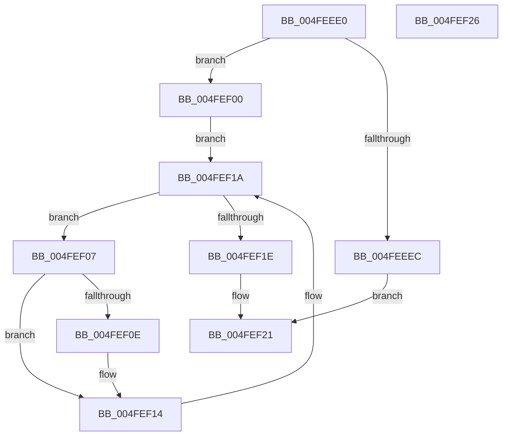

# strupr

- RVA: `0x004FEEE0`–`0x004FEF27` (길이 `71` bytes)
- VA: `0x00000001404FEEE0`
- 실행 섹션: `.text`
- PDB 이름 있음: `예`; PDB Function 태그: `아니요`
- unwind 정보 RVA: `0x0005D2F4`
- 디코드: `26`개 명령, `71/71` bytes 표시
- 미해석 바이트: `0` (있으면 어셈블리에 `.byte`로 보존)

> 이 문서는 커널 이미지의 기계어와 PDB 기호를 분석해 생성했습니다. 4번과 5번은 함수 원형과 자료형을 바이너리 사용 방식에서 추정한 C 해석이며 원본 소스 복구 결과는 아닙니다.

## 1. Dependencies

- 직접 호출 지점: **1**; 고유 호출 대상: **1**
- 직접 호출자로 확인된 함수: **8**
- RIP 상대 이미지 참조: **0**

### Outgoing calls
- `0x004FEEF7` → [EmpCheckErrataList](../49/EmpCheckErrataList_function_0049E550.md) (function, `0x0049E550`)

### Direct callers
- [HalInitializeBios](../53/HalInitializeBios_function_0053D9A0.md) at `0x0053D9CD`
- [InbvDetermineFunction](../59/InbvDetermineFunction_function_005901C0.md) at `0x005901F0`
- [KdInitSystem](../../pagekd/B8/KdInitSystem_function_00B85E30.md) at `0x00B85FF3`
- [InitBootProcessor](../../init/C1/InitBootProcessor_function_00C1B1C8.md) at `0x00C1B34F`
- [Phase1InitializationDiscard](../../init/C1/Phase1InitializationDiscard_function_00C1C728.md) at `0x00C1C813`
- [InbvDriverInitialize](../../init/C2/InbvDriverInitialize_function_00C2A420.md) at `0x00C2A489`
- [BvgaDriverInitialize](../../init/C2/BvgaDriverInitialize_function_00C2A500.md) at `0x00C2A54C`
- [RamdiskStart](../../init/C6/RamdiskStart_function_00C6EF68.md) at `0x00C6F0CD`

### Static image references
- 디코드된 RIP-relative 메모리 참조가 없습니다.

## 2. Other-region calls and transfers

- 다른 실행 섹션으로 향하는 call: **0**
- 별도 외부 분기/꼬리 이동을 확인하지 못했습니다.

## 3. Assembly (complete function range)

```asm
004FEEE0  48 83 EC 38                     sub rsp, 0x38
004FEEE4  48 8B D1                        mov rdx, rcx
004FEEE7  48 85 C9                        test rcx, rcx
004FEEEA  75 14                           jne 0x1404fef00
004FEEEC  48 21 4C 24 20                  and qword ptr [rsp + 0x20], rcx
004FEEF1  45 33 C9                        xor r9d, r9d
004FEEF4  45 33 C0                        xor r8d, r8d
004FEEF7  E8 54 F6 F9 FF                  call 0x14049e550
004FEEFC  33 C0                           xor eax, eax
004FEEFE  EB 21                           jmp 0x1404fef21
004FEF00  8A 09                           mov cl, byte ptr [rcx]
004FEF02  4C 8B C2                        mov r8, rdx
004FEF05  EB 13                           jmp 0x1404fef1a
004FEF07  8D 41 9F                        lea eax, [rcx - 0x61]
004FEF0A  3C 19                           cmp al, 0x19
004FEF0C  77 06                           ja 0x1404fef14
004FEF0E  80 E9 20                        sub cl, 0x20
004FEF11  41 88 08                        mov byte ptr [r8], cl
004FEF14  49 FF C0                        inc r8
004FEF17  41 8A 08                        mov cl, byte ptr [r8]
004FEF1A  84 C9                           test cl, cl
004FEF1C  75 E9                           jne 0x1404fef07
004FEF1E  48 8B C2                        mov rax, rdx
004FEF21  48 83 C4 38                     add rsp, 0x38
004FEF25  C3                              ret
004FEF26  CC                              int3
```

## 4. C-style interpretation (structured pseudocode)

```c
__int64 __fastcall strupr(__int64 a1, __int64 a2, int a3, int a4)
{
    __int64 result;
    __int64 v_rsp;
    unsigned __int64 v_stack_m18;

    v_rsp = (v_rsp) - (56);
    if (a1 != 0) goto loc_004FEF00;
    a4 = 0;
    a3 = 0;
    result = EmpCheckErrataList(a1, a1, a3, a4);
    result = 0;
    goto loc_004FEF21;
loc_004FEF00:
    goto loc_004FEF1A;
loc_004FEF07:
    if (((unsigned __int8)(*(unsigned __int8 *)(a1) - 97)) <= 25) {
        a1 = (unsigned __int8)((*(unsigned __int8 *)(a1)) - (32));
        *(unsigned __int8 *)(a1) = (unsigned __int8)(a1);
    }
    a3 = (a1) + 1;
loc_004FEF1A:
    if ((unsigned __int8)(*(unsigned __int8 *)(a3)) != 0) goto loc_004FEF07;
loc_004FEF21:
    v_rsp = (v_rsp) + (56);
    return a1;
}
```

## 5. (Beta) C Style

```c
int64_t strupr(int64_t Arg1, int64_t Arg2, int32_t Arg3, int32_t Arg4)
{
    int64_t result;
    int64_t local_rsp;
    uint64_t v_stack_m18;

    local_rsp = (local_rsp) - (56);
    if (Arg1 != 0) goto loc_004FEF00;
    Arg4 = 0;
    Arg3 = 0;
    result = EmpCheckErrataList(Arg1, Arg1, Arg3, Arg4);
    result = 0;
    goto loc_004FEF21;
loc_004FEF00:
    goto loc_004FEF1A;
loc_004FEF07:
    if (((uint8_t)(*(uint8_t *)(Arg1) - 97)) <= 25) {
        Arg1 = (uint8_t)((*(uint8_t *)(Arg1)) - (32));
        *(uint8_t *)(Arg1) = (uint8_t)(Arg1);
    }
    Arg3 = (Arg1) + 1;
loc_004FEF1A:
    if ((uint8_t)(*(uint8_t *)(Arg3)) != 0) goto loc_004FEF07;
loc_004FEF21:
    local_rsp = (local_rsp) + (56);
    return Arg1;
}
```

## 6. Execution-region graph

[열기: 2D/3D 그래프와 함수 탐색 컨트롤 패널](../../../control-panel.html?section=text&rva=0x004FEEE0&view=graph)

- 2D 그래프는 위에서 아래로 흐르고, 3D 그래프는 빈 공간을 드래그해 회전합니다. Shift+드래그는 이동, 휠은 확대·축소, 함수 노드 선택은 대상 보고서 이동입니다.

### Static fallback


