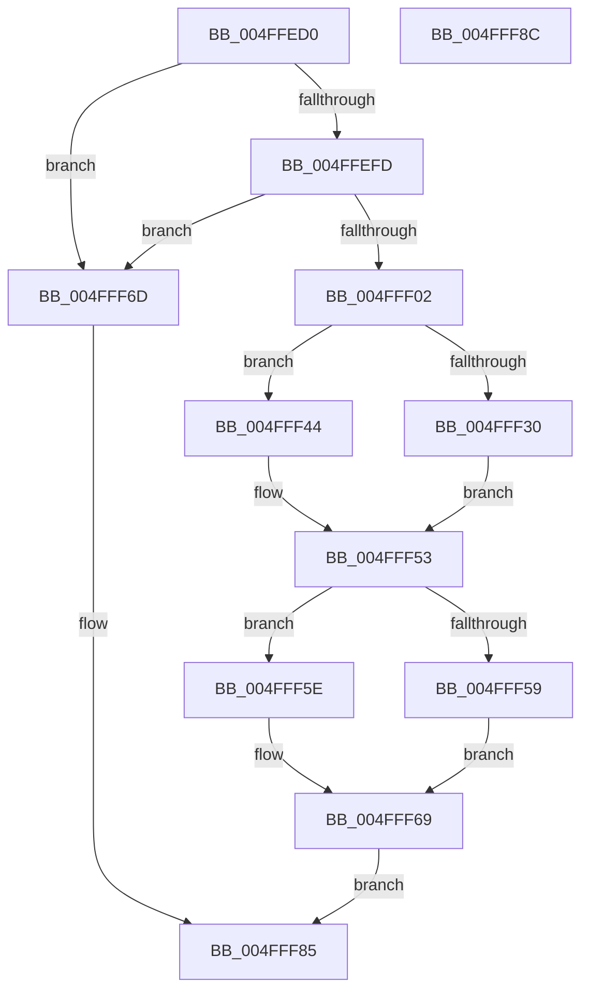

# swprintf

- RVA: `0x004FFED0`–`0x004FFF8D` (길이 `189` bytes)
- VA: `0x00000001404FFED0`
- 실행 섹션: `.text`
- PDB 이름 있음: `예`; PDB Function 태그: `아니요`
- unwind 정보 RVA: `0x000C2654`
- 디코드: `57`개 명령, `189/189` bytes 표시
- 미해석 바이트: `0` (있으면 어셈블리에 `.byte`로 보존)

> 이 문서는 커널 이미지의 기계어와 PDB 기호를 분석해 생성했습니다. 4번과 5번은 함수 원형과 자료형을 바이너리 사용 방식에서 추정한 C 해석이며 원본 소스 복구 결과는 아닙니다.

## 1. Dependencies

- 직접 호출 지점: **4**; 고유 호출 대상: **3**
- 직접 호출자로 확인된 함수: **0**
- RIP 상대 이미지 참조: **0**

### Outgoing calls
- `0x004FFF23` → [woutput_l](../50/woutput_l_function_0050293C.md) (function, `0x0050293C`)
- `0x004FFF4A` → [flsbuf](../50/flsbuf_function_0050292C.md) (function, `0x0050292C`)
- `0x004FFF64` → [flsbuf](../50/flsbuf_function_0050292C.md) (function, `0x0050292C`)
- `0x004FFF7D` → [EmpCheckErrataList](../49/EmpCheckErrataList_function_0049E550.md) (function, `0x0049E550`)

### Direct callers
- 이 함수 시작 RVA로 연결되는 직접 call은 확인되지 않았습니다. 간접 호출은 완전히 역산할 수 없습니다.

### Static image references
- 디코드된 RIP-relative 메모리 참조가 없습니다.

## 2. Other-region calls and transfers

- 다른 실행 섹션으로 향하는 call: **0**
- 별도 외부 분기/꼬리 이동을 확인하지 못했습니다.

## 3. Assembly (complete function range)

```asm
004FFED0  48 89 54 24 10                  mov qword ptr [rsp + 0x10], rdx
004FFED5  4C 89 44 24 18                  mov qword ptr [rsp + 0x18], r8
004FFEDA  4C 89 4C 24 20                  mov qword ptr [rsp + 0x20], r9
004FFEDF  55                              push rbp
004FFEE0  53                              push rbx
004FFEE1  48 8B EC                        mov rbp, rsp
004FFEE4  48 83 EC 78                     sub rsp, 0x78
004FFEE8  83 65 CC 00                     and dword ptr [rbp - 0x34], 0
004FFEEC  0F 57 C0                        xorps xmm0, xmm0
004FFEEF  83 65 EC 00                     and dword ptr [rbp - 0x14], 0
004FFEF3  F3 0F 7F 45 DC                  movdqu xmmword ptr [rbp - 0x24], xmm0
004FFEF8  48 85 D2                        test rdx, rdx
004FFEFB  74 70                           je 0x1404fff6d
004FFEFD  48 85 C9                        test rcx, rcx
004FFF00  74 6B                           je 0x1404fff6d
004FFF02  48 89 4D D0                     mov qword ptr [rbp - 0x30], rcx
004FFF06  4C 8D 4D 28                     lea r9, [rbp + 0x28]
004FFF0A  48 89 4D C0                     mov qword ptr [rbp - 0x40], rcx
004FFF0E  45 33 C0                        xor r8d, r8d
004FFF11  48 8D 4D C0                     lea rcx, [rbp - 0x40]
004FFF15  C7 45 D8 42 00 00 00            mov dword ptr [rbp - 0x28], 0x42
004FFF1C  C7 45 C8 FF FF FF 7F            mov dword ptr [rbp - 0x38], 0x7fffffff
004FFF23  E8 14 2A 00 00                  call 0x14050293c
004FFF28  83 6D C8 01                     sub dword ptr [rbp - 0x38], 1
004FFF2C  8B D8                           mov ebx, eax
004FFF2E  78 14                           js 0x1404fff44
004FFF30  48 8B 4D C0                     mov rcx, qword ptr [rbp - 0x40]
004FFF34  C6 01 00                        mov byte ptr [rcx], 0
004FFF37  48 8B 4D C0                     mov rcx, qword ptr [rbp - 0x40]
004FFF3B  48 FF C1                        inc rcx
004FFF3E  48 89 4D C0                     mov qword ptr [rbp - 0x40], rcx
004FFF42  EB 0F                           jmp 0x1404fff53
004FFF44  48 8D 55 C0                     lea rdx, [rbp - 0x40]
004FFF48  33 C9                           xor ecx, ecx
004FFF4A  E8 DD 29 00 00                  call 0x14050292c
004FFF4F  48 8B 4D C0                     mov rcx, qword ptr [rbp - 0x40]
004FFF53  83 6D C8 01                     sub dword ptr [rbp - 0x38], 1
004FFF57  78 05                           js 0x1404fff5e
004FFF59  C6 01 00                        mov byte ptr [rcx], 0
004FFF5C  EB 0B                           jmp 0x1404fff69
004FFF5E  48 8D 55 C0                     lea rdx, [rbp - 0x40]
004FFF62  33 C9                           xor ecx, ecx
004FFF64  E8 C3 29 00 00                  call 0x14050292c
004FFF69  8B C3                           mov eax, ebx
004FFF6B  EB 18                           jmp 0x1404fff85
004FFF6D  48 83 64 24 20 00               and qword ptr [rsp + 0x20], 0
004FFF73  45 33 C9                        xor r9d, r9d
004FFF76  45 33 C0                        xor r8d, r8d
004FFF79  33 D2                           xor edx, edx
004FFF7B  33 C9                           xor ecx, ecx
004FFF7D  E8 CE E5 F9 FF                  call 0x14049e550
004FFF82  83 C8 FF                        or eax, 0xffffffff
004FFF85  48 83 C4 78                     add rsp, 0x78
004FFF89  5B                              pop rbx
004FFF8A  5D                              pop rbp
004FFF8B  C3                              ret
004FFF8C  CC                              int3
```

## 4. C-style interpretation (structured pseudocode)

```c
__int64 __fastcall swprintf(__int64 a1, __int64 a2, __int64 a3, __int64 a4)
{
    __int64 result;
    __int64 v_rsp;
    unsigned int v_stack_m24;
    unsigned __int64 v_stack_m34;
    unsigned int v_stack_m38;
    unsigned __int64 v_stack_m40;
    unsigned int v_stack_m44;
    unsigned int v_stack_m48;
    unsigned __int64 v_stack_m50;
    unsigned __int64 v_stack_m68;
    unsigned __int64 v_stack_p10;
    unsigned __int64 v_stack_p18;
    unsigned __int64 v_stack_p20;

    v_stack_p10 = a2;
    v_stack_p18 = a3;
    v_stack_p20 = a4;
    v_rsp = (v_rsp) - (120);
    v_stack_m34 = v_xmm0;
    if (a2 == 0) goto loc_004FFF6D;
    if (a1 == 0) goto loc_004FFF6D;
    v_stack_m40 = a1;
    v_stack_m50 = a1;
    a3 = 0;
    v_stack_m38 = 66;
    v_stack_m48 = 0x7FFFFFFFULL;
    result = woutput_l(v_stack_m50, a2, a3, v_stack_p18);
    if (sign_flag) goto loc_004FFF44;
    *(unsigned __int8 *)(v_stack_m50) = 0;
    a1 = (v_stack_m50) + 1;
    v_stack_m50 = a1;
    goto loc_004FFF53;
loc_004FFF44:
    a1 = 0;
    result = flsbuf(a1, v_stack_m50, a3, v_stack_p18);
loc_004FFF53:
    if (sign_flag) goto loc_004FFF5E;
    *(unsigned __int8 *)(v_stack_m50) = 0;
    goto loc_004FFF69;
loc_004FFF5E:
    a1 = 0;
    result = flsbuf(a1, v_stack_m50, a3, v_stack_p18);
loc_004FFF69:
    goto loc_004FFF85;
loc_004FFF6D:
    a4 = 0;
    a3 = 0;
    a2 = 0;
    a1 = 0;
    result = EmpCheckErrataList(a1, a2, a3, a4);
    result = (unsigned int)((result) | (0xFFFFFFFFULL));
loc_004FFF85:
    v_rsp = (v_rsp) + (120);
    return result;
}
```

## 5. (Beta) C Style

```c
int64_t swprintf(int64_t Arg1, int64_t Arg2, int64_t Arg3, int64_t Arg4)
{
    int64_t result;
    int64_t local_rsp;
    uint32_t v_stack_m24;
    uint64_t v_stack_m34;
    uint32_t v_stack_m38;
    uint64_t v_stack_m40;
    uint32_t v_stack_m44;
    uint32_t v_stack_m48;
    uint64_t v_stack_m50;
    uint64_t v_stack_m68;
    uint64_t v_stack_p10;
    uint64_t v_stack_p18;
    uint64_t v_stack_p20;

    v_stack_p10 = Arg2;
    v_stack_p18 = Arg3;
    v_stack_p20 = Arg4;
    local_rsp = (local_rsp) - (120);
    v_stack_m34 = v_xmm0;
    if (Arg2 == 0) goto loc_004FFF6D;
    if (Arg1 == 0) goto loc_004FFF6D;
    v_stack_m40 = Arg1;
    v_stack_m50 = Arg1;
    Arg3 = 0;
    v_stack_m38 = 66;
    v_stack_m48 = 0x7FFFFFFFULL;
    result = woutput_l(v_stack_m50, Arg2, Arg3, v_stack_p18);
    if (sign_flag) goto loc_004FFF44;
    *(uint8_t *)(v_stack_m50) = 0;
    Arg1 = (v_stack_m50) + 1;
    v_stack_m50 = Arg1;
    goto loc_004FFF53;
loc_004FFF44:
    Arg1 = 0;
    result = flsbuf(Arg1, v_stack_m50, Arg3, v_stack_p18);
loc_004FFF53:
    if (sign_flag) goto loc_004FFF5E;
    *(uint8_t *)(v_stack_m50) = 0;
    goto loc_004FFF69;
loc_004FFF5E:
    Arg1 = 0;
    result = flsbuf(Arg1, v_stack_m50, Arg3, v_stack_p18);
loc_004FFF69:
    goto loc_004FFF85;
loc_004FFF6D:
    Arg4 = 0;
    Arg3 = 0;
    Arg2 = 0;
    Arg1 = 0;
    result = EmpCheckErrataList(Arg1, Arg2, Arg3, Arg4);
    result = (uint32_t)((result) | (0xFFFFFFFFULL));
loc_004FFF85:
    local_rsp = (local_rsp) + (120);
    return result;
}
```

## 6. Execution-region graph

[열기: 2D/3D 그래프와 함수 탐색 컨트롤 패널](../../../control-panel.html?section=text&rva=0x004FFED0&view=graph)

- 2D 그래프는 위에서 아래로 흐르고, 3D 그래프는 빈 공간을 드래그해 회전합니다. Shift+드래그는 이동, 휠은 확대·축소, 함수 노드 선택은 대상 보고서 이동입니다.

### Static fallback


