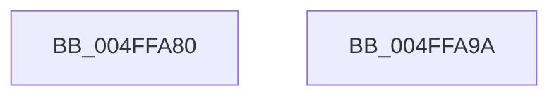

# ultow

- RVA: `0x004FFA80`–`0x004FFA9B` (길이 `27` bytes)
- VA: `0x00000001404FFA80`
- 실행 섹션: `.text`
- PDB 이름 있음: `예`; PDB Function 태그: `아니요`
- unwind 정보 RVA: `0x0005CF00`
- 디코드: `10`개 명령, `27/27` bytes 표시
- 미해석 바이트: `0` (있으면 어셈블리에 `.byte`로 보존)

> 이 문서는 커널 이미지의 기계어와 PDB 기호를 분석해 생성했습니다. 4번과 5번은 함수 원형과 자료형을 바이너리 사용 방식에서 추정한 C 해석이며 원본 소스 복구 결과는 아닙니다.

## 1. Dependencies

- 직접 호출 지점: **1**; 고유 호출 대상: **1**
- 직접 호출자로 확인된 함수: **1**
- RIP 상대 이미지 참조: **0**

### Outgoing calls
- `0x004FFA8C` → [xtow](xtow_function_004FFAA4.md) (function, `0x004FFAA4`)

### Direct callers
- [AdtpBuildUlongString](../../page/AB/AdtpBuildUlongString_function_00AB3BA4.md) at `0x00AB3C3E`

### Static image references
- 디코드된 RIP-relative 메모리 참조가 없습니다.

## 2. Other-region calls and transfers

- 다른 실행 섹션으로 향하는 call: **0**
- 별도 외부 분기/꼬리 이동을 확인하지 못했습니다.

## 3. Assembly (complete function range)

```asm
004FFA80  40 53                           push rbx
004FFA82  48 83 EC 20                     sub rsp, 0x20
004FFA86  45 33 C9                        xor r9d, r9d
004FFA89  48 8B DA                        mov rbx, rdx
004FFA8C  E8 13 00 00 00                  call 0x1404ffaa4
004FFA91  48 8B C3                        mov rax, rbx
004FFA94  48 83 C4 20                     add rsp, 0x20
004FFA98  5B                              pop rbx
004FFA99  C3                              ret
004FFA9A  CC                              int3
```

## 4. C-style interpretation (structured pseudocode)

```c
__int64 __fastcall ultow(__int64 a1, __int64 a2, __int64 a3, int a4)
{
    __int64 result;
    __int64 v_rsp;

    v_rsp = (v_rsp) - (32);
    a4 = 0;
    result = xtow(a1, a2, a3, a4);
    v_rsp = (v_rsp) + (32);
    return a2;
}
```

## 5. (Beta) C Style

```c
int64_t ultow(int64_t Arg1, int64_t Arg2, int64_t Arg3, int32_t Arg4)
{
    int64_t result;
    int64_t local_rsp;

    local_rsp = (local_rsp) - (32);
    Arg4 = 0;
    result = xtow(Arg1, Arg2, Arg3, Arg4);
    local_rsp = (local_rsp) + (32);
    return Arg2;
}
```

## 6. Execution-region graph

[열기: 2D/3D 그래프와 함수 탐색 컨트롤 패널](../../../control-panel.html?section=text&rva=0x004FFA80&view=graph)

- 2D 그래프는 위에서 아래로 흐르고, 3D 그래프는 빈 공간을 드래그해 회전합니다. Shift+드래그는 이동, 휠은 확대·축소, 함수 노드 선택은 대상 보고서 이동입니다.

### Static fallback


