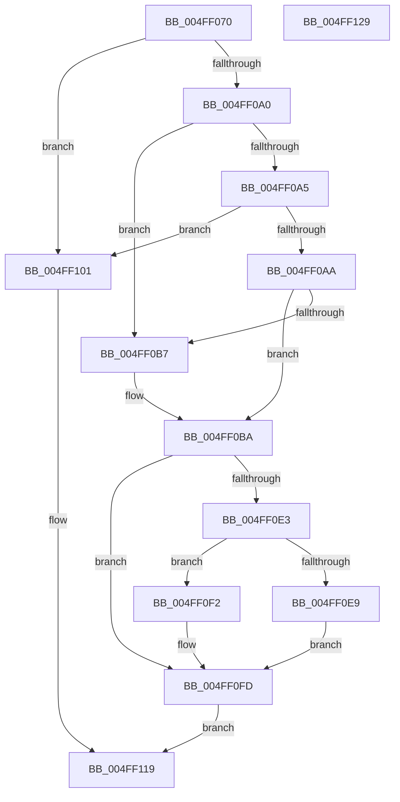

# vsnprintf_l

- RVA: `0x004FF070`–`0x004FF12A` (길이 `186` bytes)
- VA: `0x00000001404FF070`
- 실행 섹션: `.text`
- PDB 이름 있음: `예`; PDB Function 태그: `아니요`
- unwind 정보 RVA: `0x000BE5B4`
- 디코드: `57`개 명령, `186/186` bytes 표시
- 미해석 바이트: `0` (있으면 어셈블리에 `.byte`로 보존)

> 이 문서는 커널 이미지의 기계어와 PDB 기호를 분석해 생성했습니다. 4번과 5번은 함수 원형과 자료형을 바이너리 사용 방식에서 추정한 C 해석이며 원본 소스 복구 결과는 아닙니다.

## 1. Dependencies

- 직접 호출 지점: **3**; 고유 호출 대상: **3**
- 직접 호출자로 확인된 함수: **1**
- RIP 상대 이미지 참조: **0**

### Outgoing calls
- `0x004FF0D7` → [output_l](../50/output_l_function_00503368.md) (function, `0x00503368`)
- `0x004FF0F8` → [flsbuf](../50/flsbuf_function_0050292C.md) (function, `0x0050292C`)
- `0x004FF111` → [EmpCheckErrataList](../49/EmpCheckErrataList_function_0049E550.md) (function, `0x0049E550`)

### Direct callers
- [vsnprintf](vsnprintf_function_004FF050.md) at `0x004FF05C`

### Static image references
- 디코드된 RIP-relative 메모리 참조가 없습니다.

## 2. Other-region calls and transfers

- 다른 실행 섹션으로 향하는 call: **0**
- 별도 외부 분기/꼬리 이동을 확인하지 못했습니다.

## 3. Assembly (complete function range)

```asm
004FF070  48 89 5C 24 08                  mov qword ptr [rsp + 8], rbx
004FF075  48 89 7C 24 10                  mov qword ptr [rsp + 0x10], rdi
004FF07A  55                              push rbp
004FF07B  48 8B EC                        mov rbp, rsp
004FF07E  48 83 EC 60                     sub rsp, 0x60
004FF082  83 65 DC 00                     and dword ptr [rbp - 0x24], 0
004FF086  0F 57 C0                        xorps xmm0, xmm0
004FF089  83 65 FC 00                     and dword ptr [rbp - 4], 0
004FF08D  4D 8B D1                        mov r10, r9
004FF090  49 8B C0                        mov rax, r8
004FF093  48 8B D9                        mov rbx, rcx
004FF096  F3 0F 7F 45 EC                  movdqu xmmword ptr [rbp - 0x14], xmm0
004FF09B  4D 85 C0                        test r8, r8
004FF09E  74 61                           je 0x1404ff101
004FF0A0  48 85 D2                        test rdx, rdx
004FF0A3  74 12                           je 0x1404ff0b7
004FF0A5  48 85 C9                        test rcx, rcx
004FF0A8  74 57                           je 0x1404ff101
004FF0AA  B9 FF FF FF 7F                  mov ecx, 0x7fffffff
004FF0AF  89 4D D8                        mov dword ptr [rbp - 0x28], ecx
004FF0B2  48 3B D1                        cmp rdx, rcx
004FF0B5  77 03                           ja 0x1404ff0ba
004FF0B7  89 55 D8                        mov dword ptr [rbp - 0x28], edx
004FF0BA  4C 8B 4D 30                     mov r9, qword ptr [rbp + 0x30]
004FF0BE  48 8D 4D D0                     lea rcx, [rbp - 0x30]
004FF0C2  4D 8B C2                        mov r8, r10
004FF0C5  C7 45 E8 42 00 00 00            mov dword ptr [rbp - 0x18], 0x42
004FF0CC  48 8B D0                        mov rdx, rax
004FF0CF  48 89 5D E0                     mov qword ptr [rbp - 0x20], rbx
004FF0D3  48 89 5D D0                     mov qword ptr [rbp - 0x30], rbx
004FF0D7  E8 8C 42 00 00                  call 0x140503368
004FF0DC  8B F8                           mov edi, eax
004FF0DE  48 85 DB                        test rbx, rbx
004FF0E1  74 1A                           je 0x1404ff0fd
004FF0E3  83 6D D8 01                     sub dword ptr [rbp - 0x28], 1
004FF0E7  78 09                           js 0x1404ff0f2
004FF0E9  48 8B 4D D0                     mov rcx, qword ptr [rbp - 0x30]
004FF0ED  C6 01 00                        mov byte ptr [rcx], 0
004FF0F0  EB 0B                           jmp 0x1404ff0fd
004FF0F2  48 8D 55 D0                     lea rdx, [rbp - 0x30]
004FF0F6  33 C9                           xor ecx, ecx
004FF0F8  E8 2F 38 00 00                  call 0x14050292c
004FF0FD  8B C7                           mov eax, edi
004FF0FF  EB 18                           jmp 0x1404ff119
004FF101  48 83 64 24 20 00               and qword ptr [rsp + 0x20], 0
004FF107  45 33 C9                        xor r9d, r9d
004FF10A  45 33 C0                        xor r8d, r8d
004FF10D  33 D2                           xor edx, edx
004FF10F  33 C9                           xor ecx, ecx
004FF111  E8 3A F4 F9 FF                  call 0x14049e550
004FF116  83 C8 FF                        or eax, 0xffffffff
004FF119  48 8B 5C 24 70                  mov rbx, qword ptr [rsp + 0x70]
004FF11E  48 8B 7C 24 78                  mov rdi, qword ptr [rsp + 0x78]
004FF123  48 83 C4 60                     add rsp, 0x60
004FF127  5D                              pop rbp
004FF128  C3                              ret
004FF129  CC                              int3
```

## 4. C-style interpretation (structured pseudocode)

```c
__int64 __fastcall vsnprintf_l(__int64 a1, __int64 a2, __int64 a3, __int64 a4, __int64 a5)
{
    __int64 result;
    __int64 v_rsp;
    unsigned __int64 v_stack_m1C;
    unsigned int v_stack_m20;
    unsigned __int64 v_stack_m28;
    unsigned int v_stack_m2C;
    unsigned int v_stack_m30;
    unsigned __int64 v_stack_m38;
    unsigned __int64 v_stack_m48;
    unsigned int v_stack_mC;
    unsigned __int64 v_stack_p10;
    unsigned __int64 v_stack_p8;

    v_stack_p8 = v_rbx;
    v_stack_p10 = v_rdi;
    v_rsp = (v_rsp) - (96);
    v_stack_m1C = v_xmm0;
    if (a3 == 0) goto loc_004FF101;
    if (a2 == 0) goto loc_004FF0B7;
    if (a1 == 0) goto loc_004FF101;
    v_stack_m30 = (unsigned int)((unsigned int)(0x7FFFFFFFULL));
    if (a2 <= ((unsigned int)(0x7FFFFFFFULL))) {
        v_stack_m30 = (unsigned int)(a2);
    }
    v_stack_m20 = 66;
    v_stack_m28 = a1;
    v_stack_m38 = a1;
    result = output_l(v_stack_m38, a3, a4, a5);
    if (a1 == 0) goto loc_004FF0FD;
    if (sign_flag) goto loc_004FF0F2;
    *(unsigned __int8 *)(v_stack_m38) = 0;
    goto loc_004FF0FD;
loc_004FF0F2:
    a1 = 0;
    result = flsbuf(a1, v_stack_m38, a4, a5);
loc_004FF0FD:
    goto loc_004FF119;
loc_004FF101:
    a4 = 0;
    a3 = 0;
    a2 = 0;
    a1 = 0;
    result = EmpCheckErrataList(a1, a2, a3, a4);
    result = (unsigned int)((result) | (0xFFFFFFFFULL));
loc_004FF119:
    v_rsp = (v_rsp) + (96);
    return result;
}
```

## 5. (Beta) C Style

```c
int64_t vsnprintf_l(int64_t Arg1, int64_t Arg2, int64_t Arg3, int64_t Arg4, int64_t Arg5)
{
    int64_t result;
    int64_t local_rsp;
    uint64_t v_stack_m1C;
    uint32_t v_stack_m20;
    uint64_t v_stack_m28;
    uint32_t v_stack_m2C;
    uint32_t v_stack_m30;
    uint64_t v_stack_m38;
    uint64_t v_stack_m48;
    uint32_t v_stack_mC;
    uint64_t v_stack_p10;
    uint64_t v_stack_p8;

    v_stack_p8 = local_rbx;
    v_stack_p10 = local_rdi;
    local_rsp = (local_rsp) - (96);
    v_stack_m1C = v_xmm0;
    if (Arg3 == 0) goto loc_004FF101;
    if (Arg2 == 0) goto loc_004FF0B7;
    if (Arg1 == 0) goto loc_004FF101;
    v_stack_m30 = (uint32_t)((uint32_t)(0x7FFFFFFFULL));
    if (Arg2 <= ((uint32_t)(0x7FFFFFFFULL))) {
        v_stack_m30 = (uint32_t)(Arg2);
    }
    v_stack_m20 = 66;
    v_stack_m28 = Arg1;
    v_stack_m38 = Arg1;
    result = output_l(v_stack_m38, Arg3, Arg4, Arg5);
    if (Arg1 == 0) goto loc_004FF0FD;
    if (sign_flag) goto loc_004FF0F2;
    *(uint8_t *)(v_stack_m38) = 0;
    goto loc_004FF0FD;
loc_004FF0F2:
    Arg1 = 0;
    result = flsbuf(Arg1, v_stack_m38, Arg4, Arg5);
loc_004FF0FD:
    goto loc_004FF119;
loc_004FF101:
    Arg4 = 0;
    Arg3 = 0;
    Arg2 = 0;
    Arg1 = 0;
    result = EmpCheckErrataList(Arg1, Arg2, Arg3, Arg4);
    result = (uint32_t)((result) | (0xFFFFFFFFULL));
loc_004FF119:
    local_rsp = (local_rsp) + (96);
    return result;
}
```

## 6. Execution-region graph

[열기: 2D/3D 그래프와 함수 탐색 컨트롤 패널](../../../control-panel.html?section=text&rva=0x004FF070&view=graph)

- 2D 그래프는 위에서 아래로 흐르고, 3D 그래프는 빈 공간을 드래그해 회전합니다. Shift+드래그는 이동, 휠은 확대·축소, 함수 노드 선택은 대상 보고서 이동입니다.

### Static fallback


