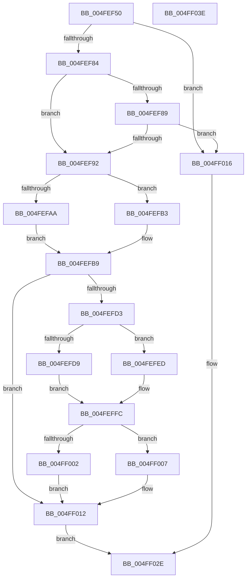

# vsnwprintf_l

- RVA: `0x004FEF50`–`0x004FF03F` (길이 `239` bytes)
- VA: `0x00000001404FEF50`
- 실행 섹션: `.text`
- PDB 이름 있음: `예`; PDB Function 태그: `아니요`
- unwind 정보 RVA: `0x000BE5B4`
- 디코드: `69`개 명령, `239/239` bytes 표시
- 미해석 바이트: `0` (있으면 어셈블리에 `.byte`로 보존)

> 이 문서는 커널 이미지의 기계어와 PDB 기호를 분석해 생성했습니다. 4번과 5번은 함수 원형과 자료형을 바이너리 사용 방식에서 추정한 C 해석이며 원본 소스 복구 결과는 아닙니다.

## 1. Dependencies

- 직접 호출 지점: **4**; 고유 호출 대상: **3**
- 직접 호출자로 확인된 함수: **1**
- RIP 상대 이미지 참조: **0**

### Outgoing calls
- `0x004FEFC7` → [woutput_l](../50/woutput_l_function_0050293C.md) (function, `0x0050293C`)
- `0x004FEFF3` → [flsbuf](../50/flsbuf_function_0050292C.md) (function, `0x0050292C`)
- `0x004FF00D` → [flsbuf](../50/flsbuf_function_0050292C.md) (function, `0x0050292C`)
- `0x004FF026` → [EmpCheckErrataList](../49/EmpCheckErrataList_function_0049E550.md) (function, `0x0049E550`)

### Direct callers
- [vsnwprintf](vsnwprintf_function_004FEF30.md) at `0x004FEF3C`

### Static image references
- 디코드된 RIP-relative 메모리 참조가 없습니다.

## 2. Other-region calls and transfers

- 다른 실행 섹션으로 향하는 call: **0**
- 별도 외부 분기/꼬리 이동을 확인하지 못했습니다.

## 3. Assembly (complete function range)

```asm
004FEF50  48 89 5C 24 08                  mov qword ptr [rsp + 8], rbx
004FEF55  48 89 7C 24 10                  mov qword ptr [rsp + 0x10], rdi
004FEF5A  55                              push rbp
004FEF5B  48 8B EC                        mov rbp, rsp
004FEF5E  48 83 EC 60                     sub rsp, 0x60
004FEF62  83 65 DC 00                     and dword ptr [rbp - 0x24], 0
004FEF66  0F 57 C0                        xorps xmm0, xmm0
004FEF69  83 65 FC 00                     and dword ptr [rbp - 4], 0
004FEF6D  4D 8B D9                        mov r11, r9
004FEF70  4D 8B D0                        mov r10, r8
004FEF73  48 8B D9                        mov rbx, rcx
004FEF76  F3 0F 7F 45 EC                  movdqu xmmword ptr [rbp - 0x14], xmm0
004FEF7B  4D 85 C0                        test r8, r8
004FEF7E  0F 84 92 00 00 00               je 0x1404ff016
004FEF84  48 85 D2                        test rdx, rdx
004FEF87  74 09                           je 0x1404fef92
004FEF89  48 85 C9                        test rcx, rcx
004FEF8C  0F 84 84 00 00 00               je 0x1404ff016
004FEF92  C7 45 E8 42 00 00 00            mov dword ptr [rbp - 0x18], 0x42
004FEF99  48 89 5D E0                     mov qword ptr [rbp - 0x20], rbx
004FEF9D  48 89 5D D0                     mov qword ptr [rbp - 0x30], rbx
004FEFA1  48 81 FA FF FF FF 3F            cmp rdx, 0x3fffffff
004FEFA8  76 09                           jbe 0x1404fefb3
004FEFAA  C7 45 D8 FF FF FF 7F            mov dword ptr [rbp - 0x28], 0x7fffffff
004FEFB1  EB 06                           jmp 0x1404fefb9
004FEFB3  8D 04 12                        lea eax, [rdx + rdx]
004FEFB6  89 45 D8                        mov dword ptr [rbp - 0x28], eax
004FEFB9  4C 8B 4D 30                     mov r9, qword ptr [rbp + 0x30]
004FEFBD  48 8D 4D D0                     lea rcx, [rbp - 0x30]
004FEFC1  4D 8B C3                        mov r8, r11
004FEFC4  49 8B D2                        mov rdx, r10
004FEFC7  E8 70 39 00 00                  call 0x14050293c
004FEFCC  8B F8                           mov edi, eax
004FEFCE  48 85 DB                        test rbx, rbx
004FEFD1  74 3F                           je 0x1404ff012
004FEFD3  83 6D D8 01                     sub dword ptr [rbp - 0x28], 1
004FEFD7  78 14                           js 0x1404fefed
004FEFD9  48 8B 4D D0                     mov rcx, qword ptr [rbp - 0x30]
004FEFDD  C6 01 00                        mov byte ptr [rcx], 0
004FEFE0  48 8B 4D D0                     mov rcx, qword ptr [rbp - 0x30]
004FEFE4  48 FF C1                        inc rcx
004FEFE7  48 89 4D D0                     mov qword ptr [rbp - 0x30], rcx
004FEFEB  EB 0F                           jmp 0x1404feffc
004FEFED  48 8D 55 D0                     lea rdx, [rbp - 0x30]
004FEFF1  33 C9                           xor ecx, ecx
004FEFF3  E8 34 39 00 00                  call 0x14050292c
004FEFF8  48 8B 4D D0                     mov rcx, qword ptr [rbp - 0x30]
004FEFFC  83 6D D8 01                     sub dword ptr [rbp - 0x28], 1
004FF000  78 05                           js 0x1404ff007
004FF002  C6 01 00                        mov byte ptr [rcx], 0
004FF005  EB 0B                           jmp 0x1404ff012
004FF007  48 8D 55 D0                     lea rdx, [rbp - 0x30]
004FF00B  33 C9                           xor ecx, ecx
004FF00D  E8 1A 39 00 00                  call 0x14050292c
004FF012  8B C7                           mov eax, edi
004FF014  EB 18                           jmp 0x1404ff02e
004FF016  48 83 64 24 20 00               and qword ptr [rsp + 0x20], 0
004FF01C  45 33 C9                        xor r9d, r9d
004FF01F  45 33 C0                        xor r8d, r8d
004FF022  33 D2                           xor edx, edx
004FF024  33 C9                           xor ecx, ecx
004FF026  E8 25 F5 F9 FF                  call 0x14049e550
004FF02B  83 C8 FF                        or eax, 0xffffffff
004FF02E  48 8B 5C 24 70                  mov rbx, qword ptr [rsp + 0x70]
004FF033  48 8B 7C 24 78                  mov rdi, qword ptr [rsp + 0x78]
004FF038  48 83 C4 60                     add rsp, 0x60
004FF03C  5D                              pop rbp
004FF03D  C3                              ret
004FF03E  CC                              int3
```

## 4. C-style interpretation (structured pseudocode)

```c
__int64 __fastcall vsnwprintf_l(__int64 a1, __int64 a2, __int64 a3, __int64 a4, __int64 a5)
{
    __int64 result;
    __int64 v_rsp;
    unsigned __int64 v_stack_m1C;
    unsigned int v_stack_m20;
    unsigned __int64 v_stack_m28;
    unsigned int v_stack_m2C;
    unsigned int v_stack_m30;
    unsigned __int64 v_stack_m38;
    unsigned __int64 v_stack_m48;
    unsigned int v_stack_mC;
    unsigned __int64 v_stack_p10;
    unsigned __int64 v_stack_p8;

    v_stack_p8 = v_rbx;
    v_stack_p10 = v_rdi;
    v_rsp = (v_rsp) - (96);
    v_stack_m1C = v_xmm0;
    if (a3 == 0) goto loc_004FF016;
    if (a2 == 0) goto loc_004FEF92;
    if (a1 == 0) goto loc_004FF016;
loc_004FEF92:
    v_stack_m20 = 66;
    v_stack_m28 = a1;
    v_stack_m38 = a1;
    if (a2 <= 0x3FFFFFFFULL) goto loc_004FEFB3;
    v_stack_m30 = 0x7FFFFFFFULL;
    goto loc_004FEFB9;
loc_004FEFB3:
    v_stack_m30 = (unsigned int)(a2 + a2 * 1);
loc_004FEFB9:
    result = woutput_l(v_stack_m38, a3, a4, a5);
    if (a1 == 0) goto loc_004FF012;
    if (sign_flag) goto loc_004FEFED;
    *(unsigned __int8 *)(v_stack_m38) = 0;
    a1 = (v_stack_m38) + 1;
    v_stack_m38 = a1;
    goto loc_004FEFFC;
loc_004FEFED:
    a1 = 0;
    result = flsbuf(a1, v_stack_m38, a4, a5);
loc_004FEFFC:
    if (sign_flag) goto loc_004FF007;
    *(unsigned __int8 *)(v_stack_m38) = 0;
    goto loc_004FF012;
loc_004FF007:
    a1 = 0;
    result = flsbuf(a1, v_stack_m38, a4, a5);
loc_004FF012:
    goto loc_004FF02E;
loc_004FF016:
    a4 = 0;
    a3 = 0;
    a2 = 0;
    a1 = 0;
    result = EmpCheckErrataList(a1, a2, a3, a4);
    result = (unsigned int)((result) | (0xFFFFFFFFULL));
loc_004FF02E:
    v_rsp = (v_rsp) + (96);
    return result;
}
```

## 5. (Beta) C Style

```c
int64_t vsnwprintf_l(int64_t Arg1, int64_t Arg2, int64_t Arg3, int64_t Arg4, int64_t Arg5)
{
    int64_t result;
    int64_t local_rsp;
    uint64_t v_stack_m1C;
    uint32_t v_stack_m20;
    uint64_t v_stack_m28;
    uint32_t v_stack_m2C;
    uint32_t v_stack_m30;
    uint64_t v_stack_m38;
    uint64_t v_stack_m48;
    uint32_t v_stack_mC;
    uint64_t v_stack_p10;
    uint64_t v_stack_p8;

    v_stack_p8 = local_rbx;
    v_stack_p10 = local_rdi;
    local_rsp = (local_rsp) - (96);
    v_stack_m1C = v_xmm0;
    if (Arg3 == 0) goto loc_004FF016;
    if (Arg2 == 0) goto loc_004FEF92;
    if (Arg1 == 0) goto loc_004FF016;
loc_004FEF92:
    v_stack_m20 = 66;
    v_stack_m28 = Arg1;
    v_stack_m38 = Arg1;
    if (Arg2 <= 0x3FFFFFFFULL) goto loc_004FEFB3;
    v_stack_m30 = 0x7FFFFFFFULL;
    goto loc_004FEFB9;
loc_004FEFB3:
    v_stack_m30 = (uint32_t)(Arg2 + Arg2 * 1);
loc_004FEFB9:
    result = woutput_l(v_stack_m38, Arg3, Arg4, Arg5);
    if (Arg1 == 0) goto loc_004FF012;
    if (sign_flag) goto loc_004FEFED;
    *(uint8_t *)(v_stack_m38) = 0;
    Arg1 = (v_stack_m38) + 1;
    v_stack_m38 = Arg1;
    goto loc_004FEFFC;
loc_004FEFED:
    Arg1 = 0;
    result = flsbuf(Arg1, v_stack_m38, Arg4, Arg5);
loc_004FEFFC:
    if (sign_flag) goto loc_004FF007;
    *(uint8_t *)(v_stack_m38) = 0;
    goto loc_004FF012;
loc_004FF007:
    Arg1 = 0;
    result = flsbuf(Arg1, v_stack_m38, Arg4, Arg5);
loc_004FF012:
    goto loc_004FF02E;
loc_004FF016:
    Arg4 = 0;
    Arg3 = 0;
    Arg2 = 0;
    Arg1 = 0;
    result = EmpCheckErrataList(Arg1, Arg2, Arg3, Arg4);
    result = (uint32_t)((result) | (0xFFFFFFFFULL));
loc_004FF02E:
    local_rsp = (local_rsp) + (96);
    return result;
}
```

## 6. Execution-region graph

[열기: 2D/3D 그래프와 함수 탐색 컨트롤 패널](../../../control-panel.html?section=text&rva=0x004FEF50&view=graph)

- 2D 그래프는 위에서 아래로 흐르고, 3D 그래프는 빈 공간을 드래그해 회전합니다. Shift+드래그는 이동, 휠은 확대·축소, 함수 노드 선택은 대상 보고서 이동입니다.

### Static fallback


