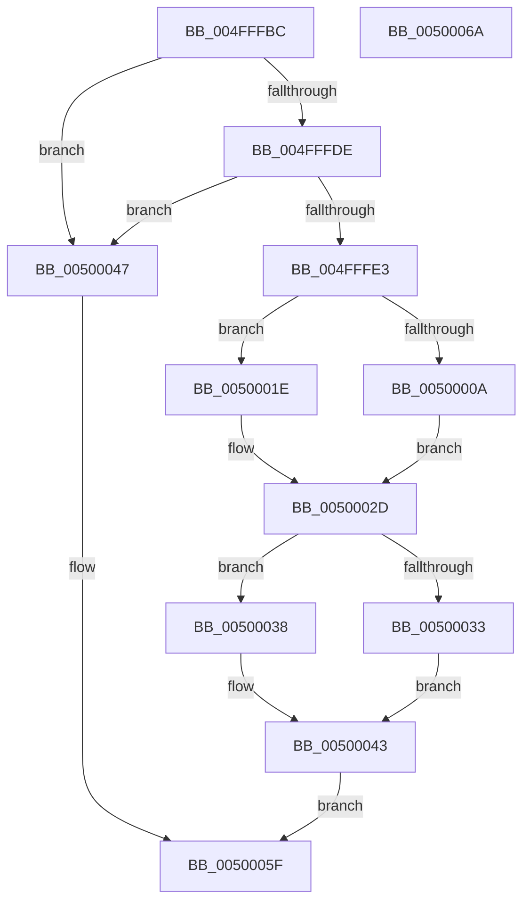

# vswprintf_l

- RVA: `0x004FFFBC`–`0x0050006B` (길이 `175` bytes)
- VA: `0x00000001404FFFBC`
- 실행 섹션: `.text`
- PDB 이름 있음: `예`; PDB Function 태그: `아니요`
- unwind 정보 RVA: `0x0009EAB4`
- 디코드: `52`개 명령, `175/175` bytes 표시
- 미해석 바이트: `0` (있으면 어셈블리에 `.byte`로 보존)

> 이 문서는 커널 이미지의 기계어와 PDB 기호를 분석해 생성했습니다. 4번과 5번은 함수 원형과 자료형을 바이너리 사용 방식에서 추정한 C 해석이며 원본 소스 복구 결과는 아닙니다.

## 1. Dependencies

- 직접 호출 지점: **4**; 고유 호출 대상: **3**
- 직접 호출자로 확인된 함수: **1**
- RIP 상대 이미지 참조: **0**

### Outgoing calls
- `0x004FFFFD` → [woutput_l](../50/woutput_l_function_0050293C.md) (function, `0x0050293C`)
- `0x00500024` → [flsbuf](../50/flsbuf_function_0050292C.md) (function, `0x0050292C`)
- `0x0050003E` → [flsbuf](../50/flsbuf_function_0050292C.md) (function, `0x0050292C`)
- `0x00500057` → [EmpCheckErrataList](../49/EmpCheckErrataList_function_0049E550.md) (function, `0x0049E550`)

### Direct callers
- [vswprintf](vswprintf_function_004FFFA0.md) at `0x004FFFAA`

### Static image references
- 디코드된 RIP-relative 메모리 참조가 없습니다.

## 2. Other-region calls and transfers

- 다른 실행 섹션으로 향하는 call: **0**
- 별도 외부 분기/꼬리 이동을 확인하지 못했습니다.

## 3. Assembly (complete function range)

```asm
004FFFBC  48 89 5C 24 08                  mov qword ptr [rsp + 8], rbx
004FFFC1  55                              push rbp
004FFFC2  48 8B EC                        mov rbp, rsp
004FFFC5  48 83 EC 60                     sub rsp, 0x60
004FFFC9  83 65 DC 00                     and dword ptr [rbp - 0x24], 0
004FFFCD  0F 57 C0                        xorps xmm0, xmm0
004FFFD0  83 65 FC 00                     and dword ptr [rbp - 4], 0
004FFFD4  F3 0F 7F 45 EC                  movdqu xmmword ptr [rbp - 0x14], xmm0
004FFFD9  48 85 D2                        test rdx, rdx
004FFFDC  74 69                           je 0x140500047
004FFFDE  48 85 C9                        test rcx, rcx
004FFFE1  74 64                           je 0x140500047
004FFFE3  48 89 4D E0                     mov qword ptr [rbp - 0x20], rcx
004FFFE7  48 89 4D D0                     mov qword ptr [rbp - 0x30], rcx
004FFFEB  48 8D 4D D0                     lea rcx, [rbp - 0x30]
004FFFEF  C7 45 E8 42 00 00 00            mov dword ptr [rbp - 0x18], 0x42
004FFFF6  C7 45 D8 FF FF FF 7F            mov dword ptr [rbp - 0x28], 0x7fffffff
004FFFFD  E8 3A 29 00 00                  call 0x14050293c
00500002  83 6D D8 01                     sub dword ptr [rbp - 0x28], 1
00500006  8B D8                           mov ebx, eax
00500008  78 14                           js 0x14050001e
0050000A  48 8B 4D D0                     mov rcx, qword ptr [rbp - 0x30]
0050000E  C6 01 00                        mov byte ptr [rcx], 0
00500011  48 8B 4D D0                     mov rcx, qword ptr [rbp - 0x30]
00500015  48 FF C1                        inc rcx
00500018  48 89 4D D0                     mov qword ptr [rbp - 0x30], rcx
0050001C  EB 0F                           jmp 0x14050002d
0050001E  48 8D 55 D0                     lea rdx, [rbp - 0x30]
00500022  33 C9                           xor ecx, ecx
00500024  E8 03 29 00 00                  call 0x14050292c
00500029  48 8B 4D D0                     mov rcx, qword ptr [rbp - 0x30]
0050002D  83 6D D8 01                     sub dword ptr [rbp - 0x28], 1
00500031  78 05                           js 0x140500038
00500033  C6 01 00                        mov byte ptr [rcx], 0
00500036  EB 0B                           jmp 0x140500043
00500038  48 8D 55 D0                     lea rdx, [rbp - 0x30]
0050003C  33 C9                           xor ecx, ecx
0050003E  E8 E9 28 00 00                  call 0x14050292c
00500043  8B C3                           mov eax, ebx
00500045  EB 18                           jmp 0x14050005f
00500047  48 83 64 24 20 00               and qword ptr [rsp + 0x20], 0
0050004D  45 33 C9                        xor r9d, r9d
00500050  45 33 C0                        xor r8d, r8d
00500053  33 D2                           xor edx, edx
00500055  33 C9                           xor ecx, ecx
00500057  E8 F4 E4 F9 FF                  call 0x14049e550
0050005C  83 C8 FF                        or eax, 0xffffffff
0050005F  48 8B 5C 24 70                  mov rbx, qword ptr [rsp + 0x70]
00500064  48 83 C4 60                     add rsp, 0x60
00500068  5D                              pop rbp
00500069  C3                              ret
0050006A  CC                              int3
```

## 4. C-style interpretation (structured pseudocode)

```c
__int64 __fastcall vswprintf_l(__int64 a1, __int64 a2, int a3, int a4)
{
    __int64 result;
    __int64 v_rsp;
    unsigned __int64 v_stack_m1C;
    unsigned int v_stack_m20;
    unsigned __int64 v_stack_m28;
    unsigned int v_stack_m2C;
    unsigned int v_stack_m30;
    unsigned __int64 v_stack_m38;
    unsigned __int64 v_stack_m48;
    unsigned int v_stack_mC;
    unsigned __int64 v_stack_p8;

    v_stack_p8 = v_rbx;
    v_rsp = (v_rsp) - (96);
    v_stack_m1C = v_xmm0;
    if (a2 == 0) goto loc_00500047;
    if (a1 == 0) goto loc_00500047;
    v_stack_m28 = a1;
    v_stack_m38 = a1;
    v_stack_m20 = 66;
    v_stack_m30 = 0x7FFFFFFFULL;
    result = woutput_l(v_stack_m38, a2, a3, a4);
    if (sign_flag) goto loc_0050001E;
    *(unsigned __int8 *)(v_stack_m38) = 0;
    a1 = (v_stack_m38) + 1;
    v_stack_m38 = a1;
    goto loc_0050002D;
loc_0050001E:
    a1 = 0;
    result = flsbuf(a1, v_stack_m38, a3, a4);
loc_0050002D:
    if (sign_flag) goto loc_00500038;
    *(unsigned __int8 *)(v_stack_m38) = 0;
    goto loc_00500043;
loc_00500038:
    a1 = 0;
    result = flsbuf(a1, v_stack_m38, a3, a4);
loc_00500043:
    goto loc_0050005F;
loc_00500047:
    a4 = 0;
    a3 = 0;
    a2 = 0;
    a1 = 0;
    result = EmpCheckErrataList(a1, a2, a3, a4);
    result = (unsigned int)((result) | (0xFFFFFFFFULL));
loc_0050005F:
    v_rsp = (v_rsp) + (96);
    return result;
}
```

## 5. (Beta) C Style

```c
int64_t vswprintf_l(int64_t Arg1, int64_t Arg2, int32_t Arg3, int32_t Arg4)
{
    int64_t result;
    int64_t local_rsp;
    uint64_t v_stack_m1C;
    uint32_t v_stack_m20;
    uint64_t v_stack_m28;
    uint32_t v_stack_m2C;
    uint32_t v_stack_m30;
    uint64_t v_stack_m38;
    uint64_t v_stack_m48;
    uint32_t v_stack_mC;
    uint64_t v_stack_p8;

    v_stack_p8 = local_rbx;
    local_rsp = (local_rsp) - (96);
    v_stack_m1C = v_xmm0;
    if (Arg2 == 0) goto loc_00500047;
    if (Arg1 == 0) goto loc_00500047;
    v_stack_m28 = Arg1;
    v_stack_m38 = Arg1;
    v_stack_m20 = 66;
    v_stack_m30 = 0x7FFFFFFFULL;
    result = woutput_l(v_stack_m38, Arg2, Arg3, Arg4);
    if (sign_flag) goto loc_0050001E;
    *(uint8_t *)(v_stack_m38) = 0;
    Arg1 = (v_stack_m38) + 1;
    v_stack_m38 = Arg1;
    goto loc_0050002D;
loc_0050001E:
    Arg1 = 0;
    result = flsbuf(Arg1, v_stack_m38, Arg3, Arg4);
loc_0050002D:
    if (sign_flag) goto loc_00500038;
    *(uint8_t *)(v_stack_m38) = 0;
    goto loc_00500043;
loc_00500038:
    Arg1 = 0;
    result = flsbuf(Arg1, v_stack_m38, Arg3, Arg4);
loc_00500043:
    goto loc_0050005F;
loc_00500047:
    Arg4 = 0;
    Arg3 = 0;
    Arg2 = 0;
    Arg1 = 0;
    result = EmpCheckErrataList(Arg1, Arg2, Arg3, Arg4);
    result = (uint32_t)((result) | (0xFFFFFFFFULL));
loc_0050005F:
    local_rsp = (local_rsp) + (96);
    return result;
}
```

## 6. Execution-region graph

[열기: 2D/3D 그래프와 함수 탐색 컨트롤 패널](../../../control-panel.html?section=text&rva=0x004FFFBC&view=graph)

- 2D 그래프는 위에서 아래로 흐르고, 3D 그래프는 빈 공간을 드래그해 회전합니다. Shift+드래그는 이동, 휠은 확대·축소, 함수 노드 선택은 대상 보고서 이동입니다.

### Static fallback


