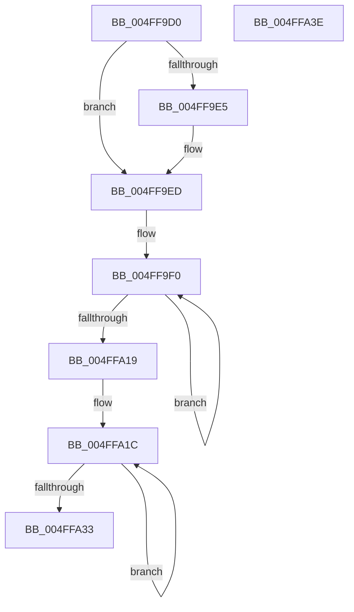

# xtoa

- RVA: `0x004FF9D0`–`0x004FFA3F` (길이 `111` bytes)
- VA: `0x00000001404FF9D0`
- 실행 섹션: `.text`
- PDB 이름 있음: `예`; PDB Function 태그: `예`
- unwind 정보 RVA: `0x000950EC`
- 디코드: `38`개 명령, `111/111` bytes 표시
- 미해석 바이트: `0` (있으면 어셈블리에 `.byte`로 보존)

> 이 문서는 커널 이미지의 기계어와 PDB 기호를 분석해 생성했습니다. 4번과 5번은 함수 원형과 자료형을 바이너리 사용 방식에서 추정한 C 해석이며 원본 소스 복구 결과는 아닙니다.

## 1. Dependencies

- 직접 호출 지점: **0**; 고유 호출 대상: **0**
- 직접 호출자로 확인된 함수: **1**
- RIP 상대 이미지 참조: **0**

### Outgoing calls
- 직접 디코드된 call 명령이 없습니다.

### Direct callers
- [itoa](itoa_function_004FF9A0.md) at `0x004FF9BA`

### Static image references
- 디코드된 RIP-relative 메모리 참조가 없습니다.

## 2. Other-region calls and transfers

- 다른 실행 섹션으로 향하는 call: **0**
- 별도 외부 분기/꼬리 이동을 확인하지 못했습니다.

## 3. Assembly (complete function range)

```asm
004FF9D0  48 89 5C 24 08                  mov qword ptr [rsp + 8], rbx
004FF9D5  48 89 7C 24 10                  mov qword ptr [rsp + 0x10], rdi
004FF9DA  41 8B D8                        mov ebx, r8d
004FF9DD  4C 8B D2                        mov r10, rdx
004FF9E0  45 85 C9                        test r9d, r9d
004FF9E3  74 08                           je 0x1404ff9ed
004FF9E5  49 FF C2                        inc r10
004FF9E8  C6 02 2D                        mov byte ptr [rdx], 0x2d
004FF9EB  F7 D9                           neg ecx
004FF9ED  4D 8B C2                        mov r8, r10
004FF9F0  33 D2                           xor edx, edx
004FF9F2  4D 8D 5A 01                     lea r11, [r10 + 1]
004FF9F6  8B C1                           mov eax, ecx
004FF9F8  4D 8B CA                        mov r9, r10
004FF9FB  F7 F3                           div ebx
004FF9FD  8B C8                           mov ecx, eax
004FF9FF  83 FA 09                        cmp edx, 9
004FFA02  B8 57 00 00 00                  mov eax, 0x57
004FFA07  8D 78 D9                        lea edi, [rax - 0x27]
004FFA0A  0F 46 C7                        cmovbe eax, edi
004FFA0D  02 C2                           add al, dl
004FFA0F  41 88 02                        mov byte ptr [r10], al
004FFA12  4D 8B D3                        mov r10, r11
004FFA15  85 C9                           test ecx, ecx
004FFA17  75 D7                           jne 0x1404ff9f0
004FFA19  41 88 0B                        mov byte ptr [r11], cl
004FFA1C  41 8A 00                        mov al, byte ptr [r8]
004FFA1F  41 8A 09                        mov cl, byte ptr [r9]
004FFA22  41 88 01                        mov byte ptr [r9], al
004FFA25  49 FF C9                        dec r9
004FFA28  41 88 08                        mov byte ptr [r8], cl
004FFA2B  49 FF C0                        inc r8
004FFA2E  4D 3B C1                        cmp r8, r9
004FFA31  72 E9                           jb 0x1404ffa1c
004FFA33  48 8B 5C 24 08                  mov rbx, qword ptr [rsp + 8]
004FFA38  48 8B 7C 24 10                  mov rdi, qword ptr [rsp + 0x10]
004FFA3D  C3                              ret
004FFA3E  CC                              int3
```

## 4. C-style interpretation (structured pseudocode)

```c
__int64 __fastcall xtoa(int a1, __int64 a2, int a3, int a4)
{
    __int64 result;
    __int64 v_r10;
    unsigned __int64 v_stack_p10;
    unsigned __int64 v_stack_p8;

    v_stack_p8 = v_rbx;
    v_stack_p10 = v_rdi;
    v_r10 = a2;
    if (a4 != 0) {
        v_r10 = (a2) + 1;
        *(unsigned __int8 *)(a2) = 45;
        a1 = (unsigned int)(-(a1));
    }
loc_004FF9F0:
    a2 = 0;
    result = 87;
    if (0 <= 9) { result = (unsigned int)(87 - 39); }
    result = (unsigned __int8)((result) + (0));
    *(unsigned __int8 *)(v_r10) = (unsigned __int8)(result);
    if ((unsigned int)((unsigned int)((unsigned int)((unsigned int)(a1)))) != 0) goto loc_004FF9F0;
    *(unsigned __int8 *)(v_r10 + 1) = (unsigned __int8)((unsigned int)((unsigned int)((unsigned int)(a1))));
loc_004FFA1C:
    *(unsigned __int8 *)(v_r10) = (unsigned __int8)(*(unsigned __int8 *)(v_r10));
    a4 = (v_r10) - 1;
    *(unsigned __int8 *)(v_r10) = (unsigned __int8)(*(unsigned __int8 *)(v_r10));
    a3 = (v_r10) + 1;
    if (a3 < a4) goto loc_004FFA1C;
    return *(unsigned __int8 *)(v_r10);
}
```

## 5. (Beta) C Style

```c
int64_t xtoa(int32_t Arg1, void *Arg2, int32_t Arg3, int32_t Arg4)
{
    uint8_t *arg2 = (uint8_t *)Arg2;

    int64_t result;
    int64_t local_r10;
    uint64_t v_stack_p10;
    uint64_t v_stack_p8;

    v_stack_p8 = local_rbx;
    v_stack_p10 = local_rdi;
    local_r10 = Arg2;
    if (Arg4 != 0) {
        local_r10 = (Arg2) + 1;
        *(uint8_t *)(arg2) = 45;
        Arg1 = (uint32_t)(-(Arg1));
    }
loc_004FF9F0:
    Arg2 = 0;
    result = 87;
    if (0 <= 9) { result = (uint32_t)(87 - 39); }
    result = (uint8_t)((result) + (0));
    *(uint8_t *)(local_r10) = (uint8_t)(result);
    if ((uint32_t)((uint32_t)((uint32_t)((uint32_t)(Arg1)))) != 0) goto loc_004FF9F0;
    *(uint8_t *)(local_r10 + 0x1) = (uint8_t)((uint32_t)((uint32_t)((uint32_t)(Arg1))));
loc_004FFA1C:
    *(uint8_t *)(local_r10) = (uint8_t)(*(uint8_t *)(local_r10));
    Arg4 = (local_r10) - 1;
    *(uint8_t *)(local_r10) = (uint8_t)(*(uint8_t *)(local_r10));
    Arg3 = (local_r10) + 1;
    if (Arg3 < Arg4) goto loc_004FFA1C;
    return *(uint8_t *)(local_r10);
}
```

### 관측된 메모리 오프셋

구조체 형식이 확인되지 않은 접근은 인자 기준의 오프셋으로만 기록했습니다.

| 기준 인자 | 오프셋 표현 | 폭 (bit) | 접근 |
|---|---:|---:|---|
| `Arg2` | `+ 0x0` | `8` | `W` |

## 6. Execution-region graph

[열기: 2D/3D 그래프와 함수 탐색 컨트롤 패널](../../../control-panel.html?section=text&rva=0x004FF9D0&view=graph)

- 2D 그래프는 위에서 아래로 흐르고, 3D 그래프는 빈 공간을 드래그해 회전합니다. Shift+드래그는 이동, 휠은 확대·축소, 함수 노드 선택은 대상 보고서 이동입니다.

### Static fallback


