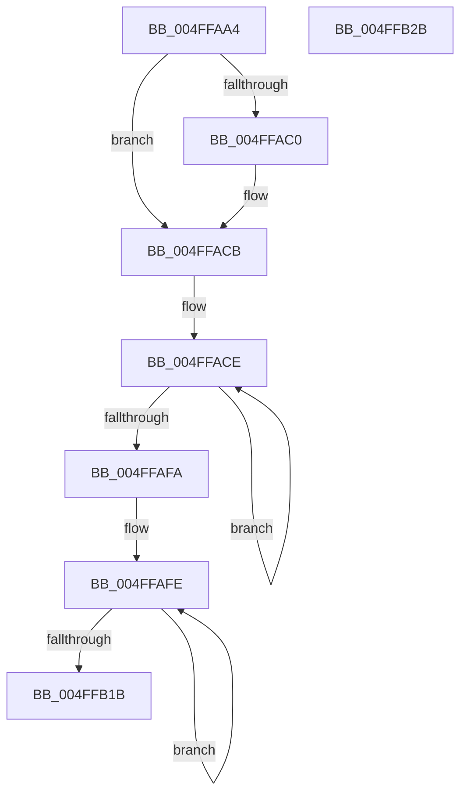

# xtow

- RVA: `0x004FFAA4`–`0x004FFB2C` (길이 `136` bytes)
- VA: `0x00000001404FFAA4`
- 실행 섹션: `.text`
- PDB 이름 있음: `예`; PDB Function 태그: `예`
- unwind 정보 RVA: `0x00069588`
- 디코드: `41`개 명령, `136/136` bytes 표시
- 미해석 바이트: `0` (있으면 어셈블리에 `.byte`로 보존)

> 이 문서는 커널 이미지의 기계어와 PDB 기호를 분석해 생성했습니다. 4번과 5번은 함수 원형과 자료형을 바이너리 사용 방식에서 추정한 C 해석이며 원본 소스 복구 결과는 아닙니다.

## 1. Dependencies

- 직접 호출 지점: **0**; 고유 호출 대상: **0**
- 직접 호출자로 확인된 함수: **2**
- RIP 상대 이미지 참조: **0**

### Outgoing calls
- 직접 디코드된 call 명령이 없습니다.

### Direct callers
- [itow](itow_function_004FFA50.md) at `0x004FFA6A`
- [ultow](ultow_function_004FFA80.md) at `0x004FFA8C`

### Static image references
- 디코드된 RIP-relative 메모리 참조가 없습니다.

## 2. Other-region calls and transfers

- 다른 실행 섹션으로 향하는 call: **0**
- 별도 외부 분기/꼬리 이동을 확인하지 못했습니다.

## 3. Assembly (complete function range)

```asm
004FFAA4  48 89 5C 24 08                  mov qword ptr [rsp + 8], rbx
004FFAA9  48 89 74 24 10                  mov qword ptr [rsp + 0x10], rsi
004FFAAE  48 89 7C 24 18                  mov qword ptr [rsp + 0x18], rdi
004FFAB3  33 F6                           xor esi, esi
004FFAB5  41 8B D8                        mov ebx, r8d
004FFAB8  4C 8B D2                        mov r10, rdx
004FFABB  45 85 C9                        test r9d, r9d
004FFABE  74 0B                           je 0x1404ffacb
004FFAC0  49 83 C2 02                     add r10, 2
004FFAC4  66 C7 02 2D 00                  mov word ptr [rdx], 0x2d
004FFAC9  F7 D9                           neg ecx
004FFACB  4D 8B C2                        mov r8, r10
004FFACE  33 D2                           xor edx, edx
004FFAD0  4D 8D 5A 02                     lea r11, [r10 + 2]
004FFAD4  8B C1                           mov eax, ecx
004FFAD6  4D 8B CA                        mov r9, r10
004FFAD9  F7 F3                           div ebx
004FFADB  8B C8                           mov ecx, eax
004FFADD  83 FA 09                        cmp edx, 9
004FFAE0  B8 57 00 00 00                  mov eax, 0x57
004FFAE5  8D 78 D9                        lea edi, [rax - 0x27]
004FFAE8  66 0F 46 C7                     cmovbe ax, di
004FFAEC  66 03 C2                        add ax, dx
004FFAEF  66 41 89 02                     mov word ptr [r10], ax
004FFAF3  4D 8B D3                        mov r10, r11
004FFAF6  85 C9                           test ecx, ecx
004FFAF8  75 D4                           jne 0x1404fface
004FFAFA  66 41 89 33                     mov word ptr [r11], si
004FFAFE  41 0F B7 00                     movzx eax, word ptr [r8]
004FFB02  41 0F B7 09                     movzx ecx, word ptr [r9]
004FFB06  66 41 89 01                     mov word ptr [r9], ax
004FFB0A  49 83 E9 02                     sub r9, 2
004FFB0E  66 41 89 08                     mov word ptr [r8], cx
004FFB12  49 83 C0 02                     add r8, 2
004FFB16  4D 3B C1                        cmp r8, r9
004FFB19  72 E3                           jb 0x1404ffafe
004FFB1B  48 8B 5C 24 08                  mov rbx, qword ptr [rsp + 8]
004FFB20  48 8B 74 24 10                  mov rsi, qword ptr [rsp + 0x10]
004FFB25  48 8B 7C 24 18                  mov rdi, qword ptr [rsp + 0x18]
004FFB2A  C3                              ret
004FFB2B  CC                              int3
```

## 4. C-style interpretation (structured pseudocode)

```c
__int64 __fastcall xtow(int a1, __int64 a2, int a3, int a4)
{
    __int64 result;
    __int64 v_r10;
    __int64 v_rsi;
    unsigned __int64 v_stack_p10;
    unsigned __int64 v_stack_p18;
    unsigned __int64 v_stack_p8;

    v_stack_p8 = v_rbx;
    v_stack_p10 = v_rsi;
    v_stack_p18 = v_rdi;
    v_rsi = 0;
    v_r10 = a2;
    if (a4 != 0) {
        v_r10 = (a2) + (2);
        *(unsigned __int16 *)(a2) = 45;
        a1 = (unsigned int)(-(a1));
    }
loc_004FFACE:
    a2 = 0;
    result = 87;
    if (0 <= 9) { result = (unsigned __int16)(87 - 39); }
    result = (unsigned __int16)((result) + (0));
    *(unsigned __int16 *)(v_r10) = (unsigned __int16)(result);
    if ((unsigned int)((unsigned int)((unsigned int)((unsigned int)(a1)))) != 0) goto loc_004FFACE;
    *(unsigned __int16 *)(v_r10 + 2) = 0;
loc_004FFAFE:
    *(unsigned __int16 *)(v_r10) = (unsigned __int16)(*(unsigned __int16 *)(v_r10));
    a4 = (v_r10) - (2);
    *(unsigned __int16 *)(v_r10) = (unsigned __int16)(*(unsigned __int16 *)(v_r10));
    a3 = (v_r10) + (2);
    if (a3 < a4) goto loc_004FFAFE;
    return *(unsigned __int16 *)(v_r10);
}
```

## 5. (Beta) C Style

```c
int64_t xtow(int32_t Arg1, void *Arg2, int32_t Arg3, int32_t Arg4)
{
    uint8_t *arg2 = (uint8_t *)Arg2;

    int64_t result;
    int64_t local_r10;
    int64_t local_rsi;
    uint64_t v_stack_p10;
    uint64_t v_stack_p18;
    uint64_t v_stack_p8;

    v_stack_p8 = local_rbx;
    v_stack_p10 = local_rsi;
    v_stack_p18 = local_rdi;
    local_rsi = 0;
    local_r10 = Arg2;
    if (Arg4 != 0) {
        local_r10 = (Arg2) + (2);
        *(uint16_t *)(arg2) = 45;
        Arg1 = (uint32_t)(-(Arg1));
    }
loc_004FFACE:
    Arg2 = 0;
    result = 87;
    if (0 <= 9) { result = (uint16_t)(87 - 39); }
    result = (uint16_t)((result) + (0));
    *(uint16_t *)(local_r10) = (uint16_t)(result);
    if ((uint32_t)((uint32_t)((uint32_t)((uint32_t)(Arg1)))) != 0) goto loc_004FFACE;
    *(uint16_t *)(local_r10 + 0x2) = 0;
loc_004FFAFE:
    *(uint16_t *)(local_r10) = (uint16_t)(*(uint16_t *)(local_r10));
    Arg4 = (local_r10) - (2);
    *(uint16_t *)(local_r10) = (uint16_t)(*(uint16_t *)(local_r10));
    Arg3 = (local_r10) + (2);
    if (Arg3 < Arg4) goto loc_004FFAFE;
    return *(uint16_t *)(local_r10);
}
```

### 관측된 메모리 오프셋

구조체 형식이 확인되지 않은 접근은 인자 기준의 오프셋으로만 기록했습니다.

| 기준 인자 | 오프셋 표현 | 폭 (bit) | 접근 |
|---|---:|---:|---|
| `Arg2` | `+ 0x0` | `16` | `R` |
| `Arg2` | `+ 0x0` | `16` | `W` |
| `Arg2` | `+ 0x2` | `64` | `R` |

## 6. Execution-region graph

[열기: 2D/3D 그래프와 함수 탐색 컨트롤 패널](../../../control-panel.html?section=text&rva=0x004FFAA4&view=graph)

- 2D 그래프는 위에서 아래로 흐르고, 3D 그래프는 빈 공간을 드래그해 회전합니다. Shift+드래그는 이동, 휠은 확대·축소, 함수 노드 선택은 대상 보고서 이동입니다.

### Static fallback


