# CcBcbProfiler

- RVA: `0x005099B0`–`0x00509D91` (길이 `993` bytes)
- VA: `0x00000001405099B0`
- 실행 섹션: `.text`
- PDB 이름 있음: `예`; PDB Function 태그: `아니요`
- unwind 정보 RVA: `0x000C2CE0`
- 디코드: `251`개 명령, `993/993` bytes 표시
- 미해석 바이트: `0` (있으면 어셈블리에 `.byte`로 보존)

> 이 문서는 커널 이미지의 기계어와 PDB 기호를 분석해 생성했습니다. 4번과 5번은 함수 원형과 자료형을 바이너리 사용 방식에서 추정한 C 해석이며 원본 소스 복구 결과는 아닙니다.

## 1. Dependencies

- 직접 호출 지점: **9**; 고유 호출 대상: **7**
- 직접 호출자로 확인된 함수: **0**
- RIP 상대 이미지 참조: **11**

### Outgoing calls
- `0x005099CF` → [KeExitRetpoline](../46/KeExitRetpoline_function_00468E7C.md) (function, `0x00468E7C`)
- `0x005099E9` → [ExQueueWorkItem](../2F/ExQueueWorkItem_function_002F9520.md) (function, `0x002F9520`)
- `0x00509B43` → [ExGenRandom](../41/ExGenRandom_function_0041B010.md) (function, `0x0041B010`)
- `0x00509B71` → [ExGenRandom](../41/ExGenRandom_function_0041B010.md) (function, `0x0041B010`)
- `0x00509B9C` → [KeSetCoalescableTimer](../22/KeSetCoalescableTimer_function_0022FFD0.md) (function, `0x0022FFD0`)
- `0x00509C01` → [VslVerifyPage](../58/VslVerifyPage_function_0058F900.md) (function, `0x0058F900`)
- `0x00509C37` → [VslVerifyPage](../58/VslVerifyPage_function_0058F900.md) (function, `0x0058F900`)
- `0x00509D1C` → [ExTryAcquireSpinLockExclusiveAtDpcLevel](../2B/ExTryAcquireSpinLockExclusiveAtDpcLevel_function_002BB800.md) (function, `0x002BB800`)
- `0x00509D8B` → [CcAdjustBcbDepth](../6B/CcAdjustBcbDepth_function_006BC740.md) (function, `0x006BC740`)

### Direct callers
- 이 함수 시작 RVA로 연결되는 직접 call은 확인되지 않았습니다. 간접 호출은 완전히 역산할 수 없습니다.

### Static image references
- `0x00509C7F` → RVA `0x00028A88` (`.rdata`; read)
- `0x00509C8A` → RVA `0x00028A90` (`.rdata`; read)
- `0x00509C95` → RVA `0x00028AA0` (`.rdata`; read)
- `0x00509CAA` → RVA `0x00FC507C` (`ALMOSTRO`; read)
- `0x00509CC0` → RVA `0x00028A98` (`.rdata`; read)
- `0x00509CD7` → RVA `0x00FC51D4` (`ALMOSTRO`; read)
- `0x00509CF2` → RVA `0x00028AD0` (`.rdata`; read)
- `0x00509CFD` → RVA `0x00028AE8` (`.rdata`; read)
- `0x00509D04` → RVA `0x00FCF200` (`CACHEALI`; read)
- `0x00509D10` → RVA `0x00028AF8` (`.rdata`; read)
- `0x00509D5A` → RVA `0x004FD660` (`KeBugCheckEx`; read)

## 2. Other-region calls and transfers

- 다른 실행 섹션으로 향하는 call: **0**
- 별도 외부 분기/꼬리 이동을 확인하지 못했습니다.

## 3. Assembly (complete function range)

```asm
005099B0  48 89 5C 24 08                  mov qword ptr [rsp + 8], rbx
005099B5  48 89 6C 24 18                  mov qword ptr [rsp + 0x18], rbp
005099BA  48 89 74 24 20                  mov qword ptr [rsp + 0x20], rsi
005099BF  57                              push rdi
005099C0  41 54                           push r12
005099C2  41 55                           push r13
005099C4  41 56                           push r14
005099C6  41 57                           push r15
005099C8  48 83 EC 50                     sub rsp, 0x50
005099CC  48 8B F2                        mov rsi, rdx
005099CF  E8 A8 F4 F5 FF                  call 0x140468e7c
005099D4  83 BE AC 00 00 00 00            cmp dword ptr [rsi + 0xac], 0
005099DB  74 30                           je 0x140509a0d
005099DD  48 8D 8E B8 00 00 00            lea rcx, [rsi + 0xb8]
005099E4  BA 01 00 00 00                  mov edx, 1
005099E9  E8 32 FB DE FF                  call 0x1402f9520
005099EE  4C 8D 5C 24 50                  lea r11, [rsp + 0x50]
005099F3  49 8B 5B 30                     mov rbx, qword ptr [r11 + 0x30]
005099F7  49 8B 6B 40                     mov rbp, qword ptr [r11 + 0x40]
005099FB  49 8B 73 48                     mov rsi, qword ptr [r11 + 0x48]
005099FF  49 8B E3                        mov rsp, r11
00509A02  41 5F                           pop r15
00509A04  41 5E                           pop r14
00509A06  41 5D                           pop r13
00509A08  41 5C                           pop r12
00509A0A  5F                              pop rdi
00509A0B  C3                              ret
00509A0C  CC                              int3
00509A0D  4C 8B 96 80 00 00 00            mov r10, qword ptr [rsi + 0x80]
00509A14  44 8B 86 90 00 00 00            mov r8d, dword ptr [rsi + 0x90]
00509A1B  44 0F B6 B6 A8 00 00 00         movzx r14d, byte ptr [rsi + 0xa8]
00509A23  41 8B C8                        mov ecx, r8d
00509A26  4C 8B A6 A0 00 00 00            mov r12, qword ptr [rsi + 0xa0]
00509A2D  41 8B DE                        mov ebx, r14d
00509A30  45 8B 3A                        mov r15d, dword ptr [r10]
00509A33  4C 03 BE 88 00 00 00            add r15, qword ptr [rsi + 0x88]
00509A3A  48 89 8C 24 88 00 00 00         mov qword ptr [rsp + 0x88], rcx
00509A42  4D 8B CF                        mov r9, r15
00509A45  49 03 CF                        add rcx, r15
00509A48  49 8B C7                        mov rax, r15
00509A4B  4C 3B F9                        cmp r15, rcx
00509A4E  73 0C                           jae 0x140509a5c
00509A50  0F 18 00                        prefetchnta byte ptr [rax]
00509A53  48 83 C0 40                     add rax, 0x40
00509A57  48 3B C1                        cmp rax, rcx
00509A5A  72 F4                           jb 0x140509a50
00509A5C  45 8B D8                        mov r11d, r8d
00509A5F  BD 01 00 00 00                  mov ebp, 1
00509A64  41 C1 EB 07                     shr r11d, 7
00509A68  49 8B FC                        mov rdi, r12
00509A6B  44 8D 6D 07                     lea r13d, [rbp + 7]
00509A6F  45 85 DB                        test r11d, r11d
00509A72  74 51                           je 0x140509ac5
00509A74  49 8B C5                        mov rax, r13
00509A77  49 33 39                        xor rdi, qword ptr [r9]
00509A7A  8B CB                           mov ecx, ebx
00509A7C  4D 03 CD                        add r9, r13
00509A7F  48 D3 C7                        rol rdi, cl
00509A82  49 33 39                        xor rdi, qword ptr [r9]
00509A85  4D 03 CD                        add r9, r13
00509A88  48 D3 C7                        rol rdi, cl
00509A8B  48 2B C5                        sub rax, rbp
00509A8E  75 E7                           jne 0x140509a77
00509A90  49 8B C9                        mov rcx, r9
00509A93  49 2B CF                        sub rcx, r15
00509A96  49 33 CC                        xor rcx, r12
00509A99  48 8B C1                        mov rax, rcx
00509A9C  48 C1 C0 11                     rol rax, 0x11
00509AA0  48 33 C8                        xor rcx, rax
00509AA3  48 B8 01 20 00 04 80 00 10 70   movabs rax, 0x7010008004002001
00509AAD  48 F7 E1                        mul rcx
00509AB0  33 C2                           xor eax, edx
00509AB2  48 89 54 24 48                  mov qword ptr [rsp + 0x48], rdx
00509AB7  33 D8                           xor ebx, eax
00509AB9  83 E3 3F                        and ebx, 0x3f
00509ABC  0F 44 DD                        cmove ebx, ebp
00509ABF  41 83 C3 FF                     add r11d, -1
00509AC3  75 AF                           jne 0x140509a74
00509AC5  41 83 E0 7F                     and r8d, 0x7f
00509AC9  45 3B C5                        cmp r8d, r13d
00509ACC  72 1B                           jb 0x140509ae9
00509ACE  41 8B C0                        mov eax, r8d
00509AD1  48 C1 E8 03                     shr rax, 3
00509AD5  49 33 39                        xor rdi, qword ptr [r9]
00509AD8  8B CB                           mov ecx, ebx
00509ADA  48 D3 C7                        rol rdi, cl
00509ADD  4D 03 CD                        add r9, r13
00509AE0  41 83 C0 F8                     add r8d, -8
00509AE4  48 2B C5                        sub rax, rbp
00509AE7  75 EC                           jne 0x140509ad5
00509AE9  45 85 C0                        test r8d, r8d
00509AEC  74 15                           je 0x140509b03
00509AEE  41 0F B6 01                     movzx eax, byte ptr [r9]
00509AF2  8B CB                           mov ecx, ebx
00509AF4  48 33 F8                        xor rdi, rax
00509AF7  4C 03 CD                        add r9, rbp
00509AFA  48 D3 C7                        rol rdi, cl
00509AFD  41 83 C0 FF                     add r8d, -1
00509B01  75 EB                           jne 0x140509aee
00509B03  49 8D 4A 0C                     lea rcx, [r10 + 0xc]
00509B07  49 8B C2                        mov rax, r10
00509B0A  4C 3B D1                        cmp r10, rcx
00509B0D  73 0C                           jae 0x140509b1b
00509B0F  0F 18 00                        prefetchnta byte ptr [rax]
00509B12  48 83 C0 40                     add rax, 0x40
00509B16  48 3B C1                        cmp rax, rcx
00509B19  72 F4                           jb 0x140509b0f
00509B1B  49 33 3A                        xor rdi, qword ptr [r10]
00509B1E  41 8B CE                        mov ecx, r14d
00509B21  48 D3 C7                        rol rdi, cl
00509B24  BA 04 00 00 00                  mov edx, 4
00509B29  4D 03 D5                        add r10, r13
00509B2C  41 0F B6 02                     movzx eax, byte ptr [r10]
00509B30  41 8B CE                        mov ecx, r14d
00509B33  48 33 F8                        xor rdi, rax
00509B36  4C 03 D5                        add r10, rbp
00509B39  48 D3 C7                        rol rdi, cl
00509B3C  83 C2 FF                        add edx, -1
00509B3F  75 EB                           jne 0x140509b2c
00509B41  8B CD                           mov ecx, ebp
00509B43  E8 C8 14 F1 FF                  call 0x14041b010
00509B48  8B C8                           mov ecx, eax
00509B4A  48 C7 C3 00 74 79 B8            mov rbx, 0xffffffffb8797400
00509B51  48 B8 FD CE 61 84 11 77 CC AB   movabs rax, 0xabcc77118461cefd
00509B5B  48 F7 E1                        mul rcx
00509B5E  48 C1 EA 1A                     shr rdx, 0x1a
00509B62  48 69 C2 00 E1 F5 05            imul rax, rdx, 0x5f5e100
00509B69  48 2B C8                        sub rcx, rax
00509B6C  48 2B D9                        sub rbx, rcx
00509B6F  8B CD                           mov ecx, ebp
00509B71  E8 9A 14 F1 FF                  call 0x14041b010
00509B76  44 8B C8                        mov r9d, eax
00509B79  48 89 74 24 20                  mov qword ptr [rsp + 0x20], rsi
00509B7E  B8 59 17 B7 D1                  mov eax, 0xd1b71759
00509B83  48 8D 4E 40                     lea rcx, [rsi + 0x40]
00509B87  41 F7 E1                        mul r9d
00509B8A  45 33 C0                        xor r8d, r8d
00509B8D  C1 EA 0D                        shr edx, 0xd
00509B90  69 C2 10 27 00 00               imul eax, edx, 0x2710
00509B96  48 8B D3                        mov rdx, rbx
00509B99  44 2B C8                        sub r9d, eax
00509B9C  E8 2F 64 D2 FF                  call 0x14022ffd0
00509BA1  48 3B BE 98 00 00 00            cmp rdi, qword ptr [rsi + 0x98]
00509BA8  0F 84 40 FE FF FF               je 0x1405099ee
00509BAE  83 BE B0 00 00 00 00            cmp dword ptr [rsi + 0xb0], 0
00509BB5  0F 84 BA 00 00 00               je 0x140509c75
00509BBB  48 8B 84 24 88 00 00 00         mov rax, qword ptr [rsp + 0x88]
00509BC3  44 8B AE AC 00 00 00            mov r13d, dword ptr [rsi + 0xac]
00509BCA  48 85 C0                        test rax, rax
00509BCD  0F 84 A2 00 00 00               je 0x140509c75
00509BD3  44 0F 20 C7                     mov rdi, cr8
00509BD7  B9 02 00 00 00                  mov ecx, 2
00509BDC  44 0F 22 C1                     mov cr8, rcx
00509BE0  49 8B DF                        mov rbx, r15
00509BE3  4C 8D 60 FF                     lea r12, [rax - 1]
00509BE7  48 81 E3 00 F0 FF FF            and rbx, 0xfffffffffffff000
00509BEE  4D 03 E7                        add r12, r15
00509BF1  49 81 CC FF 0F 00 00            or r12, 0xfff
00509BF8  4C 8D 73 FF                     lea r14, [rbx - 1]
00509BFC  33 D2                           xor edx, edx
00509BFE  48 8B CB                        mov rcx, rbx
00509C01  E8 FA 5C 08 00                  call 0x14058f900
00509C06  3D 2D 02 00 C0                  cmp eax, 0xc000022d
00509C0B  75 36                           jne 0x140509c43
00509C0D  40 0F B6 F7                     movzx esi, dil
00509C11  45 85 ED                        test r13d, r13d
00509C14  74 51                           je 0x140509c67
00509C16  40 3A FD                        cmp dil, bpl
00509C19  77 2C                           ja 0x140509c47
00509C1B  40 0F B6 F7                     movzx esi, dil
00509C1F  44 0F 22 C6                     mov cr8, rsi
00509C23  8A 03                           mov al, byte ptr [rbx]
00509C25  44 0F 20 C0                     mov rax, cr8
00509C29  B8 02 00 00 00                  mov eax, 2
00509C2E  44 0F 22 C0                     mov cr8, rax
00509C32  33 D2                           xor edx, edx
00509C34  48 8B CB                        mov rcx, rbx
00509C37  E8 C4 5C 08 00                  call 0x14058f900
00509C3C  3D 2D 02 00 C0                  cmp eax, 0xc000022d
00509C41  74 CE                           je 0x140509c11
00509C43  85 C0                           test eax, eax
00509C45  78 26                           js 0x140509c6d
00509C47  48 81 C3 00 10 00 00            add rbx, 0x1000
00509C4E  49 81 C6 00 10 00 00            add r14, 0x1000
00509C55  4D 3B F4                        cmp r14, r12
00509C58  75 A2                           jne 0x140509bfc
00509C5A  40 0F B6 C7                     movzx eax, dil
00509C5E  44 0F 22 C0                     mov cr8, rax
00509C62  E9 87 FD FF FF                  jmp 0x1405099ee
00509C67  44 0F 22 C6                     mov cr8, rsi
00509C6B  EB 08                           jmp 0x140509c75
00509C6D  40 0F B6 C7                     movzx eax, dil
00509C71  44 0F 22 C0                     mov cr8, rax
00509C75  FA                              cli
00509C76  65 48 8B 14 25 20 00 00 00      mov rdx, qword ptr gs:[0x20]
00509C7F  48 8B 05 02 EE B1 FF            mov rax, qword ptr [rip - 0x4e11fe]
00509C86  48 8B 1C 02                     mov rbx, qword ptr [rdx + rax]
00509C8A  48 8B 05 FF ED B1 FF            mov rax, qword ptr [rip - 0x4e1201]
00509C91  4C 8B 04 02                     mov r8, qword ptr [rdx + rax]
00509C95  48 8B 05 04 EE B1 FF            mov rax, qword ptr [rip - 0x4e11fc]
00509C9C  4C 8B 0C 02                     mov r9, qword ptr [rdx + rax]
00509CA0  48 8D 44 24 40                  lea rax, [rsp + 0x40]
00509CA5  48 3B C3                        cmp rax, rbx
00509CA8  77 16                           ja 0x140509cc0
00509CAA  8B 05 CC B3 AB 00               mov eax, dword ptr [rip + 0xabb3cc]
00509CB0  48 8B CB                        mov rcx, rbx
00509CB3  48 2B C8                        sub rcx, rax
00509CB6  48 8D 44 24 40                  lea rax, [rsp + 0x40]
00509CBB  48 3B C1                        cmp rax, rcx
00509CBE  73 3D                           jae 0x140509cfd
00509CC0  48 8B 05 D1 ED B1 FF            mov rax, qword ptr [rip - 0x4e122f]
00509CC7  80 3C 02 00                     cmp byte ptr [rdx + rax], 0
00509CCB  74 25                           je 0x140509cf2
00509CCD  48 8D 44 24 40                  lea rax, [rsp + 0x40]
00509CD2  49 3B C0                        cmp rax, r8
00509CD5  77 1B                           ja 0x140509cf2
00509CD7  8B 05 F7 B4 AB 00               mov eax, dword ptr [rip + 0xabb4f7]
00509CDD  49 8B C8                        mov rcx, r8
00509CE0  48 2B C8                        sub rcx, rax
00509CE3  48 8D 44 24 40                  lea rax, [rsp + 0x40]
00509CE8  48 3B C1                        cmp rax, rcx
00509CEB  72 05                           jb 0x140509cf2
00509CED  49 8B D8                        mov rbx, r8
00509CF0  EB 0B                           jmp 0x140509cfd
00509CF2  48 8B 05 D7 ED B1 FF            mov rax, qword ptr [rip - 0x4e1229]
00509CF9  4A 8B 1C 08                     mov rbx, qword ptr [rax + r9]
00509CFD  48 8B 05 E4 ED B1 FF            mov rax, qword ptr [rip - 0x4e121c]
00509D04  48 8D 0D F5 54 AC 00            lea rcx, [rip + 0xac54f5]
00509D0B  4A 83 24 08 00                  and qword ptr [rax + r9], 0
00509D10  48 8B 05 E1 ED B1 FF            mov rax, qword ptr [rip - 0x4e121f]
00509D17  4A 83 24 08 00                  and qword ptr [rax + r9], 0
00509D1C  E8 DF 1A DB FF                  call 0x1402bb800
00509D21  C7 84 24 88 00 00 00 00 00 06 01  mov dword ptr [rsp + 0x88], 0x1060000
00509D2C  48 B8 74 14 9D 16 39 12 EB 07   movabs rax, 0x7eb1239169d1474
00509D36  44 8B 84 24 88 00 00 00         mov r8d, dword ptr [rsp + 0x88]
00509D3E  4D 8B CF                        mov r9, r15
00509D41  48 89 84 24 88 00 00 00         mov qword ptr [rsp + 0x88], rax
00509D49  48 8D 43 F8                     lea rax, [rbx - 8]
00509D4D  48 8B 94 24 88 00 00 00         mov rdx, qword ptr [rsp + 0x88]
00509D55  48 89 44 24 30                  mov qword ptr [rsp + 0x30], rax
00509D5A  48 8D 05 FF 38 FF FF            lea rax, [rip - 0xc701]
00509D61  41 C1 C8 90                     ror r8d, 0x90
00509D65  48 89 44 24 28                  mov qword ptr [rsp + 0x28], rax
00509D6A  4C 89 44 24 20                  mov qword ptr [rsp + 0x20], r8
00509D6F  45 33 C0                        xor r8d, r8d
00509D72  C7 84 24 88 00 00 00 00 00 90 10  mov dword ptr [rsp + 0x88], 0x10900000
00509D7D  8B 8C 24 88 00 00 00            mov ecx, dword ptr [rsp + 0x88]
00509D84  48 C1 CA 8D                     ror rdx, 0x8d
00509D88  C1 C1 8C                        rol ecx, 0x8c
00509D8B  E8 B0 29 1B 00                  call 0x1406bc740
00509D90  CC                              int3
```

## 4. C-style interpretation (structured pseudocode)

```c
__int64 __fastcall CcBcbProfiler(__int64 a1, __int64 a2)
{
    __int64 result;
    __int64 v_r10;
    __int64 v_r11;
    __int64 v_r12;
    __int64 v_r14;
    __int64 v_r15;
    __int64 v_rbx;
    __int64 v_rdi;
    __int64 v_rsp;
    unsigned __int64 v_stack_m10;
    unsigned __int64 v_stack_m20;
    unsigned __int64 v_stack_m28;
    unsigned __int64 v_stack_m30;
    unsigned __int64 v_stack_m8;
    unsigned __int64 v_stack_p18;
    unsigned __int64 v_stack_p20;
    unsigned __int64 v_stack_p38;
    unsigned __int64 v_stack_p8;

    v_stack_p8 = v_rbx;
    v_stack_p18 = v_rbp;
    v_stack_p20 = v_rsi;
    v_rsp = (v_rsp) - (80);
    result = KeExitRetpoline(a1, a2, a3, a4);
    if ((*(unsigned int *)(a2 + 172)) == 0) goto loc_00509A0D;
    result = ExQueueWorkItem(a2 + 184, 1, a3, a4);
loc_005099EE:
    return result;
loc_00509A0D:
    v_r15 = ((unsigned int)(*(unsigned int *)(*(unsigned __int64 *)(*(unsigned __int64 *)(v_stack_m28 + 72) + 128)))) + (*(unsigned __int64 *)(*(unsigned __int64 *)(v_stack_m28 + 72) + 136));
    v_stack_p38 = (unsigned int)((unsigned int)((unsigned int)(*(unsigned int *)(*(unsigned __int64 *)(v_stack_m28 + 72) + 144))));
    a1 = ((unsigned int)((unsigned int)((unsigned int)(*(unsigned int *)(*(unsigned __int64 *)(v_stack_m28 + 72) + 144))))) + (v_r15);
    if (v_r15 >= a1) goto loc_00509A5C;
loc_00509A50:
    result = (v_r15) + (64);
    if (result < a1) goto loc_00509A50;
loc_00509A5C:
    v_r11 = (unsigned int)(((unsigned int)((unsigned int)((unsigned int)(*(unsigned int *)(*(unsigned __int64 *)(v_stack_m28 + 72) + 144))))) >> (7));
    if ((unsigned int)(v_r11) == 0) goto loc_00509AC5;
loc_00509A74:
loc_00509A77:
    v_rdi = (*(unsigned __int64 *)(*(unsigned __int64 *)(v_stack_m28 + 72) + 160)) ^ (*(unsigned __int64 *)(v_r15));
    a4 = (v_r15) + (1 + 7);
    v_rdi = (v_rdi) ^ (*(unsigned __int64 *)(a4));
    a4 = (a4) + (1 + 7);
    result = (1 + 7) - (1);
    if (condition_is_not_equal) goto loc_00509A77;
    a1 = (a4) - (v_r15);
    a1 = (a1) ^ (*(unsigned __int64 *)(*(unsigned __int64 *)(v_stack_m28 + 72) + 160));
    a1 = (a1) ^ (a1);
    result = (unsigned int)((a1) ^ (1));
    v_stack_m8 = 1;
    v_rbx = (unsigned int)(((unsigned int)((unsigned int)(*(unsigned __int8 *)(*(unsigned __int64 *)(v_stack_m28 + 72) + 168)))) ^ ((unsigned int)(result)));
    v_rbx = (unsigned int)((v_rbx) & (63));
    if (condition_is_equal) { v_rbx = 1; }
    v_r11 = (unsigned int)((v_r11) + (-1));
    if (condition_is_not_equal) goto loc_00509A74;
loc_00509AC5:
    a3 = (unsigned int)(((unsigned int)(*(unsigned int *)(*(unsigned __int64 *)(v_stack_m28 + 72) + 144))) & (127));
    if (((unsigned int)(a3)) < ((unsigned int)(1 + 7))) goto loc_00509AE9;
    result = ((unsigned int)((unsigned int)(a3))) >> (3);
loc_00509AD5:
    v_rdi = (v_rdi) ^ (*(unsigned __int64 *)(a4));
    a4 = (a4) + (1 + 7);
    a3 = (unsigned int)((a3) + (-8));
    result = (result) - (1);
    if (condition_is_not_equal) goto loc_00509AD5;
loc_00509AE9:
    if ((unsigned int)(a3) == 0) goto loc_00509B03;
loc_00509AEE:
    v_rdi = (v_rdi) ^ (*(unsigned __int8 *)(a4));
    a4 = (a4) + (1);
    a3 = (unsigned int)((a3) + (-1));
    if (condition_is_not_equal) goto loc_00509AEE;
loc_00509B03:
    if ((*(unsigned __int64 *)(*(unsigned __int64 *)(v_stack_m28 + 72) + 128)) >= (*(unsigned __int64 *)(*(unsigned __int64 *)(v_stack_m28 + 72) + 128) + 12)) goto loc_00509B1B;
loc_00509B0F:
    result = (*(unsigned __int64 *)(*(unsigned __int64 *)(v_stack_m28 + 72) + 128)) + (64);
    if (result < (*(unsigned __int64 *)(*(unsigned __int64 *)(v_stack_m28 + 72) + 128) + 12)) goto loc_00509B0F;
loc_00509B1B:
    v_rdi = (v_rdi) ^ (*(unsigned __int64 *)(*(unsigned __int64 *)(*(unsigned __int64 *)(v_stack_m28 + 72) + 128)));
    v_r10 = (*(unsigned __int64 *)(*(unsigned __int64 *)(v_stack_m28 + 72) + 128)) + (1 + 7);
loc_00509B2C:
    v_rdi = (v_rdi) ^ (*(unsigned __int8 *)(v_r10));
    v_r10 = (v_r10) + (1);
    a2 = (unsigned int)((4) + (-1));
    if (condition_is_not_equal) goto loc_00509B2C;
    result = ExGenRandom(1, a2, a3, a4);
    a2 = (a2) >> (26);
    result = (result) * (a2);
    a1 = ((unsigned int)((unsigned int)(result))) - (result);
    v_rbx = (0xFFFFFFFFB8797400ULL) - (a1);
    result = ExGenRandom(1, a2, a3, a4);
    v_stack_m30 = *(unsigned __int64 *)(v_stack_m28 + 72);
    a3 = 0;
    a2 = (unsigned int)((a2) >> (13));
    result = (unsigned int)(((unsigned int)(0xD1B71759ULL)) * ((unsigned int)(a2)));
    a4 = (unsigned int)(((unsigned int)((unsigned int)(result))) - ((unsigned int)(result)));
    result = KeSetCoalescableTimer(*(unsigned __int64 *)(v_stack_m28 + 72) + 64, v_rbx, a3, a4);
    if (v_rdi == (*(unsigned __int64 *)(*(unsigned __int64 *)(v_stack_m28 + 72) + 152))) goto loc_005099EE;
    if ((*(unsigned int *)(*(unsigned __int64 *)(v_stack_m28 + 72) + 176)) == 0) goto loc_00509C75;
    if (v_stack_p38 == 0) goto loc_00509C75;
    v_rbx = (v_r15) & (0xFFFFFFFFFFFFF000ULL);
    v_r12 = (v_stack_p38 - 1) + (v_r15);
    v_r12 = (v_r12) | (0xFFFULL);
loc_00509BFC:
    a2 = 0;
    result = VslVerifyPage(v_rbx, a2, a3, a4);
    if (((unsigned int)(result)) != 0xC000022DULL) goto loc_00509C43;
loc_00509C11:
    if ((unsigned int)((unsigned int)(*(unsigned int *)(*(unsigned __int64 *)(v_stack_m28 + 72) + 172))) == 0) goto loc_00509C67;
    if (((unsigned __int8)(v_cr8)) > 1) goto loc_00509C47;
    a2 = 0;
    result = VslVerifyPage(v_rbx, a2, a3, a4);
    if (((unsigned int)(result)) == 0xC000022DULL) goto loc_00509C11;
loc_00509C43:
    if (sign_flag) goto loc_00509C6D;
loc_00509C47:
    v_rbx = (v_rbx) + (0x1000ULL);
    v_r14 = (v_rbx - 1) + (0x1000ULL);
    if (v_r14 != v_r12) goto loc_00509BFC;
    goto loc_005099EE;
loc_00509C67:
    goto loc_00509C75;
loc_00509C6D:
loc_00509C75:
    if (v_stack_m10 > (*(unsigned __int64 *)(*(unsigned __int64 *)(gs_base + (0 + 32)) + *(unsigned __int64 *)(v_rip - 5116414) * 1))) goto loc_00509CC0;
    a1 = (*(unsigned __int64 *)(*(unsigned __int64 *)(gs_base + (0 + 32)) + *(unsigned __int64 *)(v_rip - 5116414) * 1)) - ((unsigned int)(*(unsigned int *)(v_rip + 11252684)));
    if (v_stack_m10 >= a1) goto loc_00509CFD;
loc_00509CC0:
    if ((*(unsigned __int8 *)(*(unsigned __int64 *)(gs_base + (0 + 32)) + *(unsigned __int64 *)(v_rip - 5116463) * 1)) == 0) goto loc_00509CF2;
    if (v_stack_m10 > (*(unsigned __int64 *)(*(unsigned __int64 *)(gs_base + (0 + 32)) + *(unsigned __int64 *)(v_rip - 5116417) * 1))) goto loc_00509CF2;
    a1 = (*(unsigned __int64 *)(*(unsigned __int64 *)(gs_base + (0 + 32)) + *(unsigned __int64 *)(v_rip - 5116417) * 1)) - ((unsigned int)(*(unsigned int *)(v_rip + 11252983)));
    if (v_stack_m10 < a1) goto loc_00509CF2;
    goto loc_00509CFD;
loc_00509CF2:
loc_00509CFD:
    result = ExTryAcquireSpinLockExclusiveAtDpcLevel(v_rip + 11293941, *(unsigned __int64 *)(gs_base + (0 + 32)), *(unsigned __int64 *)(*(unsigned __int64 *)(gs_base + (0 + 32)) + *(unsigned __int64 *)(v_rip - 5116417) * 1), *(unsigned __int64 *)(*(unsigned __int64 *)(gs_base + (0 + 32)) + *(unsigned __int64 *)(v_rip - 5116412) * 1));
    v_stack_p38 = 0x1060000ULL;
    v_stack_p38 = result;
    v_stack_m20 = *(unsigned __int64 *)(*(unsigned __int64 *)(v_rip - 5116457) + *(unsigned __int64 *)(*(unsigned __int64 *)(gs_base + (0 + 32)) + *(unsigned __int64 *)(v_rip - 5116412) * 1) * 1) - 8;
    v_stack_m28 = v_rip - 50945;
    v_stack_m30 = (unsigned int)(v_stack_p38);
    a3 = 0;
    v_stack_p38 = 0x10900000ULL;
    result = CcAdjustBcbDepth((unsigned int)(v_stack_p38), v_stack_p38, a3, v_r15);
    return result;
}
```

## 5. (Beta) C Style

```c
int64_t CcBcbProfiler(int64_t Arg1, void *Arg2)
{
    uint8_t *arg2 = (uint8_t *)Arg2;

    int64_t result;
    int64_t local_r10;
    int64_t local_r11;
    int64_t local_r12;
    int64_t local_r14;
    int64_t local_r15;
    int64_t local_rbx;
    int64_t local_rdi;
    int64_t local_rsp;
    uint64_t v_stack_m10;
    uint64_t v_stack_m20;
    uint64_t v_stack_m28;
    uint64_t v_stack_m30;
    uint64_t v_stack_m8;
    uint64_t v_stack_p18;
    uint64_t v_stack_p20;
    uint64_t v_stack_p38;
    uint64_t v_stack_p8;

    v_stack_p8 = local_rbx;
    v_stack_p18 = local_rbp;
    v_stack_p20 = local_rsi;
    local_rsp = (local_rsp) - (80);
    result = KeExitRetpoline(Arg1, Arg2, a3, a4);
    if ((*(uint32_t *)(arg2 + 0xAC)) == 0) goto loc_00509A0D;
    result = ExQueueWorkItem(Arg2 + 184, 1, a3, a4);
loc_005099EE:
    return result;
loc_00509A0D:
    local_r15 = ((uint32_t)(*(uint32_t *)(*(uint64_t *)(*(uint64_t *)(v_stack_m28 + 0x48) + 0x80)))) + (*(uint64_t *)(*(uint64_t *)(v_stack_m28 + 0x48) + 0x88));
    v_stack_p38 = (uint32_t)((uint32_t)((uint32_t)(*(uint32_t *)(*(uint64_t *)(v_stack_m28 + 0x48) + 0x90))));
    Arg1 = ((uint32_t)((uint32_t)((uint32_t)(*(uint32_t *)(*(uint64_t *)(v_stack_m28 + 0x48) + 0x90))))) + (local_r15);
    if (local_r15 >= Arg1) goto loc_00509A5C;
loc_00509A50:
    result = (local_r15) + (64);
    if (result < Arg1) goto loc_00509A50;
loc_00509A5C:
    local_r11 = (uint32_t)(((uint32_t)((uint32_t)((uint32_t)(*(uint32_t *)(*(uint64_t *)(v_stack_m28 + 0x48) + 0x90))))) >> (7));
    if ((uint32_t)(local_r11) == 0) goto loc_00509AC5;
loc_00509A74:
loc_00509A77:
    local_rdi = (*(uint64_t *)(*(uint64_t *)(v_stack_m28 + 0x48) + 0xA0)) ^ (*(uint64_t *)(local_r15));
    a4 = (local_r15) + (1 + 7);
    local_rdi = (local_rdi) ^ (*(uint64_t *)(a4));
    a4 = (a4) + (1 + 7);
    result = (1 + 7) - (1);
    if (condition_is_not_equal) goto loc_00509A77;
    Arg1 = (a4) - (local_r15);
    Arg1 = (Arg1) ^ (*(uint64_t *)(*(uint64_t *)(v_stack_m28 + 0x48) + 0xA0));
    Arg1 = (Arg1) ^ (Arg1);
    result = (uint32_t)((Arg1) ^ (1));
    v_stack_m8 = 1;
    local_rbx = (uint32_t)(((uint32_t)((uint32_t)(*(uint8_t *)(*(uint64_t *)(v_stack_m28 + 0x48) + 0xA8)))) ^ ((uint32_t)(result)));
    local_rbx = (uint32_t)((local_rbx) & (63));
    if (condition_is_equal) { local_rbx = 1; }
    local_r11 = (uint32_t)((local_r11) + (-1));
    if (condition_is_not_equal) goto loc_00509A74;
loc_00509AC5:
    a3 = (uint32_t)(((uint32_t)(*(uint32_t *)(*(uint64_t *)(v_stack_m28 + 0x48) + 0x90))) & (127));
    if (((uint32_t)(a3)) < ((uint32_t)(1 + 7))) goto loc_00509AE9;
    result = ((uint32_t)((uint32_t)(a3))) >> (3);
loc_00509AD5:
    local_rdi = (local_rdi) ^ (*(uint64_t *)(a4));
    a4 = (a4) + (1 + 7);
    a3 = (uint32_t)((a3) + (-8));
    result = (result) - (1);
    if (condition_is_not_equal) goto loc_00509AD5;
loc_00509AE9:
    if ((uint32_t)(a3) == 0) goto loc_00509B03;
loc_00509AEE:
    local_rdi = (local_rdi) ^ (*(uint8_t *)(a4));
    a4 = (a4) + (1);
    a3 = (uint32_t)((a3) + (-1));
    if (condition_is_not_equal) goto loc_00509AEE;
loc_00509B03:
    if ((*(uint64_t *)(*(uint64_t *)(v_stack_m28 + 0x48) + 0x80)) >= (*(uint64_t *)(*(uint64_t *)(v_stack_m28 + 0x48) + 0x80) + 12)) goto loc_00509B1B;
loc_00509B0F:
    result = (*(uint64_t *)(*(uint64_t *)(v_stack_m28 + 0x48) + 0x80)) + (64);
    if (result < (*(uint64_t *)(*(uint64_t *)(v_stack_m28 + 0x48) + 0x80) + 12)) goto loc_00509B0F;
loc_00509B1B:
    local_rdi = (local_rdi) ^ (*(uint64_t *)(*(uint64_t *)(*(uint64_t *)(v_stack_m28 + 0x48) + 0x80)));
    local_r10 = (*(uint64_t *)(*(uint64_t *)(v_stack_m28 + 0x48) + 0x80)) + (1 + 7);
loc_00509B2C:
    local_rdi = (local_rdi) ^ (*(uint8_t *)(local_r10));
    local_r10 = (local_r10) + (1);
    Arg2 = (uint32_t)((4) + (-1));
    if (condition_is_not_equal) goto loc_00509B2C;
    result = ExGenRandom(1, Arg2, a3, a4);
    Arg2 = (Arg2) >> (26);
    result = (result) * (Arg2);
    Arg1 = ((uint32_t)((uint32_t)(result))) - (result);
    local_rbx = (0xFFFFFFFFB8797400ULL) - (Arg1);
    result = ExGenRandom(1, Arg2, a3, a4);
    v_stack_m30 = *(uint64_t *)(v_stack_m28 + 0x48);
    a3 = 0;
    Arg2 = (uint32_t)((Arg2) >> (13));
    result = (uint32_t)(((uint32_t)(0xD1B71759ULL)) * ((uint32_t)(Arg2)));
    a4 = (uint32_t)(((uint32_t)((uint32_t)(result))) - ((uint32_t)(result)));
    result = KeSetCoalescableTimer(*(uint64_t *)(v_stack_m28 + 0x48) + 64, local_rbx, a3, a4);
    if (local_rdi == (*(uint64_t *)(*(uint64_t *)(v_stack_m28 + 0x48) + 0x98))) goto loc_005099EE;
    if ((*(uint32_t *)(*(uint64_t *)(v_stack_m28 + 0x48) + 0xB0)) == 0) goto loc_00509C75;
    if (v_stack_p38 == 0) goto loc_00509C75;
    local_rbx = (local_r15) & (0xFFFFFFFFFFFFF000ULL);
    local_r12 = (v_stack_p38 - 1) + (local_r15);
    local_r12 = (local_r12) | (0xFFFULL);
loc_00509BFC:
    Arg2 = 0;
    result = VslVerifyPage(local_rbx, Arg2, a3, a4);
    if (((uint32_t)(result)) != 0xC000022DULL) goto loc_00509C43;
loc_00509C11:
    if ((uint32_t)((uint32_t)(*(uint32_t *)(*(uint64_t *)(v_stack_m28 + 0x48) + 0xAC))) == 0) goto loc_00509C67;
    if (((uint8_t)(v_cr8)) > 1) goto loc_00509C47;
    Arg2 = 0;
    result = VslVerifyPage(local_rbx, Arg2, a3, a4);
    if (((uint32_t)(result)) == 0xC000022DULL) goto loc_00509C11;
loc_00509C43:
    if (sign_flag) goto loc_00509C6D;
loc_00509C47:
    local_rbx = (local_rbx) + (0x1000ULL);
    local_r14 = (local_rbx - 1) + (0x1000ULL);
    if (local_r14 != local_r12) goto loc_00509BFC;
    goto loc_005099EE;
loc_00509C67:
    goto loc_00509C75;
loc_00509C6D:
loc_00509C75:
    if (v_stack_m10 > (*(uint64_t *)(*(uint64_t *)(gs_base + (0 + 0x20)) + *(uint64_t *)(v_rip - 0x4E11FE) * 1))) goto loc_00509CC0;
    Arg1 = (*(uint64_t *)(*(uint64_t *)(gs_base + (0 + 0x20)) + *(uint64_t *)(v_rip - 0x4E11FE) * 1)) - ((uint32_t)(*(uint32_t *)(v_rip + 0xABB3CC)));
    if (v_stack_m10 >= Arg1) goto loc_00509CFD;
loc_00509CC0:
    if ((*(uint8_t *)(*(uint64_t *)(gs_base + (0 + 0x20)) + *(uint64_t *)(v_rip - 0x4E122F) * 1)) == 0) goto loc_00509CF2;
    if (v_stack_m10 > (*(uint64_t *)(*(uint64_t *)(gs_base + (0 + 0x20)) + *(uint64_t *)(v_rip - 0x4E1201) * 1))) goto loc_00509CF2;
    Arg1 = (*(uint64_t *)(*(uint64_t *)(gs_base + (0 + 0x20)) + *(uint64_t *)(v_rip - 0x4E1201) * 1)) - ((uint32_t)(*(uint32_t *)(v_rip + 0xABB4F7)));
    if (v_stack_m10 < Arg1) goto loc_00509CF2;
    goto loc_00509CFD;
loc_00509CF2:
loc_00509CFD:
    result = ExTryAcquireSpinLockExclusiveAtDpcLevel(v_rip + 11293941, *(uint64_t *)(gs_base + (0 + 0x20)), *(uint64_t *)(*(uint64_t *)(gs_base + (0 + 0x20)) + *(uint64_t *)(v_rip - 0x4E1201) * 1), *(uint64_t *)(*(uint64_t *)(gs_base + (0 + 0x20)) + *(uint64_t *)(v_rip - 0x4E11FC) * 1));
    v_stack_p38 = 0x1060000ULL;
    v_stack_p38 = result;
    v_stack_m20 = *(uint64_t *)(*(uint64_t *)(v_rip - 0x4E1229) + *(uint64_t *)(*(uint64_t *)(gs_base + (0 + 0x20)) + *(uint64_t *)(v_rip - 0x4E11FC) * 1) * 1) - 8;
    v_stack_m28 = v_rip - 50945;
    v_stack_m30 = (uint32_t)(v_stack_p38);
    a3 = 0;
    v_stack_p38 = 0x10900000ULL;
    result = CcAdjustBcbDepth((uint32_t)(v_stack_p38), v_stack_p38, a3, local_r15);
    return result;
}
```

### 관측된 메모리 오프셋

구조체 형식이 확인되지 않은 접근은 인자 기준의 오프셋으로만 기록했습니다.

| 기준 인자 | 오프셋 표현 | 폭 (bit) | 접근 |
|---|---:|---:|---|
| `Arg2` | `+ 0x40` | `64` | `R` |
| `Arg2` | `+ 0x80` | `64` | `R` |
| `Arg2` | `+ 0x88` | `64` | `R` |
| `Arg2` | `+ 0x90` | `32` | `R` |
| `Arg2` | `+ 0x98` | `64` | `R` |
| `Arg2` | `+ 0xA0` | `64` | `R` |
| `Arg2` | `+ 0xA8` | `8` | `R` |
| `Arg2` | `+ 0xAC` | `32` | `R` |
| `Arg2` | `+ 0xB0` | `32` | `R` |
| `Arg2` | `+ 0xB8` | `64` | `R` |

## 6. Execution-region graph

[열기: 2D/3D 그래프와 함수 탐색 컨트롤 패널](../../../control-panel.html?section=text&rva=0x005099B0&view=graph)

- 2D 그래프는 위에서 아래로 흐르고, 3D 그래프는 빈 공간을 드래그해 회전합니다. Shift+드래그는 이동, 휠은 확대·축소, 함수 노드 선택은 대상 보고서 이동입니다.

### Static fallback

```mermaid
flowchart TD
  bb_005099B0[BB_005099B0]
  bb_005099DD[BB_005099DD]
  bb_005099EE[BB_005099EE]
  bb_00509A0C[BB_00509A0C]
  bb_00509A0D[BB_00509A0D]
  bb_00509A50[BB_00509A50]
  bb_00509A5C[BB_00509A5C]
  bb_00509A74[BB_00509A74]
  bb_00509A77[BB_00509A77]
  bb_00509A90[BB_00509A90]
  bb_00509AC5[BB_00509AC5]
  bb_00509ACE[BB_00509ACE]
  bb_00509AD5[BB_00509AD5]
  bb_00509AE9[BB_00509AE9]
  bb_00509AEE[BB_00509AEE]
  bb_00509B03[BB_00509B03]
  bb_00509B0F[BB_00509B0F]
  bb_00509B1B[BB_00509B1B]
  bb_00509B2C[BB_00509B2C]
  bb_00509B41[BB_00509B41]
  bb_00509BAE[BB_00509BAE]
  bb_00509BBB[BB_00509BBB]
  bb_00509BD3[BB_00509BD3]
  bb_00509BFC[BB_00509BFC]
  bb_00509C0D[BB_00509C0D]
  bb_00509C11[BB_00509C11]
  bb_00509C16[BB_00509C16]
  bb_00509C1B[BB_00509C1B]
  bb_00509C43[BB_00509C43]
  bb_00509C47[BB_00509C47]
  bb_00509C5A[BB_00509C5A]
  bb_00509C67[BB_00509C67]
  bb_00509C6D[BB_00509C6D]
  bb_00509C75[BB_00509C75]
  bb_00509CAA[BB_00509CAA]
  bb_00509CC0[BB_00509CC0]
  bb_00509CCD[BB_00509CCD]
  bb_00509CD7[BB_00509CD7]
  bb_00509CED[BB_00509CED]
  bb_00509CF2[BB_00509CF2]
  bb_00509CFD[BB_00509CFD]
  bb_005099B0 -->|branch| bb_00509A0D
  bb_005099B0 -->|fallthrough| bb_005099DD
  bb_005099DD -->|flow| bb_005099EE
  bb_00509A0C -->|flow| bb_00509A0D
  bb_00509A0D -->|branch| bb_00509A5C
  bb_00509A0D -->|fallthrough| bb_00509A50
  bb_00509A50 -->|branch| bb_00509A50
  bb_00509A50 -->|fallthrough| bb_00509A5C
  bb_00509A5C -->|branch| bb_00509AC5
  bb_00509A5C -->|fallthrough| bb_00509A74
  bb_00509A74 -->|flow| bb_00509A77
  bb_00509A77 -->|branch| bb_00509A77
  bb_00509A77 -->|fallthrough| bb_00509A90
  bb_00509A90 -->|branch| bb_00509A74
  bb_00509A90 -->|fallthrough| bb_00509AC5
  bb_00509AC5 -->|branch| bb_00509AE9
  bb_00509AC5 -->|fallthrough| bb_00509ACE
  bb_00509ACE -->|flow| bb_00509AD5
  bb_00509AD5 -->|branch| bb_00509AD5
  bb_00509AD5 -->|fallthrough| bb_00509AE9
  bb_00509AE9 -->|branch| bb_00509B03
  bb_00509AE9 -->|fallthrough| bb_00509AEE
  bb_00509AEE -->|branch| bb_00509AEE
  bb_00509AEE -->|fallthrough| bb_00509B03
  bb_00509B03 -->|branch| bb_00509B1B
  bb_00509B03 -->|fallthrough| bb_00509B0F
  bb_00509B0F -->|branch| bb_00509B0F
  bb_00509B0F -->|fallthrough| bb_00509B1B
  bb_00509B1B -->|flow| bb_00509B2C
  bb_00509B2C -->|branch| bb_00509B2C
  bb_00509B2C -->|fallthrough| bb_00509B41
  bb_00509B41 -->|branch| bb_005099EE
  bb_00509B41 -->|fallthrough| bb_00509BAE
  bb_00509BAE -->|branch| bb_00509C75
  bb_00509BAE -->|fallthrough| bb_00509BBB
  bb_00509BBB -->|branch| bb_00509C75
  bb_00509BBB -->|fallthrough| bb_00509BD3
  bb_00509BD3 -->|flow| bb_00509BFC
  bb_00509BFC -->|branch| bb_00509C43
  bb_00509BFC -->|fallthrough| bb_00509C0D
  bb_00509C0D -->|flow| bb_00509C11
  bb_00509C11 -->|branch| bb_00509C67
  bb_00509C11 -->|fallthrough| bb_00509C16
  bb_00509C16 -->|branch| bb_00509C47
  bb_00509C16 -->|fallthrough| bb_00509C1B
  bb_00509C1B -->|branch| bb_00509C11
  bb_00509C1B -->|fallthrough| bb_00509C43
  bb_00509C43 -->|branch| bb_00509C6D
  bb_00509C43 -->|fallthrough| bb_00509C47
  bb_00509C47 -->|branch| bb_00509BFC
  bb_00509C47 -->|fallthrough| bb_00509C5A
  bb_00509C5A -->|branch| bb_005099EE
  bb_00509C67 -->|branch| bb_00509C75
  bb_00509C6D -->|flow| bb_00509C75
  bb_00509C75 -->|branch| bb_00509CC0
  bb_00509C75 -->|fallthrough| bb_00509CAA
  bb_00509CAA -->|branch| bb_00509CFD
  bb_00509CAA -->|fallthrough| bb_00509CC0
  bb_00509CC0 -->|branch| bb_00509CF2
  bb_00509CC0 -->|fallthrough| bb_00509CCD
  bb_00509CCD -->|branch| bb_00509CF2
  bb_00509CCD -->|fallthrough| bb_00509CD7
  bb_00509CD7 -->|branch| bb_00509CF2
  bb_00509CD7 -->|fallthrough| bb_00509CED
  bb_00509CED -->|branch| bb_00509CFD
  bb_00509CF2 -->|flow| bb_00509CFD
```


