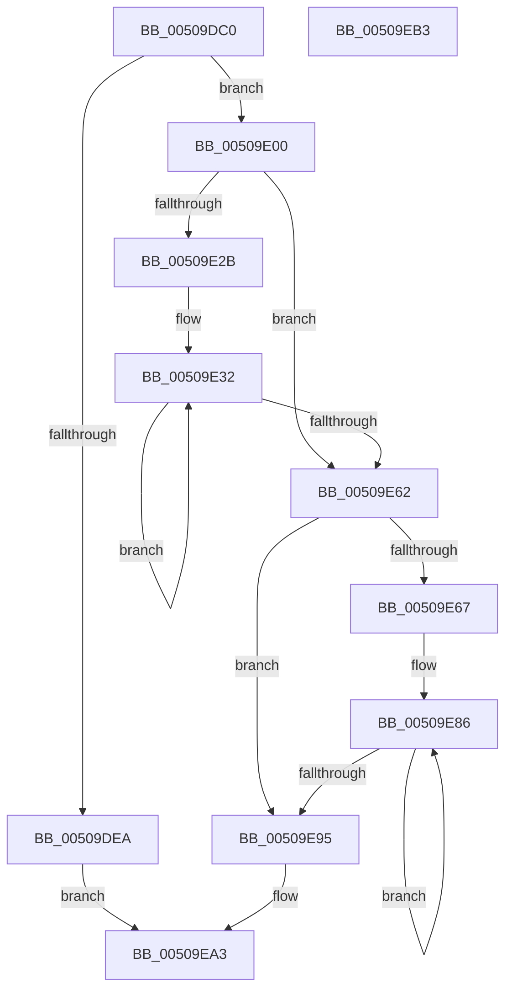

# KiDecodeMcaFault

- RVA: `0x00509DC0`–`0x00509EB4` (길이 `244` bytes)
- VA: `0x0000000140509DC0`
- 실행 섹션: `.text`
- PDB 이름 있음: `예`; PDB Function 태그: `아니요`
- unwind 정보 RVA: `0x00060BC4`
- 디코드: `67`개 명령, `244/244` bytes 표시
- 미해석 바이트: `0` (있으면 어셈블리에 `.byte`로 보존)

> 이 문서는 커널 이미지의 기계어와 PDB 기호를 분석해 생성했습니다. 4번과 5번은 함수 원형과 자료형을 바이너리 사용 방식에서 추정한 C 해석이며 원본 소스 복구 결과는 아닙니다.

## 1. Dependencies

- 직접 호출 지점: **4**; 고유 호출 대상: **3**
- 직접 호출자로 확인된 함수: **0**
- RIP 상대 이미지 참조: **0**

### Outgoing calls
- `0x00509DCF` → [FsRtlMdlReadCompleteDevEx](../../initkdbg/BD/FsRtlMdlReadCompleteDevEx_function_00BD1010.md) (function, `0x00BD1010`)
- `0x00509DE1` → [KeTestSpinLock](../41/KeTestSpinLock_function_00419C10.md) (function, `0x00419C10`)
- `0x00509DF6` → [KeGuardDispatchICall](../../initkdbg/BE/KeGuardDispatchICall_function_00BEAA60.md) (function, `0x00BEAA60`)
- `0x00509E9E` → [KeGuardDispatchICall](../../initkdbg/BE/KeGuardDispatchICall_function_00BEAA60.md) (function, `0x00BEAA60`)

### Direct callers
- 이 함수 시작 RVA로 연결되는 직접 call은 확인되지 않았습니다. 간접 호출은 완전히 역산할 수 없습니다.

### Static image references
- 디코드된 RIP-relative 메모리 참조가 없습니다.

## 2. Other-region calls and transfers

- 다른 실행 섹션으로 향하는 call: **3**
  - `0x00509DCF` → [FsRtlMdlReadCompleteDevEx](../../initkdbg/BD/FsRtlMdlReadCompleteDevEx_function_00BD1010.md) (`.text` → `INITKDBG`)
  - `0x00509DF6` → [KeGuardDispatchICall](../../initkdbg/BE/KeGuardDispatchICall_function_00BEAA60.md) (`.text` → `INITKDBG`)
  - `0x00509E9E` → [KeGuardDispatchICall](../../initkdbg/BE/KeGuardDispatchICall_function_00BEAA60.md) (`.text` → `INITKDBG`)
- 별도 외부 분기/꼬리 이동을 확인하지 못했습니다.

## 3. Assembly (complete function range)

```asm
00509DC0  48 89 5C 24 08                  mov qword ptr [rsp + 8], rbx
00509DC5  48 89 74 24 10                  mov qword ptr [rsp + 0x10], rsi
00509DCA  57                              push rdi
00509DCB  48 83 EC 20                     sub rsp, 0x20
00509DCF  E8 3C 72 6C 00                  call 0x140bd1010
00509DD4  48 8B D8                        mov rbx, rax
00509DD7  48 8D B8 20 08 00 00            lea rdi, [rax + 0x820]
00509DDE  48 8B CF                        mov rcx, rdi
00509DE1  E8 2A FE F0 FF                  call 0x140419c10
00509DE6  84 C0                           test al, al
00509DE8  75 16                           jne 0x140509e00
00509DEA  48 8B 83 80 02 00 00            mov rax, qword ptr [rbx + 0x280]
00509DF1  33 D2                           xor edx, edx
00509DF3  48 8B CF                        mov rcx, rdi
00509DF6  E8 65 0C 6E 00                  call 0x140beaa60
00509DFB  E9 A3 00 00 00                  jmp 0x140509ea3
00509E00  44 8B 8B 04 08 00 00            mov r9d, dword ptr [rbx + 0x804]
00509E07  48 BE 01 20 00 04 80 00 10 70   movabs rsi, 0x7010008004002001
00509E11  4C 8B 9B E8 07 00 00            mov r11, qword ptr [rbx + 0x7e8]
00509E18  4C 8B 83 08 01 00 00            mov r8, qword ptr [rbx + 0x108]
00509E1F  8B BB F0 07 00 00               mov edi, dword ptr [rbx + 0x7f0]
00509E25  41 83 F9 08                     cmp r9d, 8
00509E29  72 37                           jb 0x140509e62
00509E2B  45 8B D1                        mov r10d, r9d
00509E2E  49 C1 EA 03                     shr r10, 3
00509E32  0F 31                           rdtsc
00509E34  48 C1 E2 20                     shl rdx, 0x20
00509E38  41 83 C1 F8                     add r9d, -8
00509E3C  48 0B C2                        or rax, rdx
00509E3F  48 8B C8                        mov rcx, rax
00509E42  48 8B D0                        mov rdx, rax
00509E45  48 C1 C9 03                     ror rcx, 3
00509E49  48 8B C6                        mov rax, rsi
00509E4C  48 33 D1                        xor rdx, rcx
00509E4F  48 F7 E2                        mul rdx
00509E52  48 33 D0                        xor rdx, rax
00509E55  48 89 13                        mov qword ptr [rbx], rdx
00509E58  48 83 C3 08                     add rbx, 8
00509E5C  49 83 EA 01                     sub r10, 1
00509E60  75 D0                           jne 0x140509e32
00509E62  45 85 C9                        test r9d, r9d
00509E65  74 2E                           je 0x140509e95
00509E67  0F 31                           rdtsc
00509E69  48 C1 E2 20                     shl rdx, 0x20
00509E6D  48 0B C2                        or rax, rdx
00509E70  48 8B C8                        mov rcx, rax
00509E73  48 8B D0                        mov rdx, rax
00509E76  48 C1 C9 03                     ror rcx, 3
00509E7A  48 8B C6                        mov rax, rsi
00509E7D  48 33 D1                        xor rdx, rcx
00509E80  48 F7 E2                        mul rdx
00509E83  48 33 D0                        xor rdx, rax
00509E86  88 13                           mov byte ptr [rbx], dl
00509E88  48 FF C3                        inc rbx
00509E8B  48 C1 EA 08                     shr rdx, 8
00509E8F  41 83 C1 FF                     add r9d, -1
00509E93  75 F1                           jne 0x140509e86
00509E95  48 8B D7                        mov rdx, rdi
00509E98  49 8B CB                        mov rcx, r11
00509E9B  49 8B C0                        mov rax, r8
00509E9E  E8 BD 0B 6E 00                  call 0x140beaa60
00509EA3  48 8B 5C 24 30                  mov rbx, qword ptr [rsp + 0x30]
00509EA8  48 8B 74 24 38                  mov rsi, qword ptr [rsp + 0x38]
00509EAD  48 83 C4 20                     add rsp, 0x20
00509EB1  5F                              pop rdi
00509EB2  C3                              ret
00509EB3  CC                              int3
```

## 4. C-style interpretation (structured pseudocode)

```c
__int64 __fastcall KiDecodeMcaFault(__int64 a1, int a2)
{
    __int64 result;
    __int64 v_r10;
    __int64 v_rbx;
    __int64 v_rsp;
    unsigned __int64 v_stack_p10;
    unsigned __int64 v_stack_p8;

    v_stack_p8 = v_rbx;
    v_stack_p10 = v_rsi;
    v_rsp = (v_rsp) - (32);
    result = FsRtlMdlReadCompleteDevEx(a1, a2, a3, a4);
    result = KeTestSpinLock(result + 2080, a2, a3, a4);
    if ((unsigned __int8)(result) != 0) goto loc_00509E00;
    a2 = 0;
    result = KeGuardDispatchICall(result + 2080, a2, a3, a4);
    goto loc_00509EA3;
loc_00509E00:
    if (((unsigned int)((unsigned int)(*(unsigned int *)(result + 2052)))) < 8) goto loc_00509E62;
    v_r10 = ((unsigned int)((unsigned int)((unsigned int)(*(unsigned int *)(result + 2052))))) >> (3);
loc_00509E32:
    a2 = (a2) << (32);
    a4 = (unsigned int)(((unsigned int)(*(unsigned int *)(result + 2052))) + (-8));
    result = (result) | (a2);
    a2 = (result) ^ (result);
    a2 = (a2) ^ (v_rsi);
    *(unsigned __int64 *)(result) = a2;
    v_rbx = (result) + (8);
    v_r10 = (v_r10) - (1);
    if (condition_is_not_equal) goto loc_00509E32;
loc_00509E62:
    if ((unsigned int)(a4) == 0) goto loc_00509E95;
    a2 = (a2) << (32);
    result = (v_rsi) | (a2);
    a2 = (result) ^ (result);
    a2 = (a2) ^ (v_rsi);
loc_00509E86:
    *(unsigned __int8 *)(v_rbx) = (unsigned __int8)(a2);
    v_rbx = (v_rbx) + 1;
    a2 = (a2) >> (8);
    a4 = (unsigned int)((a4) + (-1));
    if (condition_is_not_equal) goto loc_00509E86;
loc_00509E95:
    result = KeGuardDispatchICall(*(unsigned __int64 *)(result + 2024), (unsigned int)(*(unsigned int *)(result + 2032)), *(unsigned __int64 *)(result + 264), a4);
loc_00509EA3:
    v_rsp = (v_rsp) + (32);
    return result;
}
```

## 5. (Beta) C Style

```c
int64_t KiDecodeMcaFault(int64_t Arg1, int32_t Arg2)
{
    int64_t result;
    int64_t local_r10;
    int64_t local_rbx;
    int64_t local_rsp;
    uint64_t v_stack_p10;
    uint64_t v_stack_p8;

    v_stack_p8 = local_rbx;
    v_stack_p10 = local_rsi;
    local_rsp = (local_rsp) - (32);
    result = FsRtlMdlReadCompleteDevEx(Arg1, Arg2, a3, a4);
    result = KeTestSpinLock(result + 2080, Arg2, a3, a4);
    if ((uint8_t)(result) != 0) goto loc_00509E00;
    Arg2 = 0;
    result = KeGuardDispatchICall(result + 2080, Arg2, a3, a4);
    goto loc_00509EA3;
loc_00509E00:
    if (((uint32_t)((uint32_t)(*(uint32_t *)(result + 0x804)))) < 8) goto loc_00509E62;
    local_r10 = ((uint32_t)((uint32_t)((uint32_t)(*(uint32_t *)(result + 0x804))))) >> (3);
loc_00509E32:
    Arg2 = (Arg2) << (32);
    a4 = (uint32_t)(((uint32_t)(*(uint32_t *)(result + 0x804))) + (-8));
    result = (result) | (Arg2);
    Arg2 = (result) ^ (result);
    Arg2 = (Arg2) ^ (local_rsi);
    *(uint64_t *)(result) = Arg2;
    local_rbx = (result) + (8);
    local_r10 = (local_r10) - (1);
    if (condition_is_not_equal) goto loc_00509E32;
loc_00509E62:
    if ((uint32_t)(a4) == 0) goto loc_00509E95;
    Arg2 = (Arg2) << (32);
    result = (local_rsi) | (Arg2);
    Arg2 = (result) ^ (result);
    Arg2 = (Arg2) ^ (local_rsi);
loc_00509E86:
    *(uint8_t *)(local_rbx) = (uint8_t)(Arg2);
    local_rbx = (local_rbx) + 1;
    Arg2 = (Arg2) >> (8);
    a4 = (uint32_t)((a4) + (-1));
    if (condition_is_not_equal) goto loc_00509E86;
loc_00509E95:
    result = KeGuardDispatchICall(*(uint64_t *)(result + 0x7E8), (uint32_t)(*(uint32_t *)(result + 0x7F0)), *(uint64_t *)(result + 0x108), a4);
loc_00509EA3:
    local_rsp = (local_rsp) + (32);
    return result;
}
```

## 6. Execution-region graph

[열기: 2D/3D 그래프와 함수 탐색 컨트롤 패널](../../../control-panel.html?section=text&rva=0x00509DC0&view=graph)

- 2D 그래프는 위에서 아래로 흐르고, 3D 그래프는 빈 공간을 드래그해 회전합니다. Shift+드래그는 이동, 휠은 확대·축소, 함수 노드 선택은 대상 보고서 이동입니다.

### Static fallback


