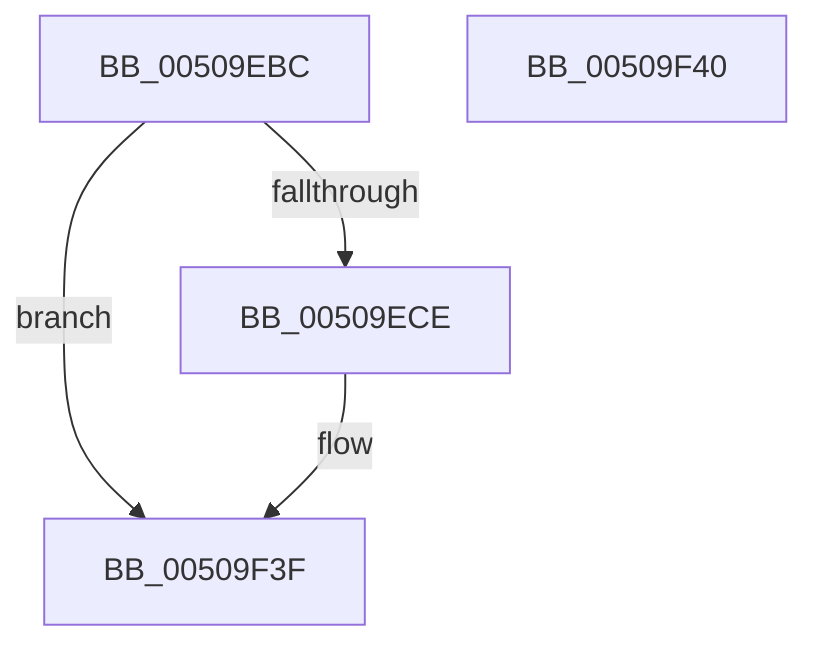

# KiFilterBugCheckInfo

- RVA: `0x00509EBC`–`0x00509F41` (길이 `133` bytes)
- VA: `0x0000000140509EBC`
- 실행 섹션: `.text`
- PDB 이름 있음: `예`; PDB Function 태그: `아니요`
- unwind 정보 RVA: `0x000DB714`
- 디코드: `25`개 명령, `133/133` bytes 표시
- 미해석 바이트: `0` (있으면 어셈블리에 `.byte`로 보존)

> 이 문서는 커널 이미지의 기계어와 PDB 기호를 분석해 생성했습니다. 4번과 5번은 함수 원형과 자료형을 바이너리 사용 방식에서 추정한 C 해석이며 원본 소스 복구 결과는 아닙니다.

## 1. Dependencies

- 직접 호출 지점: **0**; 고유 호출 대상: **0**
- 직접 호출자로 확인된 함수: **1**
- RIP 상대 이미지 참조: **10**

### Outgoing calls
- 직접 디코드된 call 명령이 없습니다.

### Direct callers
- [KeBugCheck2](../5B/KeBugCheck2_function_005B27D0.md) at `0x005B31C7`

### Static image references
- `0x00509EC5` → RVA `0x00E0F268` (`.data`; read)
- `0x00509ED6` → RVA `0x00EF0140` (`.data`; read)
- `0x00509EE1` → RVA `0x00EF0150` (`.data`; read)
- `0x00509EED` → RVA `0x00EF0160` (`.data`; write)
- `0x00509EFA` → RVA `0x00E0A720` (`.data`; read)
- `0x00509F0A` → RVA `0x00E0F270` (`.data`; read)
- `0x00509F15` → RVA `0x00E0F278` (`.data`; read)
- `0x00509F27` → RVA `0x00E0F248` (`.data`; write)
- `0x00509F2E` → RVA `0x00E0F258` (`.data`; write)
- `0x00509F38` → RVA `0x00E667E8` (`.data`; write)

## 2. Other-region calls and transfers

- 다른 실행 섹션으로 향하는 call: **0**
- 별도 외부 분기/꼬리 이동을 확인하지 못했습니다.

## 3. Assembly (complete function range)

```asm
00509EBC  65 48 8B 04 25 20 00 00 00      mov rax, qword ptr gs:[0x20]
00509EC5  48 3B 05 9C 53 90 00            cmp rax, qword ptr [rip + 0x90539c]
00509ECC  75 71                           jne 0x140509f3f
00509ECE  0F 10 02                        movups xmm0, xmmword ptr [rdx]
00509ED1  B8 09 01 00 00                  mov eax, 0x109
00509ED6  0F 11 05 63 62 9E 00            movups xmmword ptr [rip + 0x9e6263], xmm0
00509EDD  0F 10 4A 10                     movups xmm1, xmmword ptr [rdx + 0x10]
00509EE1  0F 11 0D 68 62 9E 00            movups xmmword ptr [rip + 0x9e6268], xmm1
00509EE8  F2 0F 10 42 20                  movsd xmm0, qword ptr [rdx + 0x20]
00509EED  F2 0F 11 05 6B 62 9E 00         movsd qword ptr [rip + 0x9e626b], xmm0
00509EF5  89 01                           mov dword ptr [rcx], eax
00509EF7  48 89 02                        mov qword ptr [rdx], rax
00509EFA  48 8B 05 1F 08 90 00            mov rax, qword ptr [rip + 0x90081f]
00509F01  48 83 62 10 00                  and qword ptr [rdx + 0x10], 0
00509F06  48 89 42 08                     mov qword ptr [rdx + 8], rax
00509F0A  48 8B 05 5F 53 90 00            mov rax, qword ptr [rip + 0x90535f]
00509F11  48 89 42 18                     mov qword ptr [rdx + 0x18], rax
00509F15  48 8B 05 5C 53 90 00            mov rax, qword ptr [rip + 0x90535c]
00509F1C  48 89 42 20                     mov qword ptr [rdx + 0x20], rax
00509F20  48 8D 05 19 62 9E 00            lea rax, [rip + 0x9e6219]
00509F27  48 89 05 1A 53 90 00            mov qword ptr [rip + 0x90531a], rax
00509F2E  C7 05 20 53 90 00 28 00 00 00   mov dword ptr [rip + 0x905320], 0x28
00509F38  C6 05 A9 C8 95 00 01            mov byte ptr [rip + 0x95c8a9], 1
00509F3F  C3                              ret
00509F40  CC                              int3
```

## 4. C-style interpretation (structured pseudocode)

```c
__int64 __fastcall KiFilterBugCheckInfo(__int64 a1, __int64 a2)
{
    __int64 result;

    result = *(unsigned __int64 *)(gs_base + (0 + 32));
    if ((*(unsigned __int64 *)(gs_base + (0 + 32))) == (*(unsigned __int64 *)(v_rip + 9458588))) {
        result = 265;
        *(unsigned __int64 *)(v_rip + 10379875) = v_xmm0;
        *(unsigned __int64 *)(v_rip + 10379880) = v_xmm1;
        *(unsigned __int64 *)(v_rip + 10379883) = v_xmm0;
        *(unsigned int *)(a1) = (unsigned int)(result);
        *(unsigned __int64 *)(a2) = result;
        result = *(unsigned __int64 *)(v_rip + 9439263);
        *(unsigned __int64 *)(a2 + 8) = result;
        result = *(unsigned __int64 *)(v_rip + 9458527);
        *(unsigned __int64 *)(a2 + 24) = result;
        result = *(unsigned __int64 *)(v_rip + 9458524);
        *(unsigned __int64 *)(a2 + 32) = result;
        result = v_rip + 10379801;
        *(unsigned __int64 *)(v_rip + 9458458) = result;
        *(unsigned int *)(v_rip + 9458464) = 40;
        *(unsigned __int8 *)(v_rip + 9816233) = 1;
    }
    return result;
}
```

## 5. (Beta) C Style

```c
int64_t KiFilterBugCheckInfo(void *Arg1, void *Arg2)
{
    uint8_t *arg1 = (uint8_t *)Arg1;
    uint8_t *arg2 = (uint8_t *)Arg2;

    int64_t result;

    result = *(uint64_t *)(gs_base + (0 + 0x20));
    if ((*(uint64_t *)(gs_base + (0 + 0x20))) == (*(uint64_t *)(v_rip + 0x90539C))) {
        result = 265;
        *(uint64_t *)(v_rip + 0x9E6263) = v_xmm0;
        *(uint64_t *)(v_rip + 0x9E6268) = v_xmm1;
        *(uint64_t *)(v_rip + 0x9E626B) = v_xmm0;
        *(uint32_t *)(arg1) = (uint32_t)(result);
        *(uint64_t *)(arg2) = result;
        result = *(uint64_t *)(v_rip + 0x90081F);
        *(uint64_t *)(arg2 + 0x8) = result;
        result = *(uint64_t *)(v_rip + 0x90535F);
        *(uint64_t *)(arg2 + 0x18) = result;
        result = *(uint64_t *)(v_rip + 0x90535C);
        *(uint64_t *)(arg2 + 0x20) = result;
        result = v_rip + 10379801;
        *(uint64_t *)(v_rip + 0x90531A) = result;
        *(uint32_t *)(v_rip + 0x905320) = 40;
        *(uint8_t *)(v_rip + 0x95C8A9) = 1;
    }
    return result;
}
```

### 관측된 메모리 오프셋

구조체 형식이 확인되지 않은 접근은 인자 기준의 오프셋으로만 기록했습니다.

| 기준 인자 | 오프셋 표현 | 폭 (bit) | 접근 |
|---|---:|---:|---|
| `Arg1` | `+ 0x0` | `32` | `W` |
| `Arg2` | `+ 0x0` | `64` | `W` |
| `Arg2` | `+ 0x0` | `128` | `R` |
| `Arg2` | `+ 0x8` | `64` | `W` |
| `Arg2` | `+ 0x10` | `64` | `R/W` |
| `Arg2` | `+ 0x10` | `128` | `R` |
| `Arg2` | `+ 0x18` | `64` | `W` |
| `Arg2` | `+ 0x20` | `64` | `R` |
| `Arg2` | `+ 0x20` | `64` | `W` |

## 6. Execution-region graph

[열기: 2D/3D 그래프와 함수 탐색 컨트롤 패널](../../../control-panel.html?section=text&rva=0x00509EBC&view=graph)

- 2D 그래프는 위에서 아래로 흐르고, 3D 그래프는 빈 공간을 드래그해 회전합니다. Shift+드래그는 이동, 휠은 확대·축소, 함수 노드 선택은 대상 보고서 이동입니다.

### Static fallback


