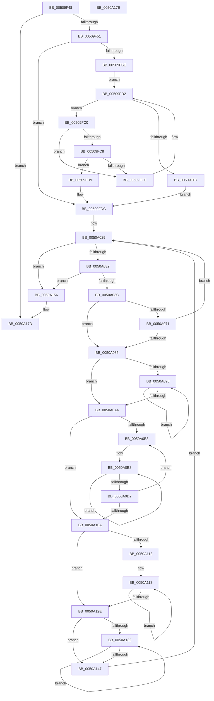

# KiLockExtendedServiceTable

- RVA: `0x00509F48`–`0x0050A17F` (길이 `567` bytes)
- VA: `0x0000000140509F48`
- 실행 섹션: `.text`
- PDB 이름 있음: `예`; PDB Function 태그: `아니요`
- unwind 정보 RVA: `0x000C2A7C`
- 디코드: `161`개 명령, `567/567` bytes 표시
- 미해석 바이트: `0` (있으면 어셈블리에 `.byte`로 보존)

> 이 문서는 커널 이미지의 기계어와 PDB 기호를 분석해 생성했습니다. 4번과 5번은 함수 원형과 자료형을 바이너리 사용 방식에서 추정한 C 해석이며 원본 소스 복구 결과는 아닙니다.

## 1. Dependencies

- 직접 호출 지점: **6**; 고유 호출 대상: **5**
- 직접 호출자로 확인된 함수: **1**
- RIP 상대 이미지 참조: **3**

### Outgoing calls
- `0x00509F8B` → [RtlImageNtHeader](../44/RtlImageNtHeader_function_00443B60.md) (function, `0x00443B60`)
- `0x00509FB5` → [KiSwInterruptPresent](../../init/BE/KiSwInterruptPresent_function_00BEF1F4.md) (function, `0x00BEF1F4`)
- `0x00509FDF` → [RtlImageNtHeader](../44/RtlImageNtHeader_function_00443B60.md) (function, `0x00443B60`)
- `0x00509FEF` → [RtlCaptureImageExceptionValues](../43/RtlCaptureImageExceptionValues_function_00432890.md) (function, `0x00432890`)
- `0x0050A043` → [RtlpConvertFunctionEntry](../41/RtlpConvertFunctionEntry_function_00416CA0.md) (function, `0x00416CA0`)
- `0x0050A077` → [RtlSectionTableFromVirtualAddress](../43/RtlSectionTableFromVirtualAddress_function_00432CF0.md) (function, `0x00432CF0`)

### Direct callers
- [KiLockServiceTable](../69/KiLockServiceTable_function_0069BC98.md) at `0x0069BCD4`

### Static image references
- `0x00509F73` → RVA `0x00E0F280` (`.data`; read)
- `0x00509F7A` → RVA `0x00000000` (`image boundary/outside`; read)
- `0x0050A15E` → RVA `0x00E0F280` (`.data`; write)

## 2. Other-region calls and transfers

- 다른 실행 섹션으로 향하는 call: **1**
  - `0x00509FB5` → [KiSwInterruptPresent](../../init/BE/KiSwInterruptPresent_function_00BEF1F4.md) (`.text` → `INIT`)
- 별도 외부 분기/꼬리 이동을 확인하지 못했습니다.

## 3. Assembly (complete function range)

```asm
00509F48  45 85 C9                        test r9d, r9d
00509F4B  0F 85 2C 02 00 00               jne 0x14050a17d
00509F51  48 89 5C 24 08                  mov qword ptr [rsp + 8], rbx
00509F56  48 89 74 24 10                  mov qword ptr [rsp + 0x10], rsi
00509F5B  48 89 7C 24 18                  mov qword ptr [rsp + 0x18], rdi
00509F60  55                              push rbp
00509F61  41 54                           push r12
00509F63  41 55                           push r13
00509F65  41 56                           push r14
00509F67  41 57                           push r15
00509F69  48 8B EC                        mov rbp, rsp
00509F6C  48 81 EC 80 00 00 00            sub rsp, 0x80
00509F73  48 8D 35 06 53 90 00            lea rsi, [rip + 0x905306]
00509F7A  4C 8D 35 7F 60 AF FF            lea r14, [rip - 0x509f81]
00509F81  4C 8B EE                        mov r13, rsi
00509F84  49 8B CE                        mov rcx, r14
00509F87  41 83 E5 3F                     and r13d, 0x3f
00509F8B  E8 D0 9B F3 FF                  call 0x140443b60
00509F90  4C 8B F8                        mov r15, rax
00509F93  45 33 E4                        xor r12d, r12d
00509F96  0F B7 48 06                     movzx ecx, word ptr [rax + 6]
00509F9A  44 0F B7 40 14                  movzx r8d, word ptr [rax + 0x14]
00509F9F  4C 03 C0                        add r8, rax
00509FA2  48 8D 14 8D 03 00 00 00         lea rdx, [rcx*4 + 3]
00509FAA  48 03 D1                        add rdx, rcx
00509FAD  49 8D 58 18                     lea rbx, [r8 + 0x18]
00509FB1  49 8D 3C D0                     lea rdi, [r8 + rdx*8]
00509FB5  E8 3A 52 6E 00                  call 0x140bef1f4
00509FBA  85 C0                           test eax, eax
00509FBC  78 1E                           js 0x140509fdc
00509FBE  EB 12                           jmp 0x140509fd2
00509FC0  81 3B 4B 53 43 50               cmp dword ptr [rbx], 0x5043534b
00509FC6  75 06                           jne 0x140509fce
00509FC8  44 39 63 04                     cmp dword ptr [rbx + 4], r12d
00509FCC  74 0B                           je 0x140509fd9
00509FCE  48 83 C3 28                     add rbx, 0x28
00509FD2  48 3B DF                        cmp rbx, rdi
00509FD5  75 E9                           jne 0x140509fc0
00509FD7  EB 03                           jmp 0x140509fdc
00509FD9  4C 8B E3                        mov r12, rbx
00509FDC  49 8B CE                        mov rcx, r14
00509FDF  E8 7C 9B F3 FF                  call 0x140443b60
00509FE4  4C 8D 45 48                     lea r8, [rbp + 0x48]
00509FE8  49 8B CE                        mov rcx, r14
00509FEB  48 8D 55 B8                     lea rdx, [rbp - 0x48]
00509FEF  E8 9C 88 F2 FF                  call 0x140432890
00509FF4  8B 4D 48                        mov ecx, dword ptr [rbp + 0x48]
00509FF7  48 B8 AB AA AA AA AA AA AA AA   movabs rax, 0xaaaaaaaaaaaaaaab
0050A001  4C 8B 55 B8                     mov r10, qword ptr [rbp - 0x48]
0050A005  48 F7 E1                        mul rcx
0050A008  4C 89 75 C8                     mov qword ptr [rbp - 0x38], r14
0050A00C  48 C1 EA 03                     shr rdx, 3
0050A010  8B C2                           mov eax, edx
0050A012  89 45 48                        mov dword ptr [rbp + 0x48], eax
0050A015  48 8D 04 40                     lea rax, [rax + rax*2]
0050A019  49 8D 04 82                     lea rax, [r10 + rax*4]
0050A01D  48 89 45 D0                     mov qword ptr [rbp - 0x30], rax
0050A021  48 8D 45 A0                     lea rax, [rbp - 0x60]
0050A025  48 89 45 D8                     mov qword ptr [rbp - 0x28], rax
0050A029  4D 85 D2                        test r10, r10
0050A02C  0F 84 24 01 00 00               je 0x14050a156
0050A032  4C 3B 55 D0                     cmp r10, qword ptr [rbp - 0x30]
0050A036  0F 84 1A 01 00 00               je 0x14050a156
0050A03C  48 8B 55 C8                     mov rdx, qword ptr [rbp - 0x38]
0050A040  49 8B CA                        mov rcx, r10
0050A043  E8 58 CC F0 FF                  call 0x140416ca0
0050A048  48 8B 4D D8                     mov rcx, qword ptr [rbp - 0x28]
0050A04C  48 89 01                        mov qword ptr [rcx], rax
0050A04F  4C 8B 55 B8                     mov r10, qword ptr [rbp - 0x48]
0050A053  48 8B 45 A0                     mov rax, qword ptr [rbp - 0x60]
0050A057  49 83 C2 0C                     add r10, 0xc
0050A05B  4C 89 55 B8                     mov qword ptr [rbp - 0x48], r10
0050A05F  44 8B 00                        mov r8d, dword ptr [rax]
0050A062  8B 58 04                        mov ebx, dword ptr [rax + 4]
0050A065  41 2B D8                        sub ebx, r8d
0050A068  4B 8D 3C 06                     lea rdi, [r14 + r8]
0050A06C  4D 85 E4                        test r12, r12
0050A06F  74 14                           je 0x14050a085
0050A071  49 8B D6                        mov rdx, r14
0050A074  49 8B CF                        mov rcx, r15
0050A077  E8 74 8C F2 FF                  call 0x140432cf0
0050A07C  4C 8B 55 B8                     mov r10, qword ptr [rbp - 0x48]
0050A080  49 3B C4                        cmp rax, r12
0050A083  74 A4                           je 0x14050a029
0050A085  8B CB                           mov ecx, ebx
0050A087  45 8B DD                        mov r11d, r13d
0050A08A  48 03 CF                        add rcx, rdi
0050A08D  4C 8B CF                        mov r9, rdi
0050A090  48 8B C7                        mov rax, rdi
0050A093  48 3B F9                        cmp rdi, rcx
0050A096  73 0C                           jae 0x14050a0a4
0050A098  0F 18 00                        prefetchnta byte ptr [rax]
0050A09B  48 83 C0 40                     add rax, 0x40
0050A09F  48 3B C1                        cmp rax, rcx
0050A0A2  72 F4                           jb 0x14050a098
0050A0A4  44 8B F3                        mov r14d, ebx
0050A0A7  4C 8B C6                        mov r8, rsi
0050A0AA  41 C1 EE 07                     shr r14d, 7
0050A0AE  45 85 F6                        test r14d, r14d
0050A0B1  74 57                           je 0x14050a10a
0050A0B3  B8 08 00 00 00                  mov eax, 8
0050A0B8  4D 33 01                        xor r8, qword ptr [r9]
0050A0BB  41 8B CB                        mov ecx, r11d
0050A0BE  49 D3 C0                        rol r8, cl
0050A0C1  4D 33 41 08                     xor r8, qword ptr [r9 + 8]
0050A0C5  49 83 C1 10                     add r9, 0x10
0050A0C9  49 D3 C0                        rol r8, cl
0050A0CC  48 83 E8 01                     sub rax, 1
0050A0D0  75 E6                           jne 0x14050a0b8
0050A0D2  49 8B C9                        mov rcx, r9
0050A0D5  48 2B CF                        sub rcx, rdi
0050A0D8  48 33 CE                        xor rcx, rsi
0050A0DB  48 8B C1                        mov rax, rcx
0050A0DE  48 C1 C0 11                     rol rax, 0x11
0050A0E2  48 33 C8                        xor rcx, rax
0050A0E5  48 B8 01 20 00 04 80 00 10 70   movabs rax, 0x7010008004002001
0050A0EF  48 F7 E1                        mul rcx
0050A0F2  33 C2                           xor eax, edx
0050A0F4  41 33 C3                        xor eax, r11d
0050A0F7  41 BB 01 00 00 00               mov r11d, 1
0050A0FD  83 E0 3F                        and eax, 0x3f
0050A100  44 0F 45 D8                     cmovne r11d, eax
0050A104  41 83 C6 FF                     add r14d, -1
0050A108  75 A9                           jne 0x14050a0b3
0050A10A  83 E3 7F                        and ebx, 0x7f
0050A10D  83 FB 08                        cmp ebx, 8
0050A110  72 1C                           jb 0x14050a12e
0050A112  8B C3                           mov eax, ebx
0050A114  48 C1 E8 03                     shr rax, 3
0050A118  4D 33 01                        xor r8, qword ptr [r9]
0050A11B  41 8B CB                        mov ecx, r11d
0050A11E  49 D3 C0                        rol r8, cl
0050A121  49 83 C1 08                     add r9, 8
0050A125  83 C3 F8                        add ebx, -8
0050A128  48 83 E8 01                     sub rax, 1
0050A12C  75 EA                           jne 0x14050a118
0050A12E  85 DB                           test ebx, ebx
0050A130  74 15                           je 0x14050a147
0050A132  41 0F B6 01                     movzx eax, byte ptr [r9]
0050A136  41 8B CB                        mov ecx, r11d
0050A139  4C 33 C0                        xor r8, rax
0050A13C  49 FF C1                        inc r9
0050A13F  49 D3 C0                        rol r8, cl
0050A142  83 C3 FF                        add ebx, -1
0050A145  75 EB                           jne 0x14050a132
0050A147  49 8B F0                        mov rsi, r8
0050A14A  4C 8D 35 AF 5E AF FF            lea r14, [rip - 0x50a151]
0050A151  E9 D3 FE FF FF                  jmp 0x14050a029
0050A156  4C 8D 9C 24 80 00 00 00         lea r11, [rsp + 0x80]
0050A15E  48 89 35 1B 51 90 00            mov qword ptr [rip + 0x90511b], rsi
0050A165  49 8B 5B 30                     mov rbx, qword ptr [r11 + 0x30]
0050A169  49 8B 73 38                     mov rsi, qword ptr [r11 + 0x38]
0050A16D  49 8B 7B 40                     mov rdi, qword ptr [r11 + 0x40]
0050A171  49 8B E3                        mov rsp, r11
0050A174  41 5F                           pop r15
0050A176  41 5E                           pop r14
0050A178  41 5D                           pop r13
0050A17A  41 5C                           pop r12
0050A17C  5D                              pop rbp
0050A17D  C3                              ret
0050A17E  CC                              int3
```

## 4. C-style interpretation (structured pseudocode)

```c
__int64 __fastcall KiLockExtendedServiceTable(__int64 a1, __int64 a2, __int64 a3, int a4)
{
    __int64 result;
    __int64 v_r10;
    __int64 v_r11;
    __int64 v_r12;
    __int64 v_r13;
    __int64 v_r14;
    __int64 v_rbx;
    __int64 v_rsp;
    unsigned __int64 v_stack_m28;
    unsigned __int64 v_stack_m50;
    unsigned __int64 v_stack_m58;
    unsigned __int64 v_stack_m60;
    unsigned __int64 v_stack_m70;
    unsigned __int64 v_stack_m88;
    unsigned __int64 v_stack_p10;
    unsigned __int64 v_stack_p18;
    unsigned __int64 v_stack_p20;
    unsigned __int64 v_stack_p8;

    if (a4 != 0) goto loc_0050A17D;
    v_stack_p8 = v_rbx;
    v_stack_p10 = v_rsi;
    v_stack_p18 = v_rdi;
    v_rsp = (v_rsp) - (128);
    v_r13 = (unsigned int)((v_rip + 9458438) & (63));
    result = RtlImageNtHeader(v_rip - 5283713, a2, a3, a4);
    v_r12 = 0;
    a3 = (*(unsigned __int16 *)(result + 20)) + (result);
    a2 = (*(unsigned __int16 *)(result + 6) * 4 + 3) + (*(unsigned __int16 *)(result + 6));
    result = KiSwInterruptPresent(*(unsigned __int16 *)(result + 6), a2, a3, a4);
    if (sign_flag) goto loc_00509FDC;
    goto loc_00509FD2;
loc_00509FC0:
    if ((*(unsigned int *)(a3 + 24)) != 0x5043534BULL) goto loc_00509FCE;
    if ((*(unsigned int *)(a3 + 24 + 4)) == 0) goto loc_00509FD9;
loc_00509FCE:
    v_rbx = (a3 + 24) + (40);
loc_00509FD2:
    if (v_rbx != (a3 + a2 * 8)) goto loc_00509FC0;
    goto loc_00509FDC;
loc_00509FD9:
loc_00509FDC:
    result = RtlImageNtHeader(v_rip - 5283713, a2, a3, a4);
    result = RtlCaptureImageExceptionValues(v_rip - 5283713, v_stack_m70, v_stack_p20, a4);
    v_stack_m60 = v_rip - 5283713;
    a2 = (v_stack_m70) >> (3);
    v_stack_p20 = (unsigned int)((unsigned int)((unsigned int)(a2)));
    v_stack_m58 = v_stack_m70 + (unsigned int)((unsigned int)(a2)) + (unsigned int)((unsigned int)(a2)) * 2 * 4;
    v_stack_m50 = v_stack_m88;
loc_0050A029:
    if (v_stack_m70 == 0) goto loc_0050A156;
    if (v_stack_m70 == v_stack_m58) goto loc_0050A156;
    result = RtlpConvertFunctionEntry(v_stack_m70, v_stack_m60, v_stack_p20, a4);
    *(unsigned __int64 *)(v_stack_m50) = result;
    v_r10 = (v_stack_m70) + (12);
    v_stack_m70 = v_r10;
    v_rbx = (unsigned int)(((unsigned int)(*(unsigned int *)(v_stack_m88 + 4))) - ((unsigned int)((unsigned int)(*(unsigned int *)(v_stack_m88)))));
    if (v_rbx == 0) goto loc_0050A085;
    result = RtlSectionTableFromVirtualAddress(result, v_rip - 5283713, (unsigned int)(*(unsigned int *)(v_stack_m88)), a4);
    if (result == v_rbx) goto loc_0050A029;
loc_0050A085:
    a1 = ((unsigned int)((unsigned int)(v_rbx))) + (v_rip - 5283713 + (unsigned int)(*(unsigned int *)(v_stack_m88)) * 1);
    if ((v_rip - 5283713 + (unsigned int)(*(unsigned int *)(v_stack_m88)) * 1) >= a1) goto loc_0050A0A4;
loc_0050A098:
    result = (v_rip - 5283713 + (unsigned int)(*(unsigned int *)(v_stack_m88)) * 1) + (64);
    if (result < a1) goto loc_0050A098;
loc_0050A0A4:
    v_r14 = (unsigned int)(((unsigned int)((unsigned int)(v_rbx))) >> (7));
    if ((unsigned int)(v_r14) == 0) goto loc_0050A10A;
loc_0050A0B3:
loc_0050A0B8:
    a3 = (v_rip + 9458438) ^ (*(unsigned __int64 *)(v_rip - 5283713 + (unsigned int)(*(unsigned int *)(v_stack_m88)) * 1));
    a3 = (a3) ^ (*(unsigned __int64 *)(v_rip - 5283713 + (unsigned int)(*(unsigned int *)(v_stack_m88)) * 1 + 8));
    a4 = (v_rip - 5283713 + (unsigned int)(*(unsigned int *)(v_stack_m88)) * 1) + (16);
    result = (8) - (1);
    if (condition_is_not_equal) goto loc_0050A0B8;
    a1 = (a4) - (v_rip - 5283713 + (unsigned int)(*(unsigned int *)(v_stack_m88)) * 1);
    a1 = (a1) ^ (v_rip + 9458438);
    a1 = (a1) ^ (a1);
    result = (unsigned int)((a1) ^ ((unsigned int)(v_rip - 5283713)));
    result = (unsigned int)((result) ^ ((unsigned int)((unsigned int)((unsigned int)(v_r13)))));
    result = (unsigned int)((result) & (63));
    v_r11 = 1;
    if (condition_is_not_equal) { v_r11 = (unsigned int)(result); }
    v_r14 = (unsigned int)((v_r14) + (-1));
    if (condition_is_not_equal) goto loc_0050A0B3;
loc_0050A10A:
    v_rbx = (unsigned int)((v_rbx) & (127));
    if (((unsigned int)(v_rbx)) < 8) goto loc_0050A12E;
    result = ((unsigned int)((unsigned int)(v_rbx))) >> (3);
loc_0050A118:
    a3 = (a3) ^ (*(unsigned __int64 *)(a4));
    a4 = (a4) + (8);
    v_rbx = (unsigned int)((v_rbx) + (-8));
    result = (result) - (1);
    if (condition_is_not_equal) goto loc_0050A118;
loc_0050A12E:
    if ((unsigned int)(v_rbx) == 0) goto loc_0050A147;
loc_0050A132:
    a3 = (a3) ^ (*(unsigned __int8 *)(a4));
    a4 = (a4) + 1;
    v_rbx = (unsigned int)((v_rbx) + (-1));
    if (condition_is_not_equal) goto loc_0050A132;
loc_0050A147:
    goto loc_0050A029;
loc_0050A156:
    *(unsigned __int64 *)(v_rip + 9457947) = a3;
loc_0050A17D:
    return *(unsigned __int8 *)(a4);
}
```

## 5. (Beta) C Style

```c
int64_t KiLockExtendedServiceTable(int64_t Arg1, int64_t Arg2, int64_t Arg3, int32_t Arg4)
{
    int64_t result;
    int64_t local_r10;
    int64_t local_r11;
    int64_t local_r12;
    int64_t local_r13;
    int64_t local_r14;
    int64_t local_rbx;
    int64_t local_rsp;
    uint64_t v_stack_m28;
    uint64_t v_stack_m50;
    uint64_t v_stack_m58;
    uint64_t v_stack_m60;
    uint64_t v_stack_m70;
    uint64_t v_stack_m88;
    uint64_t v_stack_p10;
    uint64_t v_stack_p18;
    uint64_t v_stack_p20;
    uint64_t v_stack_p8;

    if (Arg4 != 0) goto loc_0050A17D;
    v_stack_p8 = local_rbx;
    v_stack_p10 = local_rsi;
    v_stack_p18 = local_rdi;
    local_rsp = (local_rsp) - (128);
    local_r13 = (uint32_t)((v_rip + 9458438) & (63));
    result = RtlImageNtHeader(v_rip - 5283713, Arg2, Arg3, Arg4);
    local_r12 = 0;
    Arg3 = (*(uint16_t *)(result + 0x14)) + (result);
    Arg2 = (*(uint16_t *)(result + 0x6) * 4 + 3) + (*(uint16_t *)(result + 0x6));
    result = KiSwInterruptPresent(*(uint16_t *)(result + 0x6), Arg2, Arg3, Arg4);
    if (sign_flag) goto loc_00509FDC;
    goto loc_00509FD2;
loc_00509FC0:
    if ((*(uint32_t *)(Arg3 + 0x18)) != 0x5043534BULL) goto loc_00509FCE;
    if ((*(uint32_t *)(Arg3 + 0x18 + 0x4)) == 0) goto loc_00509FD9;
loc_00509FCE:
    local_rbx = (Arg3 + 24) + (40);
loc_00509FD2:
    if (local_rbx != (Arg3 + Arg2 * 8)) goto loc_00509FC0;
    goto loc_00509FDC;
loc_00509FD9:
loc_00509FDC:
    result = RtlImageNtHeader(v_rip - 5283713, Arg2, Arg3, Arg4);
    result = RtlCaptureImageExceptionValues(v_rip - 5283713, v_stack_m70, v_stack_p20, Arg4);
    v_stack_m60 = v_rip - 5283713;
    Arg2 = (v_stack_m70) >> (3);
    v_stack_p20 = (uint32_t)((uint32_t)((uint32_t)(Arg2)));
    v_stack_m58 = v_stack_m70 + (uint32_t)((uint32_t)(Arg2)) + (uint32_t)((uint32_t)(Arg2)) * 2 * 4;
    v_stack_m50 = v_stack_m88;
loc_0050A029:
    if (v_stack_m70 == 0) goto loc_0050A156;
    if (v_stack_m70 == v_stack_m58) goto loc_0050A156;
    result = RtlpConvertFunctionEntry(v_stack_m70, v_stack_m60, v_stack_p20, Arg4);
    *(uint64_t *)(v_stack_m50) = result;
    local_r10 = (v_stack_m70) + (12);
    v_stack_m70 = local_r10;
    local_rbx = (uint32_t)(((uint32_t)(*(uint32_t *)(v_stack_m88 + 0x4))) - ((uint32_t)((uint32_t)(*(uint32_t *)(v_stack_m88)))));
    if (local_rbx == 0) goto loc_0050A085;
    result = RtlSectionTableFromVirtualAddress(result, v_rip - 5283713, (uint32_t)(*(uint32_t *)(v_stack_m88)), Arg4);
    if (result == local_rbx) goto loc_0050A029;
loc_0050A085:
    Arg1 = ((uint32_t)((uint32_t)(local_rbx))) + (v_rip - 5283713 + (uint32_t)(*(uint32_t *)(v_stack_m88)) * 1);
    if ((v_rip - 5283713 + (uint32_t)(*(uint32_t *)(v_stack_m88)) * 1) >= Arg1) goto loc_0050A0A4;
loc_0050A098:
    result = (v_rip - 5283713 + (uint32_t)(*(uint32_t *)(v_stack_m88)) * 1) + (64);
    if (result < Arg1) goto loc_0050A098;
loc_0050A0A4:
    local_r14 = (uint32_t)(((uint32_t)((uint32_t)(local_rbx))) >> (7));
    if ((uint32_t)(local_r14) == 0) goto loc_0050A10A;
loc_0050A0B3:
loc_0050A0B8:
    Arg3 = (v_rip + 9458438) ^ (*(uint64_t *)(v_rip - 0x509F81 + (uint32_t)(*(uint32_t *)(v_stack_m88)) * 1));
    Arg3 = (Arg3) ^ (*(uint64_t *)(v_rip - 0x509F81 + (uint32_t)(*(uint32_t *)(v_stack_m88)) * 1 + 0x8));
    Arg4 = (v_rip - 5283713 + (uint32_t)(*(uint32_t *)(v_stack_m88)) * 1) + (16);
    result = (8) - (1);
    if (condition_is_not_equal) goto loc_0050A0B8;
    Arg1 = (Arg4) - (v_rip - 5283713 + (uint32_t)(*(uint32_t *)(v_stack_m88)) * 1);
    Arg1 = (Arg1) ^ (v_rip + 9458438);
    Arg1 = (Arg1) ^ (Arg1);
    result = (uint32_t)((Arg1) ^ ((uint32_t)(v_rip - 5283713)));
    result = (uint32_t)((result) ^ ((uint32_t)((uint32_t)((uint32_t)(local_r13)))));
    result = (uint32_t)((result) & (63));
    local_r11 = 1;
    if (condition_is_not_equal) { local_r11 = (uint32_t)(result); }
    local_r14 = (uint32_t)((local_r14) + (-1));
    if (condition_is_not_equal) goto loc_0050A0B3;
loc_0050A10A:
    local_rbx = (uint32_t)((local_rbx) & (127));
    if (((uint32_t)(local_rbx)) < 8) goto loc_0050A12E;
    result = ((uint32_t)((uint32_t)(local_rbx))) >> (3);
loc_0050A118:
    Arg3 = (Arg3) ^ (*(uint64_t *)(Arg4));
    Arg4 = (Arg4) + (8);
    local_rbx = (uint32_t)((local_rbx) + (-8));
    result = (result) - (1);
    if (condition_is_not_equal) goto loc_0050A118;
loc_0050A12E:
    if ((uint32_t)(local_rbx) == 0) goto loc_0050A147;
loc_0050A132:
    Arg3 = (Arg3) ^ (*(uint8_t *)(Arg4));
    Arg4 = (Arg4) + 1;
    local_rbx = (uint32_t)((local_rbx) + (-1));
    if (condition_is_not_equal) goto loc_0050A132;
loc_0050A147:
    goto loc_0050A029;
loc_0050A156:
    *(uint64_t *)(v_rip + 0x90511B) = Arg3;
loc_0050A17D:
    return *(uint8_t *)(Arg4);
}
```

## 6. Execution-region graph

[열기: 2D/3D 그래프와 함수 탐색 컨트롤 패널](../../../control-panel.html?section=text&rva=0x00509F48&view=graph)

- 2D 그래프는 위에서 아래로 흐르고, 3D 그래프는 빈 공간을 드래그해 회전합니다. Shift+드래그는 이동, 휠은 확대·축소, 함수 노드 선택은 대상 보고서 이동입니다.

### Static fallback


