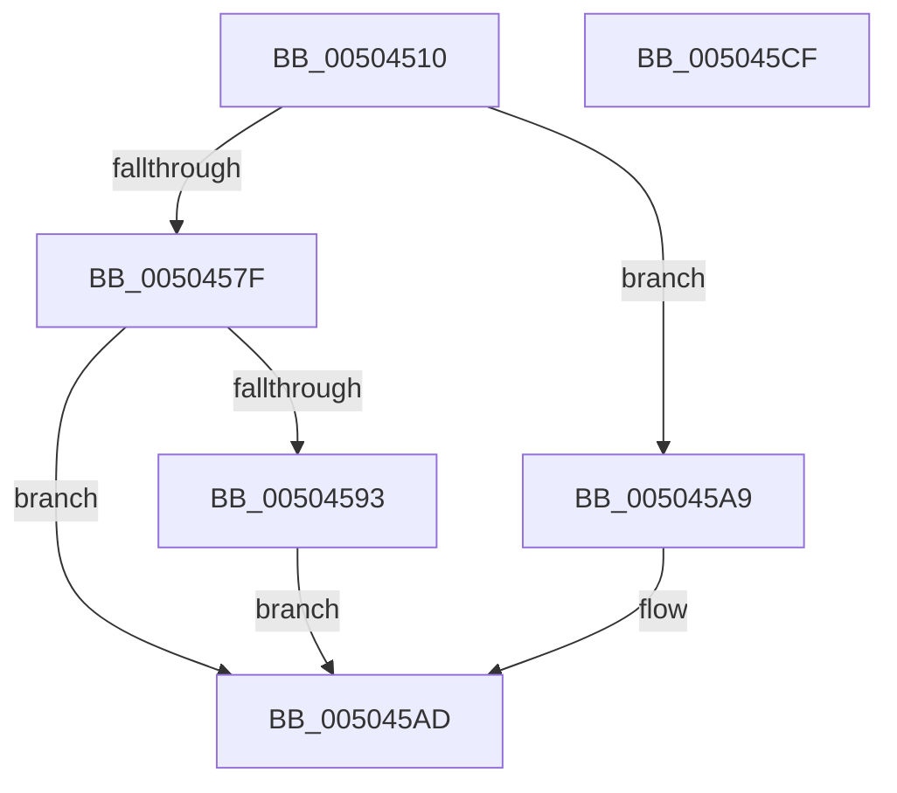

# RaiseException

- RVA: `0x00504510`–`0x005045D0` (길이 `192` bytes)
- VA: `0x0000000140504510`
- 실행 섹션: `.text`
- PDB 이름 있음: `예`; PDB Function 태그: `아니요`
- unwind 정보 RVA: `0x000C2850`
- 디코드: `46`개 명령, `192/192` bytes 표시
- 미해석 바이트: `0` (있으면 어셈블리에 `.byte`로 보존)

> 이 문서는 커널 이미지의 기계어와 PDB 기호를 분석해 생성했습니다. 4번과 5번은 함수 원형과 자료형을 바이너리 사용 방식에서 추정한 C 해석이며 원본 소스 복구 결과는 아닙니다.

## 1. Dependencies

- 직접 호출 지점: **3**; 고유 호출 대상: **3**
- 직접 호출자로 확인된 함수: **0**
- RIP 상대 이미지 참조: **2**

### Outgoing calls
- `0x005045A2` → [memcpy](../6C/memcpy_function_006C6840.md) (function, `0x006C6840`)
- `0x005045B2` → [RtlRaiseException](../5E/RtlRaiseException_function_005E6B00.md) (function, `0x005E6B00`)
- `0x005045C2` → [_security_check_cookie](../6A/_security_check_cookie_function_006AC640.md) (function, `0x006AC640`)

### Direct callers
- 이 함수 시작 RVA로 연결되는 직접 call은 확인되지 않았습니다. 간접 호출은 완전히 역산할 수 없습니다.

### Static image references
- `0x0050451A` → RVA `0x00E0A740` (`.data`; read)
- `0x00504555` → RVA `0x00504510` (`RaiseException`; read)

## 2. Other-region calls and transfers

- 다른 실행 섹션으로 향하는 call: **0**
- 별도 외부 분기/꼬리 이동을 확인하지 못했습니다.

## 3. Assembly (complete function range)

```asm
00504510  4C 8B DC                        mov r11, rsp
00504513  48 81 EC D8 00 00 00            sub rsp, 0xd8
0050451A  48 8B 05 1F 62 90 00            mov rax, qword ptr [rip + 0x90621f]
00504521  48 33 C4                        xor rax, rsp
00504524  48 89 84 24 C0 00 00 00         mov qword ptr [rsp + 0xc0], rax
0050452C  0F 57 C0                        xorps xmm0, xmm0
0050452F  33 C0                           xor eax, eax
00504531  0F 11 44 24 3C                  movups xmmword ptr [rsp + 0x3c], xmm0
00504536  83 E2 01                        and edx, 1
00504539  0F 11 44 24 4C                  movups xmmword ptr [rsp + 0x4c], xmm0
0050453E  0F 11 44 24 5C                  movups xmmword ptr [rsp + 0x5c], xmm0
00504543  0F 11 44 24 6C                  movups xmmword ptr [rsp + 0x6c], xmm0
00504548  0F 11 44 24 7C                  movups xmmword ptr [rsp + 0x7c], xmm0
0050454D  49 89 43 D4                     mov qword ptr [r11 - 0x2c], rax
00504551  41 89 43 DC                     mov dword ptr [r11 - 0x24], eax
00504555  48 8D 05 B4 FF FF FF            lea rax, [rip - 0x4c]
0050455C  41 0F 11 43 B4                  movups xmmword ptr [r11 - 0x4c], xmm0
00504561  41 0F 11 43 C4                  movups xmmword ptr [r11 - 0x3c], xmm0
00504566  89 4C 24 20                     mov dword ptr [rsp + 0x20], ecx
0050456A  33 C9                           xor ecx, ecx
0050456C  89 54 24 24                     mov dword ptr [rsp + 0x24], edx
00504570  48 89 4C 24 28                  mov qword ptr [rsp + 0x28], rcx
00504575  48 89 44 24 30                  mov qword ptr [rsp + 0x30], rax
0050457A  4D 85 C9                        test r9, r9
0050457D  74 2A                           je 0x1405045a9
0050457F  B8 0F 00 00 00                  mov eax, 0xf
00504584  44 3B C0                        cmp r8d, eax
00504587  41 0F 46 C0                     cmovbe eax, r8d
0050458B  89 44 24 38                     mov dword ptr [rsp + 0x38], eax
0050458F  85 C0                           test eax, eax
00504591  74 1A                           je 0x1405045ad
00504593  44 8B C0                        mov r8d, eax
00504596  48 8D 4C 24 40                  lea rcx, [rsp + 0x40]
0050459B  49 C1 E0 03                     shl r8, 3
0050459F  49 8B D1                        mov rdx, r9
005045A2  E8 99 22 1C 00                  call 0x1406c6840
005045A7  EB 04                           jmp 0x1405045ad
005045A9  89 4C 24 38                     mov dword ptr [rsp + 0x38], ecx
005045AD  48 8D 4C 24 20                  lea rcx, [rsp + 0x20]
005045B2  E8 49 25 0E 00                  call 0x1405e6b00
005045B7  48 8B 8C 24 C0 00 00 00         mov rcx, qword ptr [rsp + 0xc0]
005045BF  48 33 CC                        xor rcx, rsp
005045C2  E8 79 80 1A 00                  call 0x1406ac640
005045C7  48 81 C4 D8 00 00 00            add rsp, 0xd8
005045CE  C3                              ret
005045CF  CC                              int3
```

## 4. C-style interpretation (structured pseudocode)

```c
__int64 __fastcall RaiseException(int a1, int a2, int a3, __int64 a4)
{
    __int64 result;
    __int64 v_rsp;
    unsigned __int64 v_stack_m18;
    unsigned __int64 v_stack_m5C;
    unsigned __int64 v_stack_m6C;
    unsigned __int64 v_stack_m7C;
    unsigned __int64 v_stack_m8C;
    unsigned __int64 v_stack_m98;
    unsigned __int64 v_stack_m9C;
    unsigned int v_stack_mA0;
    unsigned __int64 v_stack_mA8;
    unsigned __int64 v_stack_mB0;
    unsigned int v_stack_mB4;
    unsigned int v_stack_mB8;

    v_rsp = (v_rsp) - (216);
    result = (*(unsigned __int64 *)(v_rip + 9462303)) ^ (v_rsp);
    v_stack_m18 = result;
    result = 0;
    v_stack_m9C = v_xmm0;
    a2 = (unsigned int)((a2) & (1));
    v_stack_m8C = v_xmm0;
    v_stack_m7C = v_xmm0;
    v_stack_m6C = v_xmm0;
    v_stack_m5C = v_xmm0;
    *(unsigned __int64 *)(v_rsp - 44) = 0;
    *(unsigned int *)(v_rsp - 36) = 0;
    *(unsigned __int64 *)(v_rsp - 76) = v_xmm0;
    *(unsigned __int64 *)(v_rsp - 60) = v_xmm0;
    v_stack_mB8 = a1;
    a1 = 0;
    v_stack_mB4 = a2;
    v_stack_mB0 = 0;
    v_stack_mA8 = v_rip - 76;
    if (a4 == 0) goto loc_005045A9;
    result = 15;
    if (a3 <= 15) { result = a3; }
    v_stack_mA0 = (unsigned int)(result);
    if ((unsigned int)(result) == 0) goto loc_005045AD;
    a3 = ((unsigned int)((unsigned int)(result))) << (3);
    result = memcpy(v_stack_m98, a4, a3, a4);
    goto loc_005045AD;
loc_005045A9:
    v_stack_mA0 = (unsigned int)(v_stack_m98);
loc_005045AD:
    result = RtlRaiseException(v_stack_mB8, a4, a3, a4);
    a1 = (v_stack_m18) ^ (v_rsp);
    result = _security_check_cookie(a1, a4, a3, a4);
    v_rsp = (v_rsp) + (216);
    return result;
}
```

## 5. (Beta) C Style

```c
int64_t RaiseException(int32_t Arg1, int32_t Arg2, int32_t Arg3, int64_t Arg4)
{
    int64_t result;
    int64_t local_rsp;
    uint64_t v_stack_m18;
    uint64_t v_stack_m5C;
    uint64_t v_stack_m6C;
    uint64_t v_stack_m7C;
    uint64_t v_stack_m8C;
    uint64_t v_stack_m98;
    uint64_t v_stack_m9C;
    uint32_t v_stack_mA0;
    uint64_t v_stack_mA8;
    uint64_t v_stack_mB0;
    uint32_t v_stack_mB4;
    uint32_t v_stack_mB8;

    local_rsp = (local_rsp) - (216);
    result = (*(uint64_t *)(v_rip + 0x90621F)) ^ (local_rsp);
    v_stack_m18 = result;
    result = 0;
    v_stack_m9C = v_xmm0;
    Arg2 = (uint32_t)((Arg2) & (1));
    v_stack_m8C = v_xmm0;
    v_stack_m7C = v_xmm0;
    v_stack_m6C = v_xmm0;
    v_stack_m5C = v_xmm0;
    *(uint64_t *)(local_rsp - 0x2C) = 0;
    *(uint32_t *)(local_rsp - 0x24) = 0;
    *(uint64_t *)(local_rsp - 0x4C) = v_xmm0;
    *(uint64_t *)(local_rsp - 0x3C) = v_xmm0;
    v_stack_mB8 = Arg1;
    Arg1 = 0;
    v_stack_mB4 = Arg2;
    v_stack_mB0 = 0;
    v_stack_mA8 = v_rip - 76;
    if (Arg4 == 0) goto loc_005045A9;
    result = 15;
    if (Arg3 <= 15) { result = Arg3; }
    v_stack_mA0 = (uint32_t)(result);
    if ((uint32_t)(result) == 0) goto loc_005045AD;
    Arg3 = ((uint32_t)((uint32_t)(result))) << (3);
    result = memcpy(v_stack_m98, Arg4, Arg3, Arg4);
    goto loc_005045AD;
loc_005045A9:
    v_stack_mA0 = (uint32_t)(v_stack_m98);
loc_005045AD:
    result = RtlRaiseException(v_stack_mB8, Arg4, Arg3, Arg4);
    Arg1 = (v_stack_m18) ^ (local_rsp);
    result = _security_check_cookie(Arg1, Arg4, Arg3, Arg4);
    local_rsp = (local_rsp) + (216);
    return result;
}
```

## 6. Execution-region graph

[열기: 2D/3D 그래프와 함수 탐색 컨트롤 패널](../../../control-panel.html?section=text&rva=0x00504510&view=graph)

- 2D 그래프는 위에서 아래로 흐르고, 3D 그래프는 빈 공간을 드래그해 회전합니다. Shift+드래그는 이동, 휠은 확대·축소, 함수 노드 선택은 대상 보고서 이동입니다.

### Static fallback


