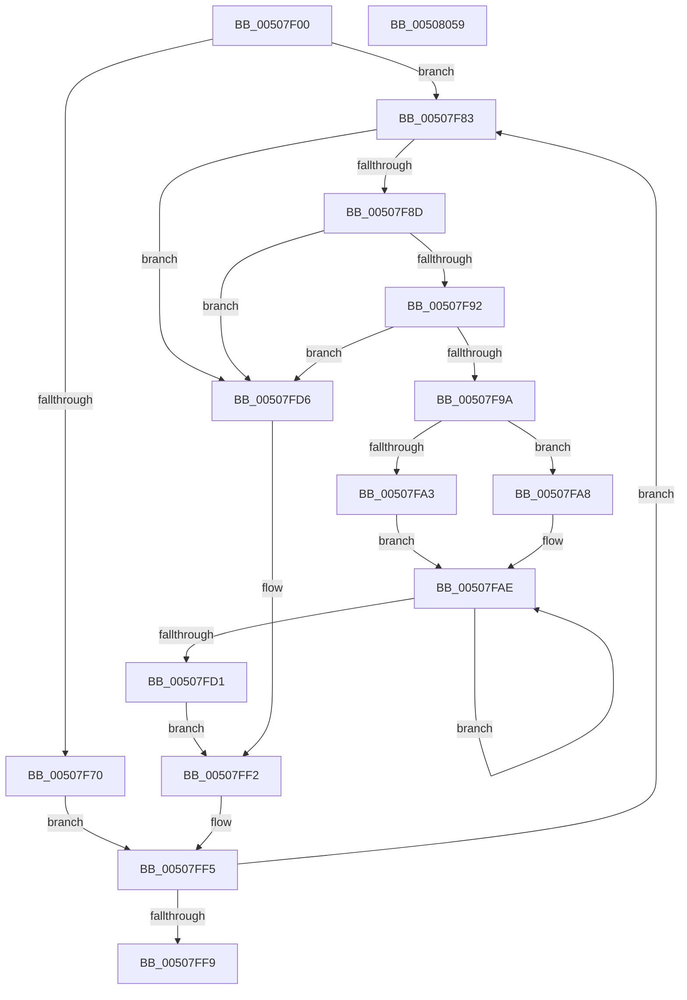

# ReadStringDelimited

- RVA: `0x00507F00`–`0x0050805A` (길이 `346` bytes)
- VA: `0x0000000140507F00`
- 실행 섹션: `.text`
- PDB 이름 있음: `예`; PDB Function 태그: `예`
- unwind 정보 RVA: `0x000C449C`
- 디코드: `101`개 명령, `346/346` bytes 표시
- 미해석 바이트: `0` (있으면 어셈블리에 `.byte`로 보존)

> 이 문서는 커널 이미지의 기계어와 PDB 기호를 분석해 생성했습니다. 4번과 5번은 함수 원형과 자료형을 바이너리 사용 방식에서 추정한 C 해석이며 원본 소스 복구 결과는 아닙니다.

## 1. Dependencies

- 직접 호출 지점: **2**; 고유 호출 대상: **2**
- 직접 호출자로 확인된 함수: **1**
- RIP 상대 이미지 참조: **1**

### Outgoing calls
- `0x00508039` → [ReadString](ReadString_function_00507D40.md) (function, `0x00507D40`)
- `0x00508046` → [_security_check_cookie](../6A/_security_check_cookie_function_006AC640.md) (function, `0x006AC640`)

### Direct callers
- [input_s](input_s_function_00508090.md) at `0x005087FA`

### Static image references
- `0x00507F0E` → RVA `0x00E0A740` (`.data`; read)

## 2. Other-region calls and transfers

- 다른 실행 섹션으로 향하는 call: **0**
- 별도 외부 분기/꼬리 이동을 확인하지 못했습니다.

## 3. Assembly (complete function range)

```asm
00507F00  40 53                           push rbx
00507F02  55                              push rbp
00507F03  56                              push rsi
00507F04  57                              push rdi
00507F05  41 56                           push r14
00507F07  48 81 EC 80 00 00 00            sub rsp, 0x80
00507F0E  48 8B 05 2B 28 90 00            mov rax, qword ptr [rip + 0x90282b]
00507F15  48 33 C4                        xor rax, rsp
00507F18  48 89 44 24 70                  mov qword ptr [rsp + 0x70], rax
00507F1D  48 8B AC 24 D0 00 00 00         mov rbp, qword ptr [rsp + 0xd0]
00507F25  49 8B F9                        mov rdi, r9
00507F28  4C 8B B4 24 E0 00 00 00         mov r14, qword ptr [rsp + 0xe0]
00507F30  45 32 D2                        xor r10b, r10b
00507F33  0F 57 C0                        xorps xmm0, xmm0
00507F36  49 8B F0                        mov rsi, r8
00507F39  44 8B C1                        mov r8d, ecx
00507F3C  48 8B DA                        mov rbx, rdx
00507F3F  48 8B 0A                        mov rcx, qword ptr [rdx]
00507F42  45 8B D8                        mov r11d, r8d
00507F45  41 83 CB 08                     or r11d, 8
00507F49  0F 11 44 24 50                  movups xmmword ptr [rsp + 0x50], xmm0
00507F4E  4C 8D 49 01                     lea r9, [rcx + 1]
00507F52  4C 89 0A                        mov qword ptr [rdx], r9
00507F55  41 80 39 5E                     cmp byte ptr [r9], 0x5e
00507F59  0F 11 44 24 60                  movups xmmword ptr [rsp + 0x60], xmm0
00507F5E  4C 0F 45 C9                     cmovne r9, rcx
00507F62  45 0F 45 D8                     cmovne r11d, r8d
00507F66  49 FF C1                        inc r9
00507F69  41 8A 01                        mov al, byte ptr [r9]
00507F6C  3C 5D                           cmp al, 0x5d
00507F6E  75 13                           jne 0x140507f83
00507F70  44 8A D0                        mov r10b, al
00507F73  C6 44 24 5B 20                  mov byte ptr [rsp + 0x5b], 0x20
00507F78  49 8D 41 01                     lea rax, [r9 + 1]
00507F7C  4C 8B C8                        mov r9, rax
00507F7F  8A 00                           mov al, byte ptr [rax]
00507F81  EB 72                           jmp 0x140507ff5
00507F83  49 8B D1                        mov rdx, r9
00507F86  49 FF C1                        inc r9
00507F89  3C 2D                           cmp al, 0x2d
00507F8B  75 49                           jne 0x140507fd6
00507F8D  45 84 D2                        test r10b, r10b
00507F90  74 44                           je 0x140507fd6
00507F92  41 8A 09                        mov cl, byte ptr [r9]
00507F95  80 F9 5D                        cmp cl, 0x5d
00507F98  74 3C                           je 0x140507fd6
00507F9A  4C 8D 4A 02                     lea r9, [rdx + 2]
00507F9E  44 3A D1                        cmp r10b, cl
00507FA1  73 05                           jae 0x140507fa8
00507FA3  44 8A C1                        mov r8b, cl
00507FA6  EB 06                           jmp 0x140507fae
00507FA8  45 8A C2                        mov r8b, r10b
00507FAB  44 8A D1                        mov r10b, cl
00507FAE  41 0F B6 D2                     movzx edx, r10b
00507FB2  48 C1 EA 03                     shr rdx, 3
00507FB6  41 0F B6 C2                     movzx eax, r10b
00507FBA  41 FE C2                        inc r10b
00507FBD  83 E0 07                        and eax, 7
00507FC0  0F BE 4C 14 50                  movsx ecx, byte ptr [rsp + rdx + 0x50]
00507FC5  0F AB C1                        bts ecx, eax
00507FC8  88 4C 14 50                     mov byte ptr [rsp + rdx + 0x50], cl
00507FCC  45 3A D0                        cmp r10b, r8b
00507FCF  76 DD                           jbe 0x140507fae
00507FD1  45 32 D2                        xor r10b, r10b
00507FD4  EB 1C                           jmp 0x140507ff2
00507FD6  0F B6 D0                        movzx edx, al
00507FD9  44 8A D0                        mov r10b, al
00507FDC  48 C1 EA 03                     shr rdx, 3
00507FE0  0F B6 C0                        movzx eax, al
00507FE3  83 E0 07                        and eax, 7
00507FE6  0F BE 4C 14 50                  movsx ecx, byte ptr [rsp + rdx + 0x50]
00507FEB  0F AB C1                        bts ecx, eax
00507FEE  88 4C 14 50                     mov byte ptr [rsp + rdx + 0x50], cl
00507FF2  41 8A 01                        mov al, byte ptr [r9]
00507FF5  3C 5D                           cmp al, 0x5d
00507FF7  75 8A                           jne 0x140507f83
00507FF9  48 8B 84 24 F0 00 00 00         mov rax, qword ptr [rsp + 0xf0]
00508001  48 8D 54 24 50                  lea rdx, [rsp + 0x50]
00508006  48 89 44 24 40                  mov qword ptr [rsp + 0x40], rax
0050800B  4C 8B C6                        mov r8, rsi
0050800E  48 8B 84 24 E8 00 00 00         mov rax, qword ptr [rsp + 0xe8]
00508016  41 8B CB                        mov ecx, r11d
00508019  48 89 44 24 38                  mov qword ptr [rsp + 0x38], rax
0050801E  8B 84 24 D8 00 00 00            mov eax, dword ptr [rsp + 0xd8]
00508025  4C 89 74 24 30                  mov qword ptr [rsp + 0x30], r14
0050802A  4C 89 0B                        mov qword ptr [rbx], r9
0050802D  4C 8B CF                        mov r9, rdi
00508030  89 44 24 28                     mov dword ptr [rsp + 0x28], eax
00508034  48 89 6C 24 20                  mov qword ptr [rsp + 0x20], rbp
00508039  E8 02 FD FF FF                  call 0x140507d40
0050803E  48 8B 4C 24 70                  mov rcx, qword ptr [rsp + 0x70]
00508043  48 33 CC                        xor rcx, rsp
00508046  E8 F5 45 1A 00                  call 0x1406ac640
0050804B  48 81 C4 80 00 00 00            add rsp, 0x80
00508052  41 5E                           pop r14
00508054  5F                              pop rdi
00508055  5E                              pop rsi
00508056  5D                              pop rbp
00508057  5B                              pop rbx
00508058  C3                              ret
00508059  CC                              int3
```

## 4. C-style interpretation (structured pseudocode)

```c
__int64 __fastcall ReadStringDelimited(int a1, __int64 a2, __int64 a3, __int64 a4, __int64 a5, unsigned int a6, __int64 a7, __int64 a8, __int64 a9)
{
    __int64 result;
    __int64 v_r10;
    __int64 v_r11;
    __int64 v_rsp;
    unsigned __int64 v_stack_m38;
    unsigned __int64 v_stack_m48;
    unsigned __int8 v_stack_m4D;
    unsigned __int64 v_stack_m58;
    unsigned __int64 v_stack_m68;
    unsigned __int64 v_stack_m70;
    unsigned __int64 v_stack_m78;
    unsigned int v_stack_m80;
    unsigned __int64 v_stack_m88;

    v_rsp = (v_rsp) - (128);
    result = (*(unsigned __int64 *)(v_rip + 9447467)) ^ (v_rsp);
    v_stack_m38 = result;
    v_r10 = 0;
    v_r11 = (unsigned int)(((unsigned int)((unsigned int)((unsigned int)(a1)))) | (8));
    v_stack_m58 = v_xmm0;
    *(unsigned __int64 *)(a2) = *(unsigned __int64 *)(a2) + 1;
    v_stack_m48 = v_xmm0;
    a4 = *(unsigned __int64 *)(a2) + 1;
    if ((*(unsigned __int8 *)(*(unsigned __int64 *)(a2) + 1)) != 94) {
        a4 = *(unsigned __int64 *)(a2);
        v_r11 = (unsigned int)((unsigned int)(a1));
    }
    a4 = (a4) + 1;
    if (((unsigned __int8)(*(unsigned __int8 *)(a4))) != 93) goto loc_00507F83;
    v_stack_m4D = 32;
    goto loc_00507FF5;
loc_00507F83:
    a4 = (a4 + 1) + 1;
    if (((unsigned __int8)(*(unsigned __int8 *)(a4 + 1))) != 45) goto loc_00507FD6;
    if ((unsigned __int8)((unsigned __int8)(*(unsigned __int8 *)(a4))) == 0) goto loc_00507FD6;
    if (((unsigned __int8)(*(unsigned __int8 *)(a4))) == 93) goto loc_00507FD6;
    if (((unsigned __int8)((unsigned __int8)(*(unsigned __int8 *)(a4)))) >= ((unsigned __int8)(*(unsigned __int8 *)(a4)))) goto loc_00507FA8;
    goto loc_00507FAE;
loc_00507FA8:
loc_00507FAE:
    a2 = ((unsigned __int8)((unsigned __int8)(*(unsigned __int8 *)(a4)))) >> (3);
    v_r10 = (unsigned __int8)(((unsigned __int8)(*(unsigned __int8 *)(a4))) + 1);
    result = (unsigned int)(((unsigned __int8)((unsigned __int8)(*(unsigned __int8 *)(a4)))) & (7));
    *(unsigned __int8 *)(v_rsp + a2 * 1 + 80) = (unsigned __int8)((__int8)(*(unsigned __int8 *)(v_rsp + a2 * 1 + 80)));
    if (((unsigned __int8)(v_r10)) <= ((unsigned __int8)((unsigned __int8)((unsigned __int8)(*(unsigned __int8 *)(a4)))))) goto loc_00507FAE;
    v_r10 = 0;
    goto loc_00507FF2;
loc_00507FD6:
    a2 = ((unsigned __int8)(result)) >> (3);
    result = (unsigned int)(((unsigned __int8)(result)) & (7));
    *(unsigned __int8 *)(v_rsp + a2 * 1 + 80) = (unsigned __int8)((__int8)(*(unsigned __int8 *)(v_rsp + a2 * 1 + 80)));
loc_00507FF2:
loc_00507FF5:
    if (((unsigned __int8)(*(unsigned __int8 *)(a4 + 1 + 2))) != 93) goto loc_00507F83;
    v_stack_m68 = a9;
    v_stack_m70 = a8;
    v_stack_m78 = a7;
    *(unsigned __int64 *)(a2) = a4 + 1 + 2;
    v_stack_m80 = (unsigned int)((unsigned int)(a6));
    v_stack_m88 = a5;
    result = ReadString((unsigned int)((unsigned int)(v_r11)), v_stack_m58, a3, a4);
    a1 = (v_stack_m38) ^ (v_rsp);
    result = _security_check_cookie(a1, v_stack_m58, a3, a4);
    v_rsp = (v_rsp) + (128);
    return result;
}
```

## 5. (Beta) C Style

```c
int64_t ReadStringDelimited(int32_t Arg1, void *Arg2, int64_t Arg3, int64_t Arg4, int64_t Arg5, uint32_t Arg6, int64_t Arg7, int64_t Arg8, int64_t Arg9)
{
    uint8_t *arg2 = (uint8_t *)Arg2;

    int64_t result;
    int64_t local_r10;
    int64_t local_r11;
    int64_t local_rsp;
    uint64_t v_stack_m38;
    uint64_t v_stack_m48;
    uint8_t v_stack_m4D;
    uint64_t v_stack_m58;
    uint64_t v_stack_m68;
    uint64_t v_stack_m70;
    uint64_t v_stack_m78;
    uint32_t v_stack_m80;
    uint64_t v_stack_m88;

    local_rsp = (local_rsp) - (128);
    result = (*(uint64_t *)(v_rip + 0x90282B)) ^ (local_rsp);
    v_stack_m38 = result;
    local_r10 = 0;
    local_r11 = (uint32_t)(((uint32_t)((uint32_t)((uint32_t)(Arg1)))) | (8));
    v_stack_m58 = v_xmm0;
    *(uint64_t *)(arg2) = *(uint64_t *)(arg2) + 1;
    v_stack_m48 = v_xmm0;
    Arg4 = *(uint64_t *)(arg2) + 1;
    if ((*(uint8_t *)(*(uint64_t *)(arg2) + 0x1)) != 94) {
        Arg4 = *(uint64_t *)(arg2);
        local_r11 = (uint32_t)((uint32_t)(Arg1));
    }
    Arg4 = (Arg4) + 1;
    if (((uint8_t)(*(uint8_t *)(Arg4))) != 93) goto loc_00507F83;
    v_stack_m4D = 32;
    goto loc_00507FF5;
loc_00507F83:
    Arg4 = (Arg4 + 1) + 1;
    if (((uint8_t)(*(uint8_t *)(Arg4 + 0x1))) != 45) goto loc_00507FD6;
    if ((uint8_t)((uint8_t)(*(uint8_t *)(Arg4))) == 0) goto loc_00507FD6;
    if (((uint8_t)(*(uint8_t *)(Arg4))) == 93) goto loc_00507FD6;
    if (((uint8_t)((uint8_t)(*(uint8_t *)(Arg4)))) >= ((uint8_t)(*(uint8_t *)(Arg4)))) goto loc_00507FA8;
    goto loc_00507FAE;
loc_00507FA8:
loc_00507FAE:
    Arg2 = ((uint8_t)((uint8_t)(*(uint8_t *)(Arg4)))) >> (3);
    local_r10 = (uint8_t)(((uint8_t)(*(uint8_t *)(Arg4))) + 1);
    result = (uint32_t)(((uint8_t)((uint8_t)(*(uint8_t *)(Arg4)))) & (7));
    *(uint8_t *)(local_rsp + arg2 * 1 + 0x50) = (uint8_t)((int8_t)(*(uint8_t *)(local_rsp + arg2 * 1 + 0x50)));
    if (((uint8_t)(local_r10)) <= ((uint8_t)((uint8_t)((uint8_t)(*(uint8_t *)(Arg4)))))) goto loc_00507FAE;
    local_r10 = 0;
    goto loc_00507FF2;
loc_00507FD6:
    Arg2 = ((uint8_t)(result)) >> (3);
    result = (uint32_t)(((uint8_t)(result)) & (7));
    *(uint8_t *)(local_rsp + arg2 * 1 + 0x50) = (uint8_t)((int8_t)(*(uint8_t *)(local_rsp + arg2 * 1 + 0x50)));
loc_00507FF2:
loc_00507FF5:
    if (((uint8_t)(*(uint8_t *)(Arg4 + 0x1 + 0x2))) != 93) goto loc_00507F83;
    v_stack_m68 = Arg9;
    v_stack_m70 = Arg8;
    v_stack_m78 = Arg7;
    *(uint64_t *)(arg2) = Arg4 + 1 + 2;
    v_stack_m80 = (uint32_t)((uint32_t)(Arg6));
    v_stack_m88 = Arg5;
    result = ReadString((uint32_t)((uint32_t)(local_r11)), v_stack_m58, Arg3, Arg4);
    Arg1 = (v_stack_m38) ^ (local_rsp);
    result = _security_check_cookie(Arg1, v_stack_m58, Arg3, Arg4);
    local_rsp = (local_rsp) + (128);
    return result;
}
```

### 관측된 메모리 오프셋

구조체 형식이 확인되지 않은 접근은 인자 기준의 오프셋으로만 기록했습니다.

| 기준 인자 | 오프셋 표현 | 폭 (bit) | 접근 |
|---|---:|---:|---|
| `Arg2` | `+ 0x0` | `64` | `R` |
| `Arg2` | `+ 0x0` | `64` | `W` |

## 6. Execution-region graph

[열기: 2D/3D 그래프와 함수 탐색 컨트롤 패널](../../../control-panel.html?section=text&rva=0x00507F00&view=graph)

- 2D 그래프는 위에서 아래로 흐르고, 3D 그래프는 빈 공간을 드래그해 회전합니다. Shift+드래그는 이동, 휠은 확대·축소, 함수 노드 선택은 대상 보고서 이동입니다.

### Static fallback


