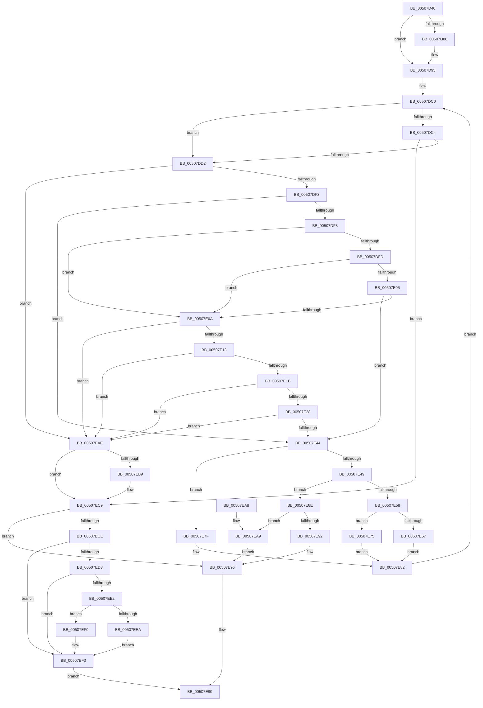

# ReadString

- RVA: `0x00507D40`–`0x00507EF7` (길이 `439` bytes)
- VA: `0x0000000140507D40`
- 실행 섹션: `.text`
- PDB 이름 있음: `예`; PDB Function 태그: `예`
- unwind 정보 RVA: `0x000C29CC`
- 디코드: `137`개 명령, `439/439` bytes 표시
- 미해석 바이트: `0` (있으면 어셈블리에 `.byte`로 보존)

> 이 문서는 커널 이미지의 기계어와 PDB 기호를 분석해 생성했습니다. 4번과 5번은 함수 원형과 자료형을 바이너리 사용 방식에서 추정한 C 해석이며 원본 소스 복구 결과는 아닙니다.

## 1. Dependencies

- 직접 호출 지점: **3**; 고유 호출 대상: **2**
- 직접 호출자로 확인된 함수: **2**
- RIP 상대 이미지 참조: **0**

### Outgoing calls
- `0x00507D90` → [ungetc_nolock](ungetc_nolock_function_00509824.md) (function, `0x00509824`)
- `0x00507DDD` → [_inc](_inc_function_00508060.md) (function, `0x00508060`)
- `0x00507EC1` → [ungetc_nolock](ungetc_nolock_function_00509824.md) (function, `0x00509824`)

### Direct callers
- [ReadStringDelimited](ReadStringDelimited_function_00507F00.md) at `0x00508039`
- [input_s](input_s_function_00508090.md) at `0x00508807`

### Static image references
- 디코드된 RIP-relative 메모리 참조가 없습니다.

## 2. Other-region calls and transfers

- 다른 실행 섹션으로 향하는 call: **0**
- 별도 외부 분기/꼬리 이동을 확인하지 못했습니다.

## 3. Assembly (complete function range)

```asm
00507D40  48 89 54 24 10                  mov qword ptr [rsp + 0x10], rdx
00507D45  53                              push rbx
00507D46  55                              push rbp
00507D47  56                              push rsi
00507D48  57                              push rdi
00507D49  41 55                           push r13
00507D4B  41 56                           push r14
00507D4D  41 57                           push r15
00507D4F  48 83 EC 20                     sub rsp, 0x20
00507D53  48 8B BC 24 80 00 00 00         mov rdi, qword ptr [rsp + 0x80]
00507D5B  8B C1                           mov eax, ecx
00507D5D  4C 8B B4 24 98 00 00 00         mov r14, qword ptr [rsp + 0x98]
00507D65  24 08                           and al, 8
00507D67  F6 D8                           neg al
00507D69  8B D9                           mov ebx, ecx
00507D6B  49 8B E9                        mov rbp, r9
00507D6E  4D 8B F8                        mov r15, r8
00507D71  48 8B 37                        mov rsi, qword ptr [rdi]
00507D74  1B C0                           sbb eax, eax
00507D76  41 FF 09                        dec dword ptr [r9]
00507D79  41 8B 08                        mov ecx, dword ptr [r8]
00507D7C  89 84 24 98 00 00 00            mov dword ptr [rsp + 0x98], eax
00507D83  83 F9 FF                        cmp ecx, -1
00507D86  74 0D                           je 0x140507d95
00507D88  48 8B 94 24 90 00 00 00         mov rdx, qword ptr [rsp + 0x90]
00507D90  E8 8F 1A 00 00                  call 0x140509824
00507D95  45 33 C0                        xor r8d, r8d
00507D98  49 8D 56 FF                     lea rdx, [r14 - 1]
00507D9C  44 8B EB                        mov r13d, ebx
00507D9F  8B C3                           mov eax, ebx
00507DA1  41 83 E5 10                     and r13d, 0x10
00507DA5  49 0F 45 D6                     cmovne rdx, r14
00507DA9  44 8B B4 24 88 00 00 00         mov r14d, dword ptr [rsp + 0x88]
00507DB1  83 E0 01                        and eax, 1
00507DB4  48 89 54 24 70                  mov qword ptr [rsp + 0x70], rdx
00507DB9  89 84 24 80 00 00 00            mov dword ptr [rsp + 0x80], eax
00507DC0  85 C0                           test eax, eax
00507DC2  74 0E                           je 0x140507dd2
00507DC4  41 8B C6                        mov eax, r14d
00507DC7  41 FF CE                        dec r14d
00507DCA  85 C0                           test eax, eax
00507DCC  0F 84 F7 00 00 00               je 0x140507ec9
00507DD2  48 8B 8C 24 90 00 00 00         mov rcx, qword ptr [rsp + 0x90]
00507DDA  FF 45 00                        inc dword ptr [rbp]
00507DDD  E8 7E 02 00 00                  call 0x140508060
00507DE2  45 33 C0                        xor r8d, r8d
00507DE5  41 89 07                        mov dword ptr [r15], eax
00507DE8  8B C8                           mov ecx, eax
00507DEA  83 F8 FF                        cmp eax, -1
00507DED  0F 84 BB 00 00 00               je 0x140507eae
00507DF3  45 85 ED                        test r13d, r13d
00507DF6  75 4C                           jne 0x140507e44
00507DF8  F6 C3 20                        test bl, 0x20
00507DFB  74 0D                           je 0x140507e0a
00507DFD  83 C0 F7                        add eax, -9
00507E00  83 F8 04                        cmp eax, 4
00507E03  76 05                           jbe 0x140507e0a
00507E05  83 F9 20                        cmp ecx, 0x20
00507E08  75 3A                           jne 0x140507e44
00507E0A  F6 C3 40                        test bl, 0x40
00507E0D  0F 84 9B 00 00 00               je 0x140507eae
00507E13  85 C9                           test ecx, ecx
00507E15  0F 88 93 00 00 00               js 0x140507eae
00507E1B  8B C1                           mov eax, ecx
00507E1D  C1 F8 03                        sar eax, 3
00507E20  3B C8                           cmp ecx, eax
00507E22  0F 8C 86 00 00 00               jl 0x140507eae
00507E28  83 E1 07                        and ecx, 7
00507E2B  48 98                           cdqe
00507E2D  8B D1                           mov edx, ecx
00507E2F  48 8B 4C 24 68                  mov rcx, qword ptr [rsp + 0x68]
00507E34  0F BE 0C 08                     movsx ecx, byte ptr [rax + rcx]
00507E38  33 8C 24 98 00 00 00            xor ecx, dword ptr [rsp + 0x98]
00507E3F  0F A3 D1                        bt ecx, edx
00507E42  73 6A                           jae 0x140507eae
00507E44  F6 C3 04                        test bl, 4
00507E47  75 36                           jne 0x140507e7f
00507E49  48 8B 54 24 70                  mov rdx, qword ptr [rsp + 0x70]
00507E4E  8B C3                           mov eax, ebx
00507E50  83 E0 02                        and eax, 2
00507E53  48 85 D2                        test rdx, rdx
00507E56  74 36                           je 0x140507e8e
00507E58  48 8B 0F                        mov rcx, qword ptr [rdi]
00507E5B  48 FF CA                        dec rdx
00507E5E  48 89 54 24 70                  mov qword ptr [rsp + 0x70], rdx
00507E63  85 C0                           test eax, eax
00507E65  74 0E                           je 0x140507e75
00507E67  48 8D 44 24 60                  lea rax, [rsp + 0x60]
00507E6C  66 89 01                        mov word ptr [rcx], ax
00507E6F  48 83 07 02                     add qword ptr [rdi], 2
00507E73  EB 0D                           jmp 0x140507e82
00507E75  41 8A 07                        mov al, byte ptr [r15]
00507E78  88 01                           mov byte ptr [rcx], al
00507E7A  48 FF 07                        inc qword ptr [rdi]
00507E7D  EB 03                           jmp 0x140507e82
00507E7F  48 FF C6                        inc rsi
00507E82  8B 84 24 80 00 00 00            mov eax, dword ptr [rsp + 0x80]
00507E89  E9 32 FF FF FF                  jmp 0x140507dc0
00507E8E  85 C0                           test eax, eax
00507E90  74 17                           je 0x140507ea9
00507E92  66 44 89 06                     mov word ptr [rsi], r8w
00507E96  83 C8 FF                        or eax, 0xffffffff
00507E99  48 83 C4 20                     add rsp, 0x20
00507E9D  41 5F                           pop r15
00507E9F  41 5E                           pop r14
00507EA1  41 5D                           pop r13
00507EA3  5F                              pop rdi
00507EA4  5E                              pop rsi
00507EA5  5D                              pop rbp
00507EA6  5B                              pop rbx
00507EA7  C3                              ret
00507EA8  CC                              int3
00507EA9  44 88 06                        mov byte ptr [rsi], r8b
00507EAC  EB E8                           jmp 0x140507e96
00507EAE  FF 4D 00                        dec dword ptr [rbp]
00507EB1  41 8B 0F                        mov ecx, dword ptr [r15]
00507EB4  83 F9 FF                        cmp ecx, -1
00507EB7  74 10                           je 0x140507ec9
00507EB9  48 8B 94 24 90 00 00 00         mov rdx, qword ptr [rsp + 0x90]
00507EC1  E8 5E 19 00 00                  call 0x140509824
00507EC6  45 33 C0                        xor r8d, r8d
00507EC9  48 3B 37                        cmp rsi, qword ptr [rdi]
00507ECC  74 C8                           je 0x140507e96
00507ECE  F6 C3 04                        test bl, 4
00507ED1  75 20                           jne 0x140507ef3
00507ED3  48 8B 84 24 A0 00 00 00         mov rax, qword ptr [rsp + 0xa0]
00507EDB  FF 00                           inc dword ptr [rax]
00507EDD  45 85 ED                        test r13d, r13d
00507EE0  75 11                           jne 0x140507ef3
00507EE2  48 8B 07                        mov rax, qword ptr [rdi]
00507EE5  F6 C3 02                        test bl, 2
00507EE8  74 06                           je 0x140507ef0
00507EEA  66 44 89 00                     mov word ptr [rax], r8w
00507EEE  EB 03                           jmp 0x140507ef3
00507EF0  44 88 00                        mov byte ptr [rax], r8b
00507EF3  33 C0                           xor eax, eax
00507EF5  EB A2                           jmp 0x140507e99
```

## 4. C-style interpretation (structured pseudocode)

```c
__int64 __fastcall ReadString(int a1, __int64 a2, __int64 a3, __int64 a4, unsigned int a5, unsigned int a6, __int64 a7, unsigned int a8, __int64 a9)
{
    __int64 result;
    __int64 v_r13;
    __int64 v_r14;
    __int64 v_rsi;
    __int64 v_rsp;
    unsigned __int64 v_stack_p10;
    unsigned __int64 v_stack_p18;
    unsigned int v_stack_p28;
    unsigned int v_stack_p40;
    unsigned __int64 v_stack_p8;

    v_stack_p10 = a2;
    v_rsp = (v_rsp) - (32);
    result = (unsigned __int8)(((unsigned int)(a1)) & (8));
    result = (unsigned __int8)(-(result));
    v_stack_p40 = (unsigned int)(result);
    if (((unsigned int)((unsigned int)(*(unsigned int *)(a3)))) != -1) {
        a2 = a7;
        result = ungetc_nolock((unsigned int)(*(unsigned int *)(a3)), a2, a3, a4);
    }
    a3 = 0;
    v_r13 = (unsigned int)(((unsigned int)((unsigned int)((unsigned int)(a1)))) & (16));
    a2 = a8 - 1;
    if (condition_is_not_equal) { a2 = a8; }
    result = (unsigned int)(((unsigned int)((unsigned int)((unsigned int)(a1)))) & (1));
    v_stack_p18 = a2;
    v_stack_p28 = (unsigned int)(result);
loc_00507DC0:
    if ((unsigned int)(result) == 0) goto loc_00507DD2;
    v_r14 = (unsigned int)(((unsigned int)(a6)) - 1);
    if ((unsigned int)((unsigned int)((unsigned int)((unsigned int)(a6)))) == 0) goto loc_00507EC9;
loc_00507DD2:
    result = _inc(a7, a2, a3, a4);
    a3 = 0;
    *(unsigned int *)(a3) = (unsigned int)(result);
    if (((unsigned int)(result)) == -1) goto loc_00507EAE;
    if ((unsigned int)(v_r13) != 0) goto loc_00507E44;
    if ((((unsigned __int8)((unsigned int)(a1))) & (32)) == 0) goto loc_00507E0A;
    result = (unsigned int)((result) + (-9));
    if (((unsigned int)(result)) <= 4) goto loc_00507E0A;
    if (((unsigned int)((unsigned int)((unsigned int)(result)))) != 32) goto loc_00507E44;
loc_00507E0A:
    if ((((unsigned __int8)((unsigned int)(a1))) & (64)) == 0) goto loc_00507EAE;
    if (sign_flag) goto loc_00507EAE;
    result = (unsigned int)(((unsigned int)((unsigned int)((unsigned int)((unsigned int)(result))))) >> (3));
    if (((unsigned int)((unsigned int)((unsigned int)(result)))) < ((unsigned int)(result))) goto loc_00507EAE;
    a1 = (unsigned int)(((unsigned int)((unsigned int)(result))) & (7));
    a1 = (unsigned int)(((__int8)(*(unsigned __int8 *)(result + v_stack_p10 * 1))) ^ (a8));
    if (condition_is_above_or_equal) goto loc_00507EAE;
loc_00507E44:
    if ((((unsigned __int8)((unsigned int)(a1))) & (4)) != 0) goto loc_00507E7F;
    result = (unsigned int)(((unsigned int)((unsigned int)((unsigned int)(a1)))) & (2));
    if (v_stack_p18 == 0) goto loc_00507E8E;
    a2 = (v_stack_p18) - 1;
    v_stack_p18 = a2;
    if ((unsigned int)(result) == 0) goto loc_00507E75;
    *(unsigned __int16 *)(*(unsigned __int64 *)(a5)) = (unsigned __int16)(v_stack_p8);
    goto loc_00507E82;
loc_00507E75:
    *(unsigned __int8 *)(*(unsigned __int64 *)(a5)) = (unsigned __int8)(*(unsigned __int8 *)(a3));
    goto loc_00507E82;
loc_00507E7F:
    v_rsi = (*(unsigned __int64 *)(a5)) + 1;
loc_00507E82:
    goto loc_00507DC0;
loc_00507E8E:
    if ((unsigned int)((unsigned int)(a5)) == 0) goto loc_00507EA9;
    *(unsigned __int16 *)(v_rsi) = 0;
loc_00507E96:
    result = (unsigned int)(((unsigned int)(a5)) | (0xFFFFFFFFULL));
loc_00507E99:
    v_rsp = (v_rsp) + (32);
    return result;
loc_00507EA9:
    *(unsigned __int8 *)(v_rsi) = 0;
    goto loc_00507E96;
loc_00507EAE:
    if (((unsigned int)((unsigned int)(*(unsigned int *)(a3)))) != -1) {
        a2 = a7;
        result = ungetc_nolock((unsigned int)(*(unsigned int *)(a3)), a2, a3, a4);
        a3 = 0;
    }
    if (v_rsi == (*(unsigned __int64 *)(a5))) goto loc_00507E96;
    if ((((unsigned __int8)((unsigned int)(a1))) & (4)) != 0) goto loc_00507EF3;
    if ((unsigned int)(v_r13) != 0) goto loc_00507EF3;
    if ((((unsigned __int8)((unsigned int)(a1))) & (2)) == 0) goto loc_00507EF0;
    *(unsigned __int16 *)(*(unsigned __int64 *)(a5)) = 0;
    goto loc_00507EF3;
loc_00507EF0:
    *(unsigned __int8 *)(*(unsigned __int64 *)(a5)) = 0;
loc_00507EF3:
    result = 0;
    goto loc_00507E99;
}
```

## 5. (Beta) C Style

```c
int64_t ReadString(int32_t Arg1, int64_t Arg2, void *Arg3, void *Arg4, void *Arg5, uint32_t Arg6, int64_t Arg7, void *Arg8, void *Arg9)
{
    uint8_t *arg3 = (uint8_t *)Arg3;
    uint8_t *arg4 = (uint8_t *)Arg4;
    uint8_t *arg5 = (uint8_t *)Arg5;
    uint8_t *arg8 = (uint8_t *)Arg8;
    uint8_t *arg9 = (uint8_t *)Arg9;

    int64_t result;
    int64_t local_r13;
    int64_t local_r14;
    int64_t local_rsi;
    int64_t local_rsp;
    uint64_t v_stack_p10;
    uint64_t v_stack_p18;
    uint32_t v_stack_p28;
    uint32_t v_stack_p40;
    uint64_t v_stack_p8;

    v_stack_p10 = Arg2;
    local_rsp = (local_rsp) - (32);
    result = (uint8_t)(((uint32_t)(Arg1)) & (8));
    result = (uint8_t)(-(result));
    v_stack_p40 = (uint32_t)(result);
    if (((uint32_t)((uint32_t)(*(uint32_t *)(arg3)))) != -1) {
        Arg2 = Arg7;
        result = ungetc_nolock((uint32_t)(*(uint32_t *)(arg3)), Arg2, Arg3, Arg4);
    }
    Arg3 = 0;
    local_r13 = (uint32_t)(((uint32_t)((uint32_t)((uint32_t)(Arg1)))) & (16));
    Arg2 = Arg8 - 1;
    if (condition_is_not_equal) { Arg2 = Arg8; }
    result = (uint32_t)(((uint32_t)((uint32_t)((uint32_t)(Arg1)))) & (1));
    v_stack_p18 = Arg2;
    v_stack_p28 = (uint32_t)(result);
loc_00507DC0:
    if ((uint32_t)(result) == 0) goto loc_00507DD2;
    local_r14 = (uint32_t)(((uint32_t)(Arg6)) - 1);
    if ((uint32_t)((uint32_t)((uint32_t)((uint32_t)(Arg6)))) == 0) goto loc_00507EC9;
loc_00507DD2:
    result = _inc(Arg7, Arg2, Arg3, Arg4);
    Arg3 = 0;
    *(uint32_t *)(arg3) = (uint32_t)(result);
    if (((uint32_t)(result)) == -1) goto loc_00507EAE;
    if ((uint32_t)(local_r13) != 0) goto loc_00507E44;
    if ((((uint8_t)((uint32_t)(Arg1))) & (32)) == 0) goto loc_00507E0A;
    result = (uint32_t)((result) + (-9));
    if (((uint32_t)(result)) <= 4) goto loc_00507E0A;
    if (((uint32_t)((uint32_t)((uint32_t)(result)))) != 32) goto loc_00507E44;
loc_00507E0A:
    if ((((uint8_t)((uint32_t)(Arg1))) & (64)) == 0) goto loc_00507EAE;
    if (sign_flag) goto loc_00507EAE;
    result = (uint32_t)(((uint32_t)((uint32_t)((uint32_t)((uint32_t)(result))))) >> (3));
    if (((uint32_t)((uint32_t)((uint32_t)(result)))) < ((uint32_t)(result))) goto loc_00507EAE;
    Arg1 = (uint32_t)(((uint32_t)((uint32_t)(result))) & (7));
    Arg1 = (uint32_t)(((int8_t)(*(uint8_t *)(result + v_stack_p10 * 1))) ^ (Arg8));
    if (condition_is_above_or_equal) goto loc_00507EAE;
loc_00507E44:
    if ((((uint8_t)((uint32_t)(Arg1))) & (4)) != 0) goto loc_00507E7F;
    result = (uint32_t)(((uint32_t)((uint32_t)((uint32_t)(Arg1)))) & (2));
    if (v_stack_p18 == 0) goto loc_00507E8E;
    Arg2 = (v_stack_p18) - 1;
    v_stack_p18 = Arg2;
    if ((uint32_t)(result) == 0) goto loc_00507E75;
    *(uint16_t *)(*(uint64_t *)(arg5)) = (uint16_t)(v_stack_p8);
    goto loc_00507E82;
loc_00507E75:
    *(uint8_t *)(*(uint64_t *)(arg5)) = (uint8_t)(*(uint8_t *)(arg3));
    goto loc_00507E82;
loc_00507E7F:
    local_rsi = (*(uint64_t *)(arg5)) + 1;
loc_00507E82:
    goto loc_00507DC0;
loc_00507E8E:
    if ((uint32_t)((uint32_t)(Arg5)) == 0) goto loc_00507EA9;
    *(uint16_t *)(local_rsi) = 0;
loc_00507E96:
    result = (uint32_t)(((uint32_t)(Arg5)) | (0xFFFFFFFFULL));
loc_00507E99:
    local_rsp = (local_rsp) + (32);
    return result;
loc_00507EA9:
    *(uint8_t *)(local_rsi) = 0;
    goto loc_00507E96;
loc_00507EAE:
    if (((uint32_t)((uint32_t)(*(uint32_t *)(arg3)))) != -1) {
        Arg2 = Arg7;
        result = ungetc_nolock((uint32_t)(*(uint32_t *)(arg3)), Arg2, Arg3, Arg4);
        Arg3 = 0;
    }
    if (local_rsi == (*(uint64_t *)(arg5))) goto loc_00507E96;
    if ((((uint8_t)((uint32_t)(Arg1))) & (4)) != 0) goto loc_00507EF3;
    if ((uint32_t)(local_r13) != 0) goto loc_00507EF3;
    if ((((uint8_t)((uint32_t)(Arg1))) & (2)) == 0) goto loc_00507EF0;
    *(uint16_t *)(*(uint64_t *)(arg5)) = 0;
    goto loc_00507EF3;
loc_00507EF0:
    *(uint8_t *)(*(uint64_t *)(arg5)) = 0;
loc_00507EF3:
    result = 0;
    goto loc_00507E99;
}
```

### 관측된 메모리 오프셋

구조체 형식이 확인되지 않은 접근은 인자 기준의 오프셋으로만 기록했습니다.

| 기준 인자 | 오프셋 표현 | 폭 (bit) | 접근 |
|---|---:|---:|---|
| `Arg3` | `+ 0x0` | `8` | `R` |
| `Arg3` | `+ 0x0` | `32` | `R` |
| `Arg3` | `+ 0x0` | `32` | `W` |
| `Arg4` | `+ 0x0` | `32` | `R/W` |
| `Arg5` | `+ 0x0` | `64` | `R` |
| `Arg5` | `+ 0x0` | `64` | `R/W` |
| `Arg8` | `- 0x1` | `64` | `R` |
| `Arg9` | `+ 0x0` | `32` | `R/W` |

## 6. Execution-region graph

[열기: 2D/3D 그래프와 함수 탐색 컨트롤 패널](../../../control-panel.html?section=text&rva=0x00507D40&view=graph)

- 2D 그래프는 위에서 아래로 흐르고, 3D 그래프는 빈 공간을 드래그해 회전합니다. Shift+드래그는 이동, 휠은 확대·축소, 함수 노드 선택은 대상 보고서 이동입니다.

### Static fallback


