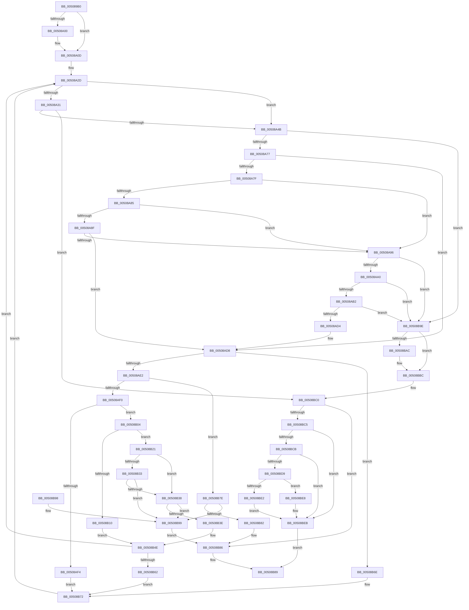

# ReadString

- RVA: `0x005089B0`–`0x00508BEF` (길이 `575` bytes)
- VA: `0x00000001405089B0`
- 실행 섹션: `.text`
- PDB 이름 있음: `예`; PDB Function 태그: `예`
- unwind 정보 RVA: `0x000C29E4`
- 디코드: `164`개 명령, `575/575` bytes 표시
- 미해석 바이트: `0` (있으면 어셈블리에 `.byte`로 보존)

> 이 문서는 커널 이미지의 기계어와 PDB 기호를 분석해 생성했습니다. 4번과 5번은 함수 원형과 자료형을 바이너리 사용 방식에서 추정한 C 해석이며 원본 소스 복구 결과는 아닙니다.

## 1. Dependencies

- 직접 호출 지점: **4**; 고유 호출 대상: **3**
- 직접 호출자로 확인된 함수: **2**
- RIP 상대 이미지 참조: **1**

### Outgoing calls
- `0x00508A08` → [ungetwc_nolock](ungetwc_nolock_function_00509900.md) (function, `0x00509900`)
- `0x00508A56` → [fgetwc_nolock](fgetwc_nolock_function_005098B4.md) (function, `0x005098B4`)
- `0x00508B46` → [memcpy](../6C/memcpy_function_006C6840.md) (function, `0x006C6840`)
- `0x00508BB4` → [ungetwc_nolock](ungetwc_nolock_function_00509900.md) (function, `0x00509900`)

### Direct callers
- [ReadStringDelimited](ReadStringDelimited_function_00508BF8.md) at `0x00508D6A`
- [winput_s](winput_s_function_00508E78.md) at `0x005096CC`

### Static image references
- `0x00508B04` → RVA `0x00E0A700` (`.data`; read)

## 2. Other-region calls and transfers

- 다른 실행 섹션으로 향하는 call: **0**
- 별도 외부 분기/꼬리 이동을 확인하지 못했습니다.

## 3. Assembly (complete function range)

```asm
005089B0  48 89 54 24 10                  mov qword ptr [rsp + 0x10], rdx
005089B5  53                              push rbx
005089B6  55                              push rbp
005089B7  56                              push rsi
005089B8  57                              push rdi
005089B9  41 54                           push r12
005089BB  41 56                           push r14
005089BD  41 57                           push r15
005089BF  48 83 EC 20                     sub rsp, 0x20
005089C3  48 8B 9C 24 80 00 00 00         mov rbx, qword ptr [rsp + 0x80]
005089CB  8B C1                           mov eax, ecx
005089CD  48 8B BC 24 98 00 00 00         mov rdi, qword ptr [rsp + 0x98]
005089D5  24 08                           and al, 8
005089D7  F6 D8                           neg al
005089D9  8B F1                           mov esi, ecx
005089DB  41 BA FF FF 00 00               mov r10d, 0xffff
005089E1  4D 8B F9                        mov r15, r9
005089E4  4C 8B 33                        mov r14, qword ptr [rbx]
005089E7  1B C0                           sbb eax, eax
005089E9  41 FF 09                        dec dword ptr [r9]
005089EC  4D 8B E0                        mov r12, r8
005089EF  41 0F B7 08                     movzx ecx, word ptr [r8]
005089F3  89 84 24 80 00 00 00            mov dword ptr [rsp + 0x80], eax
005089FA  66 44 3B D1                     cmp r10w, cx
005089FE  74 0D                           je 0x140508a0d
00508A00  48 8B 94 24 90 00 00 00         mov rdx, qword ptr [rsp + 0x90]
00508A08  E8 F3 0E 00 00                  call 0x140509900
00508A0D  45 33 C9                        xor r9d, r9d
00508A10  48 8D 6F FF                     lea rbp, [rdi - 1]
00508A14  8B CE                           mov ecx, esi
00508A16  8B C6                           mov eax, esi
00508A18  83 E1 10                        and ecx, 0x10
00508A1B  89 4C 24 60                     mov dword ptr [rsp + 0x60], ecx
00508A1F  48 0F 45 EF                     cmovne rbp, rdi
00508A23  83 E0 01                        and eax, 1
00508A26  89 84 24 98 00 00 00            mov dword ptr [rsp + 0x98], eax
00508A2D  85 C0                           test eax, eax
00508A2F  74 1A                           je 0x140508a4b
00508A31  8B 94 24 88 00 00 00            mov edx, dword ptr [rsp + 0x88]
00508A38  8B C2                           mov eax, edx
00508A3A  FF CA                           dec edx
00508A3C  89 94 24 88 00 00 00            mov dword ptr [rsp + 0x88], edx
00508A43  85 C0                           test eax, eax
00508A45  0F 84 75 01 00 00               je 0x140508bc0
00508A4B  48 8B 8C 24 90 00 00 00         mov rcx, qword ptr [rsp + 0x90]
00508A53  41 FF 07                        inc dword ptr [r15]
00508A56  E8 59 0E 00 00                  call 0x1405098b4
00508A5B  41 BA FF FF 00 00               mov r10d, 0xffff
00508A61  66 41 89 04 24                  mov word ptr [r12], ax
00508A66  45 33 C9                        xor r9d, r9d
00508A69  44 0F B7 C0                     movzx r8d, ax
00508A6D  66 44 3B D0                     cmp r10w, ax
00508A71  0F 84 27 01 00 00               je 0x140508b9e
00508A77  8B 4C 24 60                     mov ecx, dword ptr [rsp + 0x60]
00508A7B  85 C9                           test ecx, ecx
00508A7D  75 59                           jne 0x140508ad8
00508A7F  40 F6 C6 20                     test sil, 0x20
00508A83  74 11                           je 0x140508a96
00508A85  41 8D 40 F7                     lea eax, [r8 - 9]
00508A89  66 83 F8 04                     cmp ax, 4
00508A8D  76 07                           jbe 0x140508a96
00508A8F  66 41 83 F8 20                  cmp r8w, 0x20
00508A94  75 42                           jne 0x140508ad8
00508A96  40 F6 C6 40                     test sil, 0x40
00508A9A  0F 84 FE 00 00 00               je 0x140508b9e
00508AA0  41 0F B7 C8                     movzx ecx, r8w
00508AA4  66 C1 E9 03                     shr cx, 3
00508AA8  66 44 3B C1                     cmp r8w, cx
00508AAC  0F 82 EC 00 00 00               jb 0x140508b9e
00508AB2  0F B7 C1                        movzx eax, cx
00508AB5  41 8B D0                        mov edx, r8d
00508AB8  48 8B 4C 24 68                  mov rcx, qword ptr [rsp + 0x68]
00508ABD  83 E2 07                        and edx, 7
00508AC0  0F BE 0C 08                     movsx ecx, byte ptr [rax + rcx]
00508AC4  33 8C 24 80 00 00 00            xor ecx, dword ptr [rsp + 0x80]
00508ACB  0F A3 D1                        bt ecx, edx
00508ACE  0F 83 CA 00 00 00               jae 0x140508b9e
00508AD4  8B 4C 24 60                     mov ecx, dword ptr [rsp + 0x60]
00508AD8  40 F6 C6 04                     test sil, 4
00508ADC  0F 85 8C 00 00 00               jne 0x140508b6e
00508AE2  8B C6                           mov eax, esi
00508AE4  83 E0 02                        and eax, 2
00508AE7  48 85 ED                        test rbp, rbp
00508AEA  0F 84 8E 00 00 00               je 0x140508b7e
00508AF0  85 C0                           test eax, eax
00508AF2  74 10                           je 0x140508b04
00508AF4  48 8B 03                        mov rax, qword ptr [rbx]
00508AF7  66 44 89 00                     mov word ptr [rax], r8w
00508AFB  48 83 03 02                     add qword ptr [rbx], 2
00508AFF  48 FF CD                        dec rbp
00508B02  EB 6E                           jmp 0x140508b72
00508B04  48 63 05 F5 1B 90 00            movsxd rax, dword ptr [rip + 0x901bf5]
00508B0B  48 3B E8                        cmp rbp, rax
00508B0E  72 11                           jb 0x140508b21
00508B10  41 8A 04 24                     mov al, byte ptr [r12]
00508B14  48 8B 0B                        mov rcx, qword ptr [rbx]
00508B17  88 01                           mov byte ptr [rcx], al
00508B19  48 8B 03                        mov rax, qword ptr [rbx]
00508B1C  40 8A 38                        mov dil, byte ptr [rax]
00508B1F  EB 2D                           jmp 0x140508b4e
00508B21  49 0F BE 3C 24                  movsx rdi, byte ptr [r12]
00508B26  40 88 7C 24 70                  mov byte ptr [rsp + 0x70], dil
00508B2B  4C 8B C7                        mov r8, rdi
00508B2E  40 84 FF                        test dil, dil
00508B31  7E 05                           jle 0x140508b38
00508B33  48 3B FD                        cmp rdi, rbp
00508B36  77 61                           ja 0x140508b99
00508B38  40 80 FF 05                     cmp dil, 5
00508B3C  77 5B                           ja 0x140508b99
00508B3E  48 8B 0B                        mov rcx, qword ptr [rbx]
00508B41  48 8D 54 24 70                  lea rdx, [rsp + 0x70]
00508B46  E8 F5 DC 1B 00                  call 0x1406c6840
00508B4B  45 33 C9                        xor r9d, r9d
00508B4E  8B 4C 24 60                     mov ecx, dword ptr [rsp + 0x60]
00508B52  8B 84 24 98 00 00 00            mov eax, dword ptr [rsp + 0x98]
00508B59  40 84 FF                        test dil, dil
00508B5C  0F 8E CB FE FF FF               jle 0x140508a2d
00508B62  48 0F BE C7                     movsx rax, dil
00508B66  48 01 03                        add qword ptr [rbx], rax
00508B69  48 2B E8                        sub rbp, rax
00508B6C  EB 04                           jmp 0x140508b72
00508B6E  49 83 C6 02                     add r14, 2
00508B72  8B 84 24 98 00 00 00            mov eax, dword ptr [rsp + 0x98]
00508B79  E9 AF FE FF FF                  jmp 0x140508a2d
00508B7E  85 C0                           test eax, eax
00508B80  74 17                           je 0x140508b99
00508B82  66 45 89 0E                     mov word ptr [r14], r9w
00508B86  83 C8 FF                        or eax, 0xffffffff
00508B89  48 83 C4 20                     add rsp, 0x20
00508B8D  41 5F                           pop r15
00508B8F  41 5E                           pop r14
00508B91  41 5C                           pop r12
00508B93  5F                              pop rdi
00508B94  5E                              pop rsi
00508B95  5D                              pop rbp
00508B96  5B                              pop rbx
00508B97  C3                              ret
00508B98  CC                              int3
00508B99  45 88 0E                        mov byte ptr [r14], r9b
00508B9C  EB E8                           jmp 0x140508b86
00508B9E  41 FF 0F                        dec dword ptr [r15]
00508BA1  41 0F B7 0C 24                  movzx ecx, word ptr [r12]
00508BA6  66 44 3B D1                     cmp r10w, cx
00508BAA  74 10                           je 0x140508bbc
00508BAC  48 8B 94 24 90 00 00 00         mov rdx, qword ptr [rsp + 0x90]
00508BB4  E8 47 0D 00 00                  call 0x140509900
00508BB9  45 33 C9                        xor r9d, r9d
00508BBC  8B 4C 24 60                     mov ecx, dword ptr [rsp + 0x60]
00508BC0  4C 3B 33                        cmp r14, qword ptr [rbx]
00508BC3  74 C1                           je 0x140508b86
00508BC5  40 F6 C6 04                     test sil, 4
00508BC9  75 20                           jne 0x140508beb
00508BCB  48 8B 84 24 A0 00 00 00         mov rax, qword ptr [rsp + 0xa0]
00508BD3  FF 00                           inc dword ptr [rax]
00508BD5  85 C9                           test ecx, ecx
00508BD7  75 12                           jne 0x140508beb
00508BD9  48 8B 03                        mov rax, qword ptr [rbx]
00508BDC  40 F6 C6 02                     test sil, 2
00508BE0  74 06                           je 0x140508be8
00508BE2  66 44 89 08                     mov word ptr [rax], r9w
00508BE6  EB 03                           jmp 0x140508beb
00508BE8  44 88 08                        mov byte ptr [rax], r9b
00508BEB  33 C0                           xor eax, eax
00508BED  EB 9A                           jmp 0x140508b89
```

## 4. C-style interpretation (structured pseudocode)

```c
__int64 __fastcall ReadString(int a1, __int64 a2, __int64 a3, __int64 a4, unsigned int a5, unsigned int a6, __int64 a7, unsigned int a8, __int64 a9)
{
    __int64 result;
    __int64 v_r14;
    __int64 v_rbp;
    __int64 v_rsp;
    unsigned __int64 v_stack_p10;
    unsigned __int8 v_stack_p18;
    unsigned int v_stack_p28;
    unsigned int v_stack_p30;
    unsigned int v_stack_p40;
    unsigned int v_stack_p60;
    unsigned int v_stack_p8;

    v_stack_p10 = a2;
    v_rsp = (v_rsp) - (32);
    result = (unsigned __int8)(((unsigned int)(a1)) & (8));
    result = (unsigned __int8)(-(result));
    v_stack_p28 = (unsigned int)(result);
    if (((unsigned __int16)((unsigned int)(0xFFFFULL))) != ((unsigned __int16)(*(unsigned __int16 *)(a3)))) {
        a2 = a7;
        result = ungetwc_nolock(*(unsigned __int16 *)(a3), a2, a3, a4);
    }
    a4 = 0;
    a1 = (unsigned int)(((unsigned int)((unsigned int)((unsigned int)(a1)))) & (16));
    v_stack_p8 = a1;
    v_rbp = a8 - 1;
    if (condition_is_not_equal) { v_rbp = a8; }
    result = (unsigned int)(((unsigned int)((unsigned int)((unsigned int)(a1)))) & (1));
    v_stack_p40 = (unsigned int)(result);
loc_00508A2D:
    if ((unsigned int)(result) == 0) goto loc_00508A4B;
    a2 = (unsigned int)(((unsigned int)(a6)) - 1);
    v_stack_p30 = (unsigned int)(a2);
    if ((unsigned int)((unsigned int)((unsigned int)((unsigned int)(a6)))) == 0) goto loc_00508BC0;
loc_00508A4B:
    result = fgetwc_nolock(a7, a2, a3, a4);
    *(unsigned __int16 *)(a3) = (unsigned __int16)(result);
    a4 = 0;
    if (((unsigned __int16)((unsigned int)(0xFFFFULL))) == ((unsigned __int16)(result))) goto loc_00508B9E;
    if ((unsigned int)((unsigned int)(v_stack_p8)) != 0) goto loc_00508AD8;
    if ((((unsigned __int8)((unsigned int)(a1))) & (32)) == 0) goto loc_00508A96;
    if (((unsigned __int16)((unsigned __int16)(result) - 9)) <= 4) goto loc_00508A96;
    if (((unsigned __int16)((unsigned __int16)(result))) != 32) goto loc_00508AD8;
loc_00508A96:
    if ((((unsigned __int8)((unsigned int)(a1))) & (64)) == 0) goto loc_00508B9E;
    a1 = (unsigned __int16)(((unsigned __int16)((unsigned __int16)(result))) >> (3));
    if (((unsigned __int16)((unsigned __int16)(result))) < ((unsigned __int16)(a1))) goto loc_00508B9E;
    a2 = (unsigned int)(((unsigned int)((unsigned int)((unsigned __int16)(result)))) & (7));
    a1 = (unsigned int)(((__int8)(*(unsigned __int8 *)((unsigned __int16)(a1) + v_stack_p10 * 1))) ^ (a5));
    if (condition_is_above_or_equal) goto loc_00508B9E;
loc_00508AD8:
    if ((((unsigned __int8)((unsigned int)(a1))) & (4)) != 0) goto loc_00508B6E;
    result = (unsigned int)(((unsigned int)((unsigned int)((unsigned int)(a1)))) & (2));
    if (v_rbp == 0) goto loc_00508B7E;
    if ((unsigned int)(result) == 0) goto loc_00508B04;
    *(unsigned __int16 *)(*(unsigned __int64 *)(a5)) = (unsigned __int16)((unsigned __int16)(result));
    v_rbp = (v_rbp) - 1;
    goto loc_00508B72;
loc_00508B04:
    if (v_rbp < ((int)(*(unsigned int *)(v_rip + 9444341)))) goto loc_00508B21;
    *(unsigned __int8 *)(*(unsigned __int64 *)(a5)) = (unsigned __int8)(*(unsigned __int8 *)(a3));
    goto loc_00508B4E;
loc_00508B21:
    v_stack_p18 = (unsigned __int8)((__int8)(*(unsigned __int8 *)(a3)));
    if (condition_is_less_or_equal) goto loc_00508B38;
    if (((__int8)(*(unsigned __int8 *)(a3))) > v_rbp) goto loc_00508B99;
loc_00508B38:
    if (((unsigned __int8)((__int8)(*(unsigned __int8 *)(a3)))) > 5) goto loc_00508B99;
    result = memcpy(*(unsigned __int64 *)(a5), v_stack_p18, (__int8)(*(unsigned __int8 *)(a3)), a4);
    a4 = 0;
loc_00508B4E:
    if (condition_is_less_or_equal) goto loc_00508A2D;
    v_rbp = (v_rbp) - ((__int8)((unsigned __int8)((__int8)(*(unsigned __int8 *)(a3)))));
    goto loc_00508B72;
loc_00508B6E:
    v_r14 = (*(unsigned __int64 *)(a5)) + (2);
loc_00508B72:
    goto loc_00508A2D;
loc_00508B7E:
    if ((unsigned int)((unsigned int)(a8)) == 0) goto loc_00508B99;
    *(unsigned __int16 *)(v_r14) = 0;
loc_00508B86:
    result = (unsigned int)(((unsigned int)(a8)) | (0xFFFFFFFFULL));
loc_00508B89:
    v_rsp = (v_rsp) + (32);
    return result;
loc_00508B99:
    *(unsigned __int8 *)(v_r14) = 0;
    goto loc_00508B86;
loc_00508B9E:
    if (((unsigned __int16)((unsigned int)(0xFFFFULL))) != ((unsigned __int16)(*(unsigned __int16 *)(a3)))) {
        a2 = a7;
        result = ungetwc_nolock(*(unsigned __int16 *)(a3), a2, (__int8)(*(unsigned __int8 *)(a3)), a4);
        a4 = 0;
    }
loc_00508BC0:
    if (v_r14 == (*(unsigned __int64 *)(a5))) goto loc_00508B86;
    if ((((unsigned __int8)((unsigned int)(a1))) & (4)) != 0) goto loc_00508BEB;
    if ((unsigned int)((unsigned int)(v_stack_p60)) != 0) goto loc_00508BEB;
    if ((((unsigned __int8)((unsigned int)(a1))) & (2)) == 0) goto loc_00508BE8;
    *(unsigned __int16 *)(*(unsigned __int64 *)(a5)) = 0;
    goto loc_00508BEB;
loc_00508BE8:
    *(unsigned __int8 *)(*(unsigned __int64 *)(a5)) = 0;
loc_00508BEB:
    result = 0;
    goto loc_00508B89;
}
```

## 5. (Beta) C Style

```c
int64_t ReadString(int32_t Arg1, int64_t Arg2, void *Arg3, void *Arg4, void *Arg5, uint32_t Arg6, int64_t Arg7, void *Arg8, void *Arg9)
{
    uint8_t *arg3 = (uint8_t *)Arg3;
    uint8_t *arg4 = (uint8_t *)Arg4;
    uint8_t *arg5 = (uint8_t *)Arg5;
    uint8_t *arg8 = (uint8_t *)Arg8;
    uint8_t *arg9 = (uint8_t *)Arg9;

    int64_t result;
    int64_t local_r14;
    int64_t local_rbp;
    int64_t local_rsp;
    uint64_t v_stack_p10;
    uint8_t v_stack_p18;
    uint32_t v_stack_p28;
    uint32_t v_stack_p30;
    uint32_t v_stack_p40;
    uint32_t v_stack_p60;
    uint32_t v_stack_p8;

    v_stack_p10 = Arg2;
    local_rsp = (local_rsp) - (32);
    result = (uint8_t)(((uint32_t)(Arg1)) & (8));
    result = (uint8_t)(-(result));
    v_stack_p28 = (uint32_t)(result);
    if (((uint16_t)((uint32_t)(0xFFFFULL))) != ((uint16_t)(*(uint16_t *)(arg3)))) {
        Arg2 = Arg7;
        result = ungetwc_nolock(*(uint16_t *)(arg3), Arg2, Arg3, Arg4);
    }
    Arg4 = 0;
    Arg1 = (uint32_t)(((uint32_t)((uint32_t)((uint32_t)(Arg1)))) & (16));
    v_stack_p8 = Arg1;
    local_rbp = Arg8 - 1;
    if (condition_is_not_equal) { local_rbp = Arg8; }
    result = (uint32_t)(((uint32_t)((uint32_t)((uint32_t)(Arg1)))) & (1));
    v_stack_p40 = (uint32_t)(result);
loc_00508A2D:
    if ((uint32_t)(result) == 0) goto loc_00508A4B;
    Arg2 = (uint32_t)(((uint32_t)(Arg6)) - 1);
    v_stack_p30 = (uint32_t)(Arg2);
    if ((uint32_t)((uint32_t)((uint32_t)((uint32_t)(Arg6)))) == 0) goto loc_00508BC0;
loc_00508A4B:
    result = fgetwc_nolock(Arg7, Arg2, Arg3, Arg4);
    *(uint16_t *)(arg3) = (uint16_t)(result);
    Arg4 = 0;
    if (((uint16_t)((uint32_t)(0xFFFFULL))) == ((uint16_t)(result))) goto loc_00508B9E;
    if ((uint32_t)((uint32_t)(v_stack_p8)) != 0) goto loc_00508AD8;
    if ((((uint8_t)((uint32_t)(Arg1))) & (32)) == 0) goto loc_00508A96;
    if (((uint16_t)((uint16_t)(result) - 9)) <= 4) goto loc_00508A96;
    if (((uint16_t)((uint16_t)(result))) != 32) goto loc_00508AD8;
loc_00508A96:
    if ((((uint8_t)((uint32_t)(Arg1))) & (64)) == 0) goto loc_00508B9E;
    Arg1 = (uint16_t)(((uint16_t)((uint16_t)(result))) >> (3));
    if (((uint16_t)((uint16_t)(result))) < ((uint16_t)(Arg1))) goto loc_00508B9E;
    Arg2 = (uint32_t)(((uint32_t)((uint32_t)((uint16_t)(result)))) & (7));
    Arg1 = (uint32_t)(((int8_t)(*(uint8_t *)((uint16_t)(Arg1) + v_stack_p10 * 1))) ^ (Arg5));
    if (condition_is_above_or_equal) goto loc_00508B9E;
loc_00508AD8:
    if ((((uint8_t)((uint32_t)(Arg1))) & (4)) != 0) goto loc_00508B6E;
    result = (uint32_t)(((uint32_t)((uint32_t)((uint32_t)(Arg1)))) & (2));
    if (local_rbp == 0) goto loc_00508B7E;
    if ((uint32_t)(result) == 0) goto loc_00508B04;
    *(uint16_t *)(*(uint64_t *)(arg5)) = (uint16_t)((uint16_t)(result));
    local_rbp = (local_rbp) - 1;
    goto loc_00508B72;
loc_00508B04:
    if (local_rbp < ((int32_t)(*(uint32_t *)(v_rip + 0x901BF5)))) goto loc_00508B21;
    *(uint8_t *)(*(uint64_t *)(arg5)) = (uint8_t)(*(uint8_t *)(arg3));
    goto loc_00508B4E;
loc_00508B21:
    v_stack_p18 = (uint8_t)((int8_t)(*(uint8_t *)(arg3)));
    if (condition_is_less_or_equal) goto loc_00508B38;
    if (((int8_t)(*(uint8_t *)(arg3))) > local_rbp) goto loc_00508B99;
loc_00508B38:
    if (((uint8_t)((int8_t)(*(uint8_t *)(arg3)))) > 5) goto loc_00508B99;
    result = memcpy(*(uint64_t *)(arg5), v_stack_p18, (int8_t)(*(uint8_t *)(arg3)), Arg4);
    Arg4 = 0;
loc_00508B4E:
    if (condition_is_less_or_equal) goto loc_00508A2D;
    local_rbp = (local_rbp) - ((int8_t)((uint8_t)((int8_t)(*(uint8_t *)(arg3)))));
    goto loc_00508B72;
loc_00508B6E:
    local_r14 = (*(uint64_t *)(arg5)) + (2);
loc_00508B72:
    goto loc_00508A2D;
loc_00508B7E:
    if ((uint32_t)((uint32_t)(Arg8)) == 0) goto loc_00508B99;
    *(uint16_t *)(local_r14) = 0;
loc_00508B86:
    result = (uint32_t)(((uint32_t)(Arg8)) | (0xFFFFFFFFULL));
loc_00508B89:
    local_rsp = (local_rsp) + (32);
    return result;
loc_00508B99:
    *(uint8_t *)(local_r14) = 0;
    goto loc_00508B86;
loc_00508B9E:
    if (((uint16_t)((uint32_t)(0xFFFFULL))) != ((uint16_t)(*(uint16_t *)(arg3)))) {
        Arg2 = Arg7;
        result = ungetwc_nolock(*(uint16_t *)(arg3), Arg2, (int8_t)(*(uint8_t *)(arg3)), Arg4);
        Arg4 = 0;
    }
loc_00508BC0:
    if (local_r14 == (*(uint64_t *)(arg5))) goto loc_00508B86;
    if ((((uint8_t)((uint32_t)(Arg1))) & (4)) != 0) goto loc_00508BEB;
    if ((uint32_t)((uint32_t)(v_stack_p60)) != 0) goto loc_00508BEB;
    if ((((uint8_t)((uint32_t)(Arg1))) & (2)) == 0) goto loc_00508BE8;
    *(uint16_t *)(*(uint64_t *)(arg5)) = 0;
    goto loc_00508BEB;
loc_00508BE8:
    *(uint8_t *)(*(uint64_t *)(arg5)) = 0;
loc_00508BEB:
    result = 0;
    goto loc_00508B89;
}
```

### 관측된 메모리 오프셋

구조체 형식이 확인되지 않은 접근은 인자 기준의 오프셋으로만 기록했습니다.

| 기준 인자 | 오프셋 표현 | 폭 (bit) | 접근 |
|---|---:|---:|---|
| `Arg3` | `+ 0x0` | `8` | `R` |
| `Arg3` | `+ 0x0` | `16` | `R` |
| `Arg3` | `+ 0x0` | `16` | `W` |
| `Arg4` | `+ 0x0` | `32` | `R/W` |
| `Arg5` | `+ 0x0` | `64` | `R` |
| `Arg5` | `+ 0x0` | `64` | `R/W` |
| `Arg8` | `- 0x1` | `64` | `R` |
| `Arg9` | `+ 0x0` | `32` | `R/W` |

## 6. Execution-region graph

[열기: 2D/3D 그래프와 함수 탐색 컨트롤 패널](../../../control-panel.html?section=text&rva=0x005089B0&view=graph)

- 2D 그래프는 위에서 아래로 흐르고, 3D 그래프는 빈 공간을 드래그해 회전합니다. Shift+드래그는 이동, 휠은 확대·축소, 함수 노드 선택은 대상 보고서 이동입니다.

### Static fallback


