# sub_00500A6E

- RVA: `0x00500A6E`–`0x00500D66` (길이 `760` bytes)
- VA: `0x0000000140500A6E`
- 실행 섹션: `.text`
- PDB 이름 있음: `아니요`; PDB Function 태그: `아니요`
- unwind 정보 RVA: `0x000C26AC`
- 디코드: `235`개 명령, `760/760` bytes 표시
- 미해석 바이트: `0` (있으면 어셈블리에 `.byte`로 보존)

> 이 문서는 커널 이미지의 기계어와 PDB 기호를 분석해 생성했습니다. 4번과 5번은 함수 원형과 자료형을 바이너리 사용 방식에서 추정한 C 해석이며 원본 소스 복구 결과는 아닙니다.

## 1. Dependencies

- 직접 호출 지점: **10**; 고유 호출 대상: **3**
- 직접 호출자로 확인된 함수: **0**
- RIP 상대 이미지 참조: **0**

### Outgoing calls
- `0x00500A91` → [guard_check_icall](../6B/guard_check_icall_function_006BAA80.md) (function, `0x006BAA80`)
- `0x00500AE9` → [guard_dispatch_icall](../6B/guard_dispatch_icall_function_006BAAD0.md) (function, `0x006BAAD0`)
- `0x00500B68` → `indirect target` (indirect, 간접 대상)
- `0x00500BA4` → `indirect target` (indirect, 간접 대상)
- `0x00500BE1` → `indirect target` (indirect, 간접 대상)
- `0x00500C36` → `indirect target` (indirect, 간접 대상)
- `0x00500C52` → `indirect target` (indirect, 간접 대상)
- `0x00500C74` → `indirect target` (indirect, 간접 대상)
- `0x00500CD1` → `indirect target` (indirect, 간접 대상)
- `0x00500CF1` → `indirect target` (indirect, 간접 대상)

### Direct callers
- 이 함수 시작 RVA로 연결되는 직접 call은 확인되지 않았습니다. 간접 호출은 완전히 역산할 수 없습니다.

### Static image references
- 디코드된 RIP-relative 메모리 참조가 없습니다.

## 2. Other-region calls and transfers

- 다른 실행 섹션으로 향하는 call: **0**
- call이 아닌 외부 분기/꼬리 이동: **1**
  - `0x00500B3C` → [sub_00500D7E](Unknown_function_00500D7E.md) (`tail-transfer`)

## 3. Assembly (complete function range)

```asm
00500A6E  48 89 9C 24 50 04 00 00         mov qword ptr [rsp + 0x450], rbx
00500A76  49 8B CC                        mov rcx, r12
00500A79  48 89 AC 24 48 04 00 00         mov qword ptr [rsp + 0x448], rbp
00500A81  48 89 B4 24 40 04 00 00         mov qword ptr [rsp + 0x440], rsi
00500A89  48 89 BC 24 38 04 00 00         mov qword ptr [rsp + 0x438], rdi
00500A91  E8 EA 9F 1B 00                  call 0x1406baa80
00500A96  49 FF CF                        dec r15
00500A99  4D 0F AF FE                     imul r15, r14
00500A9D  4D 03 FD                        add r15, r13
00500AA0  33 C9                           xor ecx, ecx
00500AA2  48 89 4C 24 30                  mov qword ptr [rsp + 0x30], rcx
00500AA7  66 0F 1F 84 00 00 00 00 00      nop word ptr [rax + rax]
00500AB0  33 D2                           xor edx, edx
00500AB2  49 8B C7                        mov rax, r15
00500AB5  49 2B C5                        sub rax, r13
00500AB8  49 F7 F6                        div r14
00500ABB  48 8D 58 01                     lea rbx, [rax + 1]
00500ABF  48 83 FB 08                     cmp rbx, 8
00500AC3  0F 87 8B 00 00 00               ja 0x140500b54
00500AC9  4D 3B FD                        cmp r15, r13
00500ACC  76 65                           jbe 0x140500b33
00500ACE  4B 8D 34 2E                     lea rsi, [r14 + r13]
00500AD2  49 8B DD                        mov rbx, r13
00500AD5  48 8B FE                        mov rdi, rsi
00500AD8  49 3B F7                        cmp rsi, r15
00500ADB  77 25                           ja 0x140500b02
00500ADD  0F 1F 00                        nop dword ptr [rax]
00500AE0  48 8B D3                        mov rdx, rbx
00500AE3  48 8B CF                        mov rcx, rdi
00500AE6  49 8B C4                        mov rax, r12
00500AE9  E8 E2 9F 1B 00                  call 0x1406baad0
00500AEE  85 C0                           test eax, eax
00500AF0  48 8B CF                        mov rcx, rdi
00500AF3  48 0F 4E CB                     cmovle rcx, rbx
00500AF7  49 03 FE                        add rdi, r14
00500AFA  48 8B D9                        mov rbx, rcx
00500AFD  49 3B FF                        cmp rdi, r15
00500B00  76 DE                           jbe 0x140500ae0
00500B02  4D 8B C6                        mov r8, r14
00500B05  49 8B D7                        mov rdx, r15
00500B08  49 3B DF                        cmp rbx, r15
00500B0B  74 19                           je 0x140500b26
00500B0D  49 2B DF                        sub rbx, r15
00500B10  0F B6 02                        movzx eax, byte ptr [rdx]
00500B13  0F B6 0C 13                     movzx ecx, byte ptr [rbx + rdx]
00500B17  88 04 13                        mov byte ptr [rbx + rdx], al
00500B1A  88 0A                           mov byte ptr [rdx], cl
00500B1C  48 8D 52 01                     lea rdx, [rdx + 1]
00500B20  49 83 E8 01                     sub r8, 1
00500B24  75 EA                           jne 0x140500b10
00500B26  4D 2B FE                        sub r15, r14
00500B29  4D 3B FD                        cmp r15, r13
00500B2C  77 A4                           ja 0x140500ad2
00500B2E  48 8B 4C 24 30                  mov rcx, qword ptr [rsp + 0x30]
00500B33  48 83 E9 01                     sub rcx, 1
00500B37  48 89 4C 24 30                  mov qword ptr [rsp + 0x30], rcx
00500B3C  0F 88 3C 02 00 00               js 0x140500d7e
00500B42  4C 8B 6C CC 40                  mov r13, qword ptr [rsp + rcx*8 + 0x40]
00500B47  4C 8B BC CC 30 02 00 00         mov r15, qword ptr [rsp + rcx*8 + 0x230]
00500B4F  E9 5C FF FF FF                  jmp 0x140500ab0
00500B54  48 D1 EB                        shr rbx, 1
00500B57  49 8B C4                        mov rax, r12
00500B5A  49 0F AF DE                     imul rbx, r14
00500B5E  49 8B CD                        mov rcx, r13
00500B61  4A 8D 3C 2B                     lea rdi, [rbx + r13]
00500B65  48 8B D7                        mov rdx, rdi
00500B68  FF D0                           call rax
00500B6A  0F 1F 00                        nop dword ptr [rax]
00500B6D  85 C0                           test eax, eax
00500B6F  7E 2A                           jle 0x140500b9b
00500B71  4D 8B CE                        mov r9, r14
00500B74  4C 8B C7                        mov r8, rdi
00500B77  4C 3B EF                        cmp r13, rdi
00500B7A  74 1F                           je 0x140500b9b
00500B7C  0F 1F 40 00                     nop dword ptr [rax]
00500B80  41 0F B6 00                     movzx eax, byte ptr [r8]
00500B84  49 8B D0                        mov rdx, r8
00500B87  48 2B D3                        sub rdx, rbx
00500B8A  0F B6 0A                        movzx ecx, byte ptr [rdx]
00500B8D  88 02                           mov byte ptr [rdx], al
00500B8F  41 88 08                        mov byte ptr [r8], cl
00500B92  49 FF C0                        inc r8
00500B95  49 83 E9 01                     sub r9, 1
00500B99  75 E5                           jne 0x140500b80
00500B9B  49 8B C4                        mov rax, r12
00500B9E  49 8B D7                        mov rdx, r15
00500BA1  49 8B CD                        mov rcx, r13
00500BA4  FF D0                           call rax
00500BA6  0F 1F 00                        nop dword ptr [rax]
00500BA9  85 C0                           test eax, eax
00500BAB  7E 2B                           jle 0x140500bd8
00500BAD  4D 8B C6                        mov r8, r14
00500BB0  49 8B D7                        mov rdx, r15
00500BB3  4D 3B EF                        cmp r13, r15
00500BB6  74 20                           je 0x140500bd8
00500BB8  4D 8B CD                        mov r9, r13
00500BBB  4D 2B CF                        sub r9, r15
00500BBE  66 90                           nop
00500BC0  0F B6 02                        movzx eax, byte ptr [rdx]
00500BC3  41 0F B6 0C 11                  movzx ecx, byte ptr [r9 + rdx]
00500BC8  41 88 04 11                     mov byte ptr [r9 + rdx], al
00500BCC  88 0A                           mov byte ptr [rdx], cl
00500BCE  48 8D 52 01                     lea rdx, [rdx + 1]
00500BD2  49 83 E8 01                     sub r8, 1
00500BD6  75 E8                           jne 0x140500bc0
00500BD8  49 8B C4                        mov rax, r12
00500BDB  49 8B D7                        mov rdx, r15
00500BDE  48 8B CF                        mov rcx, rdi
00500BE1  FF D0                           call rax
00500BE3  0F 1F 00                        nop dword ptr [rax]
00500BE6  85 C0                           test eax, eax
00500BE8  7E 2E                           jle 0x140500c18
00500BEA  4D 8B C6                        mov r8, r14
00500BED  49 8B D7                        mov rdx, r15
00500BF0  49 3B FF                        cmp rdi, r15
00500BF3  74 23                           je 0x140500c18
00500BF5  4C 8B CF                        mov r9, rdi
00500BF8  4D 2B CF                        sub r9, r15
00500BFB  0F 1F 44 00 00                  nop dword ptr [rax + rax]
00500C00  0F B6 02                        movzx eax, byte ptr [rdx]
00500C03  41 0F B6 0C 11                  movzx ecx, byte ptr [r9 + rdx]
00500C08  41 88 04 11                     mov byte ptr [r9 + rdx], al
00500C0C  88 0A                           mov byte ptr [rdx], cl
00500C0E  48 8D 52 01                     lea rdx, [rdx + 1]
00500C12  49 83 E8 01                     sub r8, 1
00500C16  75 E8                           jne 0x140500c00
00500C18  49 8B DD                        mov rbx, r13
00500C1B  49 8B F7                        mov rsi, r15
00500C1E  66 90                           nop
00500C20  48 3B FB                        cmp rdi, rbx
00500C23  76 1C                           jbe 0x140500c41
00500C25  49 03 DE                        add rbx, r14
00500C28  48 3B DF                        cmp rbx, rdi
00500C2B  73 14                           jae 0x140500c41
00500C2D  49 8B C4                        mov rax, r12
00500C30  48 8B D7                        mov rdx, rdi
00500C33  48 8B CB                        mov rcx, rbx
00500C36  FF D0                           call rax
00500C38  0F 1F 00                        nop dword ptr [rax]
00500C3B  85 C0                           test eax, eax
00500C3D  7E E6                           jle 0x140500c25
00500C3F  EB 1F                           jmp 0x140500c60
00500C41  49 03 DE                        add rbx, r14
00500C44  49 3B DF                        cmp rbx, r15
00500C47  77 17                           ja 0x140500c60
00500C49  49 8B C4                        mov rax, r12
00500C4C  48 8B D7                        mov rdx, rdi
00500C4F  48 8B CB                        mov rcx, rbx
00500C52  FF D0                           call rax
00500C54  0F 1F 00                        nop dword ptr [rax]
00500C57  85 C0                           test eax, eax
00500C59  7E E6                           jle 0x140500c41
00500C5B  0F 1F 44 00 00                  nop dword ptr [rax + rax]
00500C60  48 8B EE                        mov rbp, rsi
00500C63  49 2B F6                        sub rsi, r14
00500C66  48 3B F7                        cmp rsi, rdi
00500C69  76 12                           jbe 0x140500c7d
00500C6B  49 8B C4                        mov rax, r12
00500C6E  48 8B D7                        mov rdx, rdi
00500C71  48 8B CE                        mov rcx, rsi
00500C74  FF D0                           call rax
00500C76  0F 1F 00                        nop dword ptr [rax]
00500C79  85 C0                           test eax, eax
00500C7B  7F E3                           jg 0x140500c60
00500C7D  48 3B F3                        cmp rsi, rbx
00500C80  72 38                           jb 0x140500cba
00500C82  4D 8B C6                        mov r8, r14
00500C85  48 8B D6                        mov rdx, rsi
00500C88  74 1E                           je 0x140500ca8
00500C8A  4C 8B CB                        mov r9, rbx
00500C8D  4C 2B CE                        sub r9, rsi
00500C90  0F B6 02                        movzx eax, byte ptr [rdx]
00500C93  41 0F B6 0C 11                  movzx ecx, byte ptr [r9 + rdx]
00500C98  41 88 04 11                     mov byte ptr [r9 + rdx], al
00500C9C  88 0A                           mov byte ptr [rdx], cl
00500C9E  48 8D 52 01                     lea rdx, [rdx + 1]
00500CA2  49 83 E8 01                     sub r8, 1
00500CA6  75 E8                           jne 0x140500c90
00500CA8  48 3B FE                        cmp rdi, rsi
00500CAB  48 8B C3                        mov rax, rbx
00500CAE  48 0F 45 C7                     cmovne rax, rdi
00500CB2  48 8B F8                        mov rdi, rax
00500CB5  E9 66 FF FF FF                  jmp 0x140500c20
00500CBA  48 3B FD                        cmp rdi, rbp
00500CBD  73 21                           jae 0x140500ce0
00500CBF  90                              nop
00500CC0  49 2B EE                        sub rbp, r14
00500CC3  48 3B EF                        cmp rbp, rdi
00500CC6  76 18                           jbe 0x140500ce0
00500CC8  49 8B C4                        mov rax, r12
00500CCB  48 8B D7                        mov rdx, rdi
00500CCE  48 8B CD                        mov rcx, rbp
00500CD1  FF D0                           call rax
00500CD3  0F 1F 00                        nop dword ptr [rax]
00500CD6  85 C0                           test eax, eax
00500CD8  74 E6                           je 0x140500cc0
00500CDA  EB 1E                           jmp 0x140500cfa
00500CDC  0F 1F 40 00                     nop dword ptr [rax]
00500CE0  49 2B EE                        sub rbp, r14
00500CE3  49 3B ED                        cmp rbp, r13
00500CE6  76 12                           jbe 0x140500cfa
00500CE8  49 8B C4                        mov rax, r12
00500CEB  48 8B D7                        mov rdx, rdi
00500CEE  48 8B CD                        mov rcx, rbp
00500CF1  FF D0                           call rax
00500CF3  0F 1F 00                        nop dword ptr [rax]
00500CF6  85 C0                           test eax, eax
00500CF8  74 E6                           je 0x140500ce0
00500CFA  49 8B CF                        mov rcx, r15
00500CFD  48 8B C5                        mov rax, rbp
00500D00  48 2B CB                        sub rcx, rbx
00500D03  49 2B C5                        sub rax, r13
00500D06  48 3B C1                        cmp rax, rcx
00500D09  48 8B 4C 24 30                  mov rcx, qword ptr [rsp + 0x30]
00500D0E  7C 2B                           jl 0x140500d3b
00500D10  4C 3B ED                        cmp r13, rbp
00500D13  73 15                           jae 0x140500d2a
00500D15  4C 89 6C CC 40                  mov qword ptr [rsp + rcx*8 + 0x40], r13
00500D1A  48 89 AC CC 30 02 00 00         mov qword ptr [rsp + rcx*8 + 0x230], rbp
00500D22  48 FF C1                        inc rcx
00500D25  48 89 4C 24 30                  mov qword ptr [rsp + 0x30], rcx
00500D2A  49 3B DF                        cmp rbx, r15
00500D2D  0F 83 00 FE FF FF               jae 0x140500b33
00500D33  4C 8B EB                        mov r13, rbx
00500D36  E9 75 FD FF FF                  jmp 0x140500ab0
00500D3B  49 3B DF                        cmp rbx, r15
00500D3E  73 15                           jae 0x140500d55
00500D40  48 89 5C CC 40                  mov qword ptr [rsp + rcx*8 + 0x40], rbx
00500D45  4C 89 BC CC 30 02 00 00         mov qword ptr [rsp + rcx*8 + 0x230], r15
00500D4D  48 FF C1                        inc rcx
00500D50  48 89 4C 24 30                  mov qword ptr [rsp + 0x30], rcx
00500D55  4C 3B ED                        cmp r13, rbp
00500D58  0F 83 D5 FD FF FF               jae 0x140500b33
00500D5E  4C 8B FD                        mov r15, rbp
00500D61  E9 4A FD FF FF                  jmp 0x140500ab0
```

## 4. C-style interpretation (structured pseudocode)

```c
__int64 __fastcall sub_00500A6E(__int64 a1, int a2, __int64 a3, __int64 a4, __int64 a5, __int64 a6, __int64 a7, __int64 a8, __int64 a9, __int64 a10, __int64 a11, __int64 a12, __int64 a13, __int64 a14, __int64 a15, __int64 a16, __int64 a17, __int64 a18, __int64 a19, __int64 a20, __int64 a21, __int64 a22, __int64 a23, __int64 a24, __int64 a25, __int64 a26, __int64 a27, __int64 a28, __int64 a29, __int64 a30, __int64 a31, __int64 a32, __int64 a33, __int64 a34, __int64 a35, __int64 a36, __int64 a37, __int64 a38, __int64 a39, __int64 a40, __int64 a41, __int64 a42, __int64 a43, __int64 a44, __int64 a45, __int64 a46, __int64 a47, __int64 a48, __int64 a49, __int64 a50, __int64 a51, __int64 a52, __int64 a53, __int64 a54, __int64 a55, __int64 a56, __int64 a57, __int64 a58, __int64 a59, __int64 a60, __int64 a61, __int64 a62, __int64 a63, __int64 a64, __int64 a65, __int64 a66, __int64 a67, __int64 a68, __int64 a69, __int64 a70)
{
    __int64 result;
    __int64 v_r15;
    __int64 v_rbp;
    __int64 v_rbx;
    __int64 v_rdi;
    __int64 v_rsi;
    unsigned __int64 v_stack_p30;
    unsigned __int64 v_stack_p438;
    unsigned __int64 v_stack_p440;
    unsigned __int64 v_stack_p448;
    unsigned __int64 v_stack_p450;

    v_stack_p450 = v_rbx;
    v_stack_p448 = v_rbp;
    v_stack_p440 = v_rsi;
    v_stack_p438 = v_rdi;
    result = guard_check_icall(v_r12, a2, a3, a4);
    v_r15 = (v_r15) - 1;
    v_r15 = (v_r15) * (v_r14);
    v_r15 = (v_r15) + (v_r13);
    a1 = 0;
    v_stack_p30 = 0;
loc_00500AB0:
    a2 = 0;
    result = (v_r15) - (v_r13);
    if ((result + 1) > 8) goto loc_00500B54;
    if (v_r15 <= v_r13) goto loc_00500B33;
loc_00500AD2:
    if ((v_r14 + v_r13 * 1) > v_r15) goto loc_00500B02;
loc_00500AE0:
    result = guard_dispatch_icall(v_r14 + v_r13 * 1, v_r13, a3, a4);
    a1 = v_r14 + v_r13 * 1;
    if (condition_is_less_or_equal) { a1 = v_r13; }
    v_rdi = (v_r14 + v_r13 * 1) + (v_r14);
    if (v_rdi <= v_r15) goto loc_00500AE0;
loc_00500B02:
    if (a1 == v_r15) goto loc_00500B26;
    v_rbx = (a1) - (v_r15);
loc_00500B10:
    *(unsigned __int8 *)(v_rbx + v_r15 * 1) = (unsigned __int8)(*(unsigned __int8 *)(v_r15));
    *(unsigned __int8 *)(v_r15) = (unsigned __int8)(*(unsigned __int8 *)(v_rbx + v_r15 * 1));
    a3 = (v_r14) - (1);
    if (condition_is_not_equal) goto loc_00500B10;
loc_00500B26:
    v_r15 = (v_r15) - (v_r14);
    if (v_r15 > v_r13) goto loc_00500AD2;
loc_00500B33:
    a1 = (a6) - (1);
    v_stack_p30 = a1;
    goto loc_00500AB0;
loc_00500B54:
    v_rbx = (v_rbx) >> (1);
    v_rbx = (v_rbx) * (v_r14);
    result = kernel_indirect_call(*(unsigned __int64 *)(v_rsp + a1 * 8 + 64), v_rbx + *(unsigned __int64 *)(v_rsp + a1 * 8 + 64) * 1, a3, a4);
    if (condition_is_less_or_equal) goto loc_00500B9B;
    if ((*(unsigned __int64 *)(v_rsp + a1 * 8 + 64)) == (v_rbx + *(unsigned __int64 *)(v_rsp + a1 * 8 + 64) * 1)) goto loc_00500B9B;
loc_00500B80:
    a2 = (v_rbx + *(unsigned __int64 *)(v_rsp + a1 * 8 + 64) * 1) - (v_rbx);
    *(unsigned __int8 *)(a2) = (unsigned __int8)(*(unsigned __int8 *)(v_rbx + *(unsigned __int64 *)(v_rsp + a1 * 8 + 64) * 1));
    *(unsigned __int8 *)(v_rbx + *(unsigned __int64 *)(v_rsp + a1 * 8 + 64) * 1) = (unsigned __int8)(*(unsigned __int8 *)(a2));
    a3 = (v_rbx + *(unsigned __int64 *)(v_rsp + a1 * 8 + 64) * 1) + 1;
    a4 = (v_r14) - (1);
    if (condition_is_not_equal) goto loc_00500B80;
loc_00500B9B:
    result = kernel_indirect_call(*(unsigned __int64 *)(v_rsp + a1 * 8 + 64), *(unsigned __int64 *)(v_rsp + a1 * 8 + 560), a3, a4);
    if (condition_is_less_or_equal) goto loc_00500BD8;
    if ((*(unsigned __int64 *)(v_rsp + a1 * 8 + 64)) == (*(unsigned __int64 *)(v_rsp + a1 * 8 + 560))) goto loc_00500BD8;
    a4 = (*(unsigned __int64 *)(v_rsp + a1 * 8 + 64)) - (*(unsigned __int64 *)(v_rsp + a1 * 8 + 560));
loc_00500BC0:
    *(unsigned __int8 *)(a4 + *(unsigned __int64 *)(v_rsp + a1 * 8 + 560) * 1) = (unsigned __int8)(*(unsigned __int8 *)(*(unsigned __int64 *)(v_rsp + a1 * 8 + 560)));
    *(unsigned __int8 *)(*(unsigned __int64 *)(v_rsp + a1 * 8 + 560)) = (unsigned __int8)(*(unsigned __int8 *)(a4 + *(unsigned __int64 *)(v_rsp + a1 * 8 + 560) * 1));
    a3 = (v_r14) - (1);
    if (condition_is_not_equal) goto loc_00500BC0;
loc_00500BD8:
    result = kernel_indirect_call(v_rbx + *(unsigned __int64 *)(v_rsp + a1 * 8 + 64) * 1, *(unsigned __int64 *)(v_rsp + a1 * 8 + 560), a3, a4);
    if (condition_is_less_or_equal) goto loc_00500C18;
    if ((v_rbx + *(unsigned __int64 *)(v_rsp + a1 * 8 + 64) * 1) == (*(unsigned __int64 *)(v_rsp + a1 * 8 + 560))) goto loc_00500C18;
    a4 = (v_rbx + *(unsigned __int64 *)(v_rsp + a1 * 8 + 64) * 1) - (*(unsigned __int64 *)(v_rsp + a1 * 8 + 560));
loc_00500C00:
    *(unsigned __int8 *)(a4 + *(unsigned __int64 *)(v_rsp + a1 * 8 + 560) * 1) = (unsigned __int8)(*(unsigned __int8 *)(*(unsigned __int64 *)(v_rsp + a1 * 8 + 560)));
    *(unsigned __int8 *)(*(unsigned __int64 *)(v_rsp + a1 * 8 + 560)) = (unsigned __int8)(*(unsigned __int8 *)(a4 + *(unsigned __int64 *)(v_rsp + a1 * 8 + 560) * 1));
    a3 = (v_r14) - (1);
    if (condition_is_not_equal) goto loc_00500C00;
loc_00500C18:
loc_00500C20:
    if ((v_rbx + *(unsigned __int64 *)(v_rsp + a1 * 8 + 64) * 1) <= (*(unsigned __int64 *)(v_rsp + a1 * 8 + 64))) goto loc_00500C41;
loc_00500C25:
    v_rbx = (*(unsigned __int64 *)(v_rsp + a1 * 8 + 64)) + (v_r14);
    if (v_rbx >= (v_rbx + *(unsigned __int64 *)(v_rsp + a1 * 8 + 64) * 1)) goto loc_00500C41;
    result = kernel_indirect_call(v_rbx, v_rbx + *(unsigned __int64 *)(v_rsp + a1 * 8 + 64) * 1, a3, a4);
    if (condition_is_less_or_equal) goto loc_00500C25;
    goto loc_00500C60;
loc_00500C41:
    v_rbx = (v_rbx) + (v_r14);
    if (v_rbx > (*(unsigned __int64 *)(v_rsp + a1 * 8 + 560))) goto loc_00500C60;
    result = kernel_indirect_call(v_rbx, v_rbx + *(unsigned __int64 *)(v_rsp + a1 * 8 + 64) * 1, a3, a4);
    if (condition_is_less_or_equal) goto loc_00500C41;
loc_00500C60:
    v_rsi = (*(unsigned __int64 *)(v_rsp + a1 * 8 + 560)) - (v_r14);
    if (v_rsi <= (v_rbx + *(unsigned __int64 *)(v_rsp + a1 * 8 + 64) * 1)) goto loc_00500C7D;
    result = kernel_indirect_call(v_rsi, v_rbx + *(unsigned __int64 *)(v_rsp + a1 * 8 + 64) * 1, a3, a4);
    if (condition_is_greater) goto loc_00500C60;
loc_00500C7D:
    if (v_rsi < v_rbx) goto loc_00500CBA;
    if (v_rsi == v_rbx) goto loc_00500CA8;
    a4 = (v_rbx) - (v_rsi);
loc_00500C90:
    *(unsigned __int8 *)(a4 + v_rsi * 1) = (unsigned __int8)(*(unsigned __int8 *)(v_rsi));
    *(unsigned __int8 *)(v_rsi) = (unsigned __int8)(*(unsigned __int8 *)(a4 + v_rsi * 1));
    a3 = (v_r14) - (1);
    if (condition_is_not_equal) goto loc_00500C90;
loc_00500CA8:
    result = v_rbx;
    if ((v_rbx + *(unsigned __int64 *)(v_rsp + a1 * 8 + 64) * 1) != v_rsi) { result = v_rbx + *(unsigned __int64 *)(v_rsp + a1 * 8 + 64) * 1; }
    goto loc_00500C20;
loc_00500CBA:
    if (result >= (*(unsigned __int64 *)(v_rsp + a1 * 8 + 560))) goto loc_00500CE0;
loc_00500CC0:
    v_rbp = (*(unsigned __int64 *)(v_rsp + a1 * 8 + 560)) - (v_r14);
    if (v_rbp <= result) goto loc_00500CE0;
    result = kernel_indirect_call(v_rbp, result, a3, a4);
    if ((unsigned int)(result) == 0) goto loc_00500CC0;
    goto loc_00500CFA;
loc_00500CE0:
    v_rbp = (v_rbp) - (v_r14);
    if (v_rbp <= (*(unsigned __int64 *)(v_rsp + a1 * 8 + 64))) goto loc_00500CFA;
    result = kernel_indirect_call(v_rbp, result, a3, a4);
    if ((unsigned int)(result) == 0) goto loc_00500CE0;
loc_00500CFA:
    a1 = (*(unsigned __int64 *)(v_rsp + a1 * 8 + 560)) - (v_rbx);
    result = (v_rbp) - (*(unsigned __int64 *)(v_rsp + a1 * 8 + 64));
    if (result < a1) goto loc_00500D3B;
    if ((*(unsigned __int64 *)(v_rsp + a1 * 8 + 64)) < v_rbp) {
        *(unsigned __int64 *)(v_rsp + a6 * 8 + 64) = *(unsigned __int64 *)(v_rsp + a1 * 8 + 64);
        *(unsigned __int64 *)(v_rsp + a6 * 8 + 560) = v_rbp;
        a1 = (a6) + 1;
        v_stack_p30 = a1;
    }
    if (v_rbx >= (*(unsigned __int64 *)(v_rsp + a1 * 8 + 560))) goto loc_00500B33;
    goto loc_00500AB0;
loc_00500D3B:
    if (v_rbx < (*(unsigned __int64 *)(v_rsp + a1 * 8 + 560))) {
        *(unsigned __int64 *)(v_rsp + a1 * 8 + 64) = v_rbx;
        *(unsigned __int64 *)(v_rsp + a1 * 8 + 560) = *(unsigned __int64 *)(v_rsp + a1 * 8 + 560);
        a1 = (a1) + 1;
        v_stack_p30 = a1;
    }
    if (v_rbx >= v_rbp) goto loc_00500B33;
    goto loc_00500AB0;
}
```

## 5. (Beta) C Style

```c
int64_t sub_00500A6E(int64_t Arg1, int32_t Arg2, int64_t Arg3, int64_t Arg4, uint64_t Arg5, int64_t Arg6, uint64_t Arg7, int64_t Arg8, uint64_t Arg9, uint64_t Arg10, uint64_t Arg11, uint64_t Arg12, uint64_t Arg13, uint64_t Arg14, uint64_t Arg15, uint64_t Arg16, uint64_t Arg17, uint64_t Arg18, uint64_t Arg19, uint64_t Arg20, uint64_t Arg21, uint64_t Arg22, uint64_t Arg23, uint64_t Arg24, uint64_t Arg25, uint64_t Arg26, uint64_t Arg27, uint64_t Arg28, uint64_t Arg29, uint64_t Arg30, uint64_t Arg31, uint64_t Arg32, uint64_t Arg33, uint64_t Arg34, uint64_t Arg35, uint64_t Arg36, uint64_t Arg37, uint64_t Arg38, uint64_t Arg39, uint64_t Arg40, uint64_t Arg41, uint64_t Arg42, uint64_t Arg43, uint64_t Arg44, uint64_t Arg45, uint64_t Arg46, uint64_t Arg47, uint64_t Arg48, uint64_t Arg49, uint64_t Arg50, uint64_t Arg51, uint64_t Arg52, uint64_t Arg53, uint64_t Arg54, uint64_t Arg55, uint64_t Arg56, uint64_t Arg57, uint64_t Arg58, uint64_t Arg59, uint64_t Arg60, uint64_t Arg61, uint64_t Arg62, uint64_t Arg63, uint64_t Arg64, uint64_t Arg65, uint64_t Arg66, uint64_t Arg67, uint64_t Arg68, uint64_t Arg69, int64_t Arg70)
{
    int64_t result;
    int64_t local_r15;
    int64_t local_rbp;
    int64_t local_rbx;
    int64_t local_rdi;
    int64_t local_rsi;
    uint64_t v_stack_p30;
    uint64_t v_stack_p438;
    uint64_t v_stack_p440;
    uint64_t v_stack_p448;
    uint64_t v_stack_p450;

    v_stack_p450 = local_rbx;
    v_stack_p448 = local_rbp;
    v_stack_p440 = local_rsi;
    v_stack_p438 = local_rdi;
    result = guard_check_icall(local_r12, Arg2, Arg3, Arg4);
    local_r15 = (local_r15) - 1;
    local_r15 = (local_r15) * (local_r14);
    local_r15 = (local_r15) + (local_r13);
    Arg1 = 0;
    v_stack_p30 = 0;
loc_00500AB0:
    Arg2 = 0;
    result = (local_r15) - (local_r13);
    if ((result + 1) > 8) goto loc_00500B54;
    if (local_r15 <= local_r13) goto loc_00500B33;
loc_00500AD2:
    if ((local_r14 + local_r13 * 1) > local_r15) goto loc_00500B02;
loc_00500AE0:
    result = guard_dispatch_icall(local_r14 + local_r13 * 1, local_r13, Arg3, Arg4);
    Arg1 = local_r14 + local_r13 * 1;
    if (condition_is_less_or_equal) { Arg1 = local_r13; }
    local_rdi = (local_r14 + local_r13 * 1) + (local_r14);
    if (local_rdi <= local_r15) goto loc_00500AE0;
loc_00500B02:
    if (Arg1 == local_r15) goto loc_00500B26;
    local_rbx = (Arg1) - (local_r15);
loc_00500B10:
    *(uint8_t *)(local_rbx + local_r15 * 1) = (uint8_t)(*(uint8_t *)(local_r15));
    *(uint8_t *)(local_r15) = (uint8_t)(*(uint8_t *)(local_rbx + local_r15 * 1));
    Arg3 = (local_r14) - (1);
    if (condition_is_not_equal) goto loc_00500B10;
loc_00500B26:
    local_r15 = (local_r15) - (local_r14);
    if (local_r15 > local_r13) goto loc_00500AD2;
loc_00500B33:
    Arg1 = (Arg6) - (1);
    v_stack_p30 = Arg1;
    goto loc_00500AB0;
loc_00500B54:
    local_rbx = (local_rbx) >> (1);
    local_rbx = (local_rbx) * (local_r14);
    result = kernel_indirect_call(*(uint64_t *)(local_rsp + Arg1 * 8 + 0x40), local_rbx + *(uint64_t *)(local_rsp + Arg1 * 8 + 0x40) * 1, Arg3, Arg4);
    if (condition_is_less_or_equal) goto loc_00500B9B;
    if ((*(uint64_t *)(local_rsp + Arg1 * 8 + 0x40)) == (local_rbx + *(uint64_t *)(local_rsp + Arg1 * 8 + 0x40) * 1)) goto loc_00500B9B;
loc_00500B80:
    Arg2 = (local_rbx + *(uint64_t *)(local_rsp + Arg1 * 8 + 0x40) * 1) - (local_rbx);
    *(uint8_t *)(Arg2) = (uint8_t)(*(uint8_t *)(local_rbx + *(uint64_t *)(local_rsp + Arg1 * 8 + 0x40) * 1));
    *(uint8_t *)(local_rbx + *(uint64_t *)(local_rsp + Arg1 * 8 + 0x40) * 1) = (uint8_t)(*(uint8_t *)(Arg2));
    Arg3 = (local_rbx + *(uint64_t *)(local_rsp + Arg1 * 8 + 0x40) * 1) + 1;
    Arg4 = (local_r14) - (1);
    if (condition_is_not_equal) goto loc_00500B80;
loc_00500B9B:
    result = kernel_indirect_call(*(uint64_t *)(local_rsp + Arg1 * 8 + 0x40), *(uint64_t *)(local_rsp + Arg1 * 8 + 0x230), Arg3, Arg4);
    if (condition_is_less_or_equal) goto loc_00500BD8;
    if ((*(uint64_t *)(local_rsp + Arg1 * 8 + 0x40)) == (*(uint64_t *)(local_rsp + Arg1 * 8 + 0x230))) goto loc_00500BD8;
    Arg4 = (*(uint64_t *)(local_rsp + Arg1 * 8 + 0x40)) - (*(uint64_t *)(local_rsp + Arg1 * 8 + 0x230));
loc_00500BC0:
    *(uint8_t *)(Arg4 + *(uint64_t *)(local_rsp + Arg1 * 8 + 0x230) * 1) = (uint8_t)(*(uint8_t *)(*(uint64_t *)(local_rsp + Arg1 * 8 + 0x230)));
    *(uint8_t *)(*(uint64_t *)(local_rsp + Arg1 * 8 + 0x230)) = (uint8_t)(*(uint8_t *)(Arg4 + *(uint64_t *)(local_rsp + Arg1 * 8 + 0x230) * 1));
    Arg3 = (local_r14) - (1);
    if (condition_is_not_equal) goto loc_00500BC0;
loc_00500BD8:
    result = kernel_indirect_call(local_rbx + *(uint64_t *)(local_rsp + Arg1 * 8 + 0x40) * 1, *(uint64_t *)(local_rsp + Arg1 * 8 + 0x230), Arg3, Arg4);
    if (condition_is_less_or_equal) goto loc_00500C18;
    if ((local_rbx + *(uint64_t *)(local_rsp + Arg1 * 8 + 0x40) * 1) == (*(uint64_t *)(local_rsp + Arg1 * 8 + 0x230))) goto loc_00500C18;
    Arg4 = (local_rbx + *(uint64_t *)(local_rsp + Arg1 * 8 + 0x40) * 1) - (*(uint64_t *)(local_rsp + Arg1 * 8 + 0x230));
loc_00500C00:
    *(uint8_t *)(Arg4 + *(uint64_t *)(local_rsp + Arg1 * 8 + 0x230) * 1) = (uint8_t)(*(uint8_t *)(*(uint64_t *)(local_rsp + Arg1 * 8 + 0x230)));
    *(uint8_t *)(*(uint64_t *)(local_rsp + Arg1 * 8 + 0x230)) = (uint8_t)(*(uint8_t *)(Arg4 + *(uint64_t *)(local_rsp + Arg1 * 8 + 0x230) * 1));
    Arg3 = (local_r14) - (1);
    if (condition_is_not_equal) goto loc_00500C00;
loc_00500C18:
loc_00500C20:
    if ((local_rbx + *(uint64_t *)(local_rsp + Arg1 * 8 + 0x40) * 1) <= (*(uint64_t *)(local_rsp + Arg1 * 8 + 0x40))) goto loc_00500C41;
loc_00500C25:
    local_rbx = (*(uint64_t *)(local_rsp + Arg1 * 8 + 0x40)) + (local_r14);
    if (local_rbx >= (local_rbx + *(uint64_t *)(local_rsp + Arg1 * 8 + 0x40) * 1)) goto loc_00500C41;
    result = kernel_indirect_call(local_rbx, local_rbx + *(uint64_t *)(local_rsp + Arg1 * 8 + 0x40) * 1, Arg3, Arg4);
    if (condition_is_less_or_equal) goto loc_00500C25;
    goto loc_00500C60;
loc_00500C41:
    local_rbx = (local_rbx) + (local_r14);
    if (local_rbx > (*(uint64_t *)(local_rsp + Arg1 * 8 + 0x230))) goto loc_00500C60;
    result = kernel_indirect_call(local_rbx, local_rbx + *(uint64_t *)(local_rsp + Arg1 * 8 + 0x40) * 1, Arg3, Arg4);
    if (condition_is_less_or_equal) goto loc_00500C41;
loc_00500C60:
    local_rsi = (*(uint64_t *)(local_rsp + Arg1 * 8 + 0x230)) - (local_r14);
    if (local_rsi <= (local_rbx + *(uint64_t *)(local_rsp + Arg1 * 8 + 0x40) * 1)) goto loc_00500C7D;
    result = kernel_indirect_call(local_rsi, local_rbx + *(uint64_t *)(local_rsp + Arg1 * 8 + 0x40) * 1, Arg3, Arg4);
    if (condition_is_greater) goto loc_00500C60;
loc_00500C7D:
    if (local_rsi < local_rbx) goto loc_00500CBA;
    if (local_rsi == local_rbx) goto loc_00500CA8;
    Arg4 = (local_rbx) - (local_rsi);
loc_00500C90:
    *(uint8_t *)(Arg4 + local_rsi * 1) = (uint8_t)(*(uint8_t *)(local_rsi));
    *(uint8_t *)(local_rsi) = (uint8_t)(*(uint8_t *)(Arg4 + local_rsi * 1));
    Arg3 = (local_r14) - (1);
    if (condition_is_not_equal) goto loc_00500C90;
loc_00500CA8:
    result = local_rbx;
    if ((local_rbx + *(uint64_t *)(local_rsp + Arg1 * 8 + 0x40) * 1) != local_rsi) { result = local_rbx + *(uint64_t *)(local_rsp + Arg1 * 8 + 0x40) * 1; }
    goto loc_00500C20;
loc_00500CBA:
    if (result >= (*(uint64_t *)(local_rsp + Arg1 * 8 + 0x230))) goto loc_00500CE0;
loc_00500CC0:
    local_rbp = (*(uint64_t *)(local_rsp + Arg1 * 8 + 0x230)) - (local_r14);
    if (local_rbp <= result) goto loc_00500CE0;
    result = kernel_indirect_call(local_rbp, result, Arg3, Arg4);
    if ((uint32_t)(result) == 0) goto loc_00500CC0;
    goto loc_00500CFA;
loc_00500CE0:
    local_rbp = (local_rbp) - (local_r14);
    if (local_rbp <= (*(uint64_t *)(local_rsp + Arg1 * 8 + 0x40))) goto loc_00500CFA;
    result = kernel_indirect_call(local_rbp, result, Arg3, Arg4);
    if ((uint32_t)(result) == 0) goto loc_00500CE0;
loc_00500CFA:
    Arg1 = (*(uint64_t *)(local_rsp + Arg1 * 8 + 0x230)) - (local_rbx);
    result = (local_rbp) - (*(uint64_t *)(local_rsp + Arg1 * 8 + 0x40));
    if (result < Arg1) goto loc_00500D3B;
    if ((*(uint64_t *)(local_rsp + Arg1 * 8 + 0x40)) < local_rbp) {
        *(uint64_t *)(local_rsp + Arg6 * 8 + 0x40) = *(uint64_t *)(local_rsp + Arg1 * 8 + 0x40);
        *(uint64_t *)(local_rsp + Arg6 * 8 + 0x230) = local_rbp;
        Arg1 = (Arg6) + 1;
        v_stack_p30 = Arg1;
    }
    if (local_rbx >= (*(uint64_t *)(local_rsp + Arg1 * 8 + 0x230))) goto loc_00500B33;
    goto loc_00500AB0;
loc_00500D3B:
    if (local_rbx < (*(uint64_t *)(local_rsp + Arg1 * 8 + 0x230))) {
        *(uint64_t *)(local_rsp + Arg1 * 8 + 0x40) = local_rbx;
        *(uint64_t *)(local_rsp + Arg1 * 8 + 0x230) = *(uint64_t *)(local_rsp + Arg1 * 8 + 0x230);
        Arg1 = (Arg1) + 1;
        v_stack_p30 = Arg1;
    }
    if (local_rbx >= local_rbp) goto loc_00500B33;
    goto loc_00500AB0;
}
```

## 6. Execution-region graph

[열기: 2D/3D 그래프와 함수 탐색 컨트롤 패널](../../../control-panel.html?section=text&rva=0x00500A6E&view=graph)

- 2D 그래프는 위에서 아래로 흐르고, 3D 그래프는 빈 공간을 드래그해 회전합니다. Shift+드래그는 이동, 휠은 확대·축소, 함수 노드 선택은 대상 보고서 이동입니다.

### Static fallback

```mermaid
flowchart TD
  bb_00500A6E[BB_00500A6E]
  bb_00500AB0[BB_00500AB0]
  bb_00500AC9[BB_00500AC9]
  bb_00500ACE[BB_00500ACE]
  bb_00500AD2[BB_00500AD2]
  bb_00500ADD[BB_00500ADD]
  bb_00500AE0[BB_00500AE0]
  bb_00500B02[BB_00500B02]
  bb_00500B0D[BB_00500B0D]
  bb_00500B10[BB_00500B10]
  bb_00500B26[BB_00500B26]
  bb_00500B2E[BB_00500B2E]
  bb_00500B33[BB_00500B33]
  bb_00500B42[BB_00500B42]
  bb_00500B54[BB_00500B54]
  bb_00500B71[BB_00500B71]
  bb_00500B7C[BB_00500B7C]
  bb_00500B80[BB_00500B80]
  bb_00500B9B[BB_00500B9B]
  bb_00500BAD[BB_00500BAD]
  bb_00500BB8[BB_00500BB8]
  bb_00500BC0[BB_00500BC0]
  bb_00500BD8[BB_00500BD8]
  bb_00500BEA[BB_00500BEA]
  bb_00500BF5[BB_00500BF5]
  bb_00500C00[BB_00500C00]
  bb_00500C18[BB_00500C18]
  bb_00500C20[BB_00500C20]
  bb_00500C25[BB_00500C25]
  bb_00500C2D[BB_00500C2D]
  bb_00500C3F[BB_00500C3F]
  bb_00500C41[BB_00500C41]
  bb_00500C49[BB_00500C49]
  bb_00500C5B[BB_00500C5B]
  bb_00500C60[BB_00500C60]
  bb_00500C6B[BB_00500C6B]
  bb_00500C7D[BB_00500C7D]
  bb_00500C82[BB_00500C82]
  bb_00500C8A[BB_00500C8A]
  bb_00500C90[BB_00500C90]
  bb_00500CA8[BB_00500CA8]
  bb_00500CBA[BB_00500CBA]
  bb_00500CBF[BB_00500CBF]
  bb_00500CC0[BB_00500CC0]
  bb_00500CC8[BB_00500CC8]
  bb_00500CDA[BB_00500CDA]
  bb_00500CDC[BB_00500CDC]
  bb_00500CE0[BB_00500CE0]
  bb_00500CE8[BB_00500CE8]
  bb_00500CFA[BB_00500CFA]
  bb_00500D10[BB_00500D10]
  bb_00500D15[BB_00500D15]
  bb_00500D2A[BB_00500D2A]
  bb_00500D33[BB_00500D33]
  bb_00500D3B[BB_00500D3B]
  bb_00500D40[BB_00500D40]
  bb_00500D55[BB_00500D55]
  bb_00500D5E[BB_00500D5E]
  bb_00500A6E -->|flow| bb_00500AB0
  bb_00500AB0 -->|branch| bb_00500B54
  bb_00500AB0 -->|fallthrough| bb_00500AC9
  bb_00500AC9 -->|branch| bb_00500B33
  bb_00500AC9 -->|fallthrough| bb_00500ACE
  bb_00500ACE -->|flow| bb_00500AD2
  bb_00500AD2 -->|branch| bb_00500B02
  bb_00500AD2 -->|fallthrough| bb_00500ADD
  bb_00500ADD -->|flow| bb_00500AE0
  bb_00500AE0 -->|branch| bb_00500AE0
  bb_00500AE0 -->|fallthrough| bb_00500B02
  bb_00500B02 -->|branch| bb_00500B26
  bb_00500B02 -->|fallthrough| bb_00500B0D
  bb_00500B0D -->|flow| bb_00500B10
  bb_00500B10 -->|branch| bb_00500B10
  bb_00500B10 -->|fallthrough| bb_00500B26
  bb_00500B26 -->|branch| bb_00500AD2
  bb_00500B26 -->|fallthrough| bb_00500B2E
  bb_00500B2E -->|flow| bb_00500B33
  bb_00500B33 -->|fallthrough| bb_00500B42
  bb_00500B42 -->|branch| bb_00500AB0
  bb_00500B54 -->|branch| bb_00500B9B
  bb_00500B54 -->|fallthrough| bb_00500B71
  bb_00500B71 -->|branch| bb_00500B9B
  bb_00500B71 -->|fallthrough| bb_00500B7C
  bb_00500B7C -->|flow| bb_00500B80
  bb_00500B80 -->|branch| bb_00500B80
  bb_00500B80 -->|fallthrough| bb_00500B9B
  bb_00500B9B -->|branch| bb_00500BD8
  bb_00500B9B -->|fallthrough| bb_00500BAD
  bb_00500BAD -->|branch| bb_00500BD8
  bb_00500BAD -->|fallthrough| bb_00500BB8
  bb_00500BB8 -->|flow| bb_00500BC0
  bb_00500BC0 -->|branch| bb_00500BC0
  bb_00500BC0 -->|fallthrough| bb_00500BD8
  bb_00500BD8 -->|branch| bb_00500C18
  bb_00500BD8 -->|fallthrough| bb_00500BEA
  bb_00500BEA -->|branch| bb_00500C18
  bb_00500BEA -->|fallthrough| bb_00500BF5
  bb_00500BF5 -->|flow| bb_00500C00
  bb_00500C00 -->|branch| bb_00500C00
  bb_00500C00 -->|fallthrough| bb_00500C18
  bb_00500C18 -->|flow| bb_00500C20
  bb_00500C20 -->|branch| bb_00500C41
  bb_00500C20 -->|fallthrough| bb_00500C25
  bb_00500C25 -->|branch| bb_00500C41
  bb_00500C25 -->|fallthrough| bb_00500C2D
  bb_00500C2D -->|branch| bb_00500C25
  bb_00500C2D -->|fallthrough| bb_00500C3F
  bb_00500C3F -->|branch| bb_00500C60
  bb_00500C41 -->|branch| bb_00500C60
  bb_00500C41 -->|fallthrough| bb_00500C49
  bb_00500C49 -->|branch| bb_00500C41
  bb_00500C49 -->|fallthrough| bb_00500C5B
  bb_00500C5B -->|flow| bb_00500C60
  bb_00500C60 -->|branch| bb_00500C7D
  bb_00500C60 -->|fallthrough| bb_00500C6B
  bb_00500C6B -->|branch| bb_00500C60
  bb_00500C6B -->|fallthrough| bb_00500C7D
  bb_00500C7D -->|branch| bb_00500CBA
  bb_00500C7D -->|fallthrough| bb_00500C82
  bb_00500C82 -->|branch| bb_00500CA8
  bb_00500C82 -->|fallthrough| bb_00500C8A
  bb_00500C8A -->|flow| bb_00500C90
  bb_00500C90 -->|branch| bb_00500C90
  bb_00500C90 -->|fallthrough| bb_00500CA8
  bb_00500CA8 -->|branch| bb_00500C20
  bb_00500CBA -->|branch| bb_00500CE0
  bb_00500CBA -->|fallthrough| bb_00500CBF
  bb_00500CBF -->|flow| bb_00500CC0
  bb_00500CC0 -->|branch| bb_00500CE0
  bb_00500CC0 -->|fallthrough| bb_00500CC8
  bb_00500CC8 -->|branch| bb_00500CC0
  bb_00500CC8 -->|fallthrough| bb_00500CDA
  bb_00500CDA -->|branch| bb_00500CFA
  bb_00500CDC -->|flow| bb_00500CE0
  bb_00500CE0 -->|branch| bb_00500CFA
  bb_00500CE0 -->|fallthrough| bb_00500CE8
  bb_00500CE8 -->|branch| bb_00500CE0
  bb_00500CE8 -->|fallthrough| bb_00500CFA
  bb_00500CFA -->|branch| bb_00500D3B
  bb_00500CFA -->|fallthrough| bb_00500D10
  bb_00500D10 -->|branch| bb_00500D2A
  bb_00500D10 -->|fallthrough| bb_00500D15
  bb_00500D15 -->|flow| bb_00500D2A
  bb_00500D2A -->|branch| bb_00500B33
  bb_00500D2A -->|fallthrough| bb_00500D33
  bb_00500D33 -->|branch| bb_00500AB0
  bb_00500D3B -->|branch| bb_00500D55
  bb_00500D3B -->|fallthrough| bb_00500D40
  bb_00500D40 -->|flow| bb_00500D55
  bb_00500D55 -->|branch| bb_00500B33
  bb_00500D55 -->|fallthrough| bb_00500D5E
  bb_00500D5E -->|branch| bb_00500AB0
```


