# sub_00500E5D

- RVA: `0x00500E5D`–`0x0050118E` (길이 `817` bytes)
- VA: `0x0000000140500E5D`
- 실행 섹션: `.text`
- PDB 이름 있음: `아니요`; PDB Function 태그: `아니요`
- unwind 정보 RVA: `0x000C272C`
- 디코드: `250`개 명령, `817/817` bytes 표시
- 미해석 바이트: `0` (있으면 어셈블리에 `.byte`로 보존)

> 이 문서는 커널 이미지의 기계어와 PDB 기호를 분석해 생성했습니다. 4번과 5번은 함수 원형과 자료형을 바이너리 사용 방식에서 추정한 C 해석이며 원본 소스 복구 결과는 아닙니다.

## 1. Dependencies

- 직접 호출 지점: **10**; 고유 호출 대상: **3**
- 직접 호출자로 확인된 함수: **0**
- RIP 상대 이미지 참조: **0**

### Outgoing calls
- `0x00500E78` → [guard_check_icall](../6B/guard_check_icall_function_006BAA80.md) (function, `0x006BAA80`)
- `0x00500ECC` → [guard_dispatch_icall](../6B/guard_dispatch_icall_function_006BAAD0.md) (function, `0x006BAAD0`)
- `0x00500F60` → `indirect target` (indirect, 간접 대상)
- `0x00500FA7` → `indirect target` (indirect, 간접 대상)
- `0x00500FE5` → `indirect target` (indirect, 간접 대상)
- `0x00501039` → `indirect target` (indirect, 간접 대상)
- `0x00501058` → `indirect target` (indirect, 간접 대상)
- `0x00501078` → `indirect target` (indirect, 간접 대상)
- `0x005010E4` → `indirect target` (indirect, 간접 대상)
- `0x00501114` → `indirect target` (indirect, 간접 대상)

### Direct callers
- 이 함수 시작 RVA로 연결되는 직접 call은 확인되지 않았습니다. 간접 호출은 완전히 역산할 수 없습니다.

### Static image references
- 디코드된 RIP-relative 메모리 참조가 없습니다.

## 2. Other-region calls and transfers

- 다른 실행 섹션으로 향하는 call: **0**
- call이 아닌 외부 분기/꼬리 이동: **1**
  - `0x00500F2C` → [sub_005011A6](Unknown_function_005011A6.md) (`tail-transfer`)

## 3. Assembly (complete function range)

```asm
00500E5D  48 89 9C 24 48 04 00 00         mov qword ptr [rsp + 0x448], rbx
00500E65  49 8B CC                        mov rcx, r12
00500E68  48 89 AC 24 40 04 00 00         mov qword ptr [rsp + 0x440], rbp
00500E70  48 89 BC 24 38 04 00 00         mov qword ptr [rsp + 0x438], rdi
00500E78  E8 03 9C 1B 00                  call 0x1406baa80
00500E7D  49 FF CF                        dec r15
00500E80  4D 0F AF FE                     imul r15, r14
00500E84  4C 03 FE                        add r15, rsi
00500E87  33 C9                           xor ecx, ecx
00500E89  48 89 4C 24 30                  mov qword ptr [rsp + 0x30], rcx
00500E8E  66 90                           nop
00500E90  33 D2                           xor edx, edx
00500E92  49 8B C7                        mov rax, r15
00500E95  48 2B C6                        sub rax, rsi
00500E98  49 F7 F6                        div r14
00500E9B  48 8D 58 01                     lea rbx, [rax + 1]
00500E9F  48 83 FB 08                     cmp rbx, 8
00500EA3  0F 87 A0 00 00 00               ja 0x140500f49
00500EA9  4C 3B FE                        cmp r15, rsi
00500EAC  76 75                           jbe 0x140500f23
00500EAE  49 8D 2C 36                     lea rbp, [r14 + rsi]
00500EB2  48 8B DE                        mov rbx, rsi
00500EB5  48 8B FD                        mov rdi, rbp
00500EB8  49 3B EF                        cmp rbp, r15
00500EBB  77 28                           ja 0x140500ee5
00500EBD  0F 1F 00                        nop dword ptr [rax]
00500EC0  4C 8B C3                        mov r8, rbx
00500EC3  48 8B D7                        mov rdx, rdi
00500EC6  49 8B CD                        mov rcx, r13
00500EC9  49 8B C4                        mov rax, r12
00500ECC  E8 FF 9B 1B 00                  call 0x1406baad0
00500ED1  85 C0                           test eax, eax
00500ED3  48 8B CF                        mov rcx, rdi
00500ED6  48 0F 4E CB                     cmovle rcx, rbx
00500EDA  49 03 FE                        add rdi, r14
00500EDD  48 8B D9                        mov rbx, rcx
00500EE0  49 3B FF                        cmp rdi, r15
00500EE3  76 DB                           jbe 0x140500ec0
00500EE5  4D 8B C6                        mov r8, r14
00500EE8  49 8B D7                        mov rdx, r15
00500EEB  49 3B DF                        cmp rbx, r15
00500EEE  74 26                           je 0x140500f16
00500EF0  49 2B DF                        sub rbx, r15
00500EF3  0F 1F 40 00                     nop dword ptr [rax]
00500EF7  66 0F 1F 84 00 00 00 00 00      nop word ptr [rax + rax]
00500F00  0F B6 02                        movzx eax, byte ptr [rdx]
00500F03  0F B6 0C 13                     movzx ecx, byte ptr [rbx + rdx]
00500F07  88 04 13                        mov byte ptr [rbx + rdx], al
00500F0A  88 0A                           mov byte ptr [rdx], cl
00500F0C  48 8D 52 01                     lea rdx, [rdx + 1]
00500F10  49 83 E8 01                     sub r8, 1
00500F14  75 EA                           jne 0x140500f00
00500F16  4D 2B FE                        sub r15, r14
00500F19  4C 3B FE                        cmp r15, rsi
00500F1C  77 94                           ja 0x140500eb2
00500F1E  48 8B 4C 24 30                  mov rcx, qword ptr [rsp + 0x30]
00500F23  48 83 E9 01                     sub rcx, 1
00500F27  48 89 4C 24 30                  mov qword ptr [rsp + 0x30], rcx
00500F2C  0F 88 74 02 00 00               js 0x1405011a6
00500F32  48 8B 74 CC 40                  mov rsi, qword ptr [rsp + rcx*8 + 0x40]
00500F37  4C 8B BC CC 30 02 00 00         mov r15, qword ptr [rsp + rcx*8 + 0x230]
00500F3F  48 89 74 24 38                  mov qword ptr [rsp + 0x38], rsi
00500F44  E9 47 FF FF FF                  jmp 0x140500e90
00500F49  48 D1 EB                        shr rbx, 1
00500F4C  49 8B C4                        mov rax, r12
00500F4F  49 0F AF DE                     imul rbx, r14
00500F53  48 8B D6                        mov rdx, rsi
00500F56  49 8B CD                        mov rcx, r13
00500F59  48 8D 3C 33                     lea rdi, [rbx + rsi]
00500F5D  4C 8B C7                        mov r8, rdi
00500F60  FF D0                           call rax
00500F62  0F 1F 00                        nop dword ptr [rax]
00500F65  85 C0                           test eax, eax
00500F67  7E 32                           jle 0x140500f9b
00500F69  4D 8B CE                        mov r9, r14
00500F6C  4C 8B C7                        mov r8, rdi
00500F6F  48 3B F7                        cmp rsi, rdi
00500F72  74 27                           je 0x140500f9b
00500F74  0F 1F 40 00                     nop dword ptr [rax]
00500F78  0F 1F 84 00 00 00 00 00         nop dword ptr [rax + rax]
00500F80  41 0F B6 00                     movzx eax, byte ptr [r8]
00500F84  49 8B D0                        mov rdx, r8
00500F87  48 2B D3                        sub rdx, rbx
00500F8A  0F B6 0A                        movzx ecx, byte ptr [rdx]
00500F8D  88 02                           mov byte ptr [rdx], al
00500F8F  41 88 08                        mov byte ptr [r8], cl
00500F92  49 FF C0                        inc r8
00500F95  49 83 E9 01                     sub r9, 1
00500F99  75 E5                           jne 0x140500f80
00500F9B  49 8B C4                        mov rax, r12
00500F9E  4D 8B C7                        mov r8, r15
00500FA1  48 8B D6                        mov rdx, rsi
00500FA4  49 8B CD                        mov rcx, r13
00500FA7  FF D0                           call rax
00500FA9  0F 1F 00                        nop dword ptr [rax]
00500FAC  85 C0                           test eax, eax
00500FAE  7E 29                           jle 0x140500fd9
00500FB0  4D 8B C6                        mov r8, r14
00500FB3  49 8B D7                        mov rdx, r15
00500FB6  49 3B F7                        cmp rsi, r15
00500FB9  74 1E                           je 0x140500fd9
00500FBB  4C 8B CE                        mov r9, rsi
00500FBE  4D 2B CF                        sub r9, r15
00500FC1  0F B6 02                        movzx eax, byte ptr [rdx]
00500FC4  41 0F B6 0C 11                  movzx ecx, byte ptr [r9 + rdx]
00500FC9  41 88 04 11                     mov byte ptr [r9 + rdx], al
00500FCD  88 0A                           mov byte ptr [rdx], cl
00500FCF  48 8D 52 01                     lea rdx, [rdx + 1]
00500FD3  49 83 E8 01                     sub r8, 1
00500FD7  75 E8                           jne 0x140500fc1
00500FD9  49 8B C4                        mov rax, r12
00500FDC  4D 8B C7                        mov r8, r15
00500FDF  48 8B D7                        mov rdx, rdi
00500FE2  49 8B CD                        mov rcx, r13
00500FE5  FF D0                           call rax
00500FE7  0F 1F 00                        nop dword ptr [rax]
00500FEA  85 C0                           test eax, eax
00500FEC  7E 2A                           jle 0x140501018
00500FEE  4D 8B C6                        mov r8, r14
00500FF1  49 8B D7                        mov rdx, r15
00500FF4  49 3B FF                        cmp rdi, r15
00500FF7  74 1F                           je 0x140501018
00500FF9  4C 8B CF                        mov r9, rdi
00500FFC  4D 2B CF                        sub r9, r15
00500FFF  90                              nop
00501000  0F B6 02                        movzx eax, byte ptr [rdx]
00501003  41 0F B6 0C 11                  movzx ecx, byte ptr [r9 + rdx]
00501008  41 88 04 11                     mov byte ptr [r9 + rdx], al
0050100C  88 0A                           mov byte ptr [rdx], cl
0050100E  48 8D 52 01                     lea rdx, [rdx + 1]
00501012  49 83 E8 01                     sub r8, 1
00501016  75 E8                           jne 0x140501000
00501018  48 8B DE                        mov rbx, rsi
0050101B  49 8B F7                        mov rsi, r15
0050101E  66 90                           nop
00501020  48 3B FB                        cmp rdi, rbx
00501023  76 1F                           jbe 0x140501044
00501025  49 03 DE                        add rbx, r14
00501028  48 3B DF                        cmp rbx, rdi
0050102B  73 17                           jae 0x140501044
0050102D  49 8B C4                        mov rax, r12
00501030  4C 8B C7                        mov r8, rdi
00501033  48 8B D3                        mov rdx, rbx
00501036  49 8B CD                        mov rcx, r13
00501039  FF D0                           call rax
0050103B  0F 1F 00                        nop dword ptr [rax]
0050103E  85 C0                           test eax, eax
00501040  7E E3                           jle 0x140501025
00501042  EB 1D                           jmp 0x140501061
00501044  49 03 DE                        add rbx, r14
00501047  49 3B DF                        cmp rbx, r15
0050104A  77 15                           ja 0x140501061
0050104C  49 8B C4                        mov rax, r12
0050104F  4C 8B C7                        mov r8, rdi
00501052  48 8B D3                        mov rdx, rbx
00501055  49 8B CD                        mov rcx, r13
00501058  FF D0                           call rax
0050105A  0F 1F 00                        nop dword ptr [rax]
0050105D  85 C0                           test eax, eax
0050105F  7E E3                           jle 0x140501044
00501061  48 8B EE                        mov rbp, rsi
00501064  49 2B F6                        sub rsi, r14
00501067  48 3B F7                        cmp rsi, rdi
0050106A  76 15                           jbe 0x140501081
0050106C  49 8B C4                        mov rax, r12
0050106F  4C 8B C7                        mov r8, rdi
00501072  48 8B D6                        mov rdx, rsi
00501075  49 8B CD                        mov rcx, r13
00501078  FF D0                           call rax
0050107A  0F 1F 00                        nop dword ptr [rax]
0050107D  85 C0                           test eax, eax
0050107F  7F E0                           jg 0x140501061
00501081  48 3B F3                        cmp rsi, rbx
00501084  72 44                           jb 0x1405010ca
00501086  4D 8B C6                        mov r8, r14
00501089  48 8B D6                        mov rdx, rsi
0050108C  74 2A                           je 0x1405010b8
0050108E  4C 8B CB                        mov r9, rbx
00501091  4C 2B CE                        sub r9, rsi
00501094  0F 1F 40 00                     nop dword ptr [rax]
00501098  0F 1F 84 00 00 00 00 00         nop dword ptr [rax + rax]
005010A0  0F B6 02                        movzx eax, byte ptr [rdx]
005010A3  41 0F B6 0C 11                  movzx ecx, byte ptr [r9 + rdx]
005010A8  41 88 04 11                     mov byte ptr [r9 + rdx], al
005010AC  88 0A                           mov byte ptr [rdx], cl
005010AE  48 8D 52 01                     lea rdx, [rdx + 1]
005010B2  49 83 E8 01                     sub r8, 1
005010B6  75 E8                           jne 0x1405010a0
005010B8  48 3B FE                        cmp rdi, rsi
005010BB  48 8B C3                        mov rax, rbx
005010BE  48 0F 45 C7                     cmovne rax, rdi
005010C2  48 8B F8                        mov rdi, rax
005010C5  E9 56 FF FF FF                  jmp 0x140501020
005010CA  48 3B FD                        cmp rdi, rbp
005010CD  73 25                           jae 0x1405010f4
005010CF  90                              nop
005010D0  49 2B EE                        sub rbp, r14
005010D3  48 3B EF                        cmp rbp, rdi
005010D6  76 1C                           jbe 0x1405010f4
005010D8  49 8B C4                        mov rax, r12
005010DB  4C 8B C7                        mov r8, rdi
005010DE  48 8B D5                        mov rdx, rbp
005010E1  49 8B CD                        mov rcx, r13
005010E4  FF D0                           call rax
005010E6  0F 1F 00                        nop dword ptr [rax]
005010E9  85 C0                           test eax, eax
005010EB  74 E3                           je 0x1405010d0
005010ED  48 8B 74 24 38                  mov rsi, qword ptr [rsp + 0x38]
005010F2  EB 29                           jmp 0x14050111d
005010F4  48 8B 74 24 38                  mov rsi, qword ptr [rsp + 0x38]
005010F9  0F 1F 80 00 00 00 00            nop dword ptr [rax]
00501100  49 2B EE                        sub rbp, r14
00501103  48 3B EE                        cmp rbp, rsi
00501106  76 15                           jbe 0x14050111d
00501108  49 8B C4                        mov rax, r12
0050110B  4C 8B C7                        mov r8, rdi
0050110E  48 8B D5                        mov rdx, rbp
00501111  49 8B CD                        mov rcx, r13
00501114  FF D0                           call rax
00501116  0F 1F 00                        nop dword ptr [rax]
00501119  85 C0                           test eax, eax
0050111B  74 E3                           je 0x140501100
0050111D  49 8B CF                        mov rcx, r15
00501120  48 8B C5                        mov rax, rbp
00501123  48 2B CB                        sub rcx, rbx
00501126  48 2B C6                        sub rax, rsi
00501129  48 3B C1                        cmp rax, rcx
0050112C  48 8B 4C 24 30                  mov rcx, qword ptr [rsp + 0x30]
00501131  7C 30                           jl 0x140501163
00501133  48 3B F5                        cmp rsi, rbp
00501136  73 15                           jae 0x14050114d
00501138  48 89 74 CC 40                  mov qword ptr [rsp + rcx*8 + 0x40], rsi
0050113D  48 89 AC CC 30 02 00 00         mov qword ptr [rsp + rcx*8 + 0x230], rbp
00501145  48 FF C1                        inc rcx
00501148  48 89 4C 24 30                  mov qword ptr [rsp + 0x30], rcx
0050114D  49 3B DF                        cmp rbx, r15
00501150  0F 83 CD FD FF FF               jae 0x140500f23
00501156  48 8B F3                        mov rsi, rbx
00501159  48 89 5C 24 38                  mov qword ptr [rsp + 0x38], rbx
0050115E  E9 2D FD FF FF                  jmp 0x140500e90
00501163  49 3B DF                        cmp rbx, r15
00501166  73 15                           jae 0x14050117d
00501168  48 89 5C CC 40                  mov qword ptr [rsp + rcx*8 + 0x40], rbx
0050116D  4C 89 BC CC 30 02 00 00         mov qword ptr [rsp + rcx*8 + 0x230], r15
00501175  48 FF C1                        inc rcx
00501178  48 89 4C 24 30                  mov qword ptr [rsp + 0x30], rcx
0050117D  48 3B F5                        cmp rsi, rbp
00501180  0F 83 9D FD FF FF               jae 0x140500f23
00501186  4C 8B FD                        mov r15, rbp
00501189  E9 02 FD FF FF                  jmp 0x140500e90
```

## 4. C-style interpretation (structured pseudocode)

```c
__int64 __fastcall sub_00500E5D(__int64 a1, int a2, __int64 a3, __int64 a4, __int64 a5, __int64 a6, __int64 a7, __int64 a8, __int64 a9, __int64 a10, __int64 a11, __int64 a12, __int64 a13, __int64 a14, __int64 a15, __int64 a16, __int64 a17, __int64 a18, __int64 a19, __int64 a20, __int64 a21, __int64 a22, __int64 a23, __int64 a24, __int64 a25, __int64 a26, __int64 a27, __int64 a28, __int64 a29, __int64 a30, __int64 a31, __int64 a32, __int64 a33, __int64 a34, __int64 a35, __int64 a36, __int64 a37, __int64 a38, __int64 a39, __int64 a40, __int64 a41, __int64 a42, __int64 a43, __int64 a44, __int64 a45, __int64 a46, __int64 a47, __int64 a48, __int64 a49, __int64 a50, __int64 a51, __int64 a52, __int64 a53, __int64 a54, __int64 a55, __int64 a56, __int64 a57, __int64 a58, __int64 a59, __int64 a60, __int64 a61, __int64 a62, __int64 a63, __int64 a64, __int64 a65, __int64 a66, __int64 a67, __int64 a68, __int64 a69, __int64 a70)
{
    __int64 result;
    __int64 v_r15;
    __int64 v_rbp;
    __int64 v_rbx;
    __int64 v_rdi;
    __int64 v_rsi;
    unsigned __int64 v_stack_p30;
    unsigned __int64 v_stack_p38;
    unsigned __int64 v_stack_p438;
    unsigned __int64 v_stack_p440;
    unsigned __int64 v_stack_p448;

    v_stack_p448 = v_rbx;
    v_stack_p440 = v_rbp;
    v_stack_p438 = v_rdi;
    result = guard_check_icall(v_r12, a2, a3, a4);
    v_r15 = (v_r15) - 1;
    v_r15 = (v_r15) * (v_r14);
    v_r15 = (v_r15) + (v_rsi);
    a1 = 0;
    v_stack_p30 = 0;
loc_00500E90:
    a2 = 0;
    result = (v_r15) - (v_rsi);
    if ((result + 1) > 8) goto loc_00500F49;
    if (v_r15 <= v_rsi) goto loc_00500F23;
loc_00500EB2:
    if ((v_r14 + v_rsi * 1) > v_r15) goto loc_00500EE5;
loc_00500EC0:
    result = guard_dispatch_icall(v_r13, v_r14 + v_rsi * 1, v_rsi, a4);
    a1 = v_r14 + v_rsi * 1;
    if (condition_is_less_or_equal) { a1 = v_rsi; }
    v_rdi = (v_r14 + v_rsi * 1) + (v_r14);
    if (v_rdi <= v_r15) goto loc_00500EC0;
loc_00500EE5:
    if (a1 == v_r15) goto loc_00500F16;
    v_rbx = (a1) - (v_r15);
loc_00500F00:
    *(unsigned __int8 *)(v_rbx + v_r15 * 1) = (unsigned __int8)(*(unsigned __int8 *)(v_r15));
    *(unsigned __int8 *)(v_r15) = (unsigned __int8)(*(unsigned __int8 *)(v_rbx + v_r15 * 1));
    a3 = (v_r14) - (1);
    if (condition_is_not_equal) goto loc_00500F00;
loc_00500F16:
    v_r15 = (v_r15) - (v_r14);
    if (v_r15 > v_rsi) goto loc_00500EB2;
loc_00500F23:
    a1 = (a6) - (1);
    v_stack_p30 = a1;
    v_stack_p38 = *(unsigned __int64 *)(v_rsp + a1 * 8 + 64);
    goto loc_00500E90;
loc_00500F49:
    v_rbx = (v_rbx) >> (1);
    v_rbx = (v_rbx) * (v_r14);
    result = kernel_indirect_call(v_r13, *(unsigned __int64 *)(v_rsp + a1 * 8 + 64), v_rbx + *(unsigned __int64 *)(v_rsp + a1 * 8 + 64) * 1, a4);
    if (condition_is_less_or_equal) goto loc_00500F9B;
    if ((*(unsigned __int64 *)(v_rsp + a1 * 8 + 64)) == (v_rbx + *(unsigned __int64 *)(v_rsp + a1 * 8 + 64) * 1)) goto loc_00500F9B;
loc_00500F80:
    a2 = (v_rbx + *(unsigned __int64 *)(v_rsp + a1 * 8 + 64) * 1) - (v_rbx);
    *(unsigned __int8 *)(a2) = (unsigned __int8)(*(unsigned __int8 *)(v_rbx + *(unsigned __int64 *)(v_rsp + a1 * 8 + 64) * 1));
    *(unsigned __int8 *)(v_rbx + *(unsigned __int64 *)(v_rsp + a1 * 8 + 64) * 1) = (unsigned __int8)(*(unsigned __int8 *)(a2));
    a3 = (v_rbx + *(unsigned __int64 *)(v_rsp + a1 * 8 + 64) * 1) + 1;
    a4 = (v_r14) - (1);
    if (condition_is_not_equal) goto loc_00500F80;
loc_00500F9B:
    result = kernel_indirect_call(v_r13, *(unsigned __int64 *)(v_rsp + a1 * 8 + 64), *(unsigned __int64 *)(v_rsp + a1 * 8 + 560), a4);
    if (condition_is_less_or_equal) goto loc_00500FD9;
    if ((*(unsigned __int64 *)(v_rsp + a1 * 8 + 64)) == (*(unsigned __int64 *)(v_rsp + a1 * 8 + 560))) goto loc_00500FD9;
    a4 = (*(unsigned __int64 *)(v_rsp + a1 * 8 + 64)) - (*(unsigned __int64 *)(v_rsp + a1 * 8 + 560));
loc_00500FC1:
    *(unsigned __int8 *)(a4 + *(unsigned __int64 *)(v_rsp + a1 * 8 + 560) * 1) = (unsigned __int8)(*(unsigned __int8 *)(*(unsigned __int64 *)(v_rsp + a1 * 8 + 560)));
    *(unsigned __int8 *)(*(unsigned __int64 *)(v_rsp + a1 * 8 + 560)) = (unsigned __int8)(*(unsigned __int8 *)(a4 + *(unsigned __int64 *)(v_rsp + a1 * 8 + 560) * 1));
    a3 = (v_r14) - (1);
    if (condition_is_not_equal) goto loc_00500FC1;
loc_00500FD9:
    result = kernel_indirect_call(v_r13, v_rbx + *(unsigned __int64 *)(v_rsp + a1 * 8 + 64) * 1, *(unsigned __int64 *)(v_rsp + a1 * 8 + 560), a4);
    if (condition_is_less_or_equal) goto loc_00501018;
    if ((v_rbx + *(unsigned __int64 *)(v_rsp + a1 * 8 + 64) * 1) == (*(unsigned __int64 *)(v_rsp + a1 * 8 + 560))) goto loc_00501018;
    a4 = (v_rbx + *(unsigned __int64 *)(v_rsp + a1 * 8 + 64) * 1) - (*(unsigned __int64 *)(v_rsp + a1 * 8 + 560));
loc_00501000:
    *(unsigned __int8 *)(a4 + *(unsigned __int64 *)(v_rsp + a1 * 8 + 560) * 1) = (unsigned __int8)(*(unsigned __int8 *)(*(unsigned __int64 *)(v_rsp + a1 * 8 + 560)));
    *(unsigned __int8 *)(*(unsigned __int64 *)(v_rsp + a1 * 8 + 560)) = (unsigned __int8)(*(unsigned __int8 *)(a4 + *(unsigned __int64 *)(v_rsp + a1 * 8 + 560) * 1));
    a3 = (v_r14) - (1);
    if (condition_is_not_equal) goto loc_00501000;
loc_00501018:
loc_00501020:
    if ((v_rbx + *(unsigned __int64 *)(v_rsp + a1 * 8 + 64) * 1) <= (*(unsigned __int64 *)(v_rsp + a1 * 8 + 64))) goto loc_00501044;
loc_00501025:
    v_rbx = (*(unsigned __int64 *)(v_rsp + a1 * 8 + 64)) + (v_r14);
    if (v_rbx >= (v_rbx + *(unsigned __int64 *)(v_rsp + a1 * 8 + 64) * 1)) goto loc_00501044;
    result = kernel_indirect_call(v_r13, v_rbx, v_rbx + *(unsigned __int64 *)(v_rsp + a1 * 8 + 64) * 1, a4);
    if (condition_is_less_or_equal) goto loc_00501025;
    goto loc_00501061;
loc_00501044:
    v_rbx = (v_rbx) + (v_r14);
    if (v_rbx > (*(unsigned __int64 *)(v_rsp + a1 * 8 + 560))) goto loc_00501061;
    result = kernel_indirect_call(v_r13, v_rbx, v_rbx + *(unsigned __int64 *)(v_rsp + a1 * 8 + 64) * 1, a4);
    if (condition_is_less_or_equal) goto loc_00501044;
loc_00501061:
    v_rsi = (*(unsigned __int64 *)(v_rsp + a1 * 8 + 560)) - (v_r14);
    if (v_rsi <= (v_rbx + *(unsigned __int64 *)(v_rsp + a1 * 8 + 64) * 1)) goto loc_00501081;
    result = kernel_indirect_call(v_r13, v_rsi, v_rbx + *(unsigned __int64 *)(v_rsp + a1 * 8 + 64) * 1, a4);
    if (condition_is_greater) goto loc_00501061;
loc_00501081:
    if (v_rsi < v_rbx) goto loc_005010CA;
    if (v_rsi == v_rbx) goto loc_005010B8;
    a4 = (v_rbx) - (v_rsi);
loc_005010A0:
    *(unsigned __int8 *)(a4 + v_rsi * 1) = (unsigned __int8)(*(unsigned __int8 *)(v_rsi));
    *(unsigned __int8 *)(v_rsi) = (unsigned __int8)(*(unsigned __int8 *)(a4 + v_rsi * 1));
    a3 = (v_r14) - (1);
    if (condition_is_not_equal) goto loc_005010A0;
loc_005010B8:
    result = v_rbx;
    if ((v_rbx + *(unsigned __int64 *)(v_rsp + a1 * 8 + 64) * 1) != v_rsi) { result = v_rbx + *(unsigned __int64 *)(v_rsp + a1 * 8 + 64) * 1; }
    goto loc_00501020;
loc_005010CA:
    if (result >= (*(unsigned __int64 *)(v_rsp + a1 * 8 + 560))) goto loc_005010F4;
loc_005010D0:
    v_rbp = (*(unsigned __int64 *)(v_rsp + a1 * 8 + 560)) - (v_r14);
    if (v_rbp <= result) goto loc_005010F4;
    result = kernel_indirect_call(v_r13, v_rbp, result, a4);
    if ((unsigned int)(result) == 0) goto loc_005010D0;
    goto loc_0050111D;
loc_005010F4:
loc_00501100:
    v_rbp = (v_rbp) - (v_r14);
    if (v_rbp <= a7) goto loc_0050111D;
    result = kernel_indirect_call(v_r13, v_rbp, result, a4);
    if ((unsigned int)(result) == 0) goto loc_00501100;
loc_0050111D:
    a1 = (*(unsigned __int64 *)(v_rsp + a1 * 8 + 560)) - (v_rbx);
    result = (v_rbp) - (a7);
    if (result < a1) goto loc_00501163;
    if (a7 < v_rbp) {
        *(unsigned __int64 *)(v_rsp + a6 * 8 + 64) = a7;
        *(unsigned __int64 *)(v_rsp + a6 * 8 + 560) = v_rbp;
        a1 = (a6) + 1;
        v_stack_p30 = a1;
    }
    if (v_rbx >= (*(unsigned __int64 *)(v_rsp + a1 * 8 + 560))) goto loc_00500F23;
    v_stack_p38 = v_rbx;
    goto loc_00500E90;
loc_00501163:
    if (v_rbx < (*(unsigned __int64 *)(v_rsp + a1 * 8 + 560))) {
        *(unsigned __int64 *)(v_rsp + a1 * 8 + 64) = v_rbx;
        *(unsigned __int64 *)(v_rsp + a1 * 8 + 560) = *(unsigned __int64 *)(v_rsp + a1 * 8 + 560);
        a1 = (a1) + 1;
        v_stack_p30 = a1;
    }
    if (v_rbx >= v_rbp) goto loc_00500F23;
    goto loc_00500E90;
}
```

## 5. (Beta) C Style

```c
int64_t sub_00500E5D(int64_t Arg1, int32_t Arg2, int64_t Arg3, int64_t Arg4, uint64_t Arg5, int64_t Arg6, int64_t Arg7, int64_t Arg8, uint64_t Arg9, uint64_t Arg10, uint64_t Arg11, uint64_t Arg12, uint64_t Arg13, uint64_t Arg14, uint64_t Arg15, uint64_t Arg16, uint64_t Arg17, uint64_t Arg18, uint64_t Arg19, uint64_t Arg20, uint64_t Arg21, uint64_t Arg22, uint64_t Arg23, uint64_t Arg24, uint64_t Arg25, uint64_t Arg26, uint64_t Arg27, uint64_t Arg28, uint64_t Arg29, uint64_t Arg30, uint64_t Arg31, uint64_t Arg32, uint64_t Arg33, uint64_t Arg34, uint64_t Arg35, uint64_t Arg36, uint64_t Arg37, uint64_t Arg38, uint64_t Arg39, uint64_t Arg40, uint64_t Arg41, uint64_t Arg42, uint64_t Arg43, uint64_t Arg44, uint64_t Arg45, uint64_t Arg46, uint64_t Arg47, uint64_t Arg48, uint64_t Arg49, uint64_t Arg50, uint64_t Arg51, uint64_t Arg52, uint64_t Arg53, uint64_t Arg54, uint64_t Arg55, uint64_t Arg56, uint64_t Arg57, uint64_t Arg58, uint64_t Arg59, uint64_t Arg60, uint64_t Arg61, uint64_t Arg62, uint64_t Arg63, uint64_t Arg64, uint64_t Arg65, uint64_t Arg66, uint64_t Arg67, uint64_t Arg68, uint64_t Arg69, int64_t Arg70)
{
    int64_t result;
    int64_t local_r15;
    int64_t local_rbp;
    int64_t local_rbx;
    int64_t local_rdi;
    int64_t local_rsi;
    uint64_t v_stack_p30;
    uint64_t v_stack_p38;
    uint64_t v_stack_p438;
    uint64_t v_stack_p440;
    uint64_t v_stack_p448;

    v_stack_p448 = local_rbx;
    v_stack_p440 = local_rbp;
    v_stack_p438 = local_rdi;
    result = guard_check_icall(local_r12, Arg2, Arg3, Arg4);
    local_r15 = (local_r15) - 1;
    local_r15 = (local_r15) * (local_r14);
    local_r15 = (local_r15) + (local_rsi);
    Arg1 = 0;
    v_stack_p30 = 0;
loc_00500E90:
    Arg2 = 0;
    result = (local_r15) - (local_rsi);
    if ((result + 1) > 8) goto loc_00500F49;
    if (local_r15 <= local_rsi) goto loc_00500F23;
loc_00500EB2:
    if ((local_r14 + local_rsi * 1) > local_r15) goto loc_00500EE5;
loc_00500EC0:
    result = guard_dispatch_icall(local_r13, local_r14 + local_rsi * 1, local_rsi, Arg4);
    Arg1 = local_r14 + local_rsi * 1;
    if (condition_is_less_or_equal) { Arg1 = local_rsi; }
    local_rdi = (local_r14 + local_rsi * 1) + (local_r14);
    if (local_rdi <= local_r15) goto loc_00500EC0;
loc_00500EE5:
    if (Arg1 == local_r15) goto loc_00500F16;
    local_rbx = (Arg1) - (local_r15);
loc_00500F00:
    *(uint8_t *)(local_rbx + local_r15 * 1) = (uint8_t)(*(uint8_t *)(local_r15));
    *(uint8_t *)(local_r15) = (uint8_t)(*(uint8_t *)(local_rbx + local_r15 * 1));
    Arg3 = (local_r14) - (1);
    if (condition_is_not_equal) goto loc_00500F00;
loc_00500F16:
    local_r15 = (local_r15) - (local_r14);
    if (local_r15 > local_rsi) goto loc_00500EB2;
loc_00500F23:
    Arg1 = (Arg6) - (1);
    v_stack_p30 = Arg1;
    v_stack_p38 = *(uint64_t *)(local_rsp + Arg1 * 8 + 0x40);
    goto loc_00500E90;
loc_00500F49:
    local_rbx = (local_rbx) >> (1);
    local_rbx = (local_rbx) * (local_r14);
    result = kernel_indirect_call(local_r13, *(uint64_t *)(local_rsp + Arg1 * 8 + 0x40), local_rbx + *(uint64_t *)(local_rsp + Arg1 * 8 + 0x40) * 1, Arg4);
    if (condition_is_less_or_equal) goto loc_00500F9B;
    if ((*(uint64_t *)(local_rsp + Arg1 * 8 + 0x40)) == (local_rbx + *(uint64_t *)(local_rsp + Arg1 * 8 + 0x40) * 1)) goto loc_00500F9B;
loc_00500F80:
    Arg2 = (local_rbx + *(uint64_t *)(local_rsp + Arg1 * 8 + 0x40) * 1) - (local_rbx);
    *(uint8_t *)(Arg2) = (uint8_t)(*(uint8_t *)(local_rbx + *(uint64_t *)(local_rsp + Arg1 * 8 + 0x40) * 1));
    *(uint8_t *)(local_rbx + *(uint64_t *)(local_rsp + Arg1 * 8 + 0x40) * 1) = (uint8_t)(*(uint8_t *)(Arg2));
    Arg3 = (local_rbx + *(uint64_t *)(local_rsp + Arg1 * 8 + 0x40) * 1) + 1;
    Arg4 = (local_r14) - (1);
    if (condition_is_not_equal) goto loc_00500F80;
loc_00500F9B:
    result = kernel_indirect_call(local_r13, *(uint64_t *)(local_rsp + Arg1 * 8 + 0x40), *(uint64_t *)(local_rsp + Arg1 * 8 + 0x230), Arg4);
    if (condition_is_less_or_equal) goto loc_00500FD9;
    if ((*(uint64_t *)(local_rsp + Arg1 * 8 + 0x40)) == (*(uint64_t *)(local_rsp + Arg1 * 8 + 0x230))) goto loc_00500FD9;
    Arg4 = (*(uint64_t *)(local_rsp + Arg1 * 8 + 0x40)) - (*(uint64_t *)(local_rsp + Arg1 * 8 + 0x230));
loc_00500FC1:
    *(uint8_t *)(Arg4 + *(uint64_t *)(local_rsp + Arg1 * 8 + 0x230) * 1) = (uint8_t)(*(uint8_t *)(*(uint64_t *)(local_rsp + Arg1 * 8 + 0x230)));
    *(uint8_t *)(*(uint64_t *)(local_rsp + Arg1 * 8 + 0x230)) = (uint8_t)(*(uint8_t *)(Arg4 + *(uint64_t *)(local_rsp + Arg1 * 8 + 0x230) * 1));
    Arg3 = (local_r14) - (1);
    if (condition_is_not_equal) goto loc_00500FC1;
loc_00500FD9:
    result = kernel_indirect_call(local_r13, local_rbx + *(uint64_t *)(local_rsp + Arg1 * 8 + 0x40) * 1, *(uint64_t *)(local_rsp + Arg1 * 8 + 0x230), Arg4);
    if (condition_is_less_or_equal) goto loc_00501018;
    if ((local_rbx + *(uint64_t *)(local_rsp + Arg1 * 8 + 0x40) * 1) == (*(uint64_t *)(local_rsp + Arg1 * 8 + 0x230))) goto loc_00501018;
    Arg4 = (local_rbx + *(uint64_t *)(local_rsp + Arg1 * 8 + 0x40) * 1) - (*(uint64_t *)(local_rsp + Arg1 * 8 + 0x230));
loc_00501000:
    *(uint8_t *)(Arg4 + *(uint64_t *)(local_rsp + Arg1 * 8 + 0x230) * 1) = (uint8_t)(*(uint8_t *)(*(uint64_t *)(local_rsp + Arg1 * 8 + 0x230)));
    *(uint8_t *)(*(uint64_t *)(local_rsp + Arg1 * 8 + 0x230)) = (uint8_t)(*(uint8_t *)(Arg4 + *(uint64_t *)(local_rsp + Arg1 * 8 + 0x230) * 1));
    Arg3 = (local_r14) - (1);
    if (condition_is_not_equal) goto loc_00501000;
loc_00501018:
loc_00501020:
    if ((local_rbx + *(uint64_t *)(local_rsp + Arg1 * 8 + 0x40) * 1) <= (*(uint64_t *)(local_rsp + Arg1 * 8 + 0x40))) goto loc_00501044;
loc_00501025:
    local_rbx = (*(uint64_t *)(local_rsp + Arg1 * 8 + 0x40)) + (local_r14);
    if (local_rbx >= (local_rbx + *(uint64_t *)(local_rsp + Arg1 * 8 + 0x40) * 1)) goto loc_00501044;
    result = kernel_indirect_call(local_r13, local_rbx, local_rbx + *(uint64_t *)(local_rsp + Arg1 * 8 + 0x40) * 1, Arg4);
    if (condition_is_less_or_equal) goto loc_00501025;
    goto loc_00501061;
loc_00501044:
    local_rbx = (local_rbx) + (local_r14);
    if (local_rbx > (*(uint64_t *)(local_rsp + Arg1 * 8 + 0x230))) goto loc_00501061;
    result = kernel_indirect_call(local_r13, local_rbx, local_rbx + *(uint64_t *)(local_rsp + Arg1 * 8 + 0x40) * 1, Arg4);
    if (condition_is_less_or_equal) goto loc_00501044;
loc_00501061:
    local_rsi = (*(uint64_t *)(local_rsp + Arg1 * 8 + 0x230)) - (local_r14);
    if (local_rsi <= (local_rbx + *(uint64_t *)(local_rsp + Arg1 * 8 + 0x40) * 1)) goto loc_00501081;
    result = kernel_indirect_call(local_r13, local_rsi, local_rbx + *(uint64_t *)(local_rsp + Arg1 * 8 + 0x40) * 1, Arg4);
    if (condition_is_greater) goto loc_00501061;
loc_00501081:
    if (local_rsi < local_rbx) goto loc_005010CA;
    if (local_rsi == local_rbx) goto loc_005010B8;
    Arg4 = (local_rbx) - (local_rsi);
loc_005010A0:
    *(uint8_t *)(Arg4 + local_rsi * 1) = (uint8_t)(*(uint8_t *)(local_rsi));
    *(uint8_t *)(local_rsi) = (uint8_t)(*(uint8_t *)(Arg4 + local_rsi * 1));
    Arg3 = (local_r14) - (1);
    if (condition_is_not_equal) goto loc_005010A0;
loc_005010B8:
    result = local_rbx;
    if ((local_rbx + *(uint64_t *)(local_rsp + Arg1 * 8 + 0x40) * 1) != local_rsi) { result = local_rbx + *(uint64_t *)(local_rsp + Arg1 * 8 + 0x40) * 1; }
    goto loc_00501020;
loc_005010CA:
    if (result >= (*(uint64_t *)(local_rsp + Arg1 * 8 + 0x230))) goto loc_005010F4;
loc_005010D0:
    local_rbp = (*(uint64_t *)(local_rsp + Arg1 * 8 + 0x230)) - (local_r14);
    if (local_rbp <= result) goto loc_005010F4;
    result = kernel_indirect_call(local_r13, local_rbp, result, Arg4);
    if ((uint32_t)(result) == 0) goto loc_005010D0;
    goto loc_0050111D;
loc_005010F4:
loc_00501100:
    local_rbp = (local_rbp) - (local_r14);
    if (local_rbp <= Arg7) goto loc_0050111D;
    result = kernel_indirect_call(local_r13, local_rbp, result, Arg4);
    if ((uint32_t)(result) == 0) goto loc_00501100;
loc_0050111D:
    Arg1 = (*(uint64_t *)(local_rsp + Arg1 * 8 + 0x230)) - (local_rbx);
    result = (local_rbp) - (Arg7);
    if (result < Arg1) goto loc_00501163;
    if (Arg7 < local_rbp) {
        *(uint64_t *)(local_rsp + Arg6 * 8 + 0x40) = Arg7;
        *(uint64_t *)(local_rsp + Arg6 * 8 + 0x230) = local_rbp;
        Arg1 = (Arg6) + 1;
        v_stack_p30 = Arg1;
    }
    if (local_rbx >= (*(uint64_t *)(local_rsp + Arg1 * 8 + 0x230))) goto loc_00500F23;
    v_stack_p38 = local_rbx;
    goto loc_00500E90;
loc_00501163:
    if (local_rbx < (*(uint64_t *)(local_rsp + Arg1 * 8 + 0x230))) {
        *(uint64_t *)(local_rsp + Arg1 * 8 + 0x40) = local_rbx;
        *(uint64_t *)(local_rsp + Arg1 * 8 + 0x230) = *(uint64_t *)(local_rsp + Arg1 * 8 + 0x230);
        Arg1 = (Arg1) + 1;
        v_stack_p30 = Arg1;
    }
    if (local_rbx >= local_rbp) goto loc_00500F23;
    goto loc_00500E90;
}
```

## 6. Execution-region graph

[열기: 2D/3D 그래프와 함수 탐색 컨트롤 패널](../../../control-panel.html?section=text&rva=0x00500E5D&view=graph)

- 2D 그래프는 위에서 아래로 흐르고, 3D 그래프는 빈 공간을 드래그해 회전합니다. Shift+드래그는 이동, 휠은 확대·축소, 함수 노드 선택은 대상 보고서 이동입니다.

### Static fallback

```mermaid
flowchart TD
  bb_00500E5D[BB_00500E5D]
  bb_00500E90[BB_00500E90]
  bb_00500EA9[BB_00500EA9]
  bb_00500EAE[BB_00500EAE]
  bb_00500EB2[BB_00500EB2]
  bb_00500EBD[BB_00500EBD]
  bb_00500EC0[BB_00500EC0]
  bb_00500EE5[BB_00500EE5]
  bb_00500EF0[BB_00500EF0]
  bb_00500F00[BB_00500F00]
  bb_00500F16[BB_00500F16]
  bb_00500F1E[BB_00500F1E]
  bb_00500F23[BB_00500F23]
  bb_00500F32[BB_00500F32]
  bb_00500F49[BB_00500F49]
  bb_00500F69[BB_00500F69]
  bb_00500F74[BB_00500F74]
  bb_00500F80[BB_00500F80]
  bb_00500F9B[BB_00500F9B]
  bb_00500FB0[BB_00500FB0]
  bb_00500FBB[BB_00500FBB]
  bb_00500FC1[BB_00500FC1]
  bb_00500FD9[BB_00500FD9]
  bb_00500FEE[BB_00500FEE]
  bb_00500FF9[BB_00500FF9]
  bb_00501000[BB_00501000]
  bb_00501018[BB_00501018]
  bb_00501020[BB_00501020]
  bb_00501025[BB_00501025]
  bb_0050102D[BB_0050102D]
  bb_00501042[BB_00501042]
  bb_00501044[BB_00501044]
  bb_0050104C[BB_0050104C]
  bb_00501061[BB_00501061]
  bb_0050106C[BB_0050106C]
  bb_00501081[BB_00501081]
  bb_00501086[BB_00501086]
  bb_0050108E[BB_0050108E]
  bb_005010A0[BB_005010A0]
  bb_005010B8[BB_005010B8]
  bb_005010CA[BB_005010CA]
  bb_005010CF[BB_005010CF]
  bb_005010D0[BB_005010D0]
  bb_005010D8[BB_005010D8]
  bb_005010ED[BB_005010ED]
  bb_005010F4[BB_005010F4]
  bb_00501100[BB_00501100]
  bb_00501108[BB_00501108]
  bb_0050111D[BB_0050111D]
  bb_00501133[BB_00501133]
  bb_00501138[BB_00501138]
  bb_0050114D[BB_0050114D]
  bb_00501156[BB_00501156]
  bb_00501163[BB_00501163]
  bb_00501168[BB_00501168]
  bb_0050117D[BB_0050117D]
  bb_00501186[BB_00501186]
  bb_00500E5D -->|flow| bb_00500E90
  bb_00500E90 -->|branch| bb_00500F49
  bb_00500E90 -->|fallthrough| bb_00500EA9
  bb_00500EA9 -->|branch| bb_00500F23
  bb_00500EA9 -->|fallthrough| bb_00500EAE
  bb_00500EAE -->|flow| bb_00500EB2
  bb_00500EB2 -->|branch| bb_00500EE5
  bb_00500EB2 -->|fallthrough| bb_00500EBD
  bb_00500EBD -->|flow| bb_00500EC0
  bb_00500EC0 -->|branch| bb_00500EC0
  bb_00500EC0 -->|fallthrough| bb_00500EE5
  bb_00500EE5 -->|branch| bb_00500F16
  bb_00500EE5 -->|fallthrough| bb_00500EF0
  bb_00500EF0 -->|flow| bb_00500F00
  bb_00500F00 -->|branch| bb_00500F00
  bb_00500F00 -->|fallthrough| bb_00500F16
  bb_00500F16 -->|branch| bb_00500EB2
  bb_00500F16 -->|fallthrough| bb_00500F1E
  bb_00500F1E -->|flow| bb_00500F23
  bb_00500F23 -->|fallthrough| bb_00500F32
  bb_00500F32 -->|branch| bb_00500E90
  bb_00500F49 -->|branch| bb_00500F9B
  bb_00500F49 -->|fallthrough| bb_00500F69
  bb_00500F69 -->|branch| bb_00500F9B
  bb_00500F69 -->|fallthrough| bb_00500F74
  bb_00500F74 -->|flow| bb_00500F80
  bb_00500F80 -->|branch| bb_00500F80
  bb_00500F80 -->|fallthrough| bb_00500F9B
  bb_00500F9B -->|branch| bb_00500FD9
  bb_00500F9B -->|fallthrough| bb_00500FB0
  bb_00500FB0 -->|branch| bb_00500FD9
  bb_00500FB0 -->|fallthrough| bb_00500FBB
  bb_00500FBB -->|flow| bb_00500FC1
  bb_00500FC1 -->|branch| bb_00500FC1
  bb_00500FC1 -->|fallthrough| bb_00500FD9
  bb_00500FD9 -->|branch| bb_00501018
  bb_00500FD9 -->|fallthrough| bb_00500FEE
  bb_00500FEE -->|branch| bb_00501018
  bb_00500FEE -->|fallthrough| bb_00500FF9
  bb_00500FF9 -->|flow| bb_00501000
  bb_00501000 -->|branch| bb_00501000
  bb_00501000 -->|fallthrough| bb_00501018
  bb_00501018 -->|flow| bb_00501020
  bb_00501020 -->|branch| bb_00501044
  bb_00501020 -->|fallthrough| bb_00501025
  bb_00501025 -->|branch| bb_00501044
  bb_00501025 -->|fallthrough| bb_0050102D
  bb_0050102D -->|branch| bb_00501025
  bb_0050102D -->|fallthrough| bb_00501042
  bb_00501042 -->|branch| bb_00501061
  bb_00501044 -->|branch| bb_00501061
  bb_00501044 -->|fallthrough| bb_0050104C
  bb_0050104C -->|branch| bb_00501044
  bb_0050104C -->|fallthrough| bb_00501061
  bb_00501061 -->|branch| bb_00501081
  bb_00501061 -->|fallthrough| bb_0050106C
  bb_0050106C -->|branch| bb_00501061
  bb_0050106C -->|fallthrough| bb_00501081
  bb_00501081 -->|branch| bb_005010CA
  bb_00501081 -->|fallthrough| bb_00501086
  bb_00501086 -->|branch| bb_005010B8
  bb_00501086 -->|fallthrough| bb_0050108E
  bb_0050108E -->|flow| bb_005010A0
  bb_005010A0 -->|branch| bb_005010A0
  bb_005010A0 -->|fallthrough| bb_005010B8
  bb_005010B8 -->|branch| bb_00501020
  bb_005010CA -->|branch| bb_005010F4
  bb_005010CA -->|fallthrough| bb_005010CF
  bb_005010CF -->|flow| bb_005010D0
  bb_005010D0 -->|branch| bb_005010F4
  bb_005010D0 -->|fallthrough| bb_005010D8
  bb_005010D8 -->|branch| bb_005010D0
  bb_005010D8 -->|fallthrough| bb_005010ED
  bb_005010ED -->|branch| bb_0050111D
  bb_005010F4 -->|flow| bb_00501100
  bb_00501100 -->|branch| bb_0050111D
  bb_00501100 -->|fallthrough| bb_00501108
  bb_00501108 -->|branch| bb_00501100
  bb_00501108 -->|fallthrough| bb_0050111D
  bb_0050111D -->|branch| bb_00501163
  bb_0050111D -->|fallthrough| bb_00501133
  bb_00501133 -->|branch| bb_0050114D
  bb_00501133 -->|fallthrough| bb_00501138
  bb_00501138 -->|flow| bb_0050114D
  bb_0050114D -->|branch| bb_00500F23
  bb_0050114D -->|fallthrough| bb_00501156
  bb_00501156 -->|branch| bb_00500E90
  bb_00501163 -->|branch| bb_0050117D
  bb_00501163 -->|fallthrough| bb_00501168
  bb_00501168 -->|flow| bb_0050117D
  bb_0050117D -->|branch| bb_00500F23
  bb_0050117D -->|fallthrough| bb_00501186
  bb_00501186 -->|branch| bb_00500E90
```


