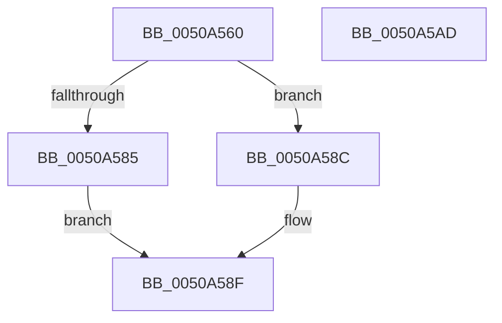

# sub_0050A560

- RVA: `0x0050A560`–`0x0050A5AE` (길이 `78` bytes)
- VA: `0x000000014050A560`
- 실행 섹션: `.text`
- PDB 이름 있음: `아니요`; PDB Function 태그: `아니요`
- unwind 정보 RVA: `0x0005CAAC`
- 디코드: `23`개 명령, `78/78` bytes 표시
- 미해석 바이트: `0` (있으면 어셈블리에 `.byte`로 보존)

> 이 문서는 커널 이미지의 기계어와 PDB 기호를 분석해 생성했습니다. 4번과 5번은 함수 원형과 자료형을 바이너리 사용 방식에서 추정한 C 해석이며 원본 소스 복구 결과는 아닙니다.

## 1. Dependencies

- 직접 호출 지점: **3**; 고유 호출 대상: **3**
- 직접 호출자로 확인된 함수: **0**
- RIP 상대 이미지 참조: **0**

### Outgoing calls
- `0x0050A585` → [KeExitRetpoline](../46/KeExitRetpoline_function_00468E7C.md) (function, `0x00468E7C`)
- `0x0050A592` → [guard_check_icall](../6B/guard_check_icall_function_006BAA80.md) (function, `0x006BAA80`)
- `0x0050A59D` → `indirect target` (indirect, 간접 대상)

### Direct callers
- 이 함수 시작 RVA로 연결되는 직접 call은 확인되지 않았습니다. 간접 호출은 완전히 역산할 수 없습니다.

### Static image references
- 디코드된 RIP-relative 메모리 참조가 없습니다.

## 2. Other-region calls and transfers

- 다른 실행 섹션으로 향하는 call: **0**
- 별도 외부 분기/꼬리 이동을 확인하지 못했습니다.

## 3. Assembly (complete function range)

```asm
0050A560  48 89 5C 24 08                  mov qword ptr [rsp + 8], rbx
0050A565  57                              push rdi
0050A566  48 83 EC 20                     sub rsp, 0x20
0050A56A  48 8B 59 10                     mov rbx, qword ptr [rcx + 0x10]
0050A56E  48 8B FB                        mov rdi, rbx
0050A571  48 33 59 08                     xor rbx, qword ptr [rcx + 8]
0050A575  48 33 79 18                     xor rdi, qword ptr [rcx + 0x18]
0050A579  F7 83 DC 09 00 00 00 00 10 00   test dword ptr [rbx + 0x9dc], 0x100000
0050A583  74 07                           je 0x14050a58c
0050A585  E8 F2 E8 F5 FF                  call 0x140468e7c
0050A58A  EB 03                           jmp 0x14050a58f
0050A58C  0F AE E8                        lfence
0050A58F  48 8B CF                        mov rcx, rdi
0050A592  E8 E9 04 1B 00                  call 0x1406baa80
0050A597  48 8B C7                        mov rax, rdi
0050A59A  48 8B CB                        mov rcx, rbx
0050A59D  FF D0                           call rax
0050A59F  0F 1F 00                        nop dword ptr [rax]
0050A5A2  48 8B 5C 24 30                  mov rbx, qword ptr [rsp + 0x30]
0050A5A7  48 83 C4 20                     add rsp, 0x20
0050A5AB  5F                              pop rdi
0050A5AC  C3                              ret
0050A5AD  CC                              int3
```

## 4. C-style interpretation (structured pseudocode)

```c
__int64 __fastcall sub_0050A560(__int64 a1)
{
    __int64 result;
    __int64 v_rbx;
    __int64 v_rdi;
    __int64 v_rsp;
    unsigned __int64 v_stack_p8;

    v_stack_p8 = v_rbx;
    v_rsp = (v_rsp) - (32);
    v_rbx = (*(unsigned __int64 *)(a1 + 16)) ^ (*(unsigned __int64 *)(a1 + 8));
    v_rdi = (*(unsigned __int64 *)(a1 + 16)) ^ (*(unsigned __int64 *)(a1 + 24));
    if (((*(unsigned int *)(v_rbx + 2524)) & (0x100000ULL)) == 0) goto loc_0050A58C;
    result = KeExitRetpoline(a1, a2, a3, a4);
    goto loc_0050A58F;
loc_0050A58C:
loc_0050A58F:
    result = guard_check_icall(v_rdi, a2, a3, a4);
    result = kernel_indirect_call(v_rbx, a2, a3, a4);
    v_rsp = (v_rsp) + (32);
    return result;
}
```

## 5. (Beta) C Style

```c
int64_t sub_0050A560(void *Arg1)
{
    uint8_t *arg1 = (uint8_t *)Arg1;

    int64_t result;
    int64_t local_rbx;
    int64_t local_rdi;
    int64_t local_rsp;
    uint64_t v_stack_p8;

    v_stack_p8 = local_rbx;
    local_rsp = (local_rsp) - (32);
    local_rbx = (*(uint64_t *)(arg1 + 0x10)) ^ (*(uint64_t *)(arg1 + 0x8));
    local_rdi = (*(uint64_t *)(arg1 + 0x10)) ^ (*(uint64_t *)(arg1 + 0x18));
    if (((*(uint32_t *)(local_rbx + 0x9DC)) & (0x100000ULL)) == 0) goto loc_0050A58C;
    result = KeExitRetpoline(Arg1, a2, a3, a4);
    goto loc_0050A58F;
loc_0050A58C:
loc_0050A58F:
    result = guard_check_icall(local_rdi, a2, a3, a4);
    result = kernel_indirect_call(local_rbx, a2, a3, a4);
    local_rsp = (local_rsp) + (32);
    return result;
}
```

### 관측된 메모리 오프셋

구조체 형식이 확인되지 않은 접근은 인자 기준의 오프셋으로만 기록했습니다.

| 기준 인자 | 오프셋 표현 | 폭 (bit) | 접근 |
|---|---:|---:|---|
| `Arg1` | `+ 0x8` | `64` | `R` |
| `Arg1` | `+ 0x10` | `64` | `R` |
| `Arg1` | `+ 0x18` | `64` | `R` |

## 6. Execution-region graph

[열기: 2D/3D 그래프와 함수 탐색 컨트롤 패널](../../../control-panel.html?section=text&rva=0x0050A560&view=graph)

- 2D 그래프는 위에서 아래로 흐르고, 3D 그래프는 빈 공간을 드래그해 회전합니다. Shift+드래그는 이동, 휠은 확대·축소, 함수 노드 선택은 대상 보고서 이동입니다.

### Static fallback


