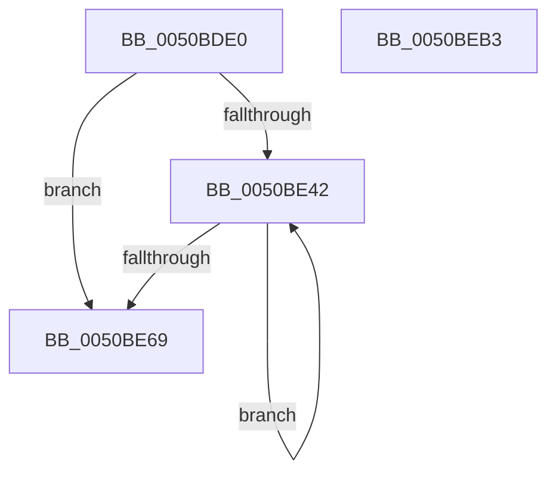

# sub_0050BDE0

- RVA: `0x0050BDE0`–`0x0050BEB4` (길이 `212` bytes)
- VA: `0x000000014050BDE0`
- 실행 섹션: `.text`
- PDB 이름 있음: `아니요`; PDB Function 태그: `아니요`
- unwind 정보 RVA: `0x0005C954`
- 디코드: `60`개 명령, `212/212` bytes 표시
- 미해석 바이트: `0` (있으면 어셈블리에 `.byte`로 보존)

> 이 문서는 커널 이미지의 기계어와 PDB 기호를 분석해 생성했습니다. 4번과 5번은 함수 원형과 자료형을 바이너리 사용 방식에서 추정한 C 해석이며 원본 소스 복구 결과는 아닙니다.

## 1. Dependencies

- 직접 호출 지점: **3**; 고유 호출 대상: **3**
- 직접 호출자로 확인된 함수: **0**
- RIP 상대 이미지 참조: **1**

### Outgoing calls
- `0x0050BDFD` → [KeExitRetpoline](../46/KeExitRetpoline_function_00468E7C.md) (function, `0x00468E7C`)
- `0x0050BE84` → [guard_check_icall](../6B/guard_check_icall_function_006BAA80.md) (function, `0x006BAA80`)
- `0x0050BE99` → `indirect target` (indirect, 간접 대상)

### Direct callers
- 이 함수 시작 RVA로 연결되는 직접 call은 확인되지 않았습니다. 간접 호출은 완전히 역산할 수 없습니다.

### Static image references
- `0x0050BE17` → RVA `0x00E0F248` (`.data`; read)

## 2. Other-region calls and transfers

- 다른 실행 섹션으로 향하는 call: **0**
- 별도 외부 분기/꼬리 이동을 확인하지 못했습니다.

## 3. Assembly (complete function range)

```asm
0050BDE0  48 89 5C 24 08                  mov qword ptr [rsp + 8], rbx
0050BDE5  48 89 6C 24 10                  mov qword ptr [rsp + 0x10], rbp
0050BDEA  48 89 74 24 18                  mov qword ptr [rsp + 0x18], rsi
0050BDEF  57                              push rdi
0050BDF0  48 83 EC 20                     sub rsp, 0x20
0050BDF4  49 8B F1                        mov rsi, r9
0050BDF7  49 8B E8                        mov rbp, r8
0050BDFA  48 8B D9                        mov rbx, rcx
0050BDFD  E8 7A D0 F5 FF                  call 0x140468e7c
0050BE02  4C 8B 53 20                     mov r10, qword ptr [rbx + 0x20]
0050BE06  B8 00 24 4C E0                  mov eax, 0xe04c2400
0050BE0B  49 8B D2                        mov rdx, r10
0050BE0E  41 B8 01 00 00 00               mov r8d, 1
0050BE14  48 33 D0                        xor rdx, rax
0050BE17  48 8D 05 2A 34 90 00            lea rax, [rip + 0x90342a]
0050BE1E  48 C1 EA 04                     shr rdx, 4
0050BE22  49 33 D2                        xor rdx, r10
0050BE25  48 C1 EA 04                     shr rdx, 4
0050BE29  48 33 D0                        xor rdx, rax
0050BE2C  8A C2                           mov al, dl
0050BE2E  4C 8B DA                        mov r11, rdx
0050BE31  24 0F                           and al, 0xf
0050BE33  4C 8B CA                        mov r9, rdx
0050BE36  0F B6 C8                        movzx ecx, al
0050BE39  44 0F 45 C1                     cmovne r8d, ecx
0050BE3D  45 84 C0                        test r8b, r8b
0050BE40  74 27                           je 0x14050be69
0050BE42  48 8B C2                        mov rax, rdx
0050BE45  83 E0 0F                        and eax, 0xf
0050BE48  4E 8B 14 10                     mov r10, qword ptr [rax + r10]
0050BE4C  49 8B C2                        mov rax, r10
0050BE4F  48 35 00 F4 1D 00               xor rax, 0x1df400
0050BE55  48 C1 E8 04                     shr rax, 4
0050BE59  49 33 C2                        xor rax, r10
0050BE5C  48 C1 E8 04                     shr rax, 4
0050BE60  48 33 D0                        xor rdx, rax
0050BE63  41 80 C0 FF                     add r8b, 0xff
0050BE67  75 D9                           jne 0x14050be42
0050BE69  49 8B FA                        mov rdi, r10
0050BE6C  41 81 E1 00 10 00 00            and r9d, 0x1000
0050BE73  49 33 FB                        xor rdi, r11
0050BE76  4D 85 C9                        test r9, r9
0050BE79  49 0F 44 FA                     cmove rdi, r10
0050BE7D  48 8B 5F 18                     mov rbx, qword ptr [rdi + 0x18]
0050BE81  48 8B CB                        mov rcx, rbx
0050BE84  E8 F7 EB 1A 00                  call 0x1406baa80
0050BE89  48 8B 57 20                     mov rdx, qword ptr [rdi + 0x20]
0050BE8D  48 8B C3                        mov rax, rbx
0050BE90  4C 8B CE                        mov r9, rsi
0050BE93  4C 8B C5                        mov r8, rbp
0050BE96  48 8B CF                        mov rcx, rdi
0050BE99  FF D0                           call rax
0050BE9B  0F 1F 00                        nop dword ptr [rax]
0050BE9E  48 8B 5C 24 30                  mov rbx, qword ptr [rsp + 0x30]
0050BEA3  48 8B 6C 24 38                  mov rbp, qword ptr [rsp + 0x38]
0050BEA8  48 8B 74 24 40                  mov rsi, qword ptr [rsp + 0x40]
0050BEAD  48 83 C4 20                     add rsp, 0x20
0050BEB1  5F                              pop rdi
0050BEB2  C3                              ret
0050BEB3  CC                              int3
```

## 4. C-style interpretation (structured pseudocode)

```c
__int64 __fastcall sub_0050BDE0(__int64 a1, __int64 a2, __int64 a3, __int64 a4)
{
    __int64 result;
    __int64 v_rdi;
    __int64 v_rsp;
    unsigned __int64 v_stack_p10;
    unsigned __int64 v_stack_p18;
    unsigned __int64 v_stack_p8;

    v_stack_p8 = v_rbx;
    v_stack_p10 = v_rbp;
    v_stack_p18 = v_rsi;
    v_rsp = (v_rsp) - (32);
    result = KeExitRetpoline(a1, a2, a3, a4);
    a2 = (*(unsigned __int64 *)(a1 + 32)) ^ ((unsigned int)(0xE04C2400ULL));
    a2 = (a2) >> (4);
    a2 = (a2) ^ (*(unsigned __int64 *)(a1 + 32));
    a2 = (a2) >> (4);
    a2 = (a2) ^ (v_rip + 9450538);
    result = (unsigned __int8)(((unsigned __int8)(a2)) & (15));
    a3 = 1;
    if (condition_is_not_equal) { a3 = (unsigned int)((unsigned __int8)(result)); }
    if ((unsigned __int8)(a3) == 0) goto loc_0050BE69;
loc_0050BE42:
    result = (unsigned int)((a2) & (15));
    result = (*(unsigned __int64 *)(result + *(unsigned __int64 *)(a1 + 32) * 1)) ^ (0x1DF400ULL);
    result = (result) >> (4);
    result = (result) ^ (*(unsigned __int64 *)(result + *(unsigned __int64 *)(a1 + 32) * 1));
    result = (result) >> (4);
    a2 = (a2) ^ (result);
    a3 = (unsigned __int8)((a3) + (255));
    if (condition_is_not_equal) goto loc_0050BE42;
loc_0050BE69:
    a4 = (unsigned int)((a2) & (0x1000ULL));
    v_rdi = (*(unsigned __int64 *)(result + *(unsigned __int64 *)(a1 + 32) * 1)) ^ (a2);
    if (a4 == 0) { v_rdi = *(unsigned __int64 *)(result + *(unsigned __int64 *)(a1 + 32) * 1); }
    result = guard_check_icall(*(unsigned __int64 *)(v_rdi + 24), a2, a3, a4);
    result = kernel_indirect_call(v_rdi, *(unsigned __int64 *)(v_rdi + 32), a3, a4);
    v_rsp = (v_rsp) + (32);
    return result;
}
```

## 5. (Beta) C Style

```c
int64_t sub_0050BDE0(void *Arg1, int64_t Arg2, int64_t Arg3, int64_t Arg4)
{
    uint8_t *arg1 = (uint8_t *)Arg1;

    int64_t result;
    int64_t local_rdi;
    int64_t local_rsp;
    uint64_t v_stack_p10;
    uint64_t v_stack_p18;
    uint64_t v_stack_p8;

    v_stack_p8 = local_rbx;
    v_stack_p10 = local_rbp;
    v_stack_p18 = local_rsi;
    local_rsp = (local_rsp) - (32);
    result = KeExitRetpoline(Arg1, Arg2, Arg3, Arg4);
    Arg2 = (*(uint64_t *)(arg1 + 0x20)) ^ ((uint32_t)(0xE04C2400ULL));
    Arg2 = (Arg2) >> (4);
    Arg2 = (Arg2) ^ (*(uint64_t *)(arg1 + 0x20));
    Arg2 = (Arg2) >> (4);
    Arg2 = (Arg2) ^ (v_rip + 9450538);
    result = (uint8_t)(((uint8_t)(Arg2)) & (15));
    Arg3 = 1;
    if (condition_is_not_equal) { Arg3 = (uint32_t)((uint8_t)(result)); }
    if ((uint8_t)(Arg3) == 0) goto loc_0050BE69;
loc_0050BE42:
    result = (uint32_t)((Arg2) & (15));
    result = (*(uint64_t *)(result + *(uint64_t *)(arg1 + 0x20) * 1)) ^ (0x1DF400ULL);
    result = (result) >> (4);
    result = (result) ^ (*(uint64_t *)(result + *(uint64_t *)(arg1 + 0x20) * 1));
    result = (result) >> (4);
    Arg2 = (Arg2) ^ (result);
    Arg3 = (uint8_t)((Arg3) + (255));
    if (condition_is_not_equal) goto loc_0050BE42;
loc_0050BE69:
    Arg4 = (uint32_t)((Arg2) & (0x1000ULL));
    local_rdi = (*(uint64_t *)(result + *(uint64_t *)(arg1 + 0x20) * 1)) ^ (Arg2);
    if (Arg4 == 0) { local_rdi = *(uint64_t *)(result + *(uint64_t *)(arg1 + 0x20) * 1); }
    result = guard_check_icall(*(uint64_t *)(local_rdi + 0x18), Arg2, Arg3, Arg4);
    result = kernel_indirect_call(local_rdi, *(uint64_t *)(local_rdi + 0x20), Arg3, Arg4);
    local_rsp = (local_rsp) + (32);
    return result;
}
```

### 관측된 메모리 오프셋

구조체 형식이 확인되지 않은 접근은 인자 기준의 오프셋으로만 기록했습니다.

| 기준 인자 | 오프셋 표현 | 폭 (bit) | 접근 |
|---|---:|---:|---|
| `Arg1` | `+ 0x20` | `64` | `R` |

## 6. Execution-region graph

[열기: 2D/3D 그래프와 함수 탐색 컨트롤 패널](../../../control-panel.html?section=text&rva=0x0050BDE0&view=graph)

- 2D 그래프는 위에서 아래로 흐르고, 3D 그래프는 빈 공간을 드래그해 회전합니다. Shift+드래그는 이동, 휠은 확대·축소, 함수 노드 선택은 대상 보고서 이동입니다.

### Static fallback


