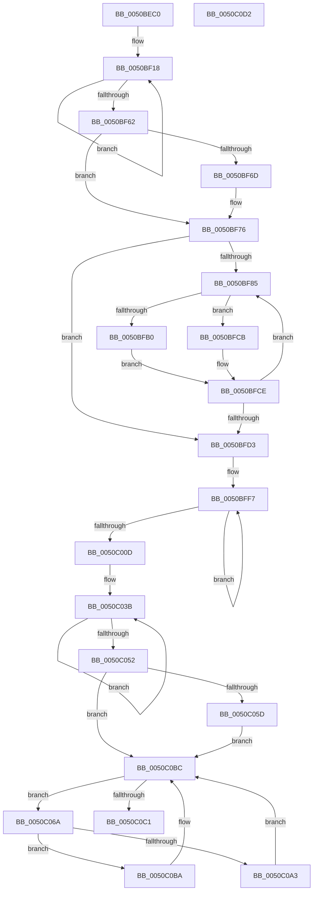

# sub_0050BEC0

- RVA: `0x0050BEC0`–`0x0050C0D3` (길이 `531` bytes)
- VA: `0x000000014050BEC0`
- 실행 섹션: `.text`
- PDB 이름 있음: `아니요`; PDB Function 태그: `아니요`
- unwind 정보 RVA: `0x000C3B5C`
- 디코드: `154`개 명령, `531/531` bytes 표시
- 미해석 바이트: `0` (있으면 어셈블리에 `.byte`로 보존)

> 이 문서는 커널 이미지의 기계어와 PDB 기호를 분석해 생성했습니다. 4번과 5번은 함수 원형과 자료형을 바이너리 사용 방식에서 추정한 C 해석이며 원본 소스 복구 결과는 아닙니다.

## 1. Dependencies

- 직접 호출 지점: **2**; 고유 호출 대상: **2**
- 직접 호출자로 확인된 함수: **0**
- RIP 상대 이미지 참조: **0**

### Outgoing calls
- `0x0050C01A` → [guard_check_icall](../6B/guard_check_icall_function_006BAA80.md) (function, `0x006BAA80`)
- `0x0050C033` → `indirect target` (indirect, 간접 대상)

### Direct callers
- 이 함수 시작 RVA로 연결되는 직접 call은 확인되지 않았습니다. 간접 호출은 완전히 역산할 수 없습니다.

### Static image references
- 디코드된 RIP-relative 메모리 참조가 없습니다.

## 2. Other-region calls and transfers

- 다른 실행 섹션으로 향하는 call: **0**
- 별도 외부 분기/꼬리 이동을 확인하지 못했습니다.

## 3. Assembly (complete function range)

```asm
0050BEC0  4C 89 4C 24 20                  mov qword ptr [rsp + 0x20], r9
0050BEC5  4C 89 44 24 18                  mov qword ptr [rsp + 0x18], r8
0050BECA  53                              push rbx
0050BECB  55                              push rbp
0050BECC  56                              push rsi
0050BECD  57                              push rdi
0050BECE  41 54                           push r12
0050BED0  41 55                           push r13
0050BED2  41 56                           push r14
0050BED4  41 57                           push r15
0050BED6  48 83 EC 28                     sub rsp, 0x28
0050BEDA  4C 8B BC 24 90 00 00 00         mov r15, qword ptr [rsp + 0x90]
0050BEE2  4C 8D 4C 24 68                  lea r9, [rsp + 0x68]
0050BEE7  44 8B DA                        mov r11d, edx
0050BEEA  48 8B D9                        mov rbx, rcx
0050BEED  BA 02 00 00 00                  mov edx, 2
0050BEF2  41 8A 37                        mov sil, byte ptr [r15]
0050BEF5  4D 8D B7 02 01 00 00            lea r14, [r15 + 0x102]
0050BEFC  45 8A 6F 01                     mov r13b, byte ptr [r15 + 1]
0050BF00  49 8D 4F 02                     lea rcx, [r15 + 2]
0050BF04  40 88 74 24 78                  mov byte ptr [rsp + 0x78], sil
0050BF09  44 8D 42 7E                     lea r8d, [rdx + 0x7e]
0050BF0D  44 88 AC 24 90 00 00 00         mov byte ptr [rsp + 0x90], r13b
0050BF15  49 8B C6                        mov rax, r14
0050BF18  0F 10 01                        movups xmm0, xmmword ptr [rcx]
0050BF1B  0F 11 00                        movups xmmword ptr [rax], xmm0
0050BF1E  0F 10 49 10                     movups xmm1, xmmword ptr [rcx + 0x10]
0050BF22  0F 11 48 10                     movups xmmword ptr [rax + 0x10], xmm1
0050BF26  0F 10 41 20                     movups xmm0, xmmword ptr [rcx + 0x20]
0050BF2A  0F 11 40 20                     movups xmmword ptr [rax + 0x20], xmm0
0050BF2E  0F 10 49 30                     movups xmm1, xmmword ptr [rcx + 0x30]
0050BF32  0F 11 48 30                     movups xmmword ptr [rax + 0x30], xmm1
0050BF36  0F 10 41 40                     movups xmm0, xmmword ptr [rcx + 0x40]
0050BF3A  0F 11 40 40                     movups xmmword ptr [rax + 0x40], xmm0
0050BF3E  0F 10 49 50                     movups xmm1, xmmword ptr [rcx + 0x50]
0050BF42  0F 11 48 50                     movups xmmword ptr [rax + 0x50], xmm1
0050BF46  0F 10 41 60                     movups xmm0, xmmword ptr [rcx + 0x60]
0050BF4A  0F 11 40 60                     movups xmmword ptr [rax + 0x60], xmm0
0050BF4E  49 03 C0                        add rax, r8
0050BF51  0F 10 49 70                     movups xmm1, xmmword ptr [rcx + 0x70]
0050BF55  49 03 C8                        add rcx, r8
0050BF58  0F 11 48 F0                     movups xmmword ptr [rax - 0x10], xmm1
0050BF5C  48 83 EA 01                     sub rdx, 1
0050BF60  75 B6                           jne 0x14050bf18
0050BF62  33 FF                           xor edi, edi
0050BF64  41 F6 47 02 01                  test byte ptr [r15 + 2], 1
0050BF69  8B EF                           mov ebp, edi
0050BF6B  74 09                           je 0x14050bf76
0050BF6D  48 8B EB                        mov rbp, rbx
0050BF70  49 33 29                        xor rbp, qword ptr [r9]
0050BF73  49 89 39                        mov qword ptr [r9], rdi
0050BF76  4E 8D 24 1B                     lea r12, [rbx + r11]
0050BF7A  4C 8B C3                        mov r8, rbx
0050BF7D  44 8B CF                        mov r9d, edi
0050BF80  49 3B DC                        cmp rbx, r12
0050BF83  74 4E                           je 0x14050bfd3
0050BF85  40 FE C6                        inc sil
0050BF88  40 0F B6 CE                     movzx ecx, sil
0050BF8C  42 8A 44 39 02                  mov al, byte ptr [rcx + r15 + 2]
0050BF91  44 02 E8                        add r13b, al
0050BF94  45 0F B6 DD                     movzx r11d, r13b
0050BF98  43 8A 54 3B 02                  mov dl, byte ptr [r11 + r15 + 2]
0050BF9D  43 88 44 3B 02                  mov byte ptr [r11 + r15 + 2], al
0050BFA2  42 88 54 39 02                  mov byte ptr [rcx + r15 + 2], dl
0050BFA7  41 81 F9 00 04 00 00            cmp r9d, 0x400
0050BFAE  72 1B                           jb 0x14050bfcb
0050BFB0  43 02 54 3B 02                  add dl, byte ptr [r11 + r15 + 2]
0050BFB5  0F B6 C2                        movzx eax, dl
0050BFB8  42 8A 54 38 02                  mov dl, byte ptr [rax + r15 + 2]
0050BFBD  41 32 10                        xor dl, byte ptr [r8]
0050BFC0  80 F2 DA                        xor dl, 0xda
0050BFC3  41 88 10                        mov byte ptr [r8], dl
0050BFC6  49 FF C0                        inc r8
0050BFC9  EB 03                           jmp 0x14050bfce
0050BFCB  41 FF C1                        inc r9d
0050BFCE  4D 3B C4                        cmp r8, r12
0050BFD1  75 B2                           jne 0x14050bf85
0050BFD3  41 88 37                        mov byte ptr [r15], sil
0050BFD6  48 8D 44 24 70                  lea rax, [rsp + 0x70]
0050BFDB  48 8B F3                        mov rsi, rbx
0050BFDE  45 88 6F 01                     mov byte ptr [r15 + 1], r13b
0050BFE2  48 33 F0                        xor rsi, rax
0050BFE5  41 BD 40 00 00 00               mov r13d, 0x40
0050BFEB  48 8B C6                        mov rax, rsi
0050BFEE  4C 8B C6                        mov r8, rsi
0050BFF1  49 8B CF                        mov rcx, r15
0050BFF4  41 8B D5                        mov edx, r13d
0050BFF7  48 31 01                        xor qword ptr [rcx], rax
0050BFFA  49 8B C0                        mov rax, r8
0050BFFD  48 C1 C8 03                     ror rax, 3
0050C001  48 8D 49 08                     lea rcx, [rcx + 8]
0050C005  4C 8B C0                        mov r8, rax
0050C008  83 C2 FF                        add edx, -1
0050C00B  75 EA                           jne 0x14050bff7
0050C00D  48 8B 8C 24 88 00 00 00         mov rcx, qword ptr [rsp + 0x88]
0050C015  48 89 44 24 70                  mov qword ptr [rsp + 0x70], rax
0050C01A  E8 61 EA 1A 00                  call 0x1406baa80
0050C01F  48 8B 84 24 88 00 00 00         mov rax, qword ptr [rsp + 0x88]
0050C027  33 D2                           xor edx, edx
0050C029  4C 8B 84 24 80 00 00 00         mov r8, qword ptr [rsp + 0x80]
0050C031  33 C9                           xor ecx, ecx
0050C033  FF D0                           call rax
0050C035  0F 1F 00                        nop dword ptr [rax]
0050C038  48 8B C6                        mov rax, rsi
0050C03B  49 31 37                        xor qword ptr [r15], rsi
0050C03E  48 8B F0                        mov rsi, rax
0050C041  48 C1 CE 03                     ror rsi, 3
0050C045  4D 8D 7F 08                     lea r15, [r15 + 8]
0050C049  48 8B C6                        mov rax, rsi
0050C04C  41 83 C5 FF                     add r13d, -1
0050C050  75 E9                           jne 0x14050c03b
0050C052  41 F6 06 01                     test byte ptr [r14], 1
0050C056  48 89 74 24 70                  mov qword ptr [rsp + 0x70], rsi
0050C05B  74 5F                           je 0x14050c0bc
0050C05D  48 33 EB                        xor rbp, rbx
0050C060  48 8D 44 24 68                  lea rax, [rsp + 0x68]
0050C065  48 89 28                        mov qword ptr [rax], rbp
0050C068  EB 52                           jmp 0x14050c0bc
0050C06A  8A 44 24 78                     mov al, byte ptr [rsp + 0x78]
0050C06E  8A 94 24 90 00 00 00            mov dl, byte ptr [rsp + 0x90]
0050C075  FE C0                           inc al
0050C077  0F B6 C8                        movzx ecx, al
0050C07A  88 44 24 78                     mov byte ptr [rsp + 0x78], al
0050C07E  42 8A 04 31                     mov al, byte ptr [rcx + r14]
0050C082  02 D0                           add dl, al
0050C084  44 0F B6 C2                     movzx r8d, dl
0050C088  88 94 24 90 00 00 00            mov byte ptr [rsp + 0x90], dl
0050C08F  43 8A 14 30                     mov dl, byte ptr [r8 + r14]
0050C093  43 88 04 30                     mov byte ptr [r8 + r14], al
0050C097  42 88 14 31                     mov byte ptr [rcx + r14], dl
0050C09B  81 FF 00 04 00 00               cmp edi, 0x400
0050C0A1  72 17                           jb 0x14050c0ba
0050C0A3  43 02 14 30                     add dl, byte ptr [r8 + r14]
0050C0A7  0F B6 C2                        movzx eax, dl
0050C0AA  42 8A 14 30                     mov dl, byte ptr [rax + r14]
0050C0AE  32 13                           xor dl, byte ptr [rbx]
0050C0B0  80 F2 DA                        xor dl, 0xda
0050C0B3  88 13                           mov byte ptr [rbx], dl
0050C0B5  48 FF C3                        inc rbx
0050C0B8  EB 02                           jmp 0x14050c0bc
0050C0BA  FF C7                           inc edi
0050C0BC  49 3B DC                        cmp rbx, r12
0050C0BF  75 A9                           jne 0x14050c06a
0050C0C1  48 83 C4 28                     add rsp, 0x28
0050C0C5  41 5F                           pop r15
0050C0C7  41 5E                           pop r14
0050C0C9  41 5D                           pop r13
0050C0CB  41 5C                           pop r12
0050C0CD  5F                              pop rdi
0050C0CE  5E                              pop rsi
0050C0CF  5D                              pop rbp
0050C0D0  5B                              pop rbx
0050C0D1  C3                              ret
0050C0D2  CC                              int3
```

## 4. C-style interpretation (structured pseudocode)

```c
__int64 __fastcall sub_0050BEC0(__int64 a1, int a2, __int64 a3, __int64 a4, unsigned __int8 a5)
{
    __int64 result;
    __int64 v_r13;
    __int64 v_rbp;
    __int64 v_rbx;
    __int64 v_rdi;
    __int64 v_rsi;
    __int64 v_rsp;
    unsigned __int64 v_stack_p0;
    unsigned __int8 v_stack_p10;
    unsigned __int64 v_stack_p18;
    unsigned __int64 v_stack_p20;
    unsigned __int8 v_stack_p28;
    unsigned __int64 v_stack_p8;

    v_stack_p20 = a4;
    v_stack_p18 = a3;
    v_rsp = (v_rsp) - (40);
    v_stack_p10 = (unsigned __int8)(*(unsigned __int8 *)(a5));
    v_stack_p28 = (unsigned __int8)(*(unsigned __int8 *)(a5 + 1));
loc_0050BF18:
    *(unsigned __int64 *)(a5 + 258) = v_xmm0;
    *(unsigned __int64 *)(a5 + 258 + 16) = v_xmm1;
    *(unsigned __int64 *)(a5 + 258 + 32) = v_xmm0;
    *(unsigned __int64 *)(a5 + 258 + 48) = v_xmm1;
    *(unsigned __int64 *)(a5 + 258 + 64) = v_xmm0;
    *(unsigned __int64 *)(a5 + 258 + 80) = v_xmm1;
    *(unsigned __int64 *)(a5 + 258 + 96) = v_xmm0;
    result = (a5 + 258) + (2 + 126);
    a1 = (a5 + 2) + (2 + 126);
    *(unsigned __int64 *)(result - 16) = v_xmm1;
    a2 = (2) - (1);
    if (condition_is_not_equal) goto loc_0050BF18;
    v_rdi = 0;
    v_rbp = 0;
    if (((*(unsigned __int8 *)(a5 + 2)) & (1)) != 0) {
        v_rbp = a1;
        v_rbp = (v_rbp) ^ (*(unsigned __int64 *)(v_stack_p0));
        *(unsigned __int64 *)(v_stack_p0) = 0;
    }
    if (a1 == (a1 + (unsigned int)(a2) * 1)) goto loc_0050BFD3;
loc_0050BF85:
    v_rsi = (unsigned __int8)((*(unsigned __int8 *)(a5)) + 1);
    v_r13 = (unsigned __int8)((*(unsigned __int8 *)(a5 + 1)) + ((unsigned __int8)(*(unsigned __int8 *)((unsigned __int8)(v_rsi) + a5 * 1 + 2))));
    *(unsigned __int8 *)((unsigned __int8)(v_r13) + a5 * 1 + 2) = (unsigned __int8)(*(unsigned __int8 *)((unsigned __int8)(v_rsi) + a5 * 1 + 2));
    *(unsigned __int8 *)((unsigned __int8)(v_rsi) + a5 * 1 + 2) = (unsigned __int8)(*(unsigned __int8 *)((unsigned __int8)(v_r13) + a5 * 1 + 2));
    if (0 < 0x400ULL) goto loc_0050BFCB;
    a2 = (unsigned __int8)((*(unsigned __int8 *)((unsigned __int8)(v_r13) + a5 * 1 + 2)) + (*(unsigned __int8 *)((unsigned __int8)(v_r13) + a5 * 1 + 2)));
    a2 = (unsigned __int8)((*(unsigned __int8 *)((unsigned __int8)(a2) + a5 * 1 + 2)) ^ (*(unsigned __int8 *)(a1)));
    a2 = (unsigned __int8)((a2) ^ (218));
    *(unsigned __int8 *)(a1) = (unsigned __int8)(a2);
    a3 = (a1) + 1;
    goto loc_0050BFCE;
loc_0050BFCB:
    a4 = (unsigned int)((0) + 1);
loc_0050BFCE:
    if (a3 != (a1 + (unsigned int)(a2) * 1)) goto loc_0050BF85;
loc_0050BFD3:
    *(unsigned __int8 *)(a5) = (unsigned __int8)(v_rsi);
    *(unsigned __int8 *)(a5 + 1) = (unsigned __int8)(v_r13);
    v_rsi = (a1) ^ (v_stack_p8);
loc_0050BFF7:
    a2 = (unsigned int)((64) + (-1));
    if (condition_is_not_equal) goto loc_0050BFF7;
    v_stack_p8 = v_rsi;
    result = guard_check_icall(v_stack_p20, a2, v_rsi, a4);
    a2 = 0;
    a1 = 0;
    result = kernel_indirect_call(a1, a2, v_stack_p18, a4);
loc_0050C03B:
    v_r13 = (unsigned int)((64) + (-1));
    if (condition_is_not_equal) goto loc_0050C03B;
    v_stack_p8 = v_rsi;
    if (((*(unsigned __int8 *)(a5 + 258)) & (1)) == 0) goto loc_0050C0BC;
    v_rbp = (v_rbp) ^ (0);
    *(unsigned __int64 *)(v_stack_p0) = v_rbp;
    goto loc_0050C0BC;
loc_0050C06A:
    result = (unsigned __int8)((v_stack_p10) + 1);
    v_stack_p10 = (unsigned __int8)(result);
    a2 = (unsigned __int8)((a5) + ((unsigned __int8)(*(unsigned __int8 *)((unsigned __int8)(result) + a5 + 258 * 1))));
    v_stack_p28 = (unsigned __int8)(a2);
    *(unsigned __int8 *)((unsigned __int8)(a2) + a5 + 258 * 1) = (unsigned __int8)(*(unsigned __int8 *)((unsigned __int8)(result) + a5 + 258 * 1));
    *(unsigned __int8 *)((unsigned __int8)(result) + a5 + 258 * 1) = (unsigned __int8)(*(unsigned __int8 *)((unsigned __int8)(a2) + a5 + 258 * 1));
    if (0 < 0x400ULL) goto loc_0050C0BA;
    a2 = (unsigned __int8)((*(unsigned __int8 *)((unsigned __int8)(a2) + a5 + 258 * 1)) + (*(unsigned __int8 *)((unsigned __int8)(a2) + a5 + 258 * 1)));
    a2 = (unsigned __int8)((*(unsigned __int8 *)((unsigned __int8)(a2) + a5 + 258 * 1)) ^ (*(unsigned __int8 *)(a1)));
    a2 = (unsigned __int8)((a2) ^ (218));
    *(unsigned __int8 *)(a1) = (unsigned __int8)(a2);
    v_rbx = (a1) + 1;
    goto loc_0050C0BC;
loc_0050C0BA:
    v_rdi = (unsigned int)((v_rdi) + 1);
loc_0050C0BC:
    if (v_rbx != (a1 + (unsigned int)(a2) * 1)) goto loc_0050C06A;
    v_rsp = (v_rsp) + (40);
    return (unsigned __int8)(a2);
}
```

## 5. (Beta) C Style

```c
int64_t sub_0050BEC0(void *Arg1, int32_t Arg2, int64_t Arg3, int64_t Arg4, void *Arg5)
{
    uint8_t *arg1 = (uint8_t *)Arg1;
    uint8_t *arg5 = (uint8_t *)Arg5;

    int64_t result;
    int64_t local_r13;
    int64_t local_rbp;
    int64_t local_rbx;
    int64_t local_rdi;
    int64_t local_rsi;
    int64_t local_rsp;
    uint64_t v_stack_p0;
    uint8_t v_stack_p10;
    uint64_t v_stack_p18;
    uint64_t v_stack_p20;
    uint8_t v_stack_p28;
    uint64_t v_stack_p8;

    v_stack_p20 = Arg4;
    v_stack_p18 = Arg3;
    local_rsp = (local_rsp) - (40);
    v_stack_p10 = (uint8_t)(*(uint8_t *)(arg5));
    v_stack_p28 = (uint8_t)(*(uint8_t *)(arg5 + 0x1));
loc_0050BF18:
    *(uint64_t *)(arg5 + 0x102) = v_xmm0;
    *(uint64_t *)(arg5 + 0x102 + 0x10) = v_xmm1;
    *(uint64_t *)(arg5 + 0x102 + 0x20) = v_xmm0;
    *(uint64_t *)(arg5 + 0x102 + 0x30) = v_xmm1;
    *(uint64_t *)(arg5 + 0x102 + 0x40) = v_xmm0;
    *(uint64_t *)(arg5 + 0x102 + 0x50) = v_xmm1;
    *(uint64_t *)(arg5 + 0x102 + 0x60) = v_xmm0;
    result = (Arg5 + 258) + (2 + 126);
    Arg1 = (Arg5 + 2) + (2 + 126);
    *(uint64_t *)(result - 0x10) = v_xmm1;
    Arg2 = (2) - (1);
    if (condition_is_not_equal) goto loc_0050BF18;
    local_rdi = 0;
    local_rbp = 0;
    if (((*(uint8_t *)(arg5 + 0x2)) & (1)) != 0) {
        local_rbp = Arg1;
        local_rbp = (local_rbp) ^ (*(uint64_t *)(v_stack_p0));
        *(uint64_t *)(v_stack_p0) = 0;
    }
    if (Arg1 == (Arg1 + (uint32_t)(Arg2) * 1)) goto loc_0050BFD3;
loc_0050BF85:
    local_rsi = (uint8_t)((*(uint8_t *)(arg5)) + 1);
    local_r13 = (uint8_t)((*(uint8_t *)(arg5 + 0x1)) + ((uint8_t)(*(uint8_t *)((uint8_t)(local_rsi) + arg5 * 1 + 0x2))));
    *(uint8_t *)((uint8_t)(local_r13) + arg5 * 1 + 0x2) = (uint8_t)(*(uint8_t *)((uint8_t)(local_rsi) + arg5 * 1 + 0x2));
    *(uint8_t *)((uint8_t)(local_rsi) + arg5 * 1 + 0x2) = (uint8_t)(*(uint8_t *)((uint8_t)(local_r13) + arg5 * 1 + 0x2));
    if (0 < 0x400ULL) goto loc_0050BFCB;
    Arg2 = (uint8_t)((*(uint8_t *)((uint8_t)(local_r13) + arg5 * 1 + 0x2)) + (*(uint8_t *)((uint8_t)(local_r13) + arg5 * 1 + 0x2)));
    Arg2 = (uint8_t)((*(uint8_t *)((uint8_t)(Arg2) + arg5 * 1 + 0x2)) ^ (*(uint8_t *)(arg1)));
    Arg2 = (uint8_t)((Arg2) ^ (218));
    *(uint8_t *)(arg1) = (uint8_t)(Arg2);
    Arg3 = (Arg1) + 1;
    goto loc_0050BFCE;
loc_0050BFCB:
    Arg4 = (uint32_t)((0) + 1);
loc_0050BFCE:
    if (Arg3 != (Arg1 + (uint32_t)(Arg2) * 1)) goto loc_0050BF85;
loc_0050BFD3:
    *(uint8_t *)(arg5) = (uint8_t)(local_rsi);
    *(uint8_t *)(arg5 + 0x1) = (uint8_t)(local_r13);
    local_rsi = (Arg1) ^ (v_stack_p8);
loc_0050BFF7:
    Arg2 = (uint32_t)((64) + (-1));
    if (condition_is_not_equal) goto loc_0050BFF7;
    v_stack_p8 = local_rsi;
    result = guard_check_icall(v_stack_p20, Arg2, local_rsi, Arg4);
    Arg2 = 0;
    Arg1 = 0;
    result = kernel_indirect_call(Arg1, Arg2, v_stack_p18, Arg4);
loc_0050C03B:
    local_r13 = (uint32_t)((64) + (-1));
    if (condition_is_not_equal) goto loc_0050C03B;
    v_stack_p8 = local_rsi;
    if (((*(uint8_t *)(arg5 + 0x102)) & (1)) == 0) goto loc_0050C0BC;
    local_rbp = (local_rbp) ^ (0);
    *(uint64_t *)(v_stack_p0) = local_rbp;
    goto loc_0050C0BC;
loc_0050C06A:
    result = (uint8_t)((v_stack_p10) + 1);
    v_stack_p10 = (uint8_t)(result);
    Arg2 = (uint8_t)((Arg5) + ((uint8_t)(*(uint8_t *)((uint8_t)(result) + arg5 + 0x102 * 1))));
    v_stack_p28 = (uint8_t)(Arg2);
    *(uint8_t *)((uint8_t)(Arg2) + arg5 + 0x102 * 1) = (uint8_t)(*(uint8_t *)((uint8_t)(result) + arg5 + 0x102 * 1));
    *(uint8_t *)((uint8_t)(result) + arg5 + 0x102 * 1) = (uint8_t)(*(uint8_t *)((uint8_t)(Arg2) + arg5 + 0x102 * 1));
    if (0 < 0x400ULL) goto loc_0050C0BA;
    Arg2 = (uint8_t)((*(uint8_t *)((uint8_t)(Arg2) + arg5 + 0x102 * 1)) + (*(uint8_t *)((uint8_t)(Arg2) + arg5 + 0x102 * 1)));
    Arg2 = (uint8_t)((*(uint8_t *)((uint8_t)(Arg2) + arg5 + 0x102 * 1)) ^ (*(uint8_t *)(arg1)));
    Arg2 = (uint8_t)((Arg2) ^ (218));
    *(uint8_t *)(arg1) = (uint8_t)(Arg2);
    local_rbx = (Arg1) + 1;
    goto loc_0050C0BC;
loc_0050C0BA:
    local_rdi = (uint32_t)((local_rdi) + 1);
loc_0050C0BC:
    if (local_rbx != (Arg1 + (uint32_t)(Arg2) * 1)) goto loc_0050C06A;
    local_rsp = (local_rsp) + (40);
    return (uint8_t)(Arg2);
}
```

### 관측된 메모리 오프셋

구조체 형식이 확인되지 않은 접근은 인자 기준의 오프셋으로만 기록했습니다.

| 기준 인자 | 오프셋 표현 | 폭 (bit) | 접근 |
|---|---:|---:|---|
| `Arg1` | `+ 0x0 + r11*1` | `64` | `R` |
| `Arg5` | `- 0x10` | `128` | `R` |
| `Arg5` | `+ 0x0` | `8` | `R` |
| `Arg5` | `+ 0x0` | `8` | `W` |
| `Arg5` | `+ 0x0` | `64` | `R/W` |
| `Arg5` | `+ 0x0` | `128` | `R` |
| `Arg5` | `+ 0x0 + r14*1` | `8` | `R` |
| `Arg5` | `+ 0x0 + r14*1` | `8` | `W` |
| `Arg5` | `+ 0x1` | `8` | `R` |
| `Arg5` | `+ 0x1` | `8` | `W` |
| `Arg5` | `+ 0x2` | `8` | `R` |
| `Arg5` | `+ 0x2` | `64` | `R` |
| `Arg5` | `+ 0x8` | `64` | `R` |
| `Arg5` | `+ 0x10` | `128` | `R` |
| `Arg5` | `+ 0x20` | `128` | `R` |
| `Arg5` | `+ 0x30` | `128` | `R` |
| `Arg5` | `+ 0x40` | `128` | `R` |
| `Arg5` | `+ 0x50` | `128` | `R` |
| `Arg5` | `+ 0x60` | `128` | `R` |
| `Arg5` | `+ 0x70` | `128` | `R` |
| `Arg5` | `+ 0x102` | `64` | `R` |

## 6. Execution-region graph

[열기: 2D/3D 그래프와 함수 탐색 컨트롤 패널](../../../control-panel.html?section=text&rva=0x0050BEC0&view=graph)

- 2D 그래프는 위에서 아래로 흐르고, 3D 그래프는 빈 공간을 드래그해 회전합니다. Shift+드래그는 이동, 휠은 확대·축소, 함수 노드 선택은 대상 보고서 이동입니다.

### Static fallback


