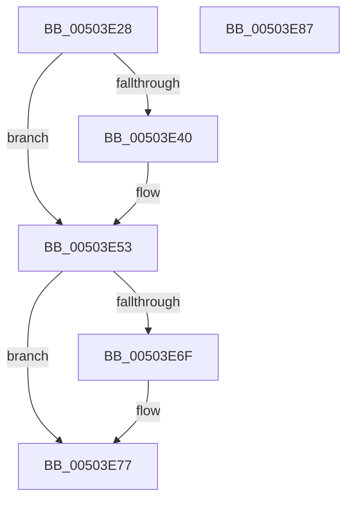

# _GSHandlerCheckCommon

- RVA: `0x00503E28`–`0x00503E88` (길이 `96` bytes)
- VA: `0x0000000140503E28`
- 실행 섹션: `.text`
- PDB 이름 있음: `예`; PDB Function 태그: `아니요`
- unwind 정보 RVA: `0x0005C788`
- 디코드: `31`개 명령, `96/96` bytes 표시
- 미해석 바이트: `0` (있으면 어셈블리에 `.byte`로 보존)

> 이 문서는 커널 이미지의 기계어와 PDB 기호를 분석해 생성했습니다. 4번과 5번은 함수 원형과 자료형을 바이너리 사용 방식에서 추정한 C 해석이며 원본 소스 복구 결과는 아닙니다.

## 1. Dependencies

- 직접 호출 지점: **1**; 고유 호출 대상: **1**
- 직접 호출자로 확인된 함수: **2**
- RIP 상대 이미지 참조: **0**

### Outgoing calls
- `0x00503E7D` → [_security_check_cookie](../6A/_security_check_cookie_function_006AC640.md) (function, `0x006AC640`)

### Direct callers
- [_GSHandlerCheck](_GSHandlerCheck_function_00503E04.md) at `0x00503E12`
- [_GSHandlerCheck_SEH](../6A/_GSHandlerCheck_SEH_function_006AC5A4.md) at `0x006AC5E1`

### Static image references
- 디코드된 RIP-relative 메모리 참조가 없습니다.

## 2. Other-region calls and transfers

- 다른 실행 섹션으로 향하는 call: **0**
- 별도 외부 분기/꼬리 이동을 확인하지 못했습니다.

## 3. Assembly (complete function range)

```asm
00503E28  48 83 EC 28                     sub rsp, 0x28
00503E2C  41 8B 00                        mov eax, dword ptr [r8]
00503E2F  4C 8B C9                        mov r9, rcx
00503E32  44 8B D8                        mov r11d, eax
00503E35  4C 8B D1                        mov r10, rcx
00503E38  41 83 E3 F8                     and r11d, 0xfffffff8
00503E3C  A8 04                           test al, 4
00503E3E  74 13                           je 0x140503e53
00503E40  41 8B 40 08                     mov eax, dword ptr [r8 + 8]
00503E44  4D 63 50 04                     movsxd r10, dword ptr [r8 + 4]
00503E48  F7 D8                           neg eax
00503E4A  4C 03 D1                        add r10, rcx
00503E4D  48 63 C8                        movsxd rcx, eax
00503E50  4C 23 D1                        and r10, rcx
00503E53  49 63 C3                        movsxd rax, r11d
00503E56  4E 8B 04 10                     mov r8, qword ptr [rax + r10]
00503E5A  48 8B 42 10                     mov rax, qword ptr [rdx + 0x10]
00503E5E  8B 48 08                        mov ecx, dword ptr [rax + 8]
00503E61  48 8B 42 08                     mov rax, qword ptr [rdx + 8]
00503E65  0F B6 54 01 03                  movzx edx, byte ptr [rcx + rax + 3]
00503E6A  F6 C2 0F                        test dl, 0xf
00503E6D  74 08                           je 0x140503e77
00503E6F  8B C2                           mov eax, edx
00503E71  83 E0 F0                        and eax, 0xfffffff0
00503E74  4C 03 C8                        add r9, rax
00503E77  4D 33 C8                        xor r9, r8
00503E7A  49 8B C9                        mov rcx, r9
00503E7D  E8 BE 87 1A 00                  call 0x1406ac640
00503E82  48 83 C4 28                     add rsp, 0x28
00503E86  C3                              ret
00503E87  CC                              int3
```

## 4. C-style interpretation (structured pseudocode)

```c
__int64 __fastcall _GSHandlerCheckCommon(__int64 a1, __int64 a2, __int64 a3)
{
    __int64 result;
    __int64 v_r10;
    __int64 v_r11;
    __int64 v_rsp;

    v_rsp = (v_rsp) - (40);
    v_r11 = (unsigned int)(((unsigned int)((unsigned int)((unsigned int)(*(unsigned int *)(a3))))) & (0xFFFFFFF8ULL));
    result = (unsigned int)(*(unsigned int *)(a3));
    v_r10 = a1;
    if ((((unsigned __int8)((unsigned int)(*(unsigned int *)(a3)))) & (4)) != 0) {
        result = *(unsigned int *)(a3 + 8);
        v_r10 = (int)(*(unsigned int *)(a3 + 4));
        result = (unsigned int)(-(result));
        v_r10 = (v_r10) + (a1);
        a1 = (int)((unsigned int)(result));
        v_r10 = (v_r10) & (a1);
    }
    result = *(unsigned __int64 *)(a2 + 8);
    if ((((unsigned __int8)(*(unsigned __int8 *)((unsigned int)(*(unsigned int *)(*(unsigned __int64 *)(a2 + 16) + 8)) + *(unsigned __int64 *)(a2 + 8) * 1 + 3))) & (15)) != 0) {
        result = (unsigned int)(*(unsigned __int8 *)((unsigned int)(*(unsigned int *)(*(unsigned __int64 *)(a2 + 16) + 8)) + *(unsigned __int64 *)(a2 + 8) * 1 + 3));
        result = (unsigned int)((result) & (0xFFFFFFF0ULL));
        a4 = (a1) + (result);
    }
    a4 = (a4) ^ (*(unsigned __int64 *)((int)((unsigned int)(v_r11)) + v_r10 * 1));
    result = _security_check_cookie(a4, *(unsigned __int8 *)((unsigned int)(*(unsigned int *)(*(unsigned __int64 *)(a2 + 16) + 8)) + *(unsigned __int64 *)(a2 + 8) * 1 + 3), *(unsigned __int64 *)((int)((unsigned int)(v_r11)) + v_r10 * 1), a4);
    v_rsp = (v_rsp) + (40);
    return result;
}
```

## 5. (Beta) C Style

```c
int64_t _GSHandlerCheckCommon(int64_t Arg1, void *Arg2, void *Arg3)
{
    uint8_t *arg2 = (uint8_t *)Arg2;
    uint8_t *arg3 = (uint8_t *)Arg3;

    int64_t result;
    int64_t local_r10;
    int64_t local_r11;
    int64_t local_rsp;

    local_rsp = (local_rsp) - (40);
    local_r11 = (uint32_t)(((uint32_t)((uint32_t)((uint32_t)(*(uint32_t *)(arg3))))) & (0xFFFFFFF8ULL));
    result = (uint32_t)(*(uint32_t *)(arg3));
    local_r10 = Arg1;
    if ((((uint8_t)((uint32_t)(*(uint32_t *)(arg3)))) & (4)) != 0) {
        result = *(uint32_t *)(arg3 + 0x8);
        local_r10 = (int32_t)(*(uint32_t *)(arg3 + 0x4));
        result = (uint32_t)(-(result));
        local_r10 = (local_r10) + (Arg1);
        Arg1 = (int32_t)((uint32_t)(result));
        local_r10 = (local_r10) & (Arg1);
    }
    result = *(uint64_t *)(arg2 + 0x8);
    if ((((uint8_t)(*(uint8_t *)((uint32_t)(*(uint32_t *)(*(uint64_t *)(arg2 + 0x10) + 0x8)) + *(uint64_t *)(arg2 + 0x8) * 1 + 0x3))) & (15)) != 0) {
        result = (uint32_t)(*(uint8_t *)((uint32_t)(*(uint32_t *)(*(uint64_t *)(arg2 + 0x10) + 0x8)) + *(uint64_t *)(arg2 + 0x8) * 1 + 0x3));
        result = (uint32_t)((result) & (0xFFFFFFF0ULL));
        a4 = (Arg1) + (result);
    }
    a4 = (a4) ^ (*(uint64_t *)((int32_t)((uint32_t)(local_r11)) + local_r10 * 1));
    result = _security_check_cookie(a4, *(uint8_t *)((uint32_t)(*(uint32_t *)(*(uint64_t *)(arg2 + 0x10) + 0x8)) + *(uint64_t *)(arg2 + 0x8) * 1 + 0x3), *(uint64_t *)((int32_t)((uint32_t)(local_r11)) + local_r10 * 1), a4);
    local_rsp = (local_rsp) + (40);
    return result;
}
```

### 관측된 메모리 오프셋

구조체 형식이 확인되지 않은 접근은 인자 기준의 오프셋으로만 기록했습니다.

| 기준 인자 | 오프셋 표현 | 폭 (bit) | 접근 |
|---|---:|---:|---|
| `Arg2` | `+ 0x8` | `64` | `R` |
| `Arg2` | `+ 0x10` | `64` | `R` |
| `Arg3` | `+ 0x0` | `32` | `R` |
| `Arg3` | `+ 0x4` | `32` | `R` |
| `Arg3` | `+ 0x8` | `32` | `R` |

## 6. Execution-region graph

[열기: 2D/3D 그래프와 함수 탐색 컨트롤 패널](../../../control-panel.html?section=text&rva=0x00503E28&view=graph)

- 2D 그래프는 위에서 아래로 흐르고, 3D 그래프는 빈 공간을 드래그해 회전합니다. Shift+드래그는 이동, 휠은 확대·축소, 함수 노드 선택은 대상 보고서 이동입니다.

### Static fallback


