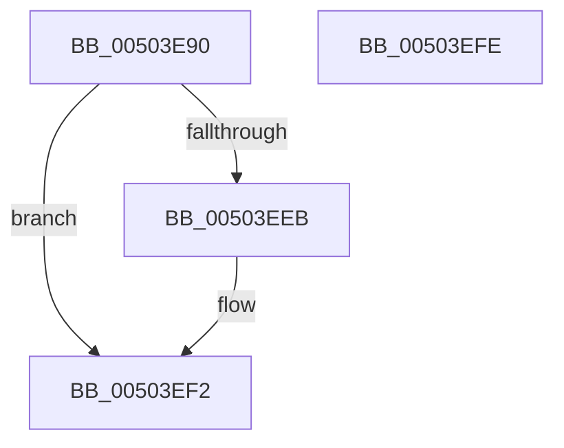

# _call_matherr

- RVA: `0x00503E90`–`0x00503EFF` (길이 `111` bytes)
- VA: `0x0000000140503E90`
- 실행 섹션: `.text`
- PDB 이름 있음: `예`; PDB Function 태그: `예`
- unwind 정보 RVA: `0x00071A74`
- 디코드: `26`개 명령, `111/111` bytes 표시
- 미해석 바이트: `0` (있으면 어셈블리에 `.byte`로 보존)

> 이 문서는 커널 이미지의 기계어와 PDB 기호를 분석해 생성했습니다. 4번과 5번은 함수 원형과 자료형을 바이너리 사용 방식에서 추정한 C 해석이며 원본 소스 복구 결과는 아닙니다.

## 1. Dependencies

- 직접 호출 지점: **3**; 고유 호출 대상: **3**
- 직접 호출자로 확인된 함수: **2**
- RIP 상대 이미지 참조: **0**

### Outgoing calls
- `0x00503ED8` → [ctrlfp](ctrlfp_function_005049B0.md) (function, `0x005049B0`)
- `0x00503EE2` → [HalAdjustResourceList](../48/HalAdjustResourceList_function_0048FDC0.md) (function, `0x0048FDC0`)
- `0x00503EED` → [EmpCheckErrataList](../49/EmpCheckErrataList_function_0049E550.md) (function, `0x0049E550`)

### Direct callers
- [handle_error](handle_error_function_00503FE0.md) at `0x00504110`
- [handle_errorf](handle_errorf_function_00504160.md) at `0x00504298`

### Static image references
- 디코드된 RIP-relative 메모리 참조가 없습니다.

## 2. Other-region calls and transfers

- 다른 실행 섹션으로 향하는 call: **0**
- 별도 외부 분기/꼬리 이동을 확인하지 못했습니다.

## 3. Assembly (complete function range)

```asm
00503E90  40 53                           push rbx
00503E92  48 83 EC 50                     sub rsp, 0x50
00503E96  F2 0F 10 84 24 80 00 00 00      movsd xmm0, qword ptr [rsp + 0x80]
00503E9F  8B D9                           mov ebx, ecx
00503EA1  F2 0F 10 8C 24 88 00 00 00      movsd xmm1, qword ptr [rsp + 0x88]
00503EAA  33 C0                           xor eax, eax
00503EAC  89 4C 24 20                     mov dword ptr [rsp + 0x20], ecx
00503EB0  BA C0 FF 00 00                  mov edx, 0xffc0
00503EB5  48 8B 8C 24 90 00 00 00         mov rcx, qword ptr [rsp + 0x90]
00503EBD  F2 0F 11 44 24 38               movsd qword ptr [rsp + 0x38], xmm0
00503EC3  F2 0F 11 4C 24 40               movsd qword ptr [rsp + 0x40], xmm1
00503EC9  89 44 24 24                     mov dword ptr [rsp + 0x24], eax
00503ECD  F2 0F 11 5C 24 30               movsd qword ptr [rsp + 0x30], xmm3
00503ED3  4C 89 44 24 28                  mov qword ptr [rsp + 0x28], r8
00503ED8  E8 D3 0A 00 00                  call 0x1405049b0
00503EDD  48 8D 4C 24 20                  lea rcx, [rsp + 0x20]
00503EE2  E8 D9 BE F8 FF                  call 0x14048fdc0
00503EE7  85 C0                           test eax, eax
00503EE9  75 07                           jne 0x140503ef2
00503EEB  8B CB                           mov ecx, ebx
00503EED  E8 5E A6 F9 FF                  call 0x14049e550
00503EF2  F2 0F 10 44 24 40               movsd xmm0, qword ptr [rsp + 0x40]
00503EF8  48 83 C4 50                     add rsp, 0x50
00503EFC  5B                              pop rbx
00503EFD  C3                              ret
00503EFE  CC                              int3
```

## 4. C-style interpretation (structured pseudocode)

```c
__int64 __fastcall _call_matherr(int a1, __int64 a2, __int64 a3, __int64 a4, __int64 a5, __int64 a6, __int64 a7)
{
    __int64 result;
    __int64 v_rsp;
    unsigned __int64 v_stack_m18;
    unsigned __int64 v_stack_m20;
    unsigned __int64 v_stack_m28;
    unsigned __int64 v_stack_m30;
    unsigned int v_stack_m34;
    unsigned int v_stack_m38;

    v_rsp = (v_rsp) - (80);
    result = 0;
    v_stack_m38 = a1;
    v_stack_m20 = v_xmm0;
    v_stack_m18 = v_xmm1;
    v_stack_m34 = 0;
    v_stack_m28 = v_xmm3;
    v_stack_m30 = a3;
    result = ctrlfp(a7, (unsigned int)(0xFFC0ULL), a3, a4);
    result = HalAdjustResourceList(v_stack_m38, (unsigned int)(0xFFC0ULL), a3, a4);
    if ((unsigned int)(result) == 0) {
        a1 = (unsigned int)((unsigned int)(a1));
        result = EmpCheckErrataList(a1, (unsigned int)(0xFFC0ULL), a3, a4);
    }
    v_rsp = (v_rsp) + (80);
    return result;
}
```

## 5. (Beta) C Style

```c
int64_t _call_matherr(int32_t Arg1, int64_t Arg2, int64_t Arg3, int64_t Arg4, int64_t Arg5, int64_t Arg6, int64_t Arg7)
{
    int64_t result;
    int64_t local_rsp;
    uint64_t v_stack_m18;
    uint64_t v_stack_m20;
    uint64_t v_stack_m28;
    uint64_t v_stack_m30;
    uint32_t v_stack_m34;
    uint32_t v_stack_m38;

    local_rsp = (local_rsp) - (80);
    result = 0;
    v_stack_m38 = Arg1;
    v_stack_m20 = v_xmm0;
    v_stack_m18 = v_xmm1;
    v_stack_m34 = 0;
    v_stack_m28 = v_xmm3;
    v_stack_m30 = Arg3;
    result = ctrlfp(Arg7, (uint32_t)(0xFFC0ULL), Arg3, Arg4);
    result = HalAdjustResourceList(v_stack_m38, (uint32_t)(0xFFC0ULL), Arg3, Arg4);
    if ((uint32_t)(result) == 0) {
        Arg1 = (uint32_t)((uint32_t)(Arg1));
        result = EmpCheckErrataList(Arg1, (uint32_t)(0xFFC0ULL), Arg3, Arg4);
    }
    local_rsp = (local_rsp) + (80);
    return result;
}
```

## 6. Execution-region graph

[열기: 2D/3D 그래프와 함수 탐색 컨트롤 패널](../../../control-panel.html?section=text&rva=0x00503E90&view=graph)

- 2D 그래프는 위에서 아래로 흐르고, 3D 그래프는 빈 공간을 드래그해 회전합니다. Shift+드래그는 이동, 휠은 확대·축소, 함수 노드 선택은 대상 보고서 이동입니다.

### Static fallback


