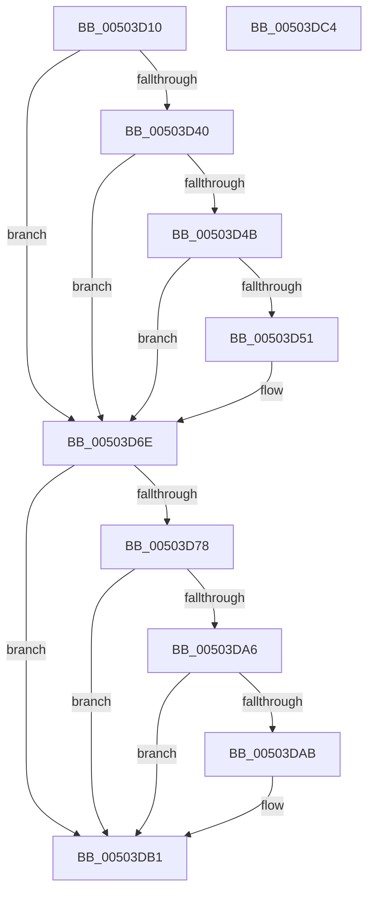

# _cpu_features_init

- RVA: `0x00503D10`–`0x00503DC5` (길이 `181` bytes)
- VA: `0x0000000140503D10`
- 실행 섹션: `.text`
- PDB 이름 있음: `예`; PDB Function 태그: `아니요`
- unwind 정보 RVA: `0x000C5118`
- 디코드: `60`개 명령, `181/181` bytes 표시
- 미해석 바이트: `0` (있으면 어셈블리에 `.byte`로 보존)

> 이 문서는 커널 이미지의 기계어와 PDB 기호를 분석해 생성했습니다. 4번과 5번은 함수 원형과 자료형을 바이너리 사용 방식에서 추정한 C 해석이며 원본 소스 복구 결과는 아닙니다.

## 1. Dependencies

- 직접 호출 지점: **0**; 고유 호출 대상: **0**
- 직접 호출자로 확인된 함수: **1**
- RIP 상대 이미지 참조: **1**

### Outgoing calls
- 직접 디코드된 call 명령이 없습니다.

### Direct callers
- [_memset_query](../6C/_memset_query_function_006C6E00.md) at `0x006C6E10`

### Static image references
- `0x00503DB5` → RVA `0x00E0A6C0` (`.data`; write)

## 2. Other-region calls and transfers

- 다른 실행 섹션으로 향하는 call: **0**
- 별도 외부 분기/꼬리 이동을 확인하지 못했습니다.

## 3. Assembly (complete function range)

```asm
00503D10  40 53                           push rbx
00503D12  48 83 EC 10                     sub rsp, 0x10
00503D16  33 C0                           xor eax, eax
00503D18  33 C9                           xor ecx, ecx
00503D1A  0F A2                           cpuid
00503D1C  44 8B C8                        mov r9d, eax
00503D1F  33 C9                           xor ecx, ecx
00503D21  B8 01 00 00 00                  mov eax, 1
00503D26  45 32 C0                        xor r8b, r8b
00503D29  0F A2                           cpuid
00503D2B  89 04 24                        mov dword ptr [rsp], eax
00503D2E  89 5C 24 04                     mov dword ptr [rsp + 4], ebx
00503D32  89 4C 24 08                     mov dword ptr [rsp + 8], ecx
00503D36  89 54 24 0C                     mov dword ptr [rsp + 0xc], edx
00503D3A  0F BA E1 14                     bt ecx, 0x14
00503D3E  73 2E                           jae 0x140503d6e
00503D40  B3 08                           mov bl, 8
00503D42  44 8A C3                        mov r8b, bl
00503D45  0F BA E1 1B                     bt ecx, 0x1b
00503D49  73 23                           jae 0x140503d6e
00503D4B  0F BA E1 1C                     bt ecx, 0x1c
00503D4F  73 1D                           jae 0x140503d6e
00503D51  33 C9                           xor ecx, ecx
00503D53  0F 01 D0                        xgetbv
00503D56  48 C1 E2 20                     shl rdx, 0x20
00503D5A  48 0B D0                        or rdx, rax
00503D5D  44 0F B6 C3                     movzx r8d, bl
00503D61  80 E2 06                        and dl, 6
00503D64  8D 41 0C                        lea eax, [rcx + 0xc]
00503D67  80 FA 06                        cmp dl, 6
00503D6A  44 0F 44 C0                     cmove r8d, eax
00503D6E  B8 07 00 00 00                  mov eax, 7
00503D73  44 3B C8                        cmp r9d, eax
00503D76  7C 39                           jl 0x140503db1
00503D78  33 C9                           xor ecx, ecx
00503D7A  0F A2                           cpuid
00503D7C  89 04 24                        mov dword ptr [rsp], eax
00503D7F  41 8A C0                        mov al, r8b
00503D82  0C 02                           or al, 2
00503D84  89 54 24 0C                     mov dword ptr [rsp + 0xc], edx
00503D88  0F B6 D0                        movzx edx, al
00503D8B  0F BA E3 09                     bt ebx, 9
00503D8F  41 0F B6 C0                     movzx eax, r8b
00503D93  0F 43 D0                        cmovae edx, eax
00503D96  89 5C 24 04                     mov dword ptr [rsp + 4], ebx
00503D9A  89 4C 24 08                     mov dword ptr [rsp + 8], ecx
00503D9E  44 8A C2                        mov r8b, dl
00503DA1  F6 C3 20                        test bl, 0x20
00503DA4  74 0B                           je 0x140503db1
00503DA6  F6 C2 04                        test dl, 4
00503DA9  74 06                           je 0x140503db1
00503DAB  80 CA 10                        or dl, 0x10
00503DAE  44 8A C2                        mov r8b, dl
00503DB1  41 80 C8 01                     or r8b, 1
00503DB5  44 88 05 04 69 90 00            mov byte ptr [rip + 0x906904], r8b
00503DBC  33 C0                           xor eax, eax
00503DBE  48 83 C4 10                     add rsp, 0x10
00503DC2  5B                              pop rbx
00503DC3  C3                              ret
00503DC4  CC                              int3
```

## 4. C-style interpretation (structured pseudocode)

```c
__int64 __fastcall _cpu_features_init(int a1, __int64 a2, unsigned __int8 a3)
{
    __int64 result;
    __int64 v_rsp;
    unsigned int v_stack_m10;
    unsigned int v_stack_m14;
    unsigned int v_stack_m18;
    unsigned int v_stack_mC;

    v_rsp = (v_rsp) - (16);
    result = 0;
    a1 = 0;
    a1 = 0;
    a3 = 0;
    v_stack_m18 = 1;
    v_stack_m14 = (unsigned int)(v_rbx);
    v_stack_m10 = 0;
    v_stack_mC = (unsigned int)(a2);
    if (condition_is_above_or_equal) goto loc_00503D6E;
    if (condition_is_above_or_equal) goto loc_00503D6E;
    result = 1;
    if (!(condition_is_above_or_equal)) {
        a1 = 0;
        a2 = (a2) << (32);
        a2 = (a2) | (1);
        a3 = 8;
        a2 = (unsigned __int8)((a2) & (6));
        result = a1 + 12;
        if (((unsigned __int8)(a2)) == 6) { a3 = (unsigned int)(result); }
    }
    if (0 < 7) goto loc_00503DB1;
    a1 = 0;
    v_stack_m18 = 7;
    result = (unsigned __int8)((a3) | (2));
    v_stack_mC = (unsigned int)(a2);
    a2 = (unsigned __int8)(result);
    if (condition_is_above_or_equal) { a2 = a3; }
    v_stack_m14 = 8;
    v_stack_m10 = 0;
    if (((8) & (32)) == 0) goto loc_00503DB1;
    if ((((unsigned __int8)(a2)) & (4)) != 0) {
        a2 = (unsigned __int8)((a2) | (16));
        a3 = (unsigned __int8)(a2);
    }
    a3 = (unsigned __int8)((a3) | (1));
    *(unsigned __int8 *)(v_rip + 9464068) = a3;
    result = 0;
    v_rsp = (v_rsp) + (16);
    return result;
}
```

## 5. (Beta) C Style

```c
int64_t _cpu_features_init(int32_t Arg1, int64_t Arg2, uint8_t Arg3)
{
    int64_t result;
    int64_t local_rsp;
    uint32_t v_stack_m10;
    uint32_t v_stack_m14;
    uint32_t v_stack_m18;
    uint32_t v_stack_mC;

    local_rsp = (local_rsp) - (16);
    result = 0;
    Arg1 = 0;
    Arg1 = 0;
    Arg3 = 0;
    v_stack_m18 = 1;
    v_stack_m14 = (uint32_t)(local_rbx);
    v_stack_m10 = 0;
    v_stack_mC = (uint32_t)(Arg2);
    if (condition_is_above_or_equal) goto loc_00503D6E;
    if (condition_is_above_or_equal) goto loc_00503D6E;
    result = 1;
    if (!(condition_is_above_or_equal)) {
        Arg1 = 0;
        Arg2 = (Arg2) << (32);
        Arg2 = (Arg2) | (1);
        Arg3 = 8;
        Arg2 = (uint8_t)((Arg2) & (6));
        result = Arg1 + 12;
        if (((uint8_t)(Arg2)) == 6) { Arg3 = (uint32_t)(result); }
    }
    if (0 < 7) goto loc_00503DB1;
    Arg1 = 0;
    v_stack_m18 = 7;
    result = (uint8_t)((Arg3) | (2));
    v_stack_mC = (uint32_t)(Arg2);
    Arg2 = (uint8_t)(result);
    if (condition_is_above_or_equal) { Arg2 = Arg3; }
    v_stack_m14 = 8;
    v_stack_m10 = 0;
    if (((8) & (32)) == 0) goto loc_00503DB1;
    if ((((uint8_t)(Arg2)) & (4)) != 0) {
        Arg2 = (uint8_t)((Arg2) | (16));
        Arg3 = (uint8_t)(Arg2);
    }
    Arg3 = (uint8_t)((Arg3) | (1));
    *(uint8_t *)(v_rip + 0x906904) = Arg3;
    result = 0;
    local_rsp = (local_rsp) + (16);
    return result;
}
```

## 6. Execution-region graph

[열기: 2D/3D 그래프와 함수 탐색 컨트롤 패널](../../../control-panel.html?section=text&rva=0x00503D10&view=graph)

- 2D 그래프는 위에서 아래로 흐르고, 3D 그래프는 빈 공간을 드래그해 회전합니다. Shift+드래그는 이동, 휠은 확대·축소, 함수 노드 선택은 대상 보고서 이동입니다.

### Static fallback


