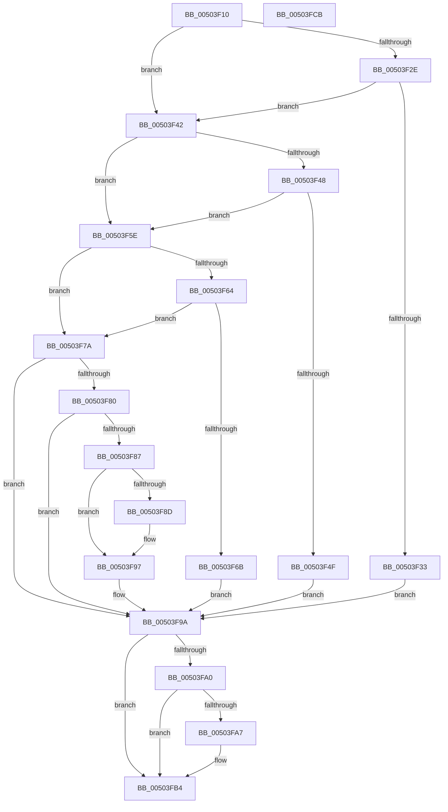

# _exception_enabled

- RVA: `0x00503F10`–`0x00503FCC` (길이 `188` bytes)
- VA: `0x0000000140503F10`
- 실행 섹션: `.text`
- PDB 이름 있음: `예`; PDB Function 태그: `예`
- unwind 정보 RVA: `0x00060BC4`
- 디코드: `57`개 명령, `188/188` bytes 표시
- 미해석 바이트: `0` (있으면 어셈블리에 `.byte`로 보존)

> 이 문서는 커널 이미지의 기계어와 PDB 기호를 분석해 생성했습니다. 4번과 5번은 함수 원형과 자료형을 바이너리 사용 방식에서 추정한 C 해석이며 원본 소스 복구 결과는 아닙니다.

## 1. Dependencies

- 직접 호출 지점: **5**; 고유 호출 대상: **1**
- 직접 호출자로 확인된 함수: **2**
- RIP 상대 이미지 참조: **0**

### Outgoing calls
- `0x00503F38` → [set_statfp](set_statfp_function_00504A40.md) (function, `0x00504A40`)
- `0x00503F54` → [set_statfp](set_statfp_function_00504A40.md) (function, `0x00504A40`)
- `0x00503F70` → [set_statfp](set_statfp_function_00504A40.md) (function, `0x00504A40`)
- `0x00503F92` → [set_statfp](set_statfp_function_00504A40.md) (function, `0x00504A40`)
- `0x00503FAC` → [set_statfp](set_statfp_function_00504A40.md) (function, `0x00504A40`)

### Direct callers
- [handle_error](handle_error_function_00503FE0.md) at `0x00504044`
- [handle_errorf](handle_errorf_function_00504160.md) at `0x005041C3`

### Static image references
- 디코드된 RIP-relative 메모리 참조가 없습니다.

## 2. Other-region calls and transfers

- 다른 실행 섹션으로 향하는 call: **0**
- 별도 외부 분기/꼬리 이동을 확인하지 못했습니다.

## 3. Assembly (complete function range)

```asm
00503F10  48 89 5C 24 08                  mov qword ptr [rsp + 8], rbx
00503F15  48 89 74 24 10                  mov qword ptr [rsp + 0x10], rsi
00503F1A  57                              push rdi
00503F1B  48 83 EC 20                     sub rsp, 0x20
00503F1F  8B D9                           mov ebx, ecx
00503F21  48 8B F2                        mov rsi, rdx
00503F24  83 E3 1F                        and ebx, 0x1f
00503F27  8B F9                           mov edi, ecx
00503F29  F6 C1 08                        test cl, 8
00503F2C  74 14                           je 0x140503f42
00503F2E  40 84 F6                        test sil, sil
00503F31  79 0F                           jns 0x140503f42
00503F33  B9 01 00 00 00                  mov ecx, 1
00503F38  E8 03 0B 00 00                  call 0x140504a40
00503F3D  83 E3 F7                        and ebx, 0xfffffff7
00503F40  EB 58                           jmp 0x140503f9a
00503F42  40 F6 C7 04                     test dil, 4
00503F46  74 16                           je 0x140503f5e
00503F48  48 0F BA E6 09                  bt rsi, 9
00503F4D  73 0F                           jae 0x140503f5e
00503F4F  B9 04 00 00 00                  mov ecx, 4
00503F54  E8 E7 0A 00 00                  call 0x140504a40
00503F59  83 E3 FB                        and ebx, 0xfffffffb
00503F5C  EB 3C                           jmp 0x140503f9a
00503F5E  40 F6 C7 01                     test dil, 1
00503F62  74 16                           je 0x140503f7a
00503F64  48 0F BA E6 0A                  bt rsi, 0xa
00503F69  73 0F                           jae 0x140503f7a
00503F6B  B9 08 00 00 00                  mov ecx, 8
00503F70  E8 CB 0A 00 00                  call 0x140504a40
00503F75  83 E3 FE                        and ebx, 0xfffffffe
00503F78  EB 20                           jmp 0x140503f9a
00503F7A  40 F6 C7 02                     test dil, 2
00503F7E  74 1A                           je 0x140503f9a
00503F80  48 0F BA E6 0B                  bt rsi, 0xb
00503F85  73 13                           jae 0x140503f9a
00503F87  40 F6 C7 10                     test dil, 0x10
00503F8B  74 0A                           je 0x140503f97
00503F8D  B9 10 00 00 00                  mov ecx, 0x10
00503F92  E8 A9 0A 00 00                  call 0x140504a40
00503F97  83 E3 FD                        and ebx, 0xfffffffd
00503F9A  40 F6 C7 10                     test dil, 0x10
00503F9E  74 14                           je 0x140503fb4
00503FA0  48 0F BA E6 0C                  bt rsi, 0xc
00503FA5  73 0D                           jae 0x140503fb4
00503FA7  B9 20 00 00 00                  mov ecx, 0x20
00503FAC  E8 8F 0A 00 00                  call 0x140504a40
00503FB1  83 E3 EF                        and ebx, 0xffffffef
00503FB4  48 8B 74 24 38                  mov rsi, qword ptr [rsp + 0x38]
00503FB9  33 C0                           xor eax, eax
00503FBB  85 DB                           test ebx, ebx
00503FBD  48 8B 5C 24 30                  mov rbx, qword ptr [rsp + 0x30]
00503FC2  0F 94 C0                        sete al
00503FC5  48 83 C4 20                     add rsp, 0x20
00503FC9  5F                              pop rdi
00503FCA  C3                              ret
00503FCB  CC                              int3
```

## 4. C-style interpretation (structured pseudocode)

```c
__int64 __fastcall _exception_enabled(int a1, __int64 a2)
{
    __int64 result;
    __int64 v_rbx;
    __int64 v_rsp;
    unsigned __int64 v_stack_p10;
    unsigned __int64 v_stack_p8;

    v_stack_p8 = v_rbx;
    v_stack_p10 = v_rsi;
    v_rsp = (v_rsp) - (32);
    v_rbx = (unsigned int)(((unsigned int)(a1)) & (31));
    if ((((unsigned __int8)(a1)) & (8)) == 0) goto loc_00503F42;
    if (!sign_flag) goto loc_00503F42;
    result = set_statfp(1, a2, a3, a4);
    v_rbx = (unsigned int)((v_rbx) & (0xFFFFFFF7ULL));
    goto loc_00503F9A;
loc_00503F42:
    if ((((unsigned __int8)((unsigned int)(a1))) & (4)) == 0) goto loc_00503F5E;
    if (condition_is_above_or_equal) goto loc_00503F5E;
    result = set_statfp(4, a2, a3, a4);
    v_rbx = (unsigned int)((v_rbx) & (0xFFFFFFFBULL));
    goto loc_00503F9A;
loc_00503F5E:
    if ((((unsigned __int8)((unsigned int)(a1))) & (1)) == 0) goto loc_00503F7A;
    if (condition_is_above_or_equal) goto loc_00503F7A;
    result = set_statfp(8, a2, a3, a4);
    v_rbx = (unsigned int)((v_rbx) & (0xFFFFFFFEULL));
    goto loc_00503F9A;
loc_00503F7A:
    if ((((unsigned __int8)((unsigned int)(a1))) & (2)) == 0) goto loc_00503F9A;
    if (condition_is_above_or_equal) goto loc_00503F9A;
    if ((((unsigned __int8)((unsigned int)(a1))) & (16)) != 0) {
        a1 = 16;
        result = set_statfp(a1, a2, a3, a4);
    }
    v_rbx = (unsigned int)((v_rbx) & (0xFFFFFFFDULL));
loc_00503F9A:
    if ((((unsigned __int8)((unsigned int)(a1))) & (16)) == 0) goto loc_00503FB4;
    if (!(condition_is_above_or_equal)) {
        a1 = 32;
        result = set_statfp(a1, a2, a3, a4);
        v_rbx = (unsigned int)((v_rbx) & (0xFFFFFFEFULL));
    }
    result = 0;
    result = ((unsigned int)(v_rbx) == 0) ? 1 : 0;
    v_rsp = (v_rsp) + (32);
    return result;
}
```

## 5. (Beta) C Style

```c
int64_t _exception_enabled(int32_t Arg1, int64_t Arg2)
{
    int64_t result;
    int64_t local_rbx;
    int64_t local_rsp;
    uint64_t v_stack_p10;
    uint64_t v_stack_p8;

    v_stack_p8 = local_rbx;
    v_stack_p10 = local_rsi;
    local_rsp = (local_rsp) - (32);
    local_rbx = (uint32_t)(((uint32_t)(Arg1)) & (31));
    if ((((uint8_t)(Arg1)) & (8)) == 0) goto loc_00503F42;
    if (!sign_flag) goto loc_00503F42;
    result = set_statfp(1, Arg2, a3, a4);
    local_rbx = (uint32_t)((local_rbx) & (0xFFFFFFF7ULL));
    goto loc_00503F9A;
loc_00503F42:
    if ((((uint8_t)((uint32_t)(Arg1))) & (4)) == 0) goto loc_00503F5E;
    if (condition_is_above_or_equal) goto loc_00503F5E;
    result = set_statfp(4, Arg2, a3, a4);
    local_rbx = (uint32_t)((local_rbx) & (0xFFFFFFFBULL));
    goto loc_00503F9A;
loc_00503F5E:
    if ((((uint8_t)((uint32_t)(Arg1))) & (1)) == 0) goto loc_00503F7A;
    if (condition_is_above_or_equal) goto loc_00503F7A;
    result = set_statfp(8, Arg2, a3, a4);
    local_rbx = (uint32_t)((local_rbx) & (0xFFFFFFFEULL));
    goto loc_00503F9A;
loc_00503F7A:
    if ((((uint8_t)((uint32_t)(Arg1))) & (2)) == 0) goto loc_00503F9A;
    if (condition_is_above_or_equal) goto loc_00503F9A;
    if ((((uint8_t)((uint32_t)(Arg1))) & (16)) != 0) {
        Arg1 = 16;
        result = set_statfp(Arg1, Arg2, a3, a4);
    }
    local_rbx = (uint32_t)((local_rbx) & (0xFFFFFFFDULL));
loc_00503F9A:
    if ((((uint8_t)((uint32_t)(Arg1))) & (16)) == 0) goto loc_00503FB4;
    if (!(condition_is_above_or_equal)) {
        Arg1 = 32;
        result = set_statfp(Arg1, Arg2, a3, a4);
        local_rbx = (uint32_t)((local_rbx) & (0xFFFFFFEFULL));
    }
    result = 0;
    result = ((uint32_t)(local_rbx) == 0) ? 1 : 0;
    local_rsp = (local_rsp) + (32);
    return result;
}
```

## 6. Execution-region graph

[열기: 2D/3D 그래프와 함수 탐색 컨트롤 패널](../../../control-panel.html?section=text&rva=0x00503F10&view=graph)

- 2D 그래프는 위에서 아래로 흐르고, 3D 그래프는 빈 공간을 드래그해 회전합니다. Shift+드래그는 이동, 휠은 확대·축소, 함수 노드 선택은 대상 보고서 이동입니다.

### Static fallback


