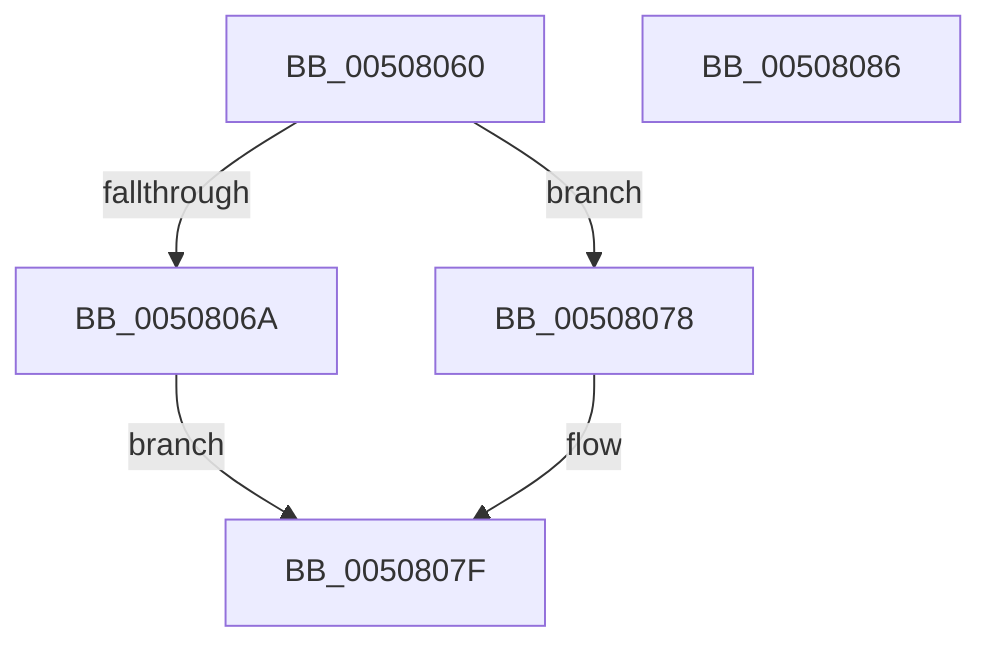

# _inc

- RVA: `0x00508060`–`0x00508087` (길이 `39` bytes)
- VA: `0x0000000140508060`
- 실행 섹션: `.text`
- PDB 이름 있음: `예`; PDB Function 태그: `예`
- unwind 정보 RVA: `0x0005C788`
- 디코드: `14`개 명령, `39/39` bytes 표시
- 미해석 바이트: `0` (있으면 어셈블리에 `.byte`로 보존)

> 이 문서는 커널 이미지의 기계어와 PDB 기호를 분석해 생성했습니다. 4번과 5번은 함수 원형과 자료형을 바이너리 사용 방식에서 추정한 C 해석이며 원본 소스 복구 결과는 아닙니다.

## 1. Dependencies

- 직접 호출 지점: **1**; 고유 호출 대상: **1**
- 직접 호출자로 확인된 함수: **2**
- RIP 상대 이미지 참조: **0**

### Outgoing calls
- `0x00508078` → [filbuf_s](../58/filbuf_s_function_00583720.md) (function, `0x00583720`)

### Direct callers
- [ReadString](ReadString_function_00507D40.md) at `0x00507DDD`
- [input_s](input_s_function_00508090.md) at `0x0050811C`
- [input_s](input_s_function_00508090.md) at `0x0050831E`
- [input_s](input_s_function_00508090.md) at `0x0050834E`
- [input_s](input_s_function_00508090.md) at `0x005084BF`
- [input_s](input_s_function_00508090.md) at `0x005084DA`
- [input_s](input_s_function_00508090.md) at `0x00508544`
- [input_s](input_s_function_00508090.md) at `0x00508596`
- [input_s](input_s_function_00508090.md) at `0x0050864D`
- [input_s](input_s_function_00508090.md) at `0x00508721`
- [input_s](input_s_function_00508090.md) at `0x00508833`

### Static image references
- 디코드된 RIP-relative 메모리 참조가 없습니다.

## 2. Other-region calls and transfers

- 다른 실행 섹션으로 향하는 call: **0**
- 별도 외부 분기/꼬리 이동을 확인하지 못했습니다.

## 3. Assembly (complete function range)

```asm
00508060  48 83 EC 28                     sub rsp, 0x28
00508064  83 69 08 01                     sub dword ptr [rcx + 8], 1
00508068  78 0E                           js 0x140508078
0050806A  48 8B 01                        mov rax, qword ptr [rcx]
0050806D  0F B6 10                        movzx edx, byte ptr [rax]
00508070  48 FF C0                        inc rax
00508073  48 89 01                        mov qword ptr [rcx], rax
00508076  EB 07                           jmp 0x14050807f
00508078  E8 A3 B6 07 00                  call 0x140583720
0050807D  8B D0                           mov edx, eax
0050807F  8B C2                           mov eax, edx
00508081  48 83 C4 28                     add rsp, 0x28
00508085  C3                              ret
00508086  CC                              int3
```

## 4. C-style interpretation (structured pseudocode)

```c
__int64 __fastcall _inc(__int64 a1)
{
    __int64 result;
    __int64 v_rsp;

    v_rsp = (v_rsp) - (40);
    if (sign_flag) goto loc_00508078;
    result = (*(unsigned __int64 *)(a1)) + 1;
    *(unsigned __int64 *)(a1) = result;
    goto loc_0050807F;
loc_00508078:
    result = filbuf_s(a1, *(unsigned __int8 *)(*(unsigned __int64 *)(a1)), a3, a4);
loc_0050807F:
    v_rsp = (v_rsp) + (40);
    return (unsigned int)((unsigned int)((unsigned int)((unsigned int)(result))));
}
```

## 5. (Beta) C Style

```c
int64_t _inc(void *Arg1)
{
    uint8_t *arg1 = (uint8_t *)Arg1;

    int64_t result;
    int64_t local_rsp;

    local_rsp = (local_rsp) - (40);
    if (sign_flag) goto loc_00508078;
    result = (*(uint64_t *)(arg1)) + 1;
    *(uint64_t *)(arg1) = result;
    goto loc_0050807F;
loc_00508078:
    result = filbuf_s(Arg1, *(uint8_t *)(*(uint64_t *)(arg1)), a3, a4);
loc_0050807F:
    local_rsp = (local_rsp) + (40);
    return (uint32_t)((uint32_t)((uint32_t)((uint32_t)(result))));
}
```

### 관측된 메모리 오프셋

구조체 형식이 확인되지 않은 접근은 인자 기준의 오프셋으로만 기록했습니다.

| 기준 인자 | 오프셋 표현 | 폭 (bit) | 접근 |
|---|---:|---:|---|
| `Arg1` | `+ 0x0` | `64` | `R` |
| `Arg1` | `+ 0x0` | `64` | `W` |
| `Arg1` | `+ 0x8` | `32` | `R/W` |

## 6. Execution-region graph

[열기: 2D/3D 그래프와 함수 탐색 컨트롤 패널](../../../control-panel.html?section=text&rva=0x00508060&view=graph)

- 2D 그래프는 위에서 아래로 흐르고, 3D 그래프는 빈 공간을 드래그해 회전합니다. Shift+드래그는 이동, 휠은 확대·축소, 함수 노드 선택은 대상 보고서 이동입니다.

### Static fallback


