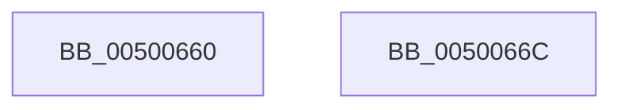

# _isascii

- RVA: `0x00500660`–`0x0050066D` (길이 `13` bytes)
- VA: `0x0000000140500660`
- 실행 섹션: `.text`
- PDB 이름 있음: `예`; PDB Function 태그: `아니요`
- unwind 정보 RVA: `0x000DB714`
- 디코드: `5`개 명령, `13/13` bytes 표시
- 미해석 바이트: `0` (있으면 어셈블리에 `.byte`로 보존)

> 이 문서는 커널 이미지의 기계어와 PDB 기호를 분석해 생성했습니다. 4번과 5번은 함수 원형과 자료형을 바이너리 사용 방식에서 추정한 C 해석이며 원본 소스 복구 결과는 아닙니다.

## 1. Dependencies

- 직접 호출 지점: **0**; 고유 호출 대상: **0**
- 직접 호출자로 확인된 함수: **5**
- RIP 상대 이미지 참조: **0**

### Outgoing calls
- 직접 디코드된 call 명령이 없습니다.

### Direct callers
- [RtlIpv4StringToAddressA](../49/RtlIpv4StringToAddressA_function_004978D0.md) at `0x00497937`
- [RtlIpv4StringToAddressA](../49/RtlIpv4StringToAddressA_function_004978D0.md) at `0x00497A67`
- [RtlIpv4StringToAddressA](../49/RtlIpv4StringToAddressA_function_004978D0.md) at `0x00497A91`
- [RtlIpv4StringToAddressA](../49/RtlIpv4StringToAddressA_function_004978D0.md) at `0x00497AAF`
- [RtlIpv6StringToAddressA](../4A/RtlIpv6StringToAddressA_function_004A6BD0.md) at `0x004A6C43`
- [RtlIpv6StringToAddressA](../4A/RtlIpv6StringToAddressA_function_004A6BD0.md) at `0x004A6DB5`
- [RtlIpv6StringToAddressA](../4A/RtlIpv6StringToAddressA_function_004A6BD0.md) at `0x004A6DF8`
- [RtlIpv6StringToAddressA](../4A/RtlIpv6StringToAddressA_function_004A6BD0.md) at `0x004A6F8D`
- [RtlEthernetStringToAddressA](../5E/RtlEthernetStringToAddressA_function_005EBE50.md) at `0x005EBE91`
- [RtlEthernetStringToAddressA](../5E/RtlEthernetStringToAddressA_function_005EBE50.md) at `0x005EBEB1`
- [RtlEthernetStringToAddressA](../5E/RtlEthernetStringToAddressA_function_005EBE50.md) at `0x005EBEC9`
- [RtlIpv4StringToAddressExA](../5E/RtlIpv4StringToAddressExA_function_005EBF80.md) at `0x005EC026`
- [RtlIpv4StringToAddressExA](../5E/RtlIpv4StringToAddressExA_function_005EBF80.md) at `0x005EC084`
- [RtlIpv4StringToAddressExA](../5E/RtlIpv4StringToAddressExA_function_005EBF80.md) at `0x005EC0A0`
- [RtlIpv4StringToAddressExA](../5E/RtlIpv4StringToAddressExA_function_005EBF80.md) at `0x005EC0DB`
- [RtlIpv6StringToAddressExA](../5E/RtlIpv6StringToAddressExA_function_005EC150.md) at `0x005EC1E3`
- [RtlIpv6StringToAddressExA](../5E/RtlIpv6StringToAddressExA_function_005EC150.md) at `0x005EC210`
- [RtlIpv6StringToAddressExA](../5E/RtlIpv6StringToAddressExA_function_005EC150.md) at `0x005EC2C5`
- [RtlIpv6StringToAddressExA](../5E/RtlIpv6StringToAddressExA_function_005EC150.md) at `0x005EC31F`
- [RtlIpv6StringToAddressExA](../5E/RtlIpv6StringToAddressExA_function_005EC150.md) at `0x005EC33D`
- [RtlIpv6StringToAddressExA](../5E/RtlIpv6StringToAddressExA_function_005EC150.md) at `0x005EC375`

### Static image references
- 디코드된 RIP-relative 메모리 참조가 없습니다.

## 2. Other-region calls and transfers

- 다른 실행 섹션으로 향하는 call: **0**
- 별도 외부 분기/꼬리 이동을 확인하지 못했습니다.

## 3. Assembly (complete function range)

```asm
00500660  33 C0                           xor eax, eax
00500662  81 F9 80 00 00 00               cmp ecx, 0x80
00500668  0F 92 C0                        setb al
0050066B  C3                              ret
0050066C  CC                              int3
```

## 4. C-style interpretation (structured pseudocode)

```c
__int64 __fastcall _isascii(int a1)
{
    __int64 result;

    result = 0;
    result = (a1 < 128) ? 1 : 0;
    return result;
}
```

## 5. (Beta) C Style

```c
int64_t _isascii(int32_t Arg1)
{
    int64_t result;

    result = 0;
    result = (Arg1 < 128) ? 1 : 0;
    return result;
}
```

## 6. Execution-region graph

[열기: 2D/3D 그래프와 함수 탐색 컨트롤 패널](../../../control-panel.html?section=text&rva=0x00500660&view=graph)

- 2D 그래프는 위에서 아래로 흐르고, 3D 그래프는 빈 공간을 드래그해 회전합니다. Shift+드래그는 이동, 휠은 확대·축소, 함수 노드 선택은 대상 보고서 이동입니다.

### Static fallback


