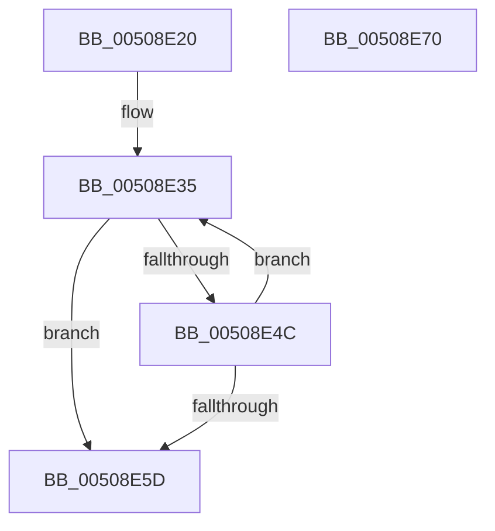

# _whiteout

- RVA: `0x00508E20`–`0x00508E71` (길이 `81` bytes)
- VA: `0x0000000140508E20`
- 실행 섹션: `.text`
- PDB 이름 있음: `예`; PDB Function 태그: `예`
- unwind 정보 RVA: `0x00060BC4`
- 디코드: `25`개 명령, `81/81` bytes 표시
- 미해석 바이트: `0` (있으면 어셈블리에 `.byte`로 보존)

> 이 문서는 커널 이미지의 기계어와 PDB 기호를 분석해 생성했습니다. 4번과 5번은 함수 원형과 자료형을 바이너리 사용 방식에서 추정한 C 해석이며 원본 소스 복구 결과는 아닙니다.

## 1. Dependencies

- 직접 호출 지점: **2**; 고유 호출 대상: **2**
- 직접 호출자로 확인된 함수: **1**
- RIP 상대 이미지 참조: **0**

### Outgoing calls
- `0x00508E3A` → [fgetwc_nolock](fgetwc_nolock_function_005098B4.md) (function, `0x005098B4`)
- `0x00508E54` → [iswctype](iswctype_function_00502900.md) (function, `0x00502900`)

### Direct callers
- [winput_s](winput_s_function_00508E78.md) at `0x00508F0F`
- [winput_s](winput_s_function_00508E78.md) at `0x0050914D`

### Static image references
- 디코드된 RIP-relative 메모리 참조가 없습니다.

## 2. Other-region calls and transfers

- 다른 실행 섹션으로 향하는 call: **0**
- 별도 외부 분기/꼬리 이동을 확인하지 못했습니다.

## 3. Assembly (complete function range)

```asm
00508E20  48 89 5C 24 08                  mov qword ptr [rsp + 8], rbx
00508E25  48 89 74 24 10                  mov qword ptr [rsp + 0x10], rsi
00508E2A  57                              push rdi
00508E2B  48 83 EC 20                     sub rsp, 0x20
00508E2F  48 8B F2                        mov rsi, rdx
00508E32  48 8B F9                        mov rdi, rcx
00508E35  FF 07                           inc dword ptr [rdi]
00508E37  48 8B CE                        mov rcx, rsi
00508E3A  E8 75 0A 00 00                  call 0x1405098b4
00508E3F  0F B7 D8                        movzx ebx, ax
00508E42  B8 FF FF 00 00                  mov eax, 0xffff
00508E47  66 3B D8                        cmp bx, ax
00508E4A  74 11                           je 0x140508e5d
00508E4C  BA 08 00 00 00                  mov edx, 8
00508E51  0F B7 CB                        movzx ecx, bx
00508E54  E8 A7 9A FF FF                  call 0x140502900
00508E59  85 C0                           test eax, eax
00508E5B  75 D8                           jne 0x140508e35
00508E5D  48 8B 74 24 38                  mov rsi, qword ptr [rsp + 0x38]
00508E62  0F B7 C3                        movzx eax, bx
00508E65  48 8B 5C 24 30                  mov rbx, qword ptr [rsp + 0x30]
00508E6A  48 83 C4 20                     add rsp, 0x20
00508E6E  5F                              pop rdi
00508E6F  C3                              ret
00508E70  CC                              int3
```

## 4. C-style interpretation (structured pseudocode)

```c
__int64 __fastcall _whiteout(__int64 a1, __int64 a2)
{
    __int64 result;
    __int64 v_rsp;
    unsigned __int64 v_stack_p10;
    unsigned __int64 v_stack_p8;

    v_stack_p8 = v_rbx;
    v_stack_p10 = v_rsi;
    v_rsp = (v_rsp) - (32);
loc_00508E35:
    result = fgetwc_nolock(a2, a2, a3, a4);
    if (((unsigned __int16)((unsigned __int16)(result))) == ((unsigned __int16)((unsigned int)(0xFFFFULL)))) goto loc_00508E5D;
    result = iswctype((unsigned __int16)((unsigned __int16)(result)), 8, a3, a4);
    if ((unsigned int)(result) != 0) goto loc_00508E35;
loc_00508E5D:
    v_rsp = (v_rsp) + (32);
    return (unsigned __int16)((unsigned __int16)(result));
}
```

## 5. (Beta) C Style

```c
int64_t _whiteout(void *Arg1, int64_t Arg2)
{
    uint8_t *arg1 = (uint8_t *)Arg1;

    int64_t result;
    int64_t local_rsp;
    uint64_t v_stack_p10;
    uint64_t v_stack_p8;

    v_stack_p8 = local_rbx;
    v_stack_p10 = local_rsi;
    local_rsp = (local_rsp) - (32);
loc_00508E35:
    result = fgetwc_nolock(Arg2, Arg2, a3, a4);
    if (((uint16_t)((uint16_t)(result))) == ((uint16_t)((uint32_t)(0xFFFFULL)))) goto loc_00508E5D;
    result = iswctype((uint16_t)((uint16_t)(result)), 8, a3, a4);
    if ((uint32_t)(result) != 0) goto loc_00508E35;
loc_00508E5D:
    local_rsp = (local_rsp) + (32);
    return (uint16_t)((uint16_t)(result));
}
```

### 관측된 메모리 오프셋

구조체 형식이 확인되지 않은 접근은 인자 기준의 오프셋으로만 기록했습니다.

| 기준 인자 | 오프셋 표현 | 폭 (bit) | 접근 |
|---|---:|---:|---|
| `Arg1` | `+ 0x0` | `32` | `R/W` |

## 6. Execution-region graph

[열기: 2D/3D 그래프와 함수 탐색 컨트롤 패널](../../../control-panel.html?section=text&rva=0x00508E20&view=graph)

- 2D 그래프는 위에서 아래로 흐르고, 3D 그래프는 빈 공간을 드래그해 회전합니다. Shift+드래그는 이동, 휠은 확대·축소, 함수 노드 선택은 대상 보고서 이동입니다.

### Static fallback


