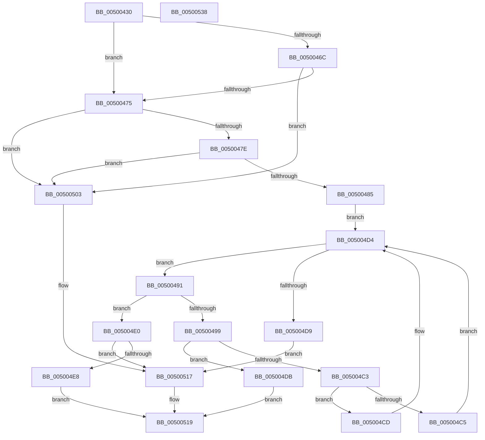

# bsearch

- RVA: `0x00500430`–`0x00500539` (길이 `265` bytes)
- VA: `0x0000000140500430`
- 실행 섹션: `.text`
- PDB 이름 있음: `예`; PDB Function 태그: `아니요`
- unwind 정보 RVA: `0x000ACFA4`
- 디코드: `84`개 명령, `265/265` bytes 표시
- 미해석 바이트: `0` (있으면 어셈블리에 `.byte`로 보존)

> 이 문서는 커널 이미지의 기계어와 PDB 기호를 분석해 생성했습니다. 4번과 5번은 함수 원형과 자료형을 바이너리 사용 방식에서 추정한 C 해석이며 원본 소스 복구 결과는 아닙니다.

## 1. Dependencies

- 직접 호출 지점: **4**; 고유 호출 대상: **3**
- 직접 호출자로 확인된 함수: **9**
- RIP 상대 이미지 참조: **0**

### Outgoing calls
- `0x0050048A` → [guard_check_icall](../6B/guard_check_icall_function_006BAA80.md) (function, `0x006BAA80`)
- `0x005004BA` → `indirect target` (indirect, 간접 대상)
- `0x005004F3` → `indirect target` (indirect, 간접 대상)
- `0x00500512` → [EmpCheckErrataList](../49/EmpCheckErrataList_function_0049E550.md) (function, `0x0049E550`)

### Direct callers
- [DownLevelLangIDToLanguageName](../4B/DownLevelLangIDToLanguageName_function_004BBAA8.md) at `0x004BBAFC`
- [LdrpGetParentLangId](../4B/LdrpGetParentLangId_function_004BDAC0.md) at `0x004BDB39`
- [DownLevelLanguageNameToLangID](../4C/DownLevelLanguageNameToLangID_function_004C3748.md) at `0x004C3788`
- [RtlCompareExchangePropertyStore](../5E/RtlCompareExchangePropertyStore_function_005E7F70.md) at `0x005E7FD4`
- [RtlQueryPropertyStore](../5E/RtlQueryPropertyStore_function_005E8260.md) at `0x005E82B1`
- [RtlRemovePropertyStore](../5E/RtlRemovePropertyStore_function_005E83E0.md) at `0x005E8432`
- [DownLevelGetParentLanguageName](../66/DownLevelGetParentLanguageName_function_00661E94.md) at `0x00661EDA`
- [sub_007C8E88](../../page/7C/Unknown_function_007C8E88.md) at `0x007C8ECB`
- [EtwpIsGuidAllowed](../../page/9E/EtwpIsGuidAllowed_function_009EB45C.md) at `0x009EB51B`

### Static image references
- 디코드된 RIP-relative 메모리 참조가 없습니다.

## 2. Other-region calls and transfers

- 다른 실행 섹션으로 향하는 call: **0**
- 별도 외부 분기/꼬리 이동을 확인하지 못했습니다.

## 3. Assembly (complete function range)

```asm
00500430  48 8B C4                        mov rax, rsp
00500433  48 89 58 08                     mov qword ptr [rax + 8], rbx
00500437  48 89 68 10                     mov qword ptr [rax + 0x10], rbp
0050043B  48 89 70 18                     mov qword ptr [rax + 0x18], rsi
0050043F  48 89 78 20                     mov qword ptr [rax + 0x20], rdi
00500443  41 55                           push r13
00500445  41 56                           push r14
00500447  41 57                           push r15
00500449  48 83 EC 30                     sub rsp, 0x30
0050044D  49 8D 78 FF                     lea rdi, [r8 - 1]
00500451  45 33 F6                        xor r14d, r14d
00500454  49 0F AF F9                     imul rdi, r9
00500458  4D 8B F9                        mov r15, r9
0050045B  49 8B F0                        mov rsi, r8
0050045E  48 03 FA                        add rdi, rdx
00500461  48 8B DA                        mov rbx, rdx
00500464  4C 8B E9                        mov r13, rcx
00500467  48 85 D2                        test rdx, rdx
0050046A  75 09                           jne 0x140500475
0050046C  4D 85 C0                        test r8, r8
0050046F  0F 85 8E 00 00 00               jne 0x140500503
00500475  4D 85 FF                        test r15, r15
00500478  0F 84 85 00 00 00               je 0x140500503
0050047E  4C 39 74 24 70                  cmp qword ptr [rsp + 0x70], r14
00500483  74 7E                           je 0x140500503
00500485  48 8B 4C 24 70                  mov rcx, qword ptr [rsp + 0x70]
0050048A  E8 F1 A5 1B 00                  call 0x1406baa80
0050048F  EB 43                           jmp 0x1405004d4
00500491  48 8B EE                        mov rbp, rsi
00500494  48 D1 ED                        shr rbp, 1
00500497  74 47                           je 0x1405004e0
00500499  48 8B 44 24 70                  mov rax, qword ptr [rsp + 0x70]
0050049E  40 F6 C6 01                     test sil, 1
005004A2  48 8D 75 FF                     lea rsi, [rbp - 1]
005004A6  49 8B CD                        mov rcx, r13
005004A9  48 0F 45 F5                     cmovne rsi, rbp
005004AD  4C 8B F6                        mov r14, rsi
005004B0  4D 0F AF F7                     imul r14, r15
005004B4  4C 03 F3                        add r14, rbx
005004B7  49 8B D6                        mov rdx, r14
005004BA  FF D0                           call rax
005004BC  0F 1F 00                        nop dword ptr [rax]
005004BF  85 C0                           test eax, eax
005004C1  74 18                           je 0x1405004db
005004C3  79 08                           jns 0x1405004cd
005004C5  49 8B FE                        mov rdi, r14
005004C8  49 2B FF                        sub rdi, r15
005004CB  EB 07                           jmp 0x1405004d4
005004CD  4B 8D 1C 3E                     lea rbx, [r14 + r15]
005004D1  48 8B F5                        mov rsi, rbp
005004D4  48 3B DF                        cmp rbx, rdi
005004D7  76 B8                           jbe 0x140500491
005004D9  EB 3C                           jmp 0x140500517
005004DB  49 8B C6                        mov rax, r14
005004DE  EB 39                           jmp 0x140500519
005004E0  45 33 F6                        xor r14d, r14d
005004E3  48 85 F6                        test rsi, rsi
005004E6  74 2F                           je 0x140500517
005004E8  48 8B 44 24 70                  mov rax, qword ptr [rsp + 0x70]
005004ED  48 8B D3                        mov rdx, rbx
005004F0  49 8B CD                        mov rcx, r13
005004F3  FF D0                           call rax
005004F5  0F 1F 00                        nop dword ptr [rax]
005004F8  85 C0                           test eax, eax
005004FA  49 0F 45 DE                     cmovne rbx, r14
005004FE  48 8B C3                        mov rax, rbx
00500501  EB 16                           jmp 0x140500519
00500503  45 33 C9                        xor r9d, r9d
00500506  4C 89 74 24 20                  mov qword ptr [rsp + 0x20], r14
0050050B  45 33 C0                        xor r8d, r8d
0050050E  33 D2                           xor edx, edx
00500510  33 C9                           xor ecx, ecx
00500512  E8 39 E0 F9 FF                  call 0x14049e550
00500517  33 C0                           xor eax, eax
00500519  48 8B 5C 24 50                  mov rbx, qword ptr [rsp + 0x50]
0050051E  48 8B 6C 24 58                  mov rbp, qword ptr [rsp + 0x58]
00500523  48 8B 74 24 60                  mov rsi, qword ptr [rsp + 0x60]
00500528  48 8B 7C 24 68                  mov rdi, qword ptr [rsp + 0x68]
0050052D  48 83 C4 30                     add rsp, 0x30
00500531  41 5F                           pop r15
00500533  41 5E                           pop r14
00500535  41 5D                           pop r13
00500537  C3                              ret
00500538  CC                              int3
```

## 4. C-style interpretation (structured pseudocode)

```c
__int64 __fastcall bsearch(__int64 a1, __int64 a2, __int64 a3, __int64 a4, __int64 a5)
{
    __int64 result;
    __int64 v_r14;
    __int64 v_rbp;
    __int64 v_rbx;
    __int64 v_rdi;
    __int64 v_rsi;
    __int64 v_rsp;
    unsigned __int64 v_stack_m28;
    unsigned __int64 v_stack_p10;
    unsigned __int64 v_stack_p18;
    unsigned __int64 v_stack_p20;
    unsigned __int64 v_stack_p8;

    *(unsigned __int64 *)(v_rsp + 8) = v_rbx;
    *(unsigned __int64 *)(v_rsp + 16) = v_rbp;
    *(unsigned __int64 *)(v_rsp + 24) = v_rsi;
    *(unsigned __int64 *)(v_rsp + 32) = v_rdi;
    v_rsp = (v_rsp) - (48);
    v_r14 = 0;
    v_rdi = (a3 - 1) * (a4);
    v_rdi = (v_rdi) + (a2);
    if (a2 != 0) goto loc_00500475;
    if (a3 != 0) goto loc_00500503;
loc_00500475:
    if (a4 == 0) goto loc_00500503;
    if (a5 == 0) goto loc_00500503;
    result = guard_check_icall(a5, a2, a3, a4);
    goto loc_005004D4;
loc_00500491:
    v_rbp = (a3) >> (1);
    if (condition_is_equal) goto loc_005004E0;
    v_rsi = v_rbp - 1;
    if ((((unsigned __int8)(a3)) & (1)) != 0) { v_rsi = v_rbp; }
    v_r14 = (v_rsi) * (a4);
    v_r14 = (v_r14) + (a2);
    result = kernel_indirect_call(a1, v_r14, a3, a4);
    if ((unsigned int)(result) == 0) goto loc_005004DB;
    if (!sign_flag) goto loc_005004CD;
    v_rdi = (v_r14) - (a4);
    goto loc_005004D4;
loc_005004CD:
loc_005004D4:
    if ((v_r14 + a4 * 1) <= v_rdi) goto loc_00500491;
    goto loc_00500517;
loc_005004DB:
    goto loc_00500519;
loc_005004E0:
    v_r14 = 0;
    if (v_rbp == 0) goto loc_00500517;
    result = kernel_indirect_call(a1, v_r14 + a4 * 1, a3, a4);
    v_rbx = v_r14 + a4 * 1;
    if ((unsigned int)(result) != 0) { v_rbx = 0; }
    goto loc_00500519;
loc_00500503:
    a4 = 0;
    v_stack_m28 = 0;
    a3 = 0;
    a2 = 0;
    a1 = 0;
    result = EmpCheckErrataList(a1, a2, a3, a4);
loc_00500517:
    result = 0;
loc_00500519:
    v_rsp = (v_rsp) + (48);
    return result;
}
```

## 5. (Beta) C Style

```c
int64_t bsearch(int64_t Arg1, int64_t Arg2, void *Arg3, int64_t Arg4, int64_t Arg5)
{
    uint8_t *arg3 = (uint8_t *)Arg3;

    int64_t result;
    int64_t local_r14;
    int64_t local_rbp;
    int64_t local_rbx;
    int64_t local_rdi;
    int64_t local_rsi;
    int64_t local_rsp;
    uint64_t v_stack_m28;
    uint64_t v_stack_p10;
    uint64_t v_stack_p18;
    uint64_t v_stack_p20;
    uint64_t v_stack_p8;

    *(uint64_t *)(local_rsp + 0x8) = local_rbx;
    *(uint64_t *)(local_rsp + 0x10) = local_rbp;
    *(uint64_t *)(local_rsp + 0x18) = local_rsi;
    *(uint64_t *)(local_rsp + 0x20) = local_rdi;
    local_rsp = (local_rsp) - (48);
    local_r14 = 0;
    local_rdi = (Arg3 - 1) * (Arg4);
    local_rdi = (local_rdi) + (Arg2);
    if (Arg2 != 0) goto loc_00500475;
    if (Arg3 != NULL) goto loc_00500503;
loc_00500475:
    if (Arg4 == 0) goto loc_00500503;
    if (Arg5 == 0) goto loc_00500503;
    result = guard_check_icall(Arg5, Arg2, Arg3, Arg4);
    goto loc_005004D4;
loc_00500491:
    local_rbp = (Arg3) >> (1);
    if (condition_is_equal) goto loc_005004E0;
    local_rsi = local_rbp - 1;
    if ((((uint8_t)(Arg3)) & (1)) != 0) { local_rsi = local_rbp; }
    local_r14 = (local_rsi) * (Arg4);
    local_r14 = (local_r14) + (Arg2);
    result = kernel_indirect_call(Arg1, local_r14, Arg3, Arg4);
    if ((uint32_t)(result) == 0) goto loc_005004DB;
    if (!sign_flag) goto loc_005004CD;
    local_rdi = (local_r14) - (Arg4);
    goto loc_005004D4;
loc_005004CD:
loc_005004D4:
    if ((local_r14 + Arg4 * 1) <= local_rdi) goto loc_00500491;
    goto loc_00500517;
loc_005004DB:
    goto loc_00500519;
loc_005004E0:
    local_r14 = 0;
    if (local_rbp == 0) goto loc_00500517;
    result = kernel_indirect_call(Arg1, local_r14 + Arg4 * 1, Arg3, Arg4);
    local_rbx = local_r14 + Arg4 * 1;
    if ((uint32_t)(result) != 0) { local_rbx = 0; }
    goto loc_00500519;
loc_00500503:
    Arg4 = 0;
    v_stack_m28 = 0;
    Arg3 = 0;
    Arg2 = 0;
    Arg1 = 0;
    result = EmpCheckErrataList(Arg1, Arg2, Arg3, Arg4);
loc_00500517:
    result = 0;
loc_00500519:
    local_rsp = (local_rsp) + (48);
    return result;
}
```

### 관측된 메모리 오프셋

구조체 형식이 확인되지 않은 접근은 인자 기준의 오프셋으로만 기록했습니다.

| 기준 인자 | 오프셋 표현 | 폭 (bit) | 접근 |
|---|---:|---:|---|
| `Arg3` | `- 0x1` | `64` | `R` |

## 6. Execution-region graph

[열기: 2D/3D 그래프와 함수 탐색 컨트롤 패널](../../../control-panel.html?section=text&rva=0x00500430&view=graph)

- 2D 그래프는 위에서 아래로 흐르고, 3D 그래프는 빈 공간을 드래그해 회전합니다. Shift+드래그는 이동, 휠은 확대·축소, 함수 노드 선택은 대상 보고서 이동입니다.

### Static fallback


