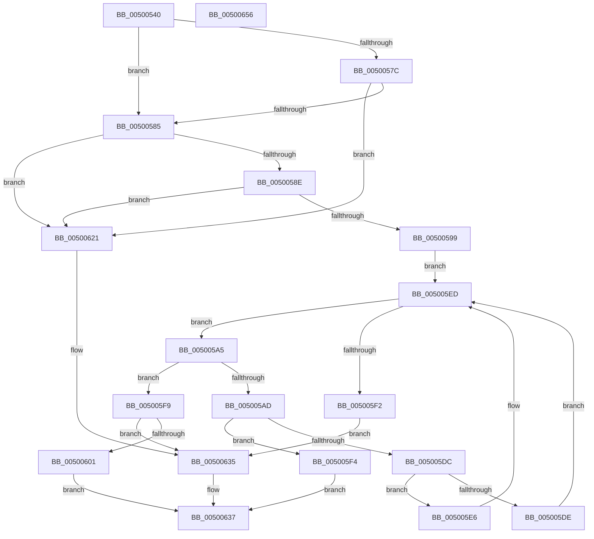

# bsearch_s

- RVA: `0x00500540`–`0x00500657` (길이 `279` bytes)
- VA: `0x0000000140500540`
- 실행 섹션: `.text`
- PDB 이름 있음: `예`; PDB Function 태그: `아니요`
- unwind 정보 RVA: `0x000ACFA4`
- 디코드: `86`개 명령, `279/279` bytes 표시
- 미해석 바이트: `0` (있으면 어셈블리에 `.byte`로 보존)

> 이 문서는 커널 이미지의 기계어와 PDB 기호를 분석해 생성했습니다. 4번과 5번은 함수 원형과 자료형을 바이너리 사용 방식에서 추정한 C 해석이며 원본 소스 복구 결과는 아닙니다.

## 1. Dependencies

- 직접 호출 지점: **4**; 고유 호출 대상: **3**
- 직접 호출자로 확인된 함수: **5**
- RIP 상대 이미지 참조: **0**

### Outgoing calls
- `0x0050059E` → [guard_check_icall](../6B/guard_check_icall_function_006BAA80.md) (function, `0x006BAA80`)
- `0x005005D3` → `indirect target` (indirect, 간접 대상)
- `0x00500611` → `indirect target` (indirect, 간접 대상)
- `0x00500630` → [EmpCheckErrataList](../49/EmpCheckErrataList_function_0049E550.md) (function, `0x0049E550`)

### Direct callers
- [RtlGuardCheckExceptionHandler](../2F/RtlGuardCheckExceptionHandler_function_002F2038.md) at `0x002F2120`
- [RtlGuardCheckLongJumpTarget](../5E/RtlGuardCheckLongJumpTarget_function_005EEF28.md) at `0x005EEFCB`
- [I_MinCryptIsCertificateHashRevokedV2](../6A/I_MinCryptIsCertificateHashRevokedV2_function_006A5F24.md) at `0x006A5FCF`
- [SeQuerySecureBootPlatformManifest](../../page/7A/SeQuerySecureBootPlatformManifest_function_007A1FB0.md) at `0x007A2001`
- [RtlVerifyUserUnwindTarget](../../page/A1/RtlVerifyUserUnwindTarget_function_00A1FDB8.md) at `0x00A1FF18`

### Static image references
- 디코드된 RIP-relative 메모리 참조가 없습니다.

## 2. Other-region calls and transfers

- 다른 실행 섹션으로 향하는 call: **0**
- 별도 외부 분기/꼬리 이동을 확인하지 못했습니다.

## 3. Assembly (complete function range)

```asm
00500540  48 8B C4                        mov rax, rsp
00500543  48 89 58 08                     mov qword ptr [rax + 8], rbx
00500547  48 89 68 10                     mov qword ptr [rax + 0x10], rbp
0050054B  48 89 70 18                     mov qword ptr [rax + 0x18], rsi
0050054F  48 89 78 20                     mov qword ptr [rax + 0x20], rdi
00500553  41 55                           push r13
00500555  41 56                           push r14
00500557  41 57                           push r15
00500559  48 83 EC 30                     sub rsp, 0x30
0050055D  49 8D 78 FF                     lea rdi, [r8 - 1]
00500561  45 33 F6                        xor r14d, r14d
00500564  49 0F AF F9                     imul rdi, r9
00500568  49 8B E9                        mov rbp, r9
0050056B  49 8B F0                        mov rsi, r8
0050056E  48 03 FA                        add rdi, rdx
00500571  48 8B DA                        mov rbx, rdx
00500574  4C 8B E9                        mov r13, rcx
00500577  48 85 D2                        test rdx, rdx
0050057A  75 09                           jne 0x140500585
0050057C  4D 85 C0                        test r8, r8
0050057F  0F 85 9C 00 00 00               jne 0x140500621
00500585  48 85 ED                        test rbp, rbp
00500588  0F 84 93 00 00 00               je 0x140500621
0050058E  4C 39 74 24 70                  cmp qword ptr [rsp + 0x70], r14
00500593  0F 84 88 00 00 00               je 0x140500621
00500599  48 8B 4C 24 70                  mov rcx, qword ptr [rsp + 0x70]
0050059E  E8 DD A4 1B 00                  call 0x1406baa80
005005A3  EB 48                           jmp 0x1405005ed
005005A5  4C 8B FE                        mov r15, rsi
005005A8  49 D1 EF                        shr r15, 1
005005AB  74 4C                           je 0x1405005f9
005005AD  48 8B 44 24 70                  mov rax, qword ptr [rsp + 0x70]
005005B2  40 F6 C6 01                     test sil, 1
005005B6  48 8B 4C 24 78                  mov rcx, qword ptr [rsp + 0x78]
005005BB  49 8D 77 FF                     lea rsi, [r15 - 1]
005005BF  49 0F 45 F7                     cmovne rsi, r15
005005C3  49 8B D5                        mov rdx, r13
005005C6  4C 8B F6                        mov r14, rsi
005005C9  4C 0F AF F5                     imul r14, rbp
005005CD  4C 03 F3                        add r14, rbx
005005D0  4D 8B C6                        mov r8, r14
005005D3  FF D0                           call rax
005005D5  0F 1F 00                        nop dword ptr [rax]
005005D8  85 C0                           test eax, eax
005005DA  74 18                           je 0x1405005f4
005005DC  79 08                           jns 0x1405005e6
005005DE  49 8B FE                        mov rdi, r14
005005E1  48 2B FD                        sub rdi, rbp
005005E4  EB 07                           jmp 0x1405005ed
005005E6  49 8D 1C 2E                     lea rbx, [r14 + rbp]
005005EA  49 8B F7                        mov rsi, r15
005005ED  48 3B DF                        cmp rbx, rdi
005005F0  76 B3                           jbe 0x1405005a5
005005F2  EB 41                           jmp 0x140500635
005005F4  49 8B C6                        mov rax, r14
005005F7  EB 3E                           jmp 0x140500637
005005F9  45 33 F6                        xor r14d, r14d
005005FC  48 85 F6                        test rsi, rsi
005005FF  74 34                           je 0x140500635
00500601  48 8B 44 24 70                  mov rax, qword ptr [rsp + 0x70]
00500606  4C 8B C3                        mov r8, rbx
00500609  48 8B 4C 24 78                  mov rcx, qword ptr [rsp + 0x78]
0050060E  49 8B D5                        mov rdx, r13
00500611  FF D0                           call rax
00500613  0F 1F 00                        nop dword ptr [rax]
00500616  85 C0                           test eax, eax
00500618  49 0F 45 DE                     cmovne rbx, r14
0050061C  48 8B C3                        mov rax, rbx
0050061F  EB 16                           jmp 0x140500637
00500621  45 33 C9                        xor r9d, r9d
00500624  4C 89 74 24 20                  mov qword ptr [rsp + 0x20], r14
00500629  45 33 C0                        xor r8d, r8d
0050062C  33 D2                           xor edx, edx
0050062E  33 C9                           xor ecx, ecx
00500630  E8 1B DF F9 FF                  call 0x14049e550
00500635  33 C0                           xor eax, eax
00500637  48 8B 5C 24 50                  mov rbx, qword ptr [rsp + 0x50]
0050063C  48 8B 6C 24 58                  mov rbp, qword ptr [rsp + 0x58]
00500641  48 8B 74 24 60                  mov rsi, qword ptr [rsp + 0x60]
00500646  48 8B 7C 24 68                  mov rdi, qword ptr [rsp + 0x68]
0050064B  48 83 C4 30                     add rsp, 0x30
0050064F  41 5F                           pop r15
00500651  41 5E                           pop r14
00500653  41 5D                           pop r13
00500655  C3                              ret
00500656  CC                              int3
```

## 4. C-style interpretation (structured pseudocode)

```c
__int64 __fastcall bsearch_s(__int64 a1, __int64 a2, __int64 a3, __int64 a4, __int64 a5, __int64 a6)
{
    __int64 result;
    __int64 v_r14;
    __int64 v_r15;
    __int64 v_rbx;
    __int64 v_rdi;
    __int64 v_rsi;
    __int64 v_rsp;
    unsigned __int64 v_stack_m28;
    unsigned __int64 v_stack_p10;
    unsigned __int64 v_stack_p18;
    unsigned __int64 v_stack_p20;
    unsigned __int64 v_stack_p8;

    *(unsigned __int64 *)(v_rsp + 8) = v_rbx;
    *(unsigned __int64 *)(v_rsp + 16) = v_rbp;
    *(unsigned __int64 *)(v_rsp + 24) = v_rsi;
    *(unsigned __int64 *)(v_rsp + 32) = v_rdi;
    v_rsp = (v_rsp) - (48);
    v_r14 = 0;
    v_rdi = (a3 - 1) * (a4);
    v_rdi = (v_rdi) + (a2);
    if (a2 != 0) goto loc_00500585;
    if (a3 != 0) goto loc_00500621;
loc_00500585:
    if (a4 == 0) goto loc_00500621;
    if (a5 == 0) goto loc_00500621;
    result = guard_check_icall(a5, a2, a3, a4);
    goto loc_005005ED;
loc_005005A5:
    v_r15 = (a3) >> (1);
    if (condition_is_equal) goto loc_005005F9;
    v_rsi = v_r15 - 1;
    if ((((unsigned __int8)(a3)) & (1)) != 0) { v_rsi = v_r15; }
    v_r14 = (v_rsi) * (a4);
    v_r14 = (v_r14) + (a2);
    result = kernel_indirect_call(a6, a1, v_r14, a4);
    if ((unsigned int)(result) == 0) goto loc_005005F4;
    if (!sign_flag) goto loc_005005E6;
    v_rdi = (v_r14) - (a4);
    goto loc_005005ED;
loc_005005E6:
loc_005005ED:
    if ((v_r14 + a4 * 1) <= v_rdi) goto loc_005005A5;
    goto loc_00500635;
loc_005005F4:
    goto loc_00500637;
loc_005005F9:
    v_r14 = 0;
    if (v_r15 == 0) goto loc_00500635;
    result = kernel_indirect_call(a6, a1, v_r14 + a4 * 1, a4);
    v_rbx = v_r14 + a4 * 1;
    if ((unsigned int)(result) != 0) { v_rbx = 0; }
    goto loc_00500637;
loc_00500621:
    a4 = 0;
    v_stack_m28 = 0;
    a3 = 0;
    a2 = 0;
    a1 = 0;
    result = EmpCheckErrataList(a1, a2, a3, a4);
loc_00500635:
    result = 0;
loc_00500637:
    v_rsp = (v_rsp) + (48);
    return result;
}
```

## 5. (Beta) C Style

```c
int64_t bsearch_s(int64_t Arg1, int64_t Arg2, void *Arg3, int64_t Arg4, int64_t Arg5, int64_t Arg6)
{
    uint8_t *arg3 = (uint8_t *)Arg3;

    int64_t result;
    int64_t local_r14;
    int64_t local_r15;
    int64_t local_rbx;
    int64_t local_rdi;
    int64_t local_rsi;
    int64_t local_rsp;
    uint64_t v_stack_m28;
    uint64_t v_stack_p10;
    uint64_t v_stack_p18;
    uint64_t v_stack_p20;
    uint64_t v_stack_p8;

    *(uint64_t *)(local_rsp + 0x8) = local_rbx;
    *(uint64_t *)(local_rsp + 0x10) = local_rbp;
    *(uint64_t *)(local_rsp + 0x18) = local_rsi;
    *(uint64_t *)(local_rsp + 0x20) = local_rdi;
    local_rsp = (local_rsp) - (48);
    local_r14 = 0;
    local_rdi = (Arg3 - 1) * (Arg4);
    local_rdi = (local_rdi) + (Arg2);
    if (Arg2 != 0) goto loc_00500585;
    if (Arg3 != NULL) goto loc_00500621;
loc_00500585:
    if (Arg4 == 0) goto loc_00500621;
    if (Arg5 == 0) goto loc_00500621;
    result = guard_check_icall(Arg5, Arg2, Arg3, Arg4);
    goto loc_005005ED;
loc_005005A5:
    local_r15 = (Arg3) >> (1);
    if (condition_is_equal) goto loc_005005F9;
    local_rsi = local_r15 - 1;
    if ((((uint8_t)(Arg3)) & (1)) != 0) { local_rsi = local_r15; }
    local_r14 = (local_rsi) * (Arg4);
    local_r14 = (local_r14) + (Arg2);
    result = kernel_indirect_call(Arg6, Arg1, local_r14, Arg4);
    if ((uint32_t)(result) == 0) goto loc_005005F4;
    if (!sign_flag) goto loc_005005E6;
    local_rdi = (local_r14) - (Arg4);
    goto loc_005005ED;
loc_005005E6:
loc_005005ED:
    if ((local_r14 + Arg4 * 1) <= local_rdi) goto loc_005005A5;
    goto loc_00500635;
loc_005005F4:
    goto loc_00500637;
loc_005005F9:
    local_r14 = 0;
    if (local_r15 == 0) goto loc_00500635;
    result = kernel_indirect_call(Arg6, Arg1, local_r14 + Arg4 * 1, Arg4);
    local_rbx = local_r14 + Arg4 * 1;
    if ((uint32_t)(result) != 0) { local_rbx = 0; }
    goto loc_00500637;
loc_00500621:
    Arg4 = 0;
    v_stack_m28 = 0;
    Arg3 = 0;
    Arg2 = 0;
    Arg1 = 0;
    result = EmpCheckErrataList(Arg1, Arg2, Arg3, Arg4);
loc_00500635:
    result = 0;
loc_00500637:
    local_rsp = (local_rsp) + (48);
    return result;
}
```

### 관측된 메모리 오프셋

구조체 형식이 확인되지 않은 접근은 인자 기준의 오프셋으로만 기록했습니다.

| 기준 인자 | 오프셋 표현 | 폭 (bit) | 접근 |
|---|---:|---:|---|
| `Arg3` | `- 0x1` | `64` | `R` |

## 6. Execution-region graph

[열기: 2D/3D 그래프와 함수 탐색 컨트롤 패널](../../../control-panel.html?section=text&rva=0x00500540&view=graph)

- 2D 그래프는 위에서 아래로 흐르고, 3D 그래프는 빈 공간을 드래그해 회전합니다. Shift+드래그는 이동, 휠은 확대·축소, 함수 노드 선택은 대상 보고서 이동입니다.

### Static fallback


