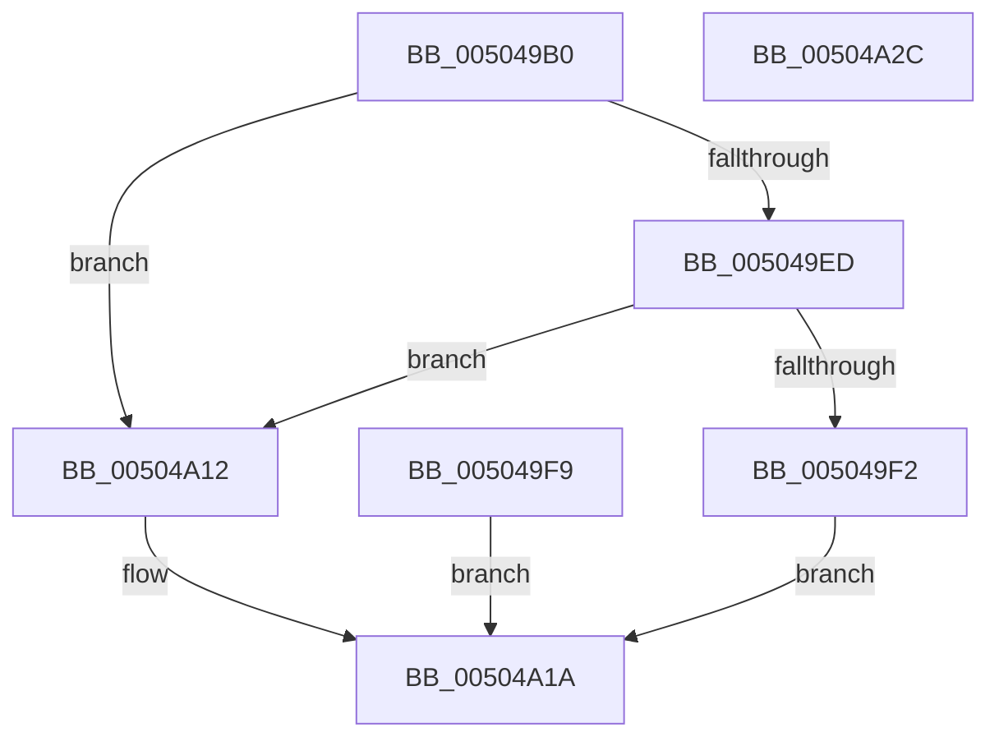

# ctrlfp

- RVA: `0x005049B0`–`0x00504A2D` (길이 `125` bytes)
- VA: `0x00000001405049B0`
- 실행 섹션: `.text`
- PDB 이름 있음: `예`; PDB Function 태그: `아니요`
- unwind 정보 RVA: `0x000C2888`
- 디코드: `37`개 명령, `125/125` bytes 표시
- 미해석 바이트: `0` (있으면 어셈블리에 `.byte`로 보존)

> 이 문서는 커널 이미지의 기계어와 PDB 기호를 분석해 생성했습니다. 4번과 5번은 함수 원형과 자료형을 바이너리 사용 방식에서 추정한 C 해석이며 원본 소스 복구 결과는 아닙니다.

## 1. Dependencies

- 직접 호출 지점: **4**; 고유 호출 대상: **2**
- 직접 호출자로 확인된 함수: **3**
- RIP 상대 이미지 참조: **2**

### Outgoing calls
- `0x005049C5` → [get_fpsr](get_fpsr_function_00504AB0.md) (function, `0x00504AB0`)
- `0x005049F2` → [set_fpsr](set_fpsr_function_00504AC0.md) (function, `0x00504AC0`)
- `0x00504A07` → [set_fpsr](set_fpsr_function_00504AC0.md) (function, `0x00504AC0`)
- `0x00504A15` → [set_fpsr](set_fpsr_function_00504AC0.md) (function, `0x00504AC0`)

### Direct callers
- [_call_matherr](_call_matherr_function_00503E90.md) at `0x00503ED8`
- [handle_error](handle_error_function_00503FE0.md) at `0x0050401B`
- [handle_error](handle_error_function_00503FE0.md) at `0x00504128`
- [handle_errorf](handle_errorf_function_00504160.md) at `0x0050419B`
- [handle_errorf](handle_errorf_function_00504160.md) at `0x005042B4`

### Static image references
- `0x005049E4` → RVA `0x00E0A710` (`.data`; read)
- `0x005049F9` → RVA `0x00E0A710` (`.data`; write)

## 2. Other-region calls and transfers

- 다른 실행 섹션으로 향하는 call: **0**
- 별도 외부 분기/꼬리 이동을 확인하지 못했습니다.

## 3. Assembly (complete function range)

```asm
005049B0  48 89 5C 24 18                  mov qword ptr [rsp + 0x18], rbx
005049B5  48 89 74 24 20                  mov qword ptr [rsp + 0x20], rsi
005049BA  57                              push rdi
005049BB  48 83 EC 20                     sub rsp, 0x20
005049BF  48 8B FA                        mov rdi, rdx
005049C2  48 8B D9                        mov rbx, rcx
005049C5  E8 E6 00 00 00                  call 0x140504ab0
005049CA  8B F0                           mov esi, eax
005049CC  89 44 24 38                     mov dword ptr [rsp + 0x38], eax
005049D0  8B CF                           mov ecx, edi
005049D2  F7 D1                           not ecx
005049D4  81 C9 7F 80 FF FF               or ecx, 0xffff807f
005049DA  23 C8                           and ecx, eax
005049DC  23 FB                           and edi, ebx
005049DE  0B CF                           or ecx, edi
005049E0  89 4C 24 30                     mov dword ptr [rsp + 0x30], ecx
005049E4  80 3D 25 5D 90 00 00            cmp byte ptr [rip + 0x905d25], 0
005049EB  74 25                           je 0x140504a12
005049ED  F6 C1 40                        test cl, 0x40
005049F0  74 20                           je 0x140504a12
005049F2  E8 C9 00 00 00                  call 0x140504ac0
005049F7  EB 21                           jmp 0x140504a1a
005049F9  C6 05 10 5D 90 00 00            mov byte ptr [rip + 0x905d10], 0
00504A00  8B 4C 24 30                     mov ecx, dword ptr [rsp + 0x30]
00504A04  83 E1 BF                        and ecx, 0xffffffbf
00504A07  E8 B4 00 00 00                  call 0x140504ac0
00504A0C  8B 74 24 38                     mov esi, dword ptr [rsp + 0x38]
00504A10  EB 08                           jmp 0x140504a1a
00504A12  83 E1 BF                        and ecx, 0xffffffbf
00504A15  E8 A6 00 00 00                  call 0x140504ac0
00504A1A  8B C6                           mov eax, esi
00504A1C  48 8B 5C 24 40                  mov rbx, qword ptr [rsp + 0x40]
00504A21  48 8B 74 24 48                  mov rsi, qword ptr [rsp + 0x48]
00504A26  48 83 C4 20                     add rsp, 0x20
00504A2A  5F                              pop rdi
00504A2B  C3                              ret
00504A2C  CC                              int3
```

## 4. C-style interpretation (structured pseudocode)

```c
__int64 __fastcall ctrlfp(__int64 a1, __int64 a2)
{
    __int64 result;
    __int64 v_rdi;
    __int64 v_rsp;
    unsigned int v_stack_p10;
    unsigned __int64 v_stack_p18;
    unsigned __int64 v_stack_p20;
    unsigned int v_stack_p8;

    v_stack_p18 = v_rbx;
    v_stack_p20 = v_rsi;
    v_rsp = (v_rsp) - (32);
    result = get_fpsr(a1, a2, a3, a4);
    v_stack_p10 = (unsigned int)(result);
    a1 = (unsigned int)(~((unsigned int)((unsigned int)(a2))));
    a1 = (unsigned int)((a1) | (0xFFFF807FULL));
    a1 = (unsigned int)((a1) & ((unsigned int)(result)));
    v_rdi = (unsigned int)((a2) & ((unsigned int)(a1)));
    a1 = (unsigned int)((a1) | ((unsigned int)(v_rdi)));
    v_stack_p8 = (unsigned int)(a1);
    if ((*(unsigned __int8 *)(v_rip + 9461029)) == 0) goto loc_00504A12;
    if ((((unsigned __int8)(a1)) & (64)) == 0) goto loc_00504A12;
    result = set_fpsr(a1, a2, a3, a4);
    goto loc_00504A1A;
loc_00504A12:
    a1 = (unsigned int)((a1) & (0xFFFFFFBFULL));
    result = set_fpsr(a1, a2, a3, a4);
loc_00504A1A:
    v_rsp = (v_rsp) + (32);
    return (unsigned int)((unsigned int)((unsigned int)((unsigned int)(result))));
}
```

## 5. (Beta) C Style

```c
int64_t ctrlfp(int64_t Arg1, int64_t Arg2)
{
    int64_t result;
    int64_t local_rdi;
    int64_t local_rsp;
    uint32_t v_stack_p10;
    uint64_t v_stack_p18;
    uint64_t v_stack_p20;
    uint32_t v_stack_p8;

    v_stack_p18 = local_rbx;
    v_stack_p20 = local_rsi;
    local_rsp = (local_rsp) - (32);
    result = get_fpsr(Arg1, Arg2, a3, a4);
    v_stack_p10 = (uint32_t)(result);
    Arg1 = (uint32_t)(~((uint32_t)((uint32_t)(Arg2))));
    Arg1 = (uint32_t)((Arg1) | (0xFFFF807FULL));
    Arg1 = (uint32_t)((Arg1) & ((uint32_t)(result)));
    local_rdi = (uint32_t)((Arg2) & ((uint32_t)(Arg1)));
    Arg1 = (uint32_t)((Arg1) | ((uint32_t)(local_rdi)));
    v_stack_p8 = (uint32_t)(Arg1);
    if ((*(uint8_t *)(v_rip + 0x905D25)) == 0) goto loc_00504A12;
    if ((((uint8_t)(Arg1)) & (64)) == 0) goto loc_00504A12;
    result = set_fpsr(Arg1, Arg2, a3, a4);
    goto loc_00504A1A;
loc_00504A12:
    Arg1 = (uint32_t)((Arg1) & (0xFFFFFFBFULL));
    result = set_fpsr(Arg1, Arg2, a3, a4);
loc_00504A1A:
    local_rsp = (local_rsp) + (32);
    return (uint32_t)((uint32_t)((uint32_t)((uint32_t)(result))));
}
```

## 6. Execution-region graph

[열기: 2D/3D 그래프와 함수 탐색 컨트롤 패널](../../../control-panel.html?section=text&rva=0x005049B0&view=graph)

- 2D 그래프는 위에서 아래로 흐르고, 3D 그래프는 빈 공간을 드래그해 회전합니다. Shift+드래그는 이동, 휠은 확대·축소, 함수 노드 선택은 대상 보고서 이동입니다.

### Static fallback


