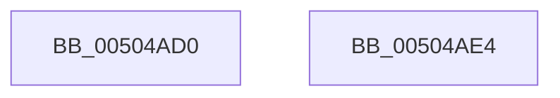

# fclrf

- RVA: `0x00504AD0`–`0x00504AF0` (길이 `32` bytes)
- VA: `0x0000000140504AD0`
- 실행 섹션: `.text`
- PDB 이름 있음: `예`; PDB Function 태그: `아니요`
- unwind 정보 RVA: `0x000DB714`
- 디코드: `6`개 명령, `32/32` bytes 표시
- 미해석 바이트: `0` (있으면 어셈블리에 `.byte`로 보존)

> 이 문서는 커널 이미지의 기계어와 PDB 기호를 분석해 생성했습니다. 4번과 5번은 함수 원형과 자료형을 바이너리 사용 방식에서 추정한 C 해석이며 원본 소스 복구 결과는 아닙니다.

## 1. Dependencies

- 직접 호출 지점: **0**; 고유 호출 대상: **0**
- 직접 호출자로 확인된 함수: **1**
- RIP 상대 이미지 참조: **0**

### Outgoing calls
- 직접 디코드된 call 명령이 없습니다.

### Direct callers
- [clrfp](clrfp_function_00504980.md) at `0x00504990`

### Static image references
- 디코드된 RIP-relative 메모리 참조가 없습니다.

## 2. Other-region calls and transfers

- 다른 실행 섹션으로 향하는 call: **0**
- 별도 외부 분기/꼬리 이동을 확인하지 못했습니다.

## 3. Assembly (complete function range)

```asm
00504AD0  0F AE 5C 24 08                  stmxcsr dword ptr [rsp + 8]
00504AD5  B9 C0 FF FF FF                  mov ecx, 0xffffffc0
00504ADA  21 4C 24 08                     and dword ptr [rsp + 8], ecx
00504ADE  0F AE 54 24 08                  ldmxcsr dword ptr [rsp + 8]
00504AE3  C3                              ret
00504AE4  66 66 66 66 0F 1F 84 00 00 00 00 00  nop word ptr [rax + rax]
```

## 4. C-style interpretation (structured pseudocode)

```c
void __fastcall fclrf(void)
{
    unsigned int v_stack_p8;

    return;
}
```

## 5. (Beta) C Style

```c
void fclrf(void)
{
    uint32_t v_stack_p8;

    return;
}
```

## 6. Execution-region graph

[열기: 2D/3D 그래프와 함수 탐색 컨트롤 패널](../../../control-panel.html?section=text&rva=0x00504AD0&view=graph)

- 2D 그래프는 위에서 아래로 흐르고, 3D 그래프는 빈 공간을 드래그해 회전합니다. Shift+드래그는 이동, 휠은 확대·축소, 함수 노드 선택은 대상 보고서 이동입니다.

### Static fallback


