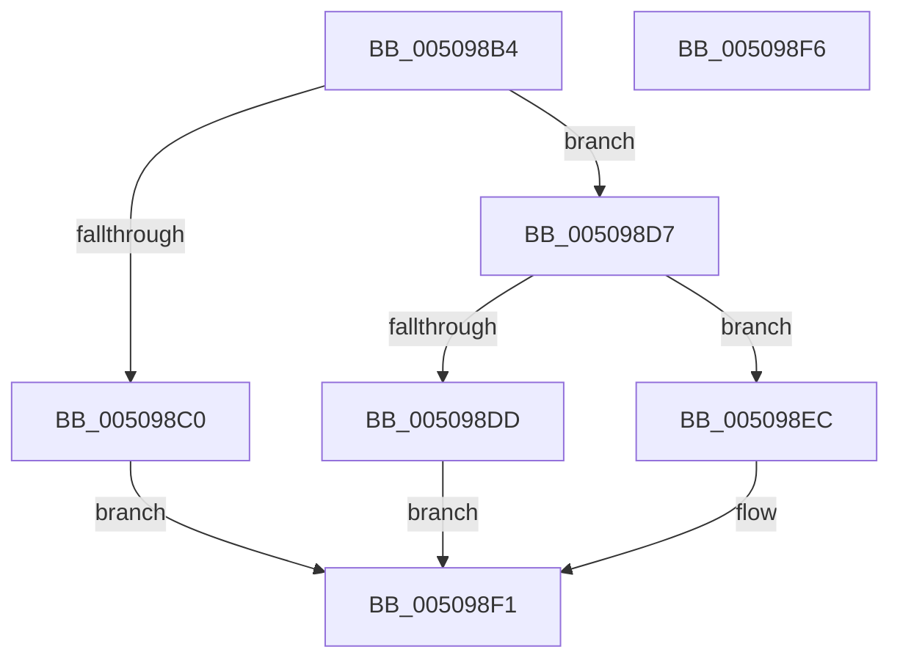

# fgetwc_nolock

- RVA: `0x005098B4`–`0x005098F7` (길이 `67` bytes)
- VA: `0x00000001405098B4`
- 실행 섹션: `.text`
- PDB 이름 있음: `예`; PDB Function 태그: `아니요`
- unwind 정보 RVA: `0x0005D2F4`
- 디코드: `21`개 명령, `67/67` bytes 표시
- 미해석 바이트: `0` (있으면 어셈블리에 `.byte`로 보존)

> 이 문서는 커널 이미지의 기계어와 PDB 기호를 분석해 생성했습니다. 4번과 5번은 함수 원형과 자료형을 바이너리 사용 방식에서 추정한 C 해석이며 원본 소스 복구 결과는 아닙니다.

## 1. Dependencies

- 직접 호출 지점: **2**; 고유 호출 대상: **2**
- 직접 호출자로 확인된 함수: **3**
- RIP 상대 이미지 참조: **0**

### Outgoing calls
- `0x005098CB` → [EmpCheckErrataList](../49/EmpCheckErrataList_function_0049E550.md) (function, `0x0049E550`)
- `0x005098EC` → [AlpcMaxAllowedMessageLength](../49/AlpcMaxAllowedMessageLength_function_00495B00.md) (function, `0x00495B00`)

### Direct callers
- [ReadString](ReadString_function_005089B0.md) at `0x00508A56`
- [_whiteout](_whiteout_function_00508E20.md) at `0x00508E3A`
- [winput_s](winput_s_function_00508E78.md) at `0x00509163`
- [winput_s](winput_s_function_00508E78.md) at `0x005092F9`
- [winput_s](winput_s_function_00508E78.md) at `0x0050934F`
- [winput_s](winput_s_function_00508E78.md) at `0x0050938D`
- [winput_s](winput_s_function_00508E78.md) at `0x005093E8`
- [winput_s](winput_s_function_00508E78.md) at `0x005094D0`
- [winput_s](winput_s_function_00508E78.md) at `0x005095DC`
- [winput_s](winput_s_function_00508E78.md) at `0x0050970E`

### Static image references
- 디코드된 RIP-relative 메모리 참조가 없습니다.

## 2. Other-region calls and transfers

- 다른 실행 섹션으로 향하는 call: **0**
- 별도 외부 분기/꼬리 이동을 확인하지 못했습니다.

## 3. Assembly (complete function range)

```asm
005098B4  48 83 EC 38                     sub rsp, 0x38
005098B8  48 8B D1                        mov rdx, rcx
005098BB  48 85 C9                        test rcx, rcx
005098BE  75 17                           jne 0x1405098d7
005098C0  48 21 4C 24 20                  and qword ptr [rsp + 0x20], rcx
005098C5  45 33 C9                        xor r9d, r9d
005098C8  45 33 C0                        xor r8d, r8d
005098CB  E8 80 4C F9 FF                  call 0x14049e550
005098D0  B8 FF FF 00 00                  mov eax, 0xffff
005098D5  EB 1A                           jmp 0x1405098f1
005098D7  83 41 08 FE                     add dword ptr [rcx + 8], -2
005098DB  78 0F                           js 0x1405098ec
005098DD  48 8B 09                        mov rcx, qword ptr [rcx]
005098E0  0F B7 01                        movzx eax, word ptr [rcx]
005098E3  48 83 C1 02                     add rcx, 2
005098E7  48 89 0A                        mov qword ptr [rdx], rcx
005098EA  EB 05                           jmp 0x1405098f1
005098EC  E8 0F C2 F8 FF                  call 0x140495b00
005098F1  48 83 C4 38                     add rsp, 0x38
005098F5  C3                              ret
005098F6  CC                              int3
```

## 4. C-style interpretation (structured pseudocode)

```c
__int64 __fastcall fgetwc_nolock(__int64 a1, __int64 a2, int a3, int a4)
{
    __int64 result;
    __int64 v_rsp;
    unsigned __int64 v_stack_m18;

    v_rsp = (v_rsp) - (56);
    if (a1 != 0) goto loc_005098D7;
    a4 = 0;
    a3 = 0;
    result = EmpCheckErrataList(a1, a1, a3, a4);
    goto loc_005098F1;
loc_005098D7:
    if (sign_flag) goto loc_005098EC;
    a1 = (*(unsigned __int64 *)(a1)) + (2);
    *(unsigned __int64 *)(a1) = a1;
    goto loc_005098F1;
loc_005098EC:
    result = AlpcMaxAllowedMessageLength(a1, a1, a3, a4);
loc_005098F1:
    v_rsp = (v_rsp) + (56);
    return result;
}
```

## 5. (Beta) C Style

```c
int64_t fgetwc_nolock(void *Arg1, int64_t Arg2, int32_t Arg3, int32_t Arg4)
{
    uint8_t *arg1 = (uint8_t *)Arg1;

    int64_t result;
    int64_t local_rsp;
    uint64_t v_stack_m18;

    local_rsp = (local_rsp) - (56);
    if (Arg1 != NULL) goto loc_005098D7;
    Arg4 = 0;
    Arg3 = 0;
    result = EmpCheckErrataList(Arg1, Arg1, Arg3, Arg4);
    goto loc_005098F1;
loc_005098D7:
    if (sign_flag) goto loc_005098EC;
    Arg1 = (*(uint64_t *)(arg1)) + (2);
    *(void **)(arg1) = Arg1;
    goto loc_005098F1;
loc_005098EC:
    result = AlpcMaxAllowedMessageLength(Arg1, Arg1, Arg3, Arg4);
loc_005098F1:
    local_rsp = (local_rsp) + (56);
    return result;
}
```

### 관측된 메모리 오프셋

구조체 형식이 확인되지 않은 접근은 인자 기준의 오프셋으로만 기록했습니다.

| 기준 인자 | 오프셋 표현 | 폭 (bit) | 접근 |
|---|---:|---:|---|
| `Arg1` | `+ 0x0` | `64` | `W` |

## 6. Execution-region graph

[열기: 2D/3D 그래프와 함수 탐색 컨트롤 패널](../../../control-panel.html?section=text&rva=0x005098B4&view=graph)

- 2D 그래프는 위에서 아래로 흐르고, 3D 그래프는 빈 공간을 드래그해 회전합니다. Shift+드래그는 이동, 휠은 확대·축소, 함수 노드 선택은 대상 보고서 이동입니다.

### Static fallback


