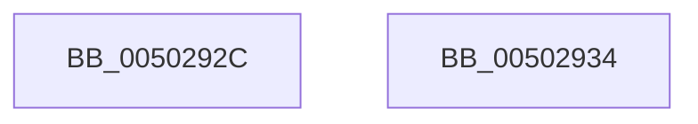

# flsbuf

- RVA: `0x0050292C`–`0x00502935` (길이 `9` bytes)
- VA: `0x000000014050292C`
- 실행 섹션: `.text`
- PDB 이름 있음: `예`; PDB Function 태그: `아니요`
- unwind 정보 RVA: `0x000DB714`
- 디코드: `4`개 명령, `9/9` bytes 표시
- 미해석 바이트: `0` (있으면 어셈블리에 `.byte`로 보존)

> 이 문서는 커널 이미지의 기계어와 PDB 기호를 분석해 생성했습니다. 4번과 5번은 함수 원형과 자료형을 바이너리 사용 방식에서 추정한 C 해석이며 원본 소스 복구 결과는 아닙니다.

## 1. Dependencies

- 직접 호출 지점: **0**; 고유 호출 대상: **0**
- 직접 호출자로 확인된 함수: **11**
- RIP 상대 이미지 참조: **0**

### Outgoing calls
- 직접 디코드된 call 명령이 없습니다.

### Direct callers
- [vsnwprintf_l](../4F/vsnwprintf_l_function_004FEF50.md) at `0x004FEFF3`
- [vsnwprintf_l](../4F/vsnwprintf_l_function_004FEF50.md) at `0x004FF00D`
- [vsnprintf_l](../4F/vsnprintf_l_function_004FF070.md) at `0x004FF0F8`
- [snprintf](../4F/snprintf_function_004FFB80.md) at `0x004FFC05`
- [snwprintf](../4F/snwprintf_function_004FFC40.md) at `0x004FFCE2`
- [snwprintf](../4F/snwprintf_function_004FFC40.md) at `0x004FFCFC`
- [swprintf](../4F/swprintf_function_004FFED0.md) at `0x004FFF4A`
- [swprintf](../4F/swprintf_function_004FFED0.md) at `0x004FFF64`
- [vswprintf_l](../4F/vswprintf_l_function_004FFFBC.md) at `0x00500024`
- [vswprintf_l](../4F/vswprintf_l_function_004FFFBC.md) at `0x0050003E`
- [sprintf](sprintf_function_00501230.md) at `0x0050129F`
- [vsprintf_l](vsprintf_l_function_00501928.md) at `0x00501985`
- [write_char](write_char_function_00503BE0.md) at `0x00503C12`
- [soutput_s](soutput_s_function_00507184.md) at `0x0050722F`
- [swoutput_s](swoutput_s_function_00507278.md) at `0x00507335`
- [swoutput_s](swoutput_s_function_00507278.md) at `0x00507356`

### Static image references
- 디코드된 RIP-relative 메모리 참조가 없습니다.

## 2. Other-region calls and transfers

- 다른 실행 섹션으로 향하는 call: **0**
- 별도 외부 분기/꼬리 이동을 확인하지 못했습니다.

## 3. Assembly (complete function range)

```asm
0050292C  83 4A 18 20                     or dword ptr [rdx + 0x18], 0x20
00502930  83 C8 FF                        or eax, 0xffffffff
00502933  C3                              ret
00502934  CC                              int3
```

## 4. C-style interpretation (structured pseudocode)

```c
__int64 __fastcall flsbuf(__int64 a1, __int64 a2)
{
    __int64 result;

    result = (unsigned int)((result) | (0xFFFFFFFFULL));
    return result;
}
```

## 5. (Beta) C Style

```c
int64_t flsbuf(int64_t Arg1, void *Arg2)
{
    uint8_t *arg2 = (uint8_t *)Arg2;

    int64_t result;

    result = (uint32_t)((result) | (0xFFFFFFFFULL));
    return result;
}
```

### 관측된 메모리 오프셋

구조체 형식이 확인되지 않은 접근은 인자 기준의 오프셋으로만 기록했습니다.

| 기준 인자 | 오프셋 표현 | 폭 (bit) | 접근 |
|---|---:|---:|---|
| `Arg2` | `+ 0x18` | `32` | `R/W` |

## 6. Execution-region graph

[열기: 2D/3D 그래프와 함수 탐색 컨트롤 패널](../../../control-panel.html?section=text&rva=0x0050292C&view=graph)

- 2D 그래프는 위에서 아래로 흐르고, 3D 그래프는 빈 공간을 드래그해 회전합니다. Shift+드래그는 이동, 휠은 확대·축소, 함수 노드 선택은 대상 보고서 이동입니다.

### Static fallback


