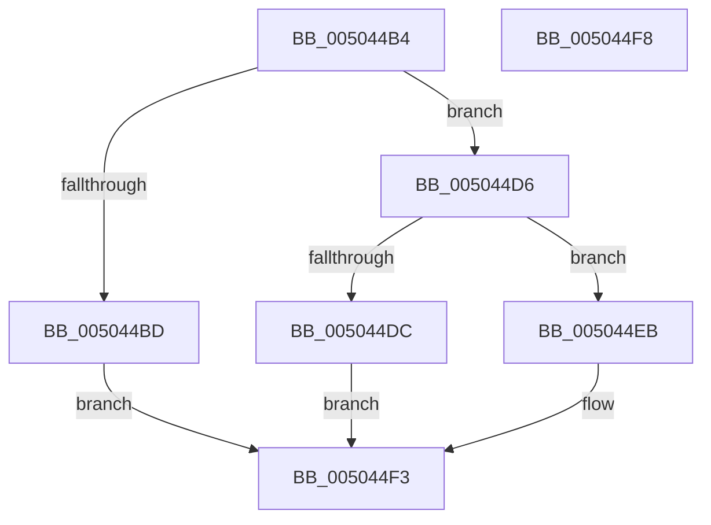

# fputwc_nolock

- RVA: `0x005044B4`–`0x005044F9` (길이 `69` bytes)
- VA: `0x00000001405044B4`
- 실행 섹션: `.text`
- PDB 이름 있음: `예`; PDB Function 태그: `아니요`
- unwind 정보 RVA: `0x0005D2F4`
- 디코드: `22`개 명령, `69/69` bytes 표시
- 미해석 바이트: `0` (있으면 어셈블리에 `.byte`로 보존)

> 이 문서는 커널 이미지의 기계어와 PDB 기호를 분석해 생성했습니다. 4번과 5번은 함수 원형과 자료형을 바이너리 사용 방식에서 추정한 C 해석이며 원본 소스 복구 결과는 아닙니다.

## 1. Dependencies

- 직접 호출 지점: **2**; 고유 호출 대상: **2**
- 직접 호출자로 확인된 함수: **1**
- RIP 상대 이미지 참조: **0**

### Outgoing calls
- `0x005044CA` → [EmpCheckErrataList](../49/EmpCheckErrataList_function_0049E550.md) (function, `0x0049E550`)
- `0x005044EE` → [flswbuf](flswbuf_function_00504A88.md) (function, `0x00504A88`)

### Direct callers
- [write_char](write_char_function_00503248.md) at `0x0050326B`

### Static image references
- 디코드된 RIP-relative 메모리 참조가 없습니다.

## 2. Other-region calls and transfers

- 다른 실행 섹션으로 향하는 call: **0**
- 별도 외부 분기/꼬리 이동을 확인하지 못했습니다.

## 3. Assembly (complete function range)

```asm
005044B4  48 83 EC 38                     sub rsp, 0x38
005044B8  48 85 D2                        test rdx, rdx
005044BB  75 19                           jne 0x1405044d6
005044BD  48 21 54 24 20                  and qword ptr [rsp + 0x20], rdx
005044C2  45 33 C9                        xor r9d, r9d
005044C5  45 33 C0                        xor r8d, r8d
005044C8  33 C9                           xor ecx, ecx
005044CA  E8 81 A0 F9 FF                  call 0x14049e550
005044CF  B8 FF FF 00 00                  mov eax, 0xffff
005044D4  EB 1D                           jmp 0x1405044f3
005044D6  83 42 08 FE                     add dword ptr [rdx + 8], -2
005044DA  78 0F                           js 0x1405044eb
005044DC  48 8B 02                        mov rax, qword ptr [rdx]
005044DF  66 89 08                        mov word ptr [rax], cx
005044E2  0F B7 C1                        movzx eax, cx
005044E5  48 83 02 02                     add qword ptr [rdx], 2
005044E9  EB 08                           jmp 0x1405044f3
005044EB  0F B7 C9                        movzx ecx, cx
005044EE  E8 95 05 00 00                  call 0x140504a88
005044F3  48 83 C4 38                     add rsp, 0x38
005044F7  C3                              ret
005044F8  CC                              int3
```

## 4. C-style interpretation (structured pseudocode)

```c
__int64 __fastcall fputwc_nolock(int a1, __int64 a2, int a3, int a4)
{
    __int64 result;
    __int64 v_rsp;
    unsigned __int64 v_stack_m18;

    v_rsp = (v_rsp) - (56);
    if (a2 != 0) goto loc_005044D6;
    a4 = 0;
    a3 = 0;
    a1 = 0;
    result = EmpCheckErrataList(a1, a2, a3, a4);
    goto loc_005044F3;
loc_005044D6:
    if (sign_flag) goto loc_005044EB;
    *(unsigned __int16 *)(*(unsigned __int64 *)(a2)) = 0;
    goto loc_005044F3;
loc_005044EB:
    result = flswbuf(0, a2, a3, a4);
loc_005044F3:
    v_rsp = (v_rsp) + (56);
    return result;
}
```

## 5. (Beta) C Style

```c
int64_t fputwc_nolock(int32_t Arg1, int64_t Arg2, int32_t Arg3, int32_t Arg4)
{
    int64_t result;
    int64_t local_rsp;
    uint64_t v_stack_m18;

    local_rsp = (local_rsp) - (56);
    if (Arg2 != 0) goto loc_005044D6;
    Arg4 = 0;
    Arg3 = 0;
    Arg1 = 0;
    result = EmpCheckErrataList(Arg1, Arg2, Arg3, Arg4);
    goto loc_005044F3;
loc_005044D6:
    if (sign_flag) goto loc_005044EB;
    *(uint16_t *)(*(uint64_t *)(Arg2)) = 0;
    goto loc_005044F3;
loc_005044EB:
    result = flswbuf(0, Arg2, Arg3, Arg4);
loc_005044F3:
    local_rsp = (local_rsp) + (56);
    return result;
}
```

## 6. Execution-region graph

[열기: 2D/3D 그래프와 함수 탐색 컨트롤 패널](../../../control-panel.html?section=text&rva=0x005044B4&view=graph)

- 2D 그래프는 위에서 아래로 흐르고, 3D 그래프는 빈 공간을 드래그해 회전합니다. Shift+드래그는 이동, 휠은 확대·축소, 함수 노드 선택은 대상 보고서 이동입니다.

### Static fallback


