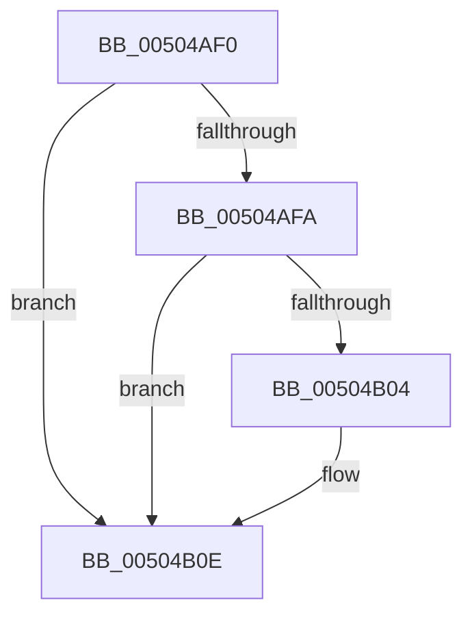

# frnd

- RVA: `0x00504AF0`–`0x00504B0F` (길이 `31` bytes)
- VA: `0x0000000140504AF0`
- 실행 섹션: `.text`
- PDB 이름 있음: `예`; PDB Function 태그: `아니요`
- unwind 정보 RVA: `0x000DB714`
- 디코드: `7`개 명령, `31/31` bytes 표시
- 미해석 바이트: `0` (있으면 어셈블리에 `.byte`로 보존)

> 이 문서는 커널 이미지의 기계어와 PDB 기호를 분석해 생성했습니다. 4번과 5번은 함수 원형과 자료형을 바이너리 사용 방식에서 추정한 C 해석이며 원본 소스 복구 결과는 아닙니다.

## 1. Dependencies

- 직접 호출 지점: **0**; 고유 호출 대상: **0**
- 직접 호출자로 확인된 함수: **0**
- RIP 상대 이미지 참조: **2**

### Outgoing calls
- 직접 디코드된 call 명령이 없습니다.

### Direct callers
- 이 함수 시작 RVA로 연결되는 직접 call은 확인되지 않았습니다. 간접 호출은 완전히 역산할 수 없습니다.

### Static image references
- `0x00504AF0` → RVA `0x0001F820` (`.rdata`; read)
- `0x00504AFA` → RVA `0x0001F828` (`.rdata`; read)

## 2. Other-region calls and transfers

- 다른 실행 섹션으로 향하는 call: **0**
- 별도 외부 분기/꼬리 이동을 확인하지 못했습니다.

## 3. Assembly (complete function range)

```asm
00504AF0  66 0F 2E 05 28 AD B1 FF         ucomisd xmm0, qword ptr [rip - 0x4e52d8]
00504AF8  73 14                           jae 0x140504b0e
00504AFA  66 0F 2E 05 26 AD B1 FF         ucomisd xmm0, qword ptr [rip - 0x4e52da]
00504B02  76 0A                           jbe 0x140504b0e
00504B04  F2 48 0F 2D C8                  cvtsd2si rcx, xmm0
00504B09  F2 48 0F 2A C1                  cvtsi2sd xmm0, rcx
00504B0E  C3                              ret
```

## 4. C-style interpretation (structured pseudocode)

```c
void __fastcall frnd(void)
{
    if (condition_is_above_or_equal) goto loc_00504B0E;
    if (!(condition_is_below_or_equal)) {
    }
    return;
}
```

## 5. (Beta) C Style

```c
void frnd(void)
{
    if (condition_is_above_or_equal) goto loc_00504B0E;
    if (!(condition_is_below_or_equal)) {
    }
    return;
}
```

## 6. Execution-region graph

[열기: 2D/3D 그래프와 함수 탐색 컨트롤 패널](../../../control-panel.html?section=text&rva=0x00504AF0&view=graph)

- 2D 그래프는 위에서 아래로 흐르고, 3D 그래프는 빈 공간을 드래그해 회전합니다. Shift+드래그는 이동, 휠은 확대·축소, 함수 노드 선택은 대상 보고서 이동입니다.

### Static fallback


