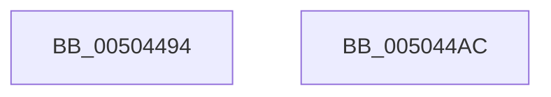

# get_printf_count_output

- RVA: `0x00504494`–`0x005044AD` (길이 `25` bytes)
- VA: `0x0000000140504494`
- 실행 섹션: `.text`
- PDB 이름 있음: `예`; PDB Function 태그: `아니요`
- unwind 정보 RVA: `0x000DB714`
- 디코드: `7`개 명령, `25/25` bytes 표시
- 미해석 바이트: `0` (있으면 어셈블리에 `.byte`로 보존)

> 이 문서는 커널 이미지의 기계어와 PDB 기호를 분석해 생성했습니다. 4번과 5번은 함수 원형과 자료형을 바이너리 사용 방식에서 추정한 C 해석이며 원본 소스 복구 결과는 아닙니다.

## 1. Dependencies

- 직접 호출 지점: **0**; 고유 호출 대상: **0**
- 직접 호출자로 확인된 함수: **2**
- RIP 상대 이미지 참조: **2**

### Outgoing calls
- 직접 디코드된 call 명령이 없습니다.

### Direct callers
- [woutput_l](woutput_l_function_0050293C.md) at `0x00502FBC`
- [output_l](output_l_function_00503368.md) at `0x00503978`

### Static image references
- `0x00504494` → RVA `0x00E0A740` (`.data`; read)
- `0x005044A1` → RVA `0x00E0F200` (`.data`; read)

## 2. Other-region calls and transfers

- 다른 실행 섹션으로 향하는 call: **0**
- 별도 외부 분기/꼬리 이동을 확인하지 못했습니다.

## 3. Assembly (complete function range)

```asm
00504494  48 8B 0D A5 62 90 00            mov rcx, qword ptr [rip + 0x9062a5]
0050449B  33 C0                           xor eax, eax
0050449D  48 83 C9 01                     or rcx, 1
005044A1  48 39 0D 58 AD 90 00            cmp qword ptr [rip + 0x90ad58], rcx
005044A8  0F 94 C0                        sete al
005044AB  C3                              ret
005044AC  CC                              int3
```

## 4. C-style interpretation (structured pseudocode)

```c
__int64 __fastcall get_printf_count_output(void)
{
    __int64 result;

    result = 0;
    a1 = (*(unsigned __int64 *)(v_rip + 9462437)) | (1);
    result = ((*(unsigned __int64 *)(v_rip + 9481560)) == a1) ? 1 : 0;
    return result;
}
```

## 5. (Beta) C Style

```c
void get_printf_count_output(void)
{
    int64_t result;

    result = 0;
    a1 = (*(uint64_t *)(v_rip + 0x9062A5)) | (1);
    result = ((*(uint64_t *)(v_rip + 0x90AD58)) == a1) ? 1 : 0;
    return result;
}
```

## 6. Execution-region graph

[열기: 2D/3D 그래프와 함수 탐색 컨트롤 패널](../../../control-panel.html?section=text&rva=0x00504494&view=graph)

- 2D 그래프는 위에서 아래로 흐르고, 3D 그래프는 빈 공간을 드래그해 회전합니다. Shift+드래그는 이동, 휠은 확대·축소, 함수 노드 선택은 대상 보고서 이동입니다.

### Static fallback


