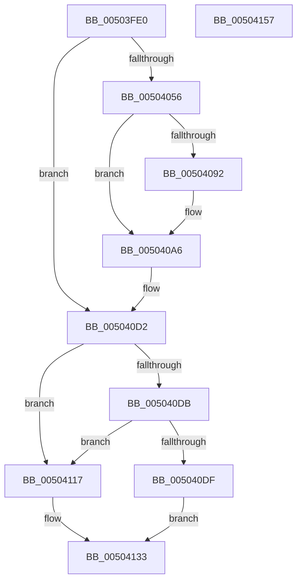

# handle_error

- RVA: `0x00503FE0`–`0x00504158` (길이 `376` bytes)
- VA: `0x0000000140503FE0`
- 실행 섹션: `.text`
- PDB 이름 있음: `예`; PDB Function 태그: `아니요`
- unwind 정보 RVA: `0x000C2820`
- 디코드: `80`개 명령, `376/376` bytes 표시
- 미해석 바이트: `0` (있으면 어셈블리에 `.byte`로 보존)

> 이 문서는 커널 이미지의 기계어와 PDB 기호를 분석해 생성했습니다. 4번과 5번은 함수 원형과 자료형을 바이너리 사용 방식에서 추정한 C 해석이며 원본 소스 복구 결과는 아닙니다.

## 1. Dependencies

- 직접 호출 지점: **7**; 고유 호출 대상: **6**
- 직접 호출자로 확인된 함수: **1**
- RIP 상대 이미지 참조: **2**

### Outgoing calls
- `0x0050401B` → [ctrlfp](ctrlfp_function_005049B0.md) (function, `0x005049B0`)
- `0x00504044` → [_exception_enabled](_exception_enabled_function_00503F10.md) (function, `0x00503F10`)
- `0x005040CD` → [raise_exc](raise_exc_function_005045E0.md) (function, `0x005045E0`)
- `0x00504110` → [_call_matherr](_call_matherr_function_00503E90.md) (function, `0x00503E90`)
- `0x00504119` → [EmpCheckErrataList](../49/EmpCheckErrataList_function_0049E550.md) (function, `0x0049E550`)
- `0x00504128` → [ctrlfp](ctrlfp_function_005049B0.md) (function, `0x005049B0`)
- `0x0050413E` → [_security_check_cookie](../6A/_security_check_cookie_function_006AC640.md) (function, `0x006AC640`)

### Direct callers
- [sqrt](sqrt_function_005012D0.md) at `0x0050135D`
- [sqrt](sqrt_function_005012D0.md) at `0x005013B1`

### Static image references
- `0x00503FF4` → RVA `0x00E0A740` (`.data`; read)
- `0x005040D2` → RVA `0x00E0A714` (`.data`; read)

## 2. Other-region calls and transfers

- 다른 실행 섹션으로 향하는 call: **0**
- 별도 외부 분기/꼬리 이동을 확인하지 못했습니다.

## 3. Assembly (complete function range)

```asm
00503FE0  40 53                           push rbx
00503FE2  55                              push rbp
00503FE3  56                              push rsi
00503FE4  57                              push rdi
00503FE5  48 81 EC E8 00 00 00            sub rsp, 0xe8
00503FEC  0F 29 B4 24 D0 00 00 00         movaps xmmword ptr [rsp + 0xd0], xmm6
00503FF4  48 8B 05 45 67 90 00            mov rax, qword ptr [rip + 0x906745]
00503FFB  48 33 C4                        xor rax, rsp
00503FFE  48 89 84 24 C0 00 00 00         mov qword ptr [rsp + 0xc0], rax
00504006  8B F2                           mov esi, edx
00504008  48 8B E9                        mov rbp, rcx
0050400B  BA C0 FF 00 00                  mov edx, 0xffc0
00504010  B9 80 1F 00 00                  mov ecx, 0x1f80
00504015  41 8B F9                        mov edi, r9d
00504018  49 8B D8                        mov rbx, r8
0050401B  E8 90 09 00 00                  call 0x1405049b0
00504020  48 89 44 24 48                  mov qword ptr [rsp + 0x48], rax
00504025  48 89 5C 24 40                  mov qword ptr [rsp + 0x40], rbx
0050402A  F2 0F 10 44 24 40               movsd xmm0, qword ptr [rsp + 0x40]
00504030  8B 9C 24 30 01 00 00            mov ebx, dword ptr [rsp + 0x130]
00504037  8B CB                           mov ecx, ebx
00504039  48 8B 54 24 48                  mov rdx, qword ptr [rsp + 0x48]
0050403E  F2 0F 11 44 24 40               movsd qword ptr [rsp + 0x40], xmm0
00504044  E8 C7 FE FF FF                  call 0x140503f10
00504049  F2 0F 10 B4 24 48 01 00 00      movsd xmm6, qword ptr [rsp + 0x148]
00504052  85 C0                           test eax, eax
00504054  75 7C                           jne 0x1405040d2
00504056  83 BC 24 50 01 00 00 02         cmp dword ptr [rsp + 0x150], 2
0050405E  0F 57 C0                        xorps xmm0, xmm0
00504061  0F 11 44 24 50                  movups xmmword ptr [rsp + 0x50], xmm0
00504066  0F 11 44 24 60                  movups xmmword ptr [rsp + 0x60], xmm0
0050406B  0F 11 44 24 70                  movups xmmword ptr [rsp + 0x70], xmm0
00504070  0F 11 84 24 80 00 00 00         movups xmmword ptr [rsp + 0x80], xmm0
00504078  0F 11 84 24 90 00 00 00         movups xmmword ptr [rsp + 0x90], xmm0
00504080  0F 11 84 24 A0 00 00 00         movups xmmword ptr [rsp + 0xa0], xmm0
00504088  0F 11 84 24 B0 00 00 00         movups xmmword ptr [rsp + 0xb0], xmm0
00504090  75 14                           jne 0x1405040a6
00504092  F2 0F 11 B4 24 80 00 00 00      movsd qword ptr [rsp + 0x80], xmm6
0050409B  C7 84 24 90 00 00 00 03 00 00 00  mov dword ptr [rsp + 0x90], 3
005040A6  48 8D 44 24 40                  lea rax, [rsp + 0x40]
005040AB  44 8B CE                        mov r9d, esi
005040AE  48 89 44 24 28                  mov qword ptr [rsp + 0x28], rax
005040B3  48 8D 54 24 48                  lea rdx, [rsp + 0x48]
005040B8  48 8D 84 24 40 01 00 00         lea rax, [rsp + 0x140]
005040C0  44 8B C3                        mov r8d, ebx
005040C3  48 8D 4C 24 50                  lea rcx, [rsp + 0x50]
005040C8  48 89 44 24 20                  mov qword ptr [rsp + 0x20], rax
005040CD  E8 0E 05 00 00                  call 0x1405045e0
005040D2  83 3D 3B 66 90 00 00            cmp dword ptr [rip + 0x90663b], 0
005040D9  75 3C                           jne 0x140504117
005040DB  85 FF                           test edi, edi
005040DD  74 38                           je 0x140504117
005040DF  48 8B 44 24 48                  mov rax, qword ptr [rsp + 0x48]
005040E4  4C 8B C5                        mov r8, rbp
005040E7  F2 0F 10 44 24 40               movsd xmm0, qword ptr [rsp + 0x40]
005040ED  8B CF                           mov ecx, edi
005040EF  F2 0F 10 9C 24 40 01 00 00      movsd xmm3, qword ptr [rsp + 0x140]
005040F8  8B 94 24 38 01 00 00            mov edx, dword ptr [rsp + 0x138]
005040FF  48 89 44 24 30                  mov qword ptr [rsp + 0x30], rax
00504104  F2 0F 11 44 24 28               movsd qword ptr [rsp + 0x28], xmm0
0050410A  F2 0F 11 74 24 20               movsd qword ptr [rsp + 0x20], xmm6
00504110  E8 7B FD FF FF                  call 0x140503e90
00504115  EB 1C                           jmp 0x140504133
00504117  8B CF                           mov ecx, edi
00504119  E8 32 A4 F9 FF                  call 0x14049e550
0050411E  48 8B 4C 24 48                  mov rcx, qword ptr [rsp + 0x48]
00504123  BA C0 FF 00 00                  mov edx, 0xffc0
00504128  E8 83 08 00 00                  call 0x1405049b0
0050412D  F2 0F 10 44 24 40               movsd xmm0, qword ptr [rsp + 0x40]
00504133  48 8B 8C 24 C0 00 00 00         mov rcx, qword ptr [rsp + 0xc0]
0050413B  48 33 CC                        xor rcx, rsp
0050413E  E8 FD 84 1A 00                  call 0x1406ac640
00504143  0F 28 B4 24 D0 00 00 00         movaps xmm6, xmmword ptr [rsp + 0xd0]
0050414B  48 81 C4 E8 00 00 00            add rsp, 0xe8
00504152  5F                              pop rdi
00504153  5E                              pop rsi
00504154  5D                              pop rbp
00504155  5B                              pop rbx
00504156  C3                              ret
00504157  CC                              int3
```

## 4. C-style interpretation (structured pseudocode)

```c
__int64 __fastcall handle_error(__int64 a1, int a2, __int64 a3, int a4, unsigned int a5, unsigned int a6, __int64 a7, __int64 a8, unsigned int a9)
{
    __int64 result;
    __int64 v_rsp;
    unsigned __int64 v_stack_m38;
    unsigned __int64 v_stack_m48;
    unsigned __int64 v_stack_m58;
    unsigned __int64 v_stack_m68;
    unsigned __int64 v_stack_m78;
    unsigned __int64 v_stack_m88;
    unsigned __int64 v_stack_m98;
    unsigned __int64 v_stack_mA8;
    unsigned __int64 v_stack_mB8;
    unsigned __int64 v_stack_mC0;
    unsigned __int64 v_stack_mC8;
    unsigned __int64 v_stack_mD8;
    unsigned __int64 v_stack_mE0;
    unsigned __int64 v_stack_mE8;

    v_rsp = (v_rsp) - (232);
    v_stack_m38 = v_xmm6;
    result = (*(unsigned __int64 *)(v_rip + 9463621)) ^ (v_rsp);
    v_stack_m48 = result;
    result = ctrlfp((unsigned int)(0x1F80ULL), (unsigned int)(0xFFC0ULL), a3, a4);
    v_stack_mC0 = result;
    v_stack_mC8 = a3;
    v_stack_mC8 = v_xmm0;
    result = _exception_enabled((unsigned int)((unsigned int)((unsigned int)(a5))), v_stack_mC0, a3, a4);
    if ((unsigned int)(result) != 0) goto loc_005040D2;
    v_stack_mB8 = v_xmm0;
    v_stack_mA8 = v_xmm0;
    v_stack_m98 = v_xmm0;
    v_stack_m88 = v_xmm0;
    v_stack_m78 = v_xmm0;
    v_stack_m68 = v_xmm0;
    v_stack_m58 = v_xmm0;
    if (a9 == 2) {
        v_stack_m88 = v_xmm6;
        v_stack_m78 = 3;
    }
    v_stack_mE0 = v_stack_mC8;
    v_stack_mE8 = a7;
    result = raise_exc(v_stack_mB8, v_stack_mC0, (unsigned int)((unsigned int)((unsigned int)(a5))), (unsigned int)((unsigned int)((unsigned int)(a2))));
loc_005040D2:
    if ((*(unsigned int *)(v_rip + 9463355)) != 0) goto loc_00504117;
    if ((unsigned int)((unsigned int)(a4)) == 0) goto loc_00504117;
    v_stack_mD8 = v_stack_mC0;
    v_stack_mE0 = v_xmm0;
    v_stack_mE8 = v_xmm6;
    result = _call_matherr((unsigned int)((unsigned int)((unsigned int)(a4))), (unsigned int)(a6), a1, (unsigned int)((unsigned int)((unsigned int)(a2))));
    goto loc_00504133;
loc_00504117:
    result = EmpCheckErrataList((unsigned int)((unsigned int)((unsigned int)(a4))), (unsigned int)(a6), a1, (unsigned int)((unsigned int)((unsigned int)(a2))));
    result = ctrlfp(v_stack_mC0, (unsigned int)(0xFFC0ULL), a1, (unsigned int)((unsigned int)((unsigned int)(a2))));
loc_00504133:
    a1 = (v_stack_m48) ^ (v_rsp);
    result = _security_check_cookie(a1, (unsigned int)(0xFFC0ULL), a1, (unsigned int)((unsigned int)((unsigned int)(a2))));
    v_rsp = (v_rsp) + (232);
    return result;
}
```

## 5. (Beta) C Style

```c
int64_t handle_error(int64_t Arg1, int32_t Arg2, int64_t Arg3, int32_t Arg4, uint32_t Arg5, uint32_t Arg6, int64_t Arg7, int64_t Arg8, uint32_t Arg9)
{
    int64_t result;
    int64_t local_rsp;
    uint64_t v_stack_m38;
    uint64_t v_stack_m48;
    uint64_t v_stack_m58;
    uint64_t v_stack_m68;
    uint64_t v_stack_m78;
    uint64_t v_stack_m88;
    uint64_t v_stack_m98;
    uint64_t v_stack_mA8;
    uint64_t v_stack_mB8;
    uint64_t v_stack_mC0;
    uint64_t v_stack_mC8;
    uint64_t v_stack_mD8;
    uint64_t v_stack_mE0;
    uint64_t v_stack_mE8;

    local_rsp = (local_rsp) - (232);
    v_stack_m38 = v_xmm6;
    result = (*(uint64_t *)(v_rip + 0x906745)) ^ (local_rsp);
    v_stack_m48 = result;
    result = ctrlfp((uint32_t)(0x1F80ULL), (uint32_t)(0xFFC0ULL), Arg3, Arg4);
    v_stack_mC0 = result;
    v_stack_mC8 = Arg3;
    v_stack_mC8 = v_xmm0;
    result = _exception_enabled((uint32_t)((uint32_t)((uint32_t)(Arg5))), v_stack_mC0, Arg3, Arg4);
    if ((uint32_t)(result) != 0) goto loc_005040D2;
    v_stack_mB8 = v_xmm0;
    v_stack_mA8 = v_xmm0;
    v_stack_m98 = v_xmm0;
    v_stack_m88 = v_xmm0;
    v_stack_m78 = v_xmm0;
    v_stack_m68 = v_xmm0;
    v_stack_m58 = v_xmm0;
    if (Arg9 == 2) {
        v_stack_m88 = v_xmm6;
        v_stack_m78 = 3;
    }
    v_stack_mE0 = v_stack_mC8;
    v_stack_mE8 = Arg7;
    result = raise_exc(v_stack_mB8, v_stack_mC0, (uint32_t)((uint32_t)((uint32_t)(Arg5))), (uint32_t)((uint32_t)((uint32_t)(Arg2))));
loc_005040D2:
    if ((*(uint32_t *)(v_rip + 0x90663B)) != 0) goto loc_00504117;
    if ((uint32_t)((uint32_t)(Arg4)) == 0) goto loc_00504117;
    v_stack_mD8 = v_stack_mC0;
    v_stack_mE0 = v_xmm0;
    v_stack_mE8 = v_xmm6;
    result = _call_matherr((uint32_t)((uint32_t)((uint32_t)(Arg4))), (uint32_t)(Arg6), Arg1, (uint32_t)((uint32_t)((uint32_t)(Arg2))));
    goto loc_00504133;
loc_00504117:
    result = EmpCheckErrataList((uint32_t)((uint32_t)((uint32_t)(Arg4))), (uint32_t)(Arg6), Arg1, (uint32_t)((uint32_t)((uint32_t)(Arg2))));
    result = ctrlfp(v_stack_mC0, (uint32_t)(0xFFC0ULL), Arg1, (uint32_t)((uint32_t)((uint32_t)(Arg2))));
loc_00504133:
    Arg1 = (v_stack_m48) ^ (local_rsp);
    result = _security_check_cookie(Arg1, (uint32_t)(0xFFC0ULL), Arg1, (uint32_t)((uint32_t)((uint32_t)(Arg2))));
    local_rsp = (local_rsp) + (232);
    return result;
}
```

## 6. Execution-region graph

[열기: 2D/3D 그래프와 함수 탐색 컨트롤 패널](../../../control-panel.html?section=text&rva=0x00503FE0&view=graph)

- 2D 그래프는 위에서 아래로 흐르고, 3D 그래프는 빈 공간을 드래그해 회전합니다. Shift+드래그는 이동, 휠은 확대·축소, 함수 노드 선택은 대상 보고서 이동입니다.

### Static fallback


