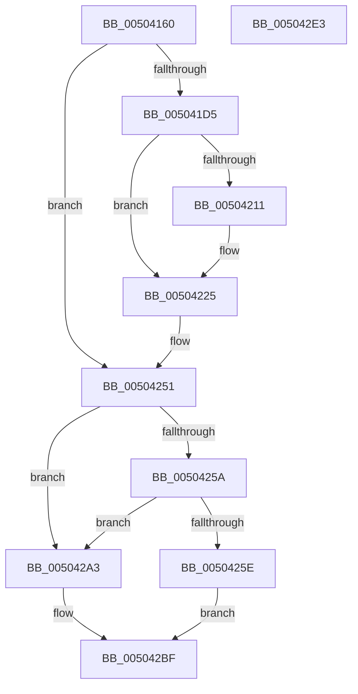

# handle_errorf

- RVA: `0x00504160`–`0x005042E4` (길이 `388` bytes)
- VA: `0x0000000140504160`
- 실행 섹션: `.text`
- PDB 이름 있음: `예`; PDB Function 태그: `아니요`
- unwind 정보 RVA: `0x000C2820`
- 디코드: `84`개 명령, `388/388` bytes 표시
- 미해석 바이트: `0` (있으면 어셈블리에 `.byte`로 보존)

> 이 문서는 커널 이미지의 기계어와 PDB 기호를 분석해 생성했습니다. 4번과 5번은 함수 원형과 자료형을 바이너리 사용 방식에서 추정한 C 해석이며 원본 소스 복구 결과는 아닙니다.

## 1. Dependencies

- 직접 호출 지점: **7**; 고유 호출 대상: **6**
- 직접 호출자로 확인된 함수: **1**
- RIP 상대 이미지 참조: **2**

### Outgoing calls
- `0x0050419B` → [ctrlfp](ctrlfp_function_005049B0.md) (function, `0x005049B0`)
- `0x005041C3` → [_exception_enabled](_exception_enabled_function_00503F10.md) (function, `0x00503F10`)
- `0x0050424C` → [raise_excf](raise_excf_function_00504940.md) (function, `0x00504940`)
- `0x00504298` → [_call_matherr](_call_matherr_function_00503E90.md) (function, `0x00503E90`)
- `0x005042A5` → [EmpCheckErrataList](../49/EmpCheckErrataList_function_0049E550.md) (function, `0x0049E550`)
- `0x005042B4` → [ctrlfp](ctrlfp_function_005049B0.md) (function, `0x005049B0`)
- `0x005042CA` → [_security_check_cookie](../6A/_security_check_cookie_function_006AC640.md) (function, `0x006AC640`)

### Direct callers
- [sqrtf](sqrtf_function_005013F0.md) at `0x00501463`
- [sqrtf](sqrtf_function_005013F0.md) at `0x005014B5`

### Static image references
- `0x00504174` → RVA `0x00E0A740` (`.data`; read)
- `0x00504251` → RVA `0x00E0A714` (`.data`; read)

## 2. Other-region calls and transfers

- 다른 실행 섹션으로 향하는 call: **0**
- 별도 외부 분기/꼬리 이동을 확인하지 못했습니다.

## 3. Assembly (complete function range)

```asm
00504160  40 53                           push rbx
00504162  55                              push rbp
00504163  56                              push rsi
00504164  57                              push rdi
00504165  48 81 EC E8 00 00 00            sub rsp, 0xe8
0050416C  0F 29 B4 24 D0 00 00 00         movaps xmmword ptr [rsp + 0xd0], xmm6
00504174  48 8B 05 C5 65 90 00            mov rax, qword ptr [rip + 0x9065c5]
0050417B  48 33 C4                        xor rax, rsp
0050417E  48 89 84 24 C0 00 00 00         mov qword ptr [rsp + 0xc0], rax
00504186  8B F2                           mov esi, edx
00504188  48 8B E9                        mov rbp, rcx
0050418B  BA C0 FF 00 00                  mov edx, 0xffc0
00504190  B9 80 1F 00 00                  mov ecx, 0x1f80
00504195  41 8B F9                        mov edi, r9d
00504198  49 8B D8                        mov rbx, r8
0050419B  E8 10 08 00 00                  call 0x1405049b0
005041A0  48 89 44 24 48                  mov qword ptr [rsp + 0x48], rax
005041A5  89 5C 24 40                     mov dword ptr [rsp + 0x40], ebx
005041A9  F3 0F 10 44 24 40               movss xmm0, dword ptr [rsp + 0x40]
005041AF  8B 9C 24 30 01 00 00            mov ebx, dword ptr [rsp + 0x130]
005041B6  8B CB                           mov ecx, ebx
005041B8  48 8B 54 24 48                  mov rdx, qword ptr [rsp + 0x48]
005041BD  F3 0F 11 44 24 40               movss dword ptr [rsp + 0x40], xmm0
005041C3  E8 48 FD FF FF                  call 0x140503f10
005041C8  F3 0F 10 B4 24 48 01 00 00      movss xmm6, dword ptr [rsp + 0x148]
005041D1  85 C0                           test eax, eax
005041D3  75 7C                           jne 0x140504251
005041D5  83 BC 24 50 01 00 00 02         cmp dword ptr [rsp + 0x150], 2
005041DD  0F 57 C0                        xorps xmm0, xmm0
005041E0  0F 11 44 24 50                  movups xmmword ptr [rsp + 0x50], xmm0
005041E5  0F 11 44 24 60                  movups xmmword ptr [rsp + 0x60], xmm0
005041EA  0F 11 44 24 70                  movups xmmword ptr [rsp + 0x70], xmm0
005041EF  0F 11 84 24 80 00 00 00         movups xmmword ptr [rsp + 0x80], xmm0
005041F7  0F 11 84 24 90 00 00 00         movups xmmword ptr [rsp + 0x90], xmm0
005041FF  0F 11 84 24 A0 00 00 00         movups xmmword ptr [rsp + 0xa0], xmm0
00504207  0F 11 84 24 B0 00 00 00         movups xmmword ptr [rsp + 0xb0], xmm0
0050420F  75 14                           jne 0x140504225
00504211  F3 0F 11 B4 24 80 00 00 00      movss dword ptr [rsp + 0x80], xmm6
0050421A  C7 84 24 90 00 00 00 01 00 00 00  mov dword ptr [rsp + 0x90], 1
00504225  48 8D 44 24 40                  lea rax, [rsp + 0x40]
0050422A  44 8B CE                        mov r9d, esi
0050422D  48 89 44 24 28                  mov qword ptr [rsp + 0x28], rax
00504232  48 8D 54 24 48                  lea rdx, [rsp + 0x48]
00504237  48 8D 84 24 40 01 00 00         lea rax, [rsp + 0x140]
0050423F  44 8B C3                        mov r8d, ebx
00504242  48 8D 4C 24 50                  lea rcx, [rsp + 0x50]
00504247  48 89 44 24 20                  mov qword ptr [rsp + 0x20], rax
0050424C  E8 EF 06 00 00                  call 0x140504940
00504251  83 3D BC 64 90 00 00            cmp dword ptr [rip + 0x9064bc], 0
00504258  75 49                           jne 0x1405042a3
0050425A  85 FF                           test edi, edi
0050425C  74 45                           je 0x1405042a3
0050425E  F3 0F 10 44 24 40               movss xmm0, dword ptr [rsp + 0x40]
00504264  4C 8B C5                        mov r8, rbp
00504267  F3 0F 10 9C 24 40 01 00 00      movss xmm3, dword ptr [rsp + 0x140]
00504270  8B CF                           mov ecx, edi
00504272  48 8B 44 24 48                  mov rax, qword ptr [rsp + 0x48]
00504277  8B 94 24 38 01 00 00            mov edx, dword ptr [rsp + 0x138]
0050427E  48 89 44 24 30                  mov qword ptr [rsp + 0x30], rax
00504283  0F 5A C0                        cvtps2pd xmm0, xmm0
00504286  0F 5A CE                        cvtps2pd xmm1, xmm6
00504289  F2 0F 11 44 24 28               movsd qword ptr [rsp + 0x28], xmm0
0050428F  0F 5A DB                        cvtps2pd xmm3, xmm3
00504292  F2 0F 11 4C 24 20               movsd qword ptr [rsp + 0x20], xmm1
00504298  E8 F3 FB FF FF                  call 0x140503e90
0050429D  F2 0F 5A C0                     cvtsd2ss xmm0, xmm0
005042A1  EB 1C                           jmp 0x1405042bf
005042A3  8B CF                           mov ecx, edi
005042A5  E8 A6 A2 F9 FF                  call 0x14049e550
005042AA  48 8B 4C 24 48                  mov rcx, qword ptr [rsp + 0x48]
005042AF  BA C0 FF 00 00                  mov edx, 0xffc0
005042B4  E8 F7 06 00 00                  call 0x1405049b0
005042B9  F3 0F 10 44 24 40               movss xmm0, dword ptr [rsp + 0x40]
005042BF  48 8B 8C 24 C0 00 00 00         mov rcx, qword ptr [rsp + 0xc0]
005042C7  48 33 CC                        xor rcx, rsp
005042CA  E8 71 83 1A 00                  call 0x1406ac640
005042CF  0F 28 B4 24 D0 00 00 00         movaps xmm6, xmmword ptr [rsp + 0xd0]
005042D7  48 81 C4 E8 00 00 00            add rsp, 0xe8
005042DE  5F                              pop rdi
005042DF  5E                              pop rsi
005042E0  5D                              pop rbp
005042E1  5B                              pop rbx
005042E2  C3                              ret
005042E3  CC                              int3
```

## 4. C-style interpretation (structured pseudocode)

```c
__int64 __fastcall handle_errorf(__int64 a1, int a2, __int64 a3, int a4, unsigned int a5, unsigned int a6, unsigned int a7, unsigned int a8, unsigned int a9)
{
    __int64 result;
    __int64 v_rsp;
    unsigned __int64 v_stack_m38;
    unsigned __int64 v_stack_m48;
    unsigned __int64 v_stack_m58;
    unsigned __int64 v_stack_m68;
    unsigned __int64 v_stack_m78;
    unsigned __int64 v_stack_m88;
    unsigned __int64 v_stack_m98;
    unsigned __int64 v_stack_mA8;
    unsigned __int64 v_stack_mB8;
    unsigned __int64 v_stack_mC0;
    unsigned int v_stack_mC8;
    unsigned __int64 v_stack_mD8;
    unsigned __int64 v_stack_mE0;
    unsigned __int64 v_stack_mE8;

    v_rsp = (v_rsp) - (232);
    v_stack_m38 = v_xmm6;
    result = (*(unsigned __int64 *)(v_rip + 9463237)) ^ (v_rsp);
    v_stack_m48 = result;
    result = ctrlfp((unsigned int)(0x1F80ULL), (unsigned int)(0xFFC0ULL), a3, a4);
    v_stack_mC0 = result;
    v_stack_mC8 = (unsigned int)(a3);
    v_stack_mC8 = v_xmm0;
    result = _exception_enabled((unsigned int)((unsigned int)((unsigned int)(a5))), v_stack_mC0, a3, a4);
    if ((unsigned int)(result) != 0) goto loc_00504251;
    v_stack_mB8 = v_xmm0;
    v_stack_mA8 = v_xmm0;
    v_stack_m98 = v_xmm0;
    v_stack_m88 = v_xmm0;
    v_stack_m78 = v_xmm0;
    v_stack_m68 = v_xmm0;
    v_stack_m58 = v_xmm0;
    if (a9 == 2) {
        v_stack_m88 = v_xmm6;
        v_stack_m78 = 1;
    }
    v_stack_mE0 = v_stack_mC8;
    v_stack_mE8 = a7;
    result = raise_excf(v_stack_mB8, v_stack_mC0, (unsigned int)((unsigned int)((unsigned int)(a5))), (unsigned int)((unsigned int)((unsigned int)(a2))));
loc_00504251:
    if ((*(unsigned int *)(v_rip + 9462972)) != 0) goto loc_005042A3;
    if ((unsigned int)((unsigned int)(a4)) == 0) goto loc_005042A3;
    v_stack_mD8 = v_stack_mC0;
    v_stack_mE0 = v_xmm0;
    v_stack_mE8 = v_xmm1;
    result = _call_matherr((unsigned int)((unsigned int)((unsigned int)(a4))), (unsigned int)(a6), a1, (unsigned int)((unsigned int)((unsigned int)(a2))));
    goto loc_005042BF;
loc_005042A3:
    result = EmpCheckErrataList((unsigned int)((unsigned int)((unsigned int)(a4))), (unsigned int)(a6), a1, (unsigned int)((unsigned int)((unsigned int)(a2))));
    result = ctrlfp(v_stack_mC0, (unsigned int)(0xFFC0ULL), a1, (unsigned int)((unsigned int)((unsigned int)(a2))));
loc_005042BF:
    a1 = (v_stack_m48) ^ (v_rsp);
    result = _security_check_cookie(a1, (unsigned int)(0xFFC0ULL), a1, (unsigned int)((unsigned int)((unsigned int)(a2))));
    v_rsp = (v_rsp) + (232);
    return result;
}
```

## 5. (Beta) C Style

```c
int64_t handle_errorf(int64_t Arg1, int32_t Arg2, int64_t Arg3, int32_t Arg4, uint32_t Arg5, uint32_t Arg6, uint32_t Arg7, uint32_t Arg8, uint32_t Arg9)
{
    int64_t result;
    int64_t local_rsp;
    uint64_t v_stack_m38;
    uint64_t v_stack_m48;
    uint64_t v_stack_m58;
    uint64_t v_stack_m68;
    uint64_t v_stack_m78;
    uint64_t v_stack_m88;
    uint64_t v_stack_m98;
    uint64_t v_stack_mA8;
    uint64_t v_stack_mB8;
    uint64_t v_stack_mC0;
    uint32_t v_stack_mC8;
    uint64_t v_stack_mD8;
    uint64_t v_stack_mE0;
    uint64_t v_stack_mE8;

    local_rsp = (local_rsp) - (232);
    v_stack_m38 = v_xmm6;
    result = (*(uint64_t *)(v_rip + 0x9065C5)) ^ (local_rsp);
    v_stack_m48 = result;
    result = ctrlfp((uint32_t)(0x1F80ULL), (uint32_t)(0xFFC0ULL), Arg3, Arg4);
    v_stack_mC0 = result;
    v_stack_mC8 = (uint32_t)(Arg3);
    v_stack_mC8 = v_xmm0;
    result = _exception_enabled((uint32_t)((uint32_t)((uint32_t)(Arg5))), v_stack_mC0, Arg3, Arg4);
    if ((uint32_t)(result) != 0) goto loc_00504251;
    v_stack_mB8 = v_xmm0;
    v_stack_mA8 = v_xmm0;
    v_stack_m98 = v_xmm0;
    v_stack_m88 = v_xmm0;
    v_stack_m78 = v_xmm0;
    v_stack_m68 = v_xmm0;
    v_stack_m58 = v_xmm0;
    if (Arg9 == 2) {
        v_stack_m88 = v_xmm6;
        v_stack_m78 = 1;
    }
    v_stack_mE0 = v_stack_mC8;
    v_stack_mE8 = Arg7;
    result = raise_excf(v_stack_mB8, v_stack_mC0, (uint32_t)((uint32_t)((uint32_t)(Arg5))), (uint32_t)((uint32_t)((uint32_t)(Arg2))));
loc_00504251:
    if ((*(uint32_t *)(v_rip + 0x9064BC)) != 0) goto loc_005042A3;
    if ((uint32_t)((uint32_t)(Arg4)) == 0) goto loc_005042A3;
    v_stack_mD8 = v_stack_mC0;
    v_stack_mE0 = v_xmm0;
    v_stack_mE8 = v_xmm1;
    result = _call_matherr((uint32_t)((uint32_t)((uint32_t)(Arg4))), (uint32_t)(Arg6), Arg1, (uint32_t)((uint32_t)((uint32_t)(Arg2))));
    goto loc_005042BF;
loc_005042A3:
    result = EmpCheckErrataList((uint32_t)((uint32_t)((uint32_t)(Arg4))), (uint32_t)(Arg6), Arg1, (uint32_t)((uint32_t)((uint32_t)(Arg2))));
    result = ctrlfp(v_stack_mC0, (uint32_t)(0xFFC0ULL), Arg1, (uint32_t)((uint32_t)((uint32_t)(Arg2))));
loc_005042BF:
    Arg1 = (v_stack_m48) ^ (local_rsp);
    result = _security_check_cookie(Arg1, (uint32_t)(0xFFC0ULL), Arg1, (uint32_t)((uint32_t)((uint32_t)(Arg2))));
    local_rsp = (local_rsp) + (232);
    return result;
}
```

## 6. Execution-region graph

[열기: 2D/3D 그래프와 함수 탐색 컨트롤 패널](../../../control-panel.html?section=text&rva=0x00504160&view=graph)

- 2D 그래프는 위에서 아래로 흐르고, 3D 그래프는 빈 공간을 드래그해 회전합니다. Shift+드래그는 이동, 휠은 확대·축소, 함수 노드 선택은 대상 보고서 이동입니다.

### Static fallback


