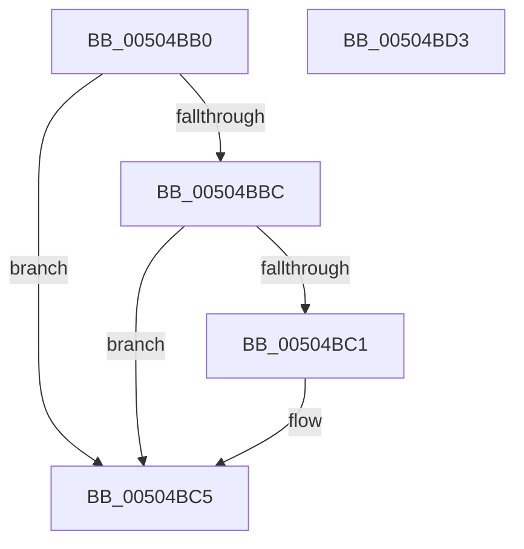

# i64toa_s

- RVA: `0x00504BB0`–`0x00504BD4` (길이 `36` bytes)
- VA: `0x0000000140504BB0`
- 실행 섹션: `.text`
- PDB 이름 있음: `예`; PDB Function 태그: `아니요`
- unwind 정보 RVA: `0x0005D2F4`
- 디코드: `12`개 명령, `36/36` bytes 표시
- 미해석 바이트: `0` (있으면 어셈블리에 `.byte`로 보존)

> 이 문서는 커널 이미지의 기계어와 PDB 기호를 분석해 생성했습니다. 4번과 5번은 함수 원형과 자료형을 바이너리 사용 방식에서 추정한 C 해석이며 원본 소스 복구 결과는 아닙니다.

## 1. Dependencies

- 직접 호출 지점: **1**; 고유 호출 대상: **1**
- 직접 호출자로 확인된 함수: **0**
- RIP 상대 이미지 참조: **0**

### Outgoing calls
- `0x00504BC9` → [x64toa_s](x64toa_s_function_00504C4C.md) (function, `0x00504C4C`)

### Direct callers
- 이 함수 시작 RVA로 연결되는 직접 call은 확인되지 않았습니다. 간접 호출은 완전히 역산할 수 없습니다.

### Static image references
- 디코드된 RIP-relative 메모리 참조가 없습니다.

## 2. Other-region calls and transfers

- 다른 실행 섹션으로 향하는 call: **0**
- 별도 외부 분기/꼬리 이동을 확인하지 못했습니다.

## 3. Assembly (complete function range)

```asm
00504BB0  48 83 EC 38                     sub rsp, 0x38
00504BB4  33 C0                           xor eax, eax
00504BB6  41 83 F9 0A                     cmp r9d, 0xa
00504BBA  75 09                           jne 0x140504bc5
00504BBC  48 85 C9                        test rcx, rcx
00504BBF  79 04                           jns 0x140504bc5
00504BC1  41 8D 41 F7                     lea eax, [r9 - 9]
00504BC5  89 44 24 20                     mov dword ptr [rsp + 0x20], eax
00504BC9  E8 7E 00 00 00                  call 0x140504c4c
00504BCE  48 83 C4 38                     add rsp, 0x38
00504BD2  C3                              ret
00504BD3  CC                              int3
```

## 4. C-style interpretation (structured pseudocode)

```c
__int64 __fastcall i64toa_s(__int64 a1, __int64 a2, __int64 a3, __int64 a4)
{
    __int64 result;
    __int64 v_rsp;
    unsigned int v_stack_m18;

    v_rsp = (v_rsp) - (56);
    result = 0;
    if (((unsigned int)(a4)) != 10) goto loc_00504BC5;
    if (sign_flag) {
        result = a4 - 9;
    }
    v_stack_m18 = (unsigned int)(result);
    result = x64toa_s(a1, a2, a3, a4);
    v_rsp = (v_rsp) + (56);
    return result;
}
```

## 5. (Beta) C Style

```c
int64_t i64toa_s(int64_t Arg1, int64_t Arg2, int64_t Arg3, int64_t Arg4)
{
    int64_t result;
    int64_t local_rsp;
    uint32_t v_stack_m18;

    local_rsp = (local_rsp) - (56);
    result = 0;
    if (((uint32_t)(Arg4)) != 10) goto loc_00504BC5;
    if (sign_flag) {
        result = Arg4 - 9;
    }
    v_stack_m18 = (uint32_t)(result);
    result = x64toa_s(Arg1, Arg2, Arg3, Arg4);
    local_rsp = (local_rsp) + (56);
    return result;
}
```

## 6. Execution-region graph

[열기: 2D/3D 그래프와 함수 탐색 컨트롤 패널](../../../control-panel.html?section=text&rva=0x00504BB0&view=graph)

- 2D 그래프는 위에서 아래로 흐르고, 3D 그래프는 빈 공간을 드래그해 회전합니다. Shift+드래그는 이동, 휠은 확대·축소, 함수 노드 선택은 대상 보고서 이동입니다.

### Static fallback


