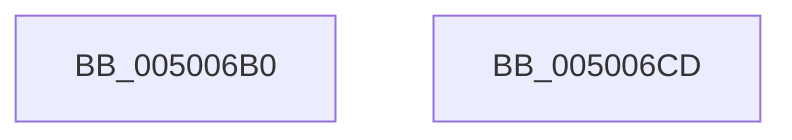

# islower

- RVA: `0x005006B0`–`0x005006CE` (길이 `30` bytes)
- VA: `0x00000001405006B0`
- 실행 섹션: `.text`
- PDB 이름 있음: `예`; PDB Function 태그: `아니요`
- unwind 정보 RVA: `0x000DB714`
- 디코드: `10`개 명령, `30/30` bytes 표시
- 미해석 바이트: `0` (있으면 어셈블리에 `.byte`로 보존)

> 이 문서는 커널 이미지의 기계어와 PDB 기호를 분석해 생성했습니다. 4번과 5번은 함수 원형과 자료형을 바이너리 사용 방식에서 추정한 C 해석이며 원본 소스 복구 결과는 아닙니다.

## 1. Dependencies

- 직접 호출 지점: **0**; 고유 호출 대상: **0**
- 직접 호출자로 확인된 함수: **4**
- RIP 상대 이미지 참조: **1**

### Outgoing calls
- 직접 디코드된 call 명령이 없습니다.

### Direct callers
- [RtlIpv4StringToAddressA](../49/RtlIpv4StringToAddressA_function_004978D0.md) at `0x00497ABE`
- [RtlEthernetStringToAddressA](../5E/RtlEthernetStringToAddressA_function_005EBE50.md) at `0x005EBED5`
- [RtlIpv4StringToAddressExA](../5E/RtlIpv4StringToAddressExA_function_005EBF80.md) at `0x005EC0AC`
- [RtlIpv4StringToAddressExA](../5E/RtlIpv4StringToAddressExA_function_005EBF80.md) at `0x005EC0E7`
- [RtlIpv6StringToAddressExA](../5E/RtlIpv6StringToAddressExA_function_005EC150.md) at `0x005EC348`
- [RtlIpv6StringToAddressExA](../5E/RtlIpv6StringToAddressExA_function_005EC150.md) at `0x005EC380`

### Static image references
- `0x005006BE` → RVA `0x00E00150` (`.data`; read)

## 2. Other-region calls and transfers

- 다른 실행 섹션으로 향하는 call: **0**
- 별도 외부 분기/꼬리 이동을 확인하지 못했습니다.

## 3. Assembly (complete function range)

```asm
005006B0  0F B6 C1                        movzx eax, cl
005006B3  83 CA FF                        or edx, 0xffffffff
005006B6  3B CA                           cmp ecx, edx
005006B8  0F 44 C2                        cmove eax, edx
005006BB  48 63 C8                        movsxd rcx, eax
005006BE  48 8B 05 8B FA 8F 00            mov rax, qword ptr [rip + 0x8ffa8b]
005006C5  0F B7 04 48                     movzx eax, word ptr [rax + rcx*2]
005006C9  83 E0 02                        and eax, 2
005006CC  C3                              ret
005006CD  CC                              int3
```

## 4. C-style interpretation (structured pseudocode)

```c
__int64 __fastcall islower(int a1, int a2)
{
    __int64 result;

    a2 = (unsigned int)((a2) | (0xFFFFFFFFULL));
    result = (unsigned __int8)(a1);
    if (a1 == a2) { result = a2; }
    result = (unsigned int)((*(unsigned __int16 *)(*(unsigned __int64 *)(v_rip + 9435787) + (int)((unsigned int)(result)) * 2)) & (2));
    return result;
}
```

## 5. (Beta) C Style

```c
int64_t islower(int32_t Arg1, int32_t Arg2)
{
    int64_t result;

    Arg2 = (uint32_t)((Arg2) | (0xFFFFFFFFULL));
    result = (uint8_t)(Arg1);
    if (Arg1 == Arg2) { result = Arg2; }
    result = (uint32_t)((*(uint16_t *)(*(uint64_t *)(v_rip + 0x8FFA8B) + (int32_t)((uint32_t)(result)) * 2)) & (2));
    return result;
}
```

## 6. Execution-region graph

[열기: 2D/3D 그래프와 함수 탐색 컨트롤 패널](../../../control-panel.html?section=text&rva=0x005006B0&view=graph)

- 2D 그래프는 위에서 아래로 흐르고, 3D 그래프는 빈 공간을 드래그해 회전합니다. Shift+드래그는 이동, 휠은 확대·축소, 함수 노드 선택은 대상 보고서 이동입니다.

### Static fallback


