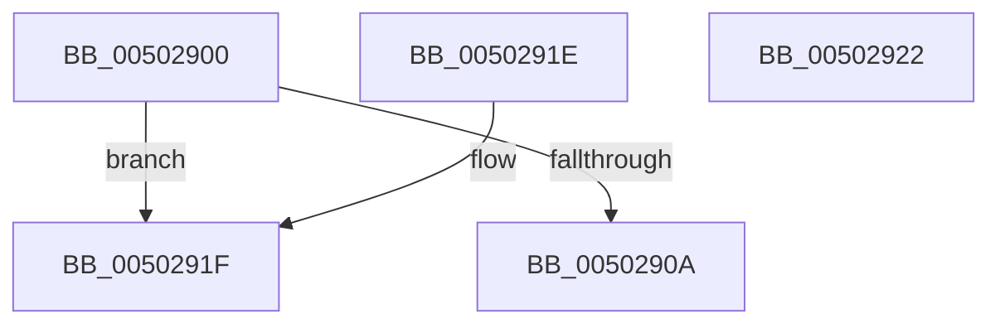

# iswctype

- RVA: `0x00502900`–`0x00502923` (길이 `35` bytes)
- VA: `0x0000000140502900`
- 실행 섹션: `.text`
- PDB 이름 있음: `예`; PDB Function 태그: `아니요`
- unwind 정보 RVA: `0x000DB714`
- 디코드: `13`개 명령, `35/35` bytes 표시
- 미해석 바이트: `0` (있으면 어셈블리에 `.byte`로 보존)

> 이 문서는 커널 이미지의 기계어와 PDB 기호를 분석해 생성했습니다. 4번과 5번은 함수 원형과 자료형을 바이너리 사용 방식에서 추정한 C 해석이며 원본 소스 복구 결과는 아닙니다.

## 1. Dependencies

- 직접 호출 지점: **0**; 고유 호출 대상: **0**
- 직접 호출자로 확인된 함수: **14**
- RIP 상대 이미지 참조: **1**

### Outgoing calls
- 직접 디코드된 call 명령이 없습니다.

### Direct callers
- [RtlIpv6StringToAddressExW](../47/RtlIpv6StringToAddressExW_function_0047BEE0.md) at `0x0047BF94`
- [RtlIpv6StringToAddressExW](../47/RtlIpv6StringToAddressExW_function_0047BEE0.md) at `0x0047BFB8`
- [RtlIpv6StringToAddressExW](../47/RtlIpv6StringToAddressExW_function_0047BEE0.md) at `0x0047C05C`
- [RtlIpv6StringToAddressW](../47/RtlIpv6StringToAddressW_function_0047C110.md) at `0x0047C19B`
- [RtlIpv6StringToAddressW](../47/RtlIpv6StringToAddressW_function_0047C110.md) at `0x0047C1B0`
- [RtlIpv6StringToAddressW](../47/RtlIpv6StringToAddressW_function_0047C110.md) at `0x0047C2B6`
- [RtlIpv6StringToAddressW](../47/RtlIpv6StringToAddressW_function_0047C110.md) at `0x0047C2EF`
- [RtlIpv4StringToAddressExW](../48/RtlIpv4StringToAddressExW_function_00480490.md) at `0x00480548`
- [RtlIpv4StringToAddressW](../48/RtlIpv4StringToAddressW_function_00480600.md) at `0x00480671`
- [RtlIpv4StringToAddressW](../48/RtlIpv4StringToAddressW_function_00480600.md) at `0x004807B3`
- [RtlIpv4StringToAddressW](../48/RtlIpv4StringToAddressW_function_00480600.md) at `0x004807DD`
- [RtlIpv4StringToAddressW](../48/RtlIpv4StringToAddressW_function_00480600.md) at `0x004807F4`
- [iswalnum](iswalnum_function_005007A0.md) at `0x005007A9`
- [iswalpha](iswalpha_function_005007BC.md) at `0x005007C5`
- [iswdigit](iswdigit_function_005007E0.md) at `0x005007E9`
- [iswspace](iswspace_function_00500800.md) at `0x00500809`
- [towlower](towlower_function_005018E0.md) at `0x005018EE`
- [_whiteout](_whiteout_function_00508E20.md) at `0x00508E54`
- [winput_s](winput_s_function_00508E78.md) at `0x00508EF8`
- [winput_s](winput_s_function_00508E78.md) at `0x00508F36`
- [RtlEthernetStringToAddressW](../5E/RtlEthernetStringToAddressW_function_005EC3F0.md) at `0x005EC442`
- [RtlEthernetStringToAddressW](../5E/RtlEthernetStringToAddressW_function_005EC3F0.md) at `0x005EC462`
- [RtlEthernetStringToAddressW](../5E/RtlEthernetStringToAddressW_function_005EC3F0.md) at `0x005EC473`
- [sub_006F49D4](../6F/Unknown_function_006F49D4.md) at `0x006F49F2`
- [sub_006F49D4](../6F/Unknown_function_006F49D4.md) at `0x006F4A07`
- [sub_006F49D4](../6F/Unknown_function_006F49D4.md) at `0x006F4A3E`
- [sub_006F4F1E](../6F/Unknown_function_006F4F1E.md) at `0x006F4F2E`
- [sub_006F4F1E](../6F/Unknown_function_006F4F1E.md) at `0x006F4F43`
- [sub_006F4F1E](../6F/Unknown_function_006F4F1E.md) at `0x006F4F77`

### Static image references
- `0x0050290A` → RVA `0x00E00008` (`.data`; read)

## 2. Other-region calls and transfers

- 다른 실행 섹션으로 향하는 call: **0**
- 별도 외부 분기/꼬리 이동을 확인하지 못했습니다.

## 3. Assembly (complete function range)

```asm
00502900  B8 00 01 00 00                  mov eax, 0x100
00502905  66 3B C8                        cmp cx, ax
00502908  73 15                           jae 0x14050291f
0050290A  48 8B 05 F7 D6 8F 00            mov rax, qword ptr [rip + 0x8fd6f7]
00502911  0F B7 C9                        movzx ecx, cx
00502914  0F B7 04 48                     movzx eax, word ptr [rax + rcx*2]
00502918  0F B7 CA                        movzx ecx, dx
0050291B  23 C1                           and eax, ecx
0050291D  C3                              ret
0050291E  CC                              int3
0050291F  33 C0                           xor eax, eax
00502921  C3                              ret
00502922  CC                              int3
```

## 4. C-style interpretation (structured pseudocode)

```c
__int64 __fastcall iswctype(unsigned __int16 a1, unsigned __int16 a2)
{
    __int64 result;

    if (a1 >= 256) goto loc_0050291F;
    result = (unsigned int)((*(unsigned __int16 *)(*(unsigned __int64 *)(v_rip + 9426679) + a1 * 2)) & (a2));
    return result;
loc_0050291F:
    result = 0;
    return result;
}
```

## 5. (Beta) C Style

```c
int64_t iswctype(uint16_t Arg1, uint16_t Arg2)
{
    int64_t result;

    if (Arg1 >= 256) goto loc_0050291F;
    result = (uint32_t)((*(uint16_t *)(*(uint64_t *)(v_rip + 0x8FD6F7) + Arg1 * 2)) & (Arg2));
    return result;
loc_0050291F:
    result = 0;
    return result;
}
```

## 6. Execution-region graph

[열기: 2D/3D 그래프와 함수 탐색 컨트롤 패널](../../../control-panel.html?section=text&rva=0x00502900&view=graph)

- 2D 그래프는 위에서 아래로 흐르고, 3D 그래프는 빈 공간을 드래그해 회전합니다. Shift+드래그는 이동, 휠은 확대·축소, 함수 노드 선택은 대상 보고서 이동입니다.

### Static fallback


