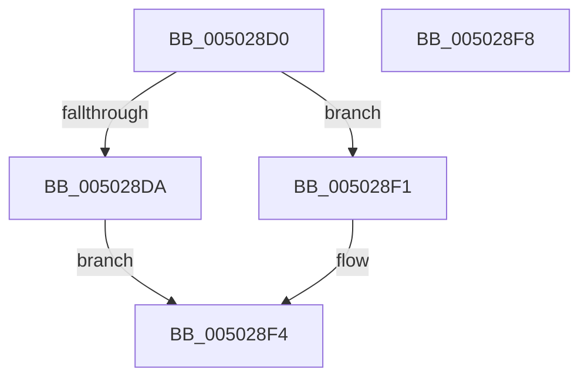

# iswctype_l

- RVA: `0x005028D0`–`0x005028F9` (길이 `41` bytes)
- VA: `0x00000001405028D0`
- 실행 섹션: `.text`
- PDB 이름 있음: `예`; PDB Function 태그: `아니요`
- unwind 정보 RVA: `0x000DB714`
- 디코드: `13`개 명령, `41/41` bytes 표시
- 미해석 바이트: `0` (있으면 어셈블리에 `.byte`로 보존)

> 이 문서는 커널 이미지의 기계어와 PDB 기호를 분석해 생성했습니다. 4번과 5번은 함수 원형과 자료형을 바이너리 사용 방식에서 추정한 C 해석이며 원본 소스 복구 결과는 아닙니다.

## 1. Dependencies

- 직접 호출 지점: **0**; 고유 호출 대상: **0**
- 직접 호출자로 확인된 함수: **2**
- RIP 상대 이미지 참조: **1**

### Outgoing calls
- 직접 디코드된 call 명령이 없습니다.

### Direct callers
- [wcstoxlX](wcstoxlX_function_00502214.md) at `0x00502279`
- [wcstoxq](wcstoxq_function_00502674.md) at `0x005026DE`

### Static image references
- `0x005028DA` → RVA `0x00E00008` (`.data`; read)

## 2. Other-region calls and transfers

- 다른 실행 섹션으로 향하는 call: **0**
- 별도 외부 분기/꼬리 이동을 확인하지 못했습니다.

## 3. Assembly (complete function range)

```asm
005028D0  B8 00 01 00 00                  mov eax, 0x100
005028D5  66 3B C8                        cmp cx, ax
005028D8  73 17                           jae 0x1405028f1
005028DA  48 8B 05 27 D7 8F 00            mov rax, qword ptr [rip + 0x8fd727]
005028E1  0F B7 C9                        movzx ecx, cx
005028E4  44 0F B7 04 48                  movzx r8d, word ptr [rax + rcx*2]
005028E9  0F B7 C2                        movzx eax, dx
005028EC  44 23 C0                        and r8d, eax
005028EF  EB 03                           jmp 0x1405028f4
005028F1  45 33 C0                        xor r8d, r8d
005028F4  41 8B C0                        mov eax, r8d
005028F7  C3                              ret
005028F8  CC                              int3
```

## 4. C-style interpretation (structured pseudocode)

```c
__int64 __fastcall iswctype_l(unsigned __int16 a1, unsigned __int16 a2)
{
    if (a1 >= 256) goto loc_005028F1;
    a3 = (unsigned int)((*(unsigned __int16 *)(*(unsigned __int64 *)(v_rip + 9426727) + a1 * 2)) & (a2));
    goto loc_005028F4;
loc_005028F1:
    a3 = 0;
loc_005028F4:
    return 0;
}
```

## 5. (Beta) C Style

```c
int64_t iswctype_l(uint16_t Arg1, uint16_t Arg2)
{
    if (Arg1 >= 256) goto loc_005028F1;
    a3 = (uint32_t)((*(uint16_t *)(*(uint64_t *)(v_rip + 0x8FD727) + Arg1 * 2)) & (Arg2));
    goto loc_005028F4;
loc_005028F1:
    a3 = 0;
loc_005028F4:
    return 0;
}
```

## 6. Execution-region graph

[열기: 2D/3D 그래프와 함수 탐색 컨트롤 패널](../../../control-panel.html?section=text&rva=0x005028D0&view=graph)

- 2D 그래프는 위에서 아래로 흐르고, 3D 그래프는 빈 공간을 드래그해 회전합니다. Shift+드래그는 이동, 휠은 확대·축소, 함수 노드 선택은 대상 보고서 이동입니다.

### Static fallback


