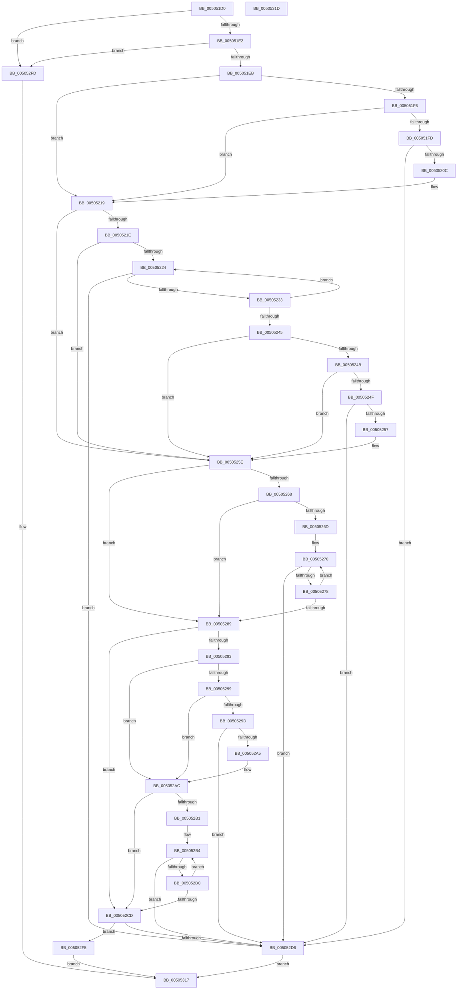

# makepath_s

- RVA: `0x005051D0`–`0x0050531E` (길이 `334` bytes)
- VA: `0x00000001405051D0`
- 실행 섹션: `.text`
- PDB 이름 있음: `예`; PDB Function 태그: `아니요`
- unwind 정보 RVA: `0x00064C80`
- 디코드: `109`개 명령, `334/334` bytes 표시
- 미해석 바이트: `0` (있으면 어셈블리에 `.byte`로 보존)

> 이 문서는 커널 이미지의 기계어와 PDB 기호를 분석해 생성했습니다. 4번과 5번은 함수 원형과 자료형을 바이너리 사용 방식에서 추정한 C 해석이며 원본 소스 복구 결과는 아닙니다.

## 1. Dependencies

- 직접 호출 지점: **2**; 고유 호출 대상: **1**
- 직접 호출자로 확인된 함수: **0**
- RIP 상대 이미지 참조: **0**

### Outgoing calls
- `0x005052E9` → [EmpCheckErrataList](../49/EmpCheckErrataList_function_0049E550.md) (function, `0x0049E550`)
- `0x0050530D` → [EmpCheckErrataList](../49/EmpCheckErrataList_function_0049E550.md) (function, `0x0049E550`)

### Direct callers
- 이 함수 시작 RVA로 연결되는 직접 call은 확인되지 않았습니다. 간접 호출은 완전히 역산할 수 없습니다.

### Static image references
- 디코드된 RIP-relative 메모리 참조가 없습니다.

## 2. Other-region calls and transfers

- 다른 실행 섹션으로 향하는 call: **0**
- 별도 외부 분기/꼬리 이동을 확인하지 못했습니다.

## 3. Assembly (complete function range)

```asm
005051D0  40 53                           push rbx
005051D2  48 83 EC 30                     sub rsp, 0x30
005051D6  48 8B D9                        mov rbx, rcx
005051D9  48 85 C9                        test rcx, rcx
005051DC  0F 84 1B 01 00 00               je 0x1405052fd
005051E2  48 85 D2                        test rdx, rdx
005051E5  0F 84 12 01 00 00               je 0x1405052fd
005051EB  45 33 DB                        xor r11d, r11d
005051EE  4C 8B D1                        mov r10, rcx
005051F1  4D 85 C0                        test r8, r8
005051F4  74 23                           je 0x140505219
005051F6  41 8A 00                        mov al, byte ptr [r8]
005051F9  84 C0                           test al, al
005051FB  74 1C                           je 0x140505219
005051FD  41 BB 02 00 00 00               mov r11d, 2
00505203  49 3B D3                        cmp rdx, r11
00505206  0F 86 CA 00 00 00               jbe 0x1405052d6
0050520C  4C 8D 51 01                     lea r10, [rcx + 1]
00505210  88 01                           mov byte ptr [rcx], al
00505212  41 C6 02 3A                     mov byte ptr [r10], 0x3a
00505216  49 FF C2                        inc r10
00505219  4D 85 C9                        test r9, r9
0050521C  74 40                           je 0x14050525e
0050521E  41 80 39 00                     cmp byte ptr [r9], 0
00505222  74 3A                           je 0x14050525e
00505224  49 FF C3                        inc r11
00505227  49 8B C9                        mov rcx, r9
0050522A  4C 3B DA                        cmp r11, rdx
0050522D  0F 83 A3 00 00 00               jae 0x1405052d6
00505233  41 8A 01                        mov al, byte ptr [r9]
00505236  49 FF C1                        inc r9
00505239  41 88 02                        mov byte ptr [r10], al
0050523C  49 FF C2                        inc r10
0050523F  41 80 39 00                     cmp byte ptr [r9], 0
00505243  75 DF                           jne 0x140505224
00505245  8A 01                           mov al, byte ptr [rcx]
00505247  3C 2F                           cmp al, 0x2f
00505249  74 13                           je 0x14050525e
0050524B  3C 5C                           cmp al, 0x5c
0050524D  74 0F                           je 0x14050525e
0050524F  49 FF C3                        inc r11
00505252  4C 3B DA                        cmp r11, rdx
00505255  73 7F                           jae 0x1405052d6
00505257  41 C6 02 5C                     mov byte ptr [r10], 0x5c
0050525B  49 FF C2                        inc r10
0050525E  48 8B 4C 24 60                  mov rcx, qword ptr [rsp + 0x60]
00505263  48 85 C9                        test rcx, rcx
00505266  74 21                           je 0x140505289
00505268  80 39 00                        cmp byte ptr [rcx], 0
0050526B  74 1C                           je 0x140505289
0050526D  49 2B CA                        sub rcx, r10
00505270  49 FF C3                        inc r11
00505273  4C 3B DA                        cmp r11, rdx
00505276  73 5E                           jae 0x1405052d6
00505278  42 8A 04 11                     mov al, byte ptr [rcx + r10]
0050527C  41 88 02                        mov byte ptr [r10], al
0050527F  49 FF C2                        inc r10
00505282  42 80 3C 11 00                  cmp byte ptr [rcx + r10], 0
00505287  75 E7                           jne 0x140505270
00505289  48 8B 4C 24 68                  mov rcx, qword ptr [rsp + 0x68]
0050528E  48 85 C9                        test rcx, rcx
00505291  74 3A                           je 0x1405052cd
00505293  8A 01                           mov al, byte ptr [rcx]
00505295  84 C0                           test al, al
00505297  74 13                           je 0x1405052ac
00505299  3C 2E                           cmp al, 0x2e
0050529B  74 0F                           je 0x1405052ac
0050529D  49 FF C3                        inc r11
005052A0  4C 3B DA                        cmp r11, rdx
005052A3  73 31                           jae 0x1405052d6
005052A5  41 C6 02 2E                     mov byte ptr [r10], 0x2e
005052A9  49 FF C2                        inc r10
005052AC  80 39 00                        cmp byte ptr [rcx], 0
005052AF  74 1C                           je 0x1405052cd
005052B1  49 2B CA                        sub rcx, r10
005052B4  49 FF C3                        inc r11
005052B7  4C 3B DA                        cmp r11, rdx
005052BA  73 1A                           jae 0x1405052d6
005052BC  42 8A 04 11                     mov al, byte ptr [rcx + r10]
005052C0  41 88 02                        mov byte ptr [r10], al
005052C3  49 FF C2                        inc r10
005052C6  42 80 3C 11 00                  cmp byte ptr [rcx + r10], 0
005052CB  75 E7                           jne 0x1405052b4
005052CD  49 8D 43 01                     lea rax, [r11 + 1]
005052D1  48 3B C2                        cmp rax, rdx
005052D4  76 1F                           jbe 0x1405052f5
005052D6  48 83 64 24 20 00               and qword ptr [rsp + 0x20], 0
005052DC  45 33 C9                        xor r9d, r9d
005052DF  45 33 C0                        xor r8d, r8d
005052E2  C6 03 00                        mov byte ptr [rbx], 0
005052E5  33 D2                           xor edx, edx
005052E7  33 C9                           xor ecx, ecx
005052E9  E8 62 92 F9 FF                  call 0x14049e550
005052EE  B8 22 00 00 00                  mov eax, 0x22
005052F3  EB 22                           jmp 0x140505317
005052F5  41 C6 02 00                     mov byte ptr [r10], 0
005052F9  33 C0                           xor eax, eax
005052FB  EB 1A                           jmp 0x140505317
005052FD  48 83 64 24 20 00               and qword ptr [rsp + 0x20], 0
00505303  45 33 C9                        xor r9d, r9d
00505306  45 33 C0                        xor r8d, r8d
00505309  33 D2                           xor edx, edx
0050530B  33 C9                           xor ecx, ecx
0050530D  E8 3E 92 F9 FF                  call 0x14049e550
00505312  B8 16 00 00 00                  mov eax, 0x16
00505317  48 83 C4 30                     add rsp, 0x30
0050531B  5B                              pop rbx
0050531C  C3                              ret
0050531D  CC                              int3
```

## 4. C-style interpretation (structured pseudocode)

```c
__int64 __fastcall makepath_s(__int64 a1, __int64 a2, __int64 a3, __int64 a4, __int64 a5, __int64 a6)
{
    __int64 result;
    __int64 v_r10;
    __int64 v_r11;
    __int64 v_rsp;
    unsigned __int64 v_stack_m18;

    v_rsp = (v_rsp) - (48);
    if (a1 == 0) goto loc_005052FD;
    if (a2 == 0) goto loc_005052FD;
    v_r11 = 0;
    if (a3 == 0) goto loc_00505219;
    if ((unsigned __int8)(*(unsigned __int8 *)(a3)) == 0) goto loc_00505219;
    if (a2 <= 2) goto loc_005052D6;
    *(unsigned __int8 *)(a1) = (unsigned __int8)(*(unsigned __int8 *)(a3));
    *(unsigned __int8 *)(a1 + 1) = 58;
    v_r10 = (a1 + 1) + 1;
loc_00505219:
    if (a4 == 0) goto loc_0050525E;
    if ((*(unsigned __int8 *)(a4)) == 0) goto loc_0050525E;
loc_00505224:
    v_r11 = (2) + 1;
    if (v_r11 >= a2) goto loc_005052D6;
    a4 = (a4) + 1;
    *(unsigned __int8 *)(v_r10) = (unsigned __int8)(*(unsigned __int8 *)(a4));
    v_r10 = (v_r10) + 1;
    if ((*(unsigned __int8 *)(a4)) != 0) goto loc_00505224;
    if (((unsigned __int8)(*(unsigned __int8 *)(a4))) == 47) goto loc_0050525E;
    if (((unsigned __int8)(*(unsigned __int8 *)(a4))) == 92) goto loc_0050525E;
    v_r11 = (v_r11) + 1;
    if (v_r11 >= a2) goto loc_005052D6;
    *(unsigned __int8 *)(v_r10) = 92;
    v_r10 = (v_r10) + 1;
loc_0050525E:
    if (a5 == 0) goto loc_00505289;
    if ((*(unsigned __int8 *)(a5)) == 0) goto loc_00505289;
    a1 = (a5) - (v_r10);
loc_00505270:
    v_r11 = (v_r11) + 1;
    if (v_r11 >= a2) goto loc_005052D6;
    *(unsigned __int8 *)(v_r10) = (unsigned __int8)(*(unsigned __int8 *)(a1 + v_r10 * 1));
    v_r10 = (v_r10) + 1;
    if ((*(unsigned __int8 *)(a1 + v_r10 * 1)) != 0) goto loc_00505270;
loc_00505289:
    if (a6 == 0) goto loc_005052CD;
    if ((unsigned __int8)(*(unsigned __int8 *)(a6)) == 0) goto loc_005052AC;
    if (((unsigned __int8)(*(unsigned __int8 *)(a6))) == 46) goto loc_005052AC;
    v_r11 = (v_r11) + 1;
    if (v_r11 >= a2) goto loc_005052D6;
    *(unsigned __int8 *)(v_r10) = 46;
    v_r10 = (v_r10) + 1;
loc_005052AC:
    if ((*(unsigned __int8 *)(a6)) == 0) goto loc_005052CD;
    a1 = (a6) - (v_r10);
loc_005052B4:
    v_r11 = (v_r11) + 1;
    if (v_r11 >= a2) goto loc_005052D6;
    *(unsigned __int8 *)(v_r10) = (unsigned __int8)(*(unsigned __int8 *)(a1 + v_r10 * 1));
    v_r10 = (v_r10) + 1;
    if ((*(unsigned __int8 *)(a1 + v_r10 * 1)) != 0) goto loc_005052B4;
loc_005052CD:
    if ((v_r11 + 1) <= a2) goto loc_005052F5;
loc_005052D6:
    a4 = 0;
    a3 = 0;
    *(unsigned __int8 *)(a1) = 0;
    a2 = 0;
    a1 = 0;
    result = EmpCheckErrataList(a1, a2, a3, a4);
    goto loc_00505317;
loc_005052F5:
    *(unsigned __int8 *)(v_r10) = 0;
    result = 0;
    goto loc_00505317;
loc_005052FD:
    a4 = 0;
    a3 = 0;
    a2 = 0;
    a1 = 0;
    result = EmpCheckErrataList(a1, a2, a3, a4);
loc_00505317:
    v_rsp = (v_rsp) + (48);
    return 22;
}
```

## 5. (Beta) C Style

```c
int64_t makepath_s(void *Arg1, int64_t Arg2, int64_t Arg3, int64_t Arg4, int64_t Arg5, int64_t Arg6)
{
    uint8_t *arg1 = (uint8_t *)Arg1;

    int64_t result;
    int64_t local_r10;
    int64_t local_r11;
    int64_t local_rsp;
    uint64_t v_stack_m18;

    local_rsp = (local_rsp) - (48);
    if (Arg1 == NULL) goto loc_005052FD;
    if (Arg2 == 0) goto loc_005052FD;
    local_r11 = 0;
    if (Arg3 == 0) goto loc_00505219;
    if ((uint8_t)(*(uint8_t *)(Arg3)) == 0) goto loc_00505219;
    if (Arg2 <= 2) goto loc_005052D6;
    *(uint8_t *)(arg1) = (uint8_t)(*(uint8_t *)(Arg3));
    *(uint8_t *)(arg1 + 0x1) = 58;
    local_r10 = (Arg1 + 1) + 1;
loc_00505219:
    if (Arg4 == 0) goto loc_0050525E;
    if ((*(uint8_t *)(Arg4)) == 0) goto loc_0050525E;
loc_00505224:
    local_r11 = (2) + 1;
    if (local_r11 >= Arg2) goto loc_005052D6;
    Arg4 = (Arg4) + 1;
    *(uint8_t *)(local_r10) = (uint8_t)(*(uint8_t *)(Arg4));
    local_r10 = (local_r10) + 1;
    if ((*(uint8_t *)(Arg4)) != 0) goto loc_00505224;
    if (((uint8_t)(*(uint8_t *)(Arg4))) == 47) goto loc_0050525E;
    if (((uint8_t)(*(uint8_t *)(Arg4))) == 92) goto loc_0050525E;
    local_r11 = (local_r11) + 1;
    if (local_r11 >= Arg2) goto loc_005052D6;
    *(uint8_t *)(local_r10) = 92;
    local_r10 = (local_r10) + 1;
loc_0050525E:
    if (Arg5 == 0) goto loc_00505289;
    if ((*(uint8_t *)(Arg5)) == 0) goto loc_00505289;
    Arg1 = (Arg5) - (local_r10);
loc_00505270:
    local_r11 = (local_r11) + 1;
    if (local_r11 >= Arg2) goto loc_005052D6;
    *(uint8_t *)(local_r10) = (uint8_t)(*(uint8_t *)(arg1 + local_r10 * 1));
    local_r10 = (local_r10) + 1;
    if ((*(uint8_t *)(arg1 + local_r10 * 1)) != 0) goto loc_00505270;
loc_00505289:
    if (Arg6 == 0) goto loc_005052CD;
    if ((uint8_t)(*(uint8_t *)(Arg6)) == 0) goto loc_005052AC;
    if (((uint8_t)(*(uint8_t *)(Arg6))) == 46) goto loc_005052AC;
    local_r11 = (local_r11) + 1;
    if (local_r11 >= Arg2) goto loc_005052D6;
    *(uint8_t *)(local_r10) = 46;
    local_r10 = (local_r10) + 1;
loc_005052AC:
    if ((*(uint8_t *)(Arg6)) == 0) goto loc_005052CD;
    Arg1 = (Arg6) - (local_r10);
loc_005052B4:
    local_r11 = (local_r11) + 1;
    if (local_r11 >= Arg2) goto loc_005052D6;
    *(uint8_t *)(local_r10) = (uint8_t)(*(uint8_t *)(arg1 + local_r10 * 1));
    local_r10 = (local_r10) + 1;
    if ((*(uint8_t *)(arg1 + local_r10 * 1)) != 0) goto loc_005052B4;
loc_005052CD:
    if ((local_r11 + 1) <= Arg2) goto loc_005052F5;
loc_005052D6:
    Arg4 = 0;
    Arg3 = 0;
    *(uint8_t *)(arg1) = 0;
    Arg2 = 0;
    Arg1 = 0;
    result = EmpCheckErrataList(Arg1, Arg2, Arg3, Arg4);
    goto loc_00505317;
loc_005052F5:
    *(uint8_t *)(local_r10) = 0;
    result = 0;
    goto loc_00505317;
loc_005052FD:
    Arg4 = 0;
    Arg3 = 0;
    Arg2 = 0;
    Arg1 = 0;
    result = EmpCheckErrataList(Arg1, Arg2, Arg3, Arg4);
loc_00505317:
    local_rsp = (local_rsp) + (48);
    return 22;
}
```

### 관측된 메모리 오프셋

구조체 형식이 확인되지 않은 접근은 인자 기준의 오프셋으로만 기록했습니다.

| 기준 인자 | 오프셋 표현 | 폭 (bit) | 접근 |
|---|---:|---:|---|
| `Arg1` | `+ 0x0` | `8` | `W` |

## 6. Execution-region graph

[열기: 2D/3D 그래프와 함수 탐색 컨트롤 패널](../../../control-panel.html?section=text&rva=0x005051D0&view=graph)

- 2D 그래프는 위에서 아래로 흐르고, 3D 그래프는 빈 공간을 드래그해 회전합니다. Shift+드래그는 이동, 휠은 확대·축소, 함수 노드 선택은 대상 보고서 이동입니다.

### Static fallback


