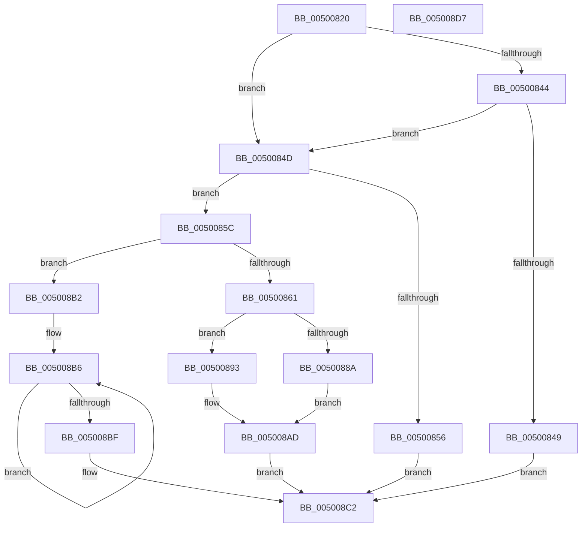

# mbstowcs

- RVA: `0x00500820`–`0x005008D8` (길이 `184` bytes)
- VA: `0x0000000140500820`
- 실행 섹션: `.text`
- PDB 이름 있음: `예`; PDB Function 태그: `아니요`
- unwind 정보 RVA: `0x000A118C`
- 디코드: `57`개 명령, `184/184` bytes 표시
- 미해석 바이트: `0` (있으면 어셈블리에 `.byte`로 보존)

> 이 문서는 커널 이미지의 기계어와 PDB 기호를 분석해 생성했습니다. 4번과 5번은 함수 원형과 자료형을 바이너리 사용 방식에서 추정한 C 해석이며 원본 소스 복구 결과는 아닙니다.

## 1. Dependencies

- 직접 호출 지점: **2**; 고유 호출 대상: **2**
- 직접 호출자로 확인된 함수: **0**
- RIP 상대 이미지 참조: **0**

### Outgoing calls
- `0x00500864` → [mbstrlen](mbstrlen_function_00503DCC.md) (function, `0x00503DCC`)
- `0x00500881` → [RtlMultiByteToUnicodeN](../../page/90/RtlMultiByteToUnicodeN_function_0090D520.md) (function, `0x0090D520`)

### Direct callers
- 이 함수 시작 RVA로 연결되는 직접 call은 확인되지 않았습니다. 간접 호출은 완전히 역산할 수 없습니다.

### Static image references
- 디코드된 RIP-relative 메모리 참조가 없습니다.

## 2. Other-region calls and transfers

- 다른 실행 섹션으로 향하는 call: **1**
  - `0x00500881` → [RtlMultiByteToUnicodeN](../../page/90/RtlMultiByteToUnicodeN_function_0090D520.md) (`.text` → `PAGE`)
- 별도 외부 분기/꼬리 이동을 확인하지 못했습니다.

## 3. Assembly (complete function range)

```asm
00500820  48 89 5C 24 10                  mov qword ptr [rsp + 0x10], rbx
00500825  48 89 6C 24 18                  mov qword ptr [rsp + 0x18], rbp
0050082A  48 89 74 24 20                  mov qword ptr [rsp + 0x20], rsi
0050082F  57                              push rdi
00500830  48 83 EC 30                     sub rsp, 0x30
00500834  33 ED                           xor ebp, ebp
00500836  49 8B F8                        mov rdi, r8
00500839  48 8B F2                        mov rsi, rdx
0050083C  48 8B D9                        mov rbx, rcx
0050083F  48 85 C9                        test rcx, rcx
00500842  74 09                           je 0x14050084d
00500844  4D 85 C0                        test r8, r8
00500847  75 04                           jne 0x14050084d
00500849  33 C0                           xor eax, eax
0050084B  EB 75                           jmp 0x1405008c2
0050084D  48 81 FF FF FF FF 7F            cmp rdi, 0x7fffffff
00500854  76 06                           jbe 0x14050085c
00500856  48 83 C8 FF                     or rax, 0xffffffffffffffff
0050085A  EB 66                           jmp 0x1405008c2
0050085C  48 85 DB                        test rbx, rbx
0050085F  74 51                           je 0x1405008b2
00500861  48 8B CE                        mov rcx, rsi
00500864  E8 63 35 00 00                  call 0x140503dcc
00500869  89 44 24 40                     mov dword ptr [rsp + 0x40], eax
0050086D  8D 14 3F                        lea edx, [rdi + rdi]
00500870  FF C0                           inc eax
00500872  4C 8D 44 24 40                  lea r8, [rsp + 0x40]
00500877  4C 8B CE                        mov r9, rsi
0050087A  89 44 24 20                     mov dword ptr [rsp + 0x20], eax
0050087E  48 8B CB                        mov rcx, rbx
00500881  E8 9A CC 40 00                  call 0x14090d520
00500886  85 C0                           test eax, eax
00500888  79 09                           jns 0x140500893
0050088A  66 89 2B                        mov word ptr [rbx], bp
0050088D  48 83 CA FF                     or rdx, 0xffffffffffffffff
00500891  EB 1A                           jmp 0x1405008ad
00500893  48 63 54 24 40                  movsxd rdx, dword ptr [rsp + 0x40]
00500898  48 D1 EA                        shr rdx, 1
0050089B  48 63 C2                        movsxd rax, edx
0050089E  89 54 24 40                     mov dword ptr [rsp + 0x40], edx
005008A2  8D 4A FF                        lea ecx, [rdx - 1]
005008A5  66 39 6C 43 FE                  cmp word ptr [rbx + rax*2 - 2], bp
005008AA  0F 44 D1                        cmove edx, ecx
005008AD  48 63 C2                        movsxd rax, edx
005008B0  EB 10                           jmp 0x1405008c2
005008B2  48 83 CA FF                     or rdx, 0xffffffffffffffff
005008B6  48 FF C2                        inc rdx
005008B9  40 38 2C 16                     cmp byte ptr [rsi + rdx], bpl
005008BD  75 F7                           jne 0x1405008b6
005008BF  48 8B C2                        mov rax, rdx
005008C2  48 8B 5C 24 48                  mov rbx, qword ptr [rsp + 0x48]
005008C7  48 8B 6C 24 50                  mov rbp, qword ptr [rsp + 0x50]
005008CC  48 8B 74 24 58                  mov rsi, qword ptr [rsp + 0x58]
005008D1  48 83 C4 30                     add rsp, 0x30
005008D5  5F                              pop rdi
005008D6  C3                              ret
005008D7  CC                              int3
```

## 4. C-style interpretation (structured pseudocode)

```c
__int64 __fastcall mbstowcs(__int64 a1, __int64 a2, __int64 a3)
{
    __int64 result;
    __int64 v_rbp;
    __int64 v_rsp;
    unsigned int v_stack_m18;
    unsigned __int64 v_stack_p10;
    unsigned __int64 v_stack_p18;
    unsigned __int64 v_stack_p20;
    unsigned int v_stack_p8;

    v_stack_p10 = v_rbx;
    v_stack_p18 = v_rbp;
    v_stack_p20 = v_rsi;
    v_rsp = (v_rsp) - (48);
    v_rbp = 0;
    if (a1 == 0) goto loc_0050084D;
    if (a3 != 0) goto loc_0050084D;
    result = 0;
    goto loc_005008C2;
loc_0050084D:
    if (a3 <= 0x7FFFFFFFULL) goto loc_0050085C;
    result = (result) | (-1);
    goto loc_005008C2;
loc_0050085C:
    if (a1 == 0) goto loc_005008B2;
    result = mbstrlen(a2, a2, a3, a4);
    v_stack_p8 = (unsigned int)(result);
    result = (unsigned int)((result) + 1);
    v_stack_m18 = (unsigned int)(result);
    result = RtlMultiByteToUnicodeN(a1, a3 + a3 * 1, v_stack_p8, a2);
    if (!sign_flag) goto loc_00500893;
    *(unsigned __int16 *)(a1) = 0;
    a2 = (a3 + a3 * 1) | (-1);
    goto loc_005008AD;
loc_00500893:
    a2 = ((int)(v_stack_p8)) >> (1);
    v_stack_p8 = (unsigned int)(a2);
    if ((*(unsigned __int16 *)(a1 + (int)((unsigned int)(a2)) * 2 - 2)) == 0) { a2 = (unsigned int)(a2 - 1); }
loc_005008AD:
    goto loc_005008C2;
loc_005008B2:
    a2 = (a2) | (-1);
loc_005008B6:
    a2 = (a2) + 1;
    if ((*(unsigned __int8 *)(a2 + a2 * 1)) != 0) goto loc_005008B6;
loc_005008C2:
    v_rsp = (v_rsp) + (48);
    return a2;
}
```

## 5. (Beta) C Style

```c
void *mbstowcs(int64_t Arg1, void *Arg2, int64_t Arg3)
{
    uint8_t *arg2 = (uint8_t *)Arg2;

    int64_t result;
    int64_t local_rbp;
    int64_t local_rsp;
    uint32_t v_stack_m18;
    uint64_t v_stack_p10;
    uint64_t v_stack_p18;
    uint64_t v_stack_p20;
    uint32_t v_stack_p8;

    v_stack_p10 = local_rbx;
    v_stack_p18 = local_rbp;
    v_stack_p20 = local_rsi;
    local_rsp = (local_rsp) - (48);
    local_rbp = 0;
    if (Arg1 == 0) goto loc_0050084D;
    if (Arg3 != 0) goto loc_0050084D;
    result = 0;
    goto loc_005008C2;
loc_0050084D:
    if (Arg3 <= 0x7FFFFFFFULL) goto loc_0050085C;
    result = (result) | (-1);
    goto loc_005008C2;
loc_0050085C:
    if (Arg1 == 0) goto loc_005008B2;
    result = mbstrlen(Arg2, Arg2, Arg3, a4);
    v_stack_p8 = (uint32_t)(result);
    result = (uint32_t)((result) + 1);
    v_stack_m18 = (uint32_t)(result);
    result = RtlMultiByteToUnicodeN(Arg1, Arg3 + Arg3 * 1, v_stack_p8, Arg2);
    if (!sign_flag) goto loc_00500893;
    *(uint16_t *)(Arg1) = 0;
    Arg2 = (Arg3 + Arg3 * 1) | (-1);
    goto loc_005008AD;
loc_00500893:
    Arg2 = ((int32_t)(v_stack_p8)) >> (1);
    v_stack_p8 = (uint32_t)(Arg2);
    if ((*(uint16_t *)(Arg1 + (int32_t)((uint32_t)(arg2)) * 2 - 0x2)) == 0) { Arg2 = (uint32_t)(Arg2 - 1); }
loc_005008AD:
    goto loc_005008C2;
loc_005008B2:
    Arg2 = (Arg2) | (-1);
loc_005008B6:
    Arg2 = (Arg2) + 1;
    if ((*(uint8_t *)(arg2 + arg2 * 1)) != 0) goto loc_005008B6;
loc_005008C2:
    local_rsp = (local_rsp) + (48);
    return Arg2;
}
```

### 관측된 메모리 오프셋

구조체 형식이 확인되지 않은 접근은 인자 기준의 오프셋으로만 기록했습니다.

| 기준 인자 | 오프셋 표현 | 폭 (bit) | 접근 |
|---|---:|---:|---|
| `Arg2` | `+ 0x0 + rdx*1` | `8` | `R` |

## 6. Execution-region graph

[열기: 2D/3D 그래프와 함수 탐색 컨트롤 패널](../../../control-panel.html?section=text&rva=0x00500820&view=graph)

- 2D 그래프는 위에서 아래로 흐르고, 3D 그래프는 빈 공간을 드래그해 회전합니다. Shift+드래그는 이동, 휠은 확대·축소, 함수 노드 선택은 대상 보고서 이동입니다.

### Static fallback


