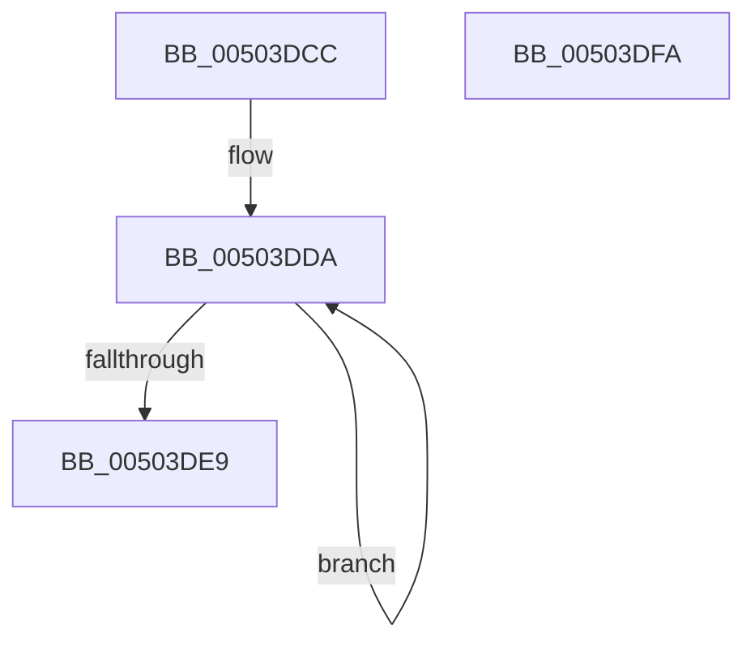

# mbstrlen

- RVA: `0x00503DCC`–`0x00503DFB` (길이 `47` bytes)
- VA: `0x0000000140503DCC`
- 실행 섹션: `.text`
- PDB 이름 있음: `예`; PDB Function 태그: `아니요`
- unwind 정보 RVA: `0x0005CF00`
- 디코드: `15`개 명령, `47/47` bytes 표시
- 미해석 바이트: `0` (있으면 어셈블리에 `.byte`로 보존)

> 이 문서는 커널 이미지의 기계어와 PDB 기호를 분석해 생성했습니다. 4번과 5번은 함수 원형과 자료형을 바이너리 사용 방식에서 추정한 C 해석이며 원본 소스 복구 결과는 아닙니다.

## 1. Dependencies

- 직접 호출 지점: **1**; 고유 호출 대상: **1**
- 직접 호출자로 확인된 함수: **1**
- RIP 상대 이미지 참조: **0**

### Outgoing calls
- `0x00503DDF` → [RtlAnsiCharToUnicodeChar](../../page/90/RtlAnsiCharToUnicodeChar_function_0090D980.md) (function, `0x0090D980`)

### Direct callers
- [mbstowcs](mbstowcs_function_00500820.md) at `0x00500864`

### Static image references
- 디코드된 RIP-relative 메모리 참조가 없습니다.

## 2. Other-region calls and transfers

- 다른 실행 섹션으로 향하는 call: **1**
  - `0x00503DDF` → [RtlAnsiCharToUnicodeChar](../../page/90/RtlAnsiCharToUnicodeChar_function_0090D980.md) (`.text` → `PAGE`)
- 별도 외부 분기/꼬리 이동을 확인하지 못했습니다.

## 3. Assembly (complete function range)

```asm
00503DCC  40 53                           push rbx
00503DCE  48 83 EC 20                     sub rsp, 0x20
00503DD2  48 8B D9                        mov rbx, rcx
00503DD5  48 89 4C 24 30                  mov qword ptr [rsp + 0x30], rcx
00503DDA  48 8D 4C 24 30                  lea rcx, [rsp + 0x30]
00503DDF  E8 9C 9B 40 00                  call 0x14090d980
00503DE4  66 85 C0                        test ax, ax
00503DE7  75 F1                           jne 0x140503dda
00503DE9  48 8B 44 24 30                  mov rax, qword ptr [rsp + 0x30]
00503DEE  48 2B C3                        sub rax, rbx
00503DF1  48 FF C8                        dec rax
00503DF4  48 83 C4 20                     add rsp, 0x20
00503DF8  5B                              pop rbx
00503DF9  C3                              ret
00503DFA  CC                              int3
```

## 4. C-style interpretation (structured pseudocode)

```c
__int64 __fastcall mbstrlen(__int64 a1)
{
    __int64 result;
    __int64 v_rsp;
    unsigned __int64 v_stack_p8;

    v_rsp = (v_rsp) - (32);
    v_stack_p8 = a1;
loc_00503DDA:
    result = RtlAnsiCharToUnicodeChar(v_stack_p8, a2, a3, a4);
    if ((unsigned __int16)(result) != 0) goto loc_00503DDA;
    result = (v_stack_p8) - (a1);
    result = (result) - 1;
    v_rsp = (v_rsp) + (32);
    return result;
}
```

## 5. (Beta) C Style

```c
int64_t mbstrlen(int64_t Arg1)
{
    int64_t result;
    int64_t local_rsp;
    uint64_t v_stack_p8;

    local_rsp = (local_rsp) - (32);
    v_stack_p8 = Arg1;
loc_00503DDA:
    result = RtlAnsiCharToUnicodeChar(v_stack_p8, a2, a3, a4);
    if ((uint16_t)(result) != 0) goto loc_00503DDA;
    result = (v_stack_p8) - (Arg1);
    result = (result) - 1;
    local_rsp = (local_rsp) + (32);
    return result;
}
```

## 6. Execution-region graph

[열기: 2D/3D 그래프와 함수 탐색 컨트롤 패널](../../../control-panel.html?section=text&rva=0x00503DCC&view=graph)

- 2D 그래프는 위에서 아래로 흐르고, 3D 그래프는 빈 공간을 드래그해 회전합니다. Shift+드래그는 이동, 휠은 확대·축소, 함수 노드 선택은 대상 보고서 이동입니다.

### Static fallback


